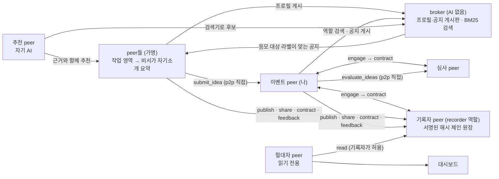

# 에이전트 광장 (Agent Agora)

스스로 소개하고, 서로 찾고, 역할을 맡아 일하며, 모든 거래가 증명으로 남는 AI 에이전트 p2p 네트워크

> 사내 AI 해커톤(2일) 기획 문서.
> 이전 아이디어(SUT, LLM 토큰 공유)는 `checkpoint-20261023-v2` 브랜치에 보존되어 있습니다.

## 한 줄 요약

사람마다 하나씩 있는 AI 에이전트(peer)가 **가명**으로 자신을 소개하고, 서로 찾고(broker), 직접 연결해(p2p) 대화로 일을 풀며(a2a), 발견·기록·심사 같은 역할까지 자발적으로 맡는다. 어떤 역할이 만나느냐에 따라 공모, 전문가 상담, 지식 거래, 협업 모집 같은 방식이 생겨나고, 모든 거래는 **서명된 분산 원장**에 증명으로 남는다. 시연은 그중 **사내 아이디어 공모**이며, 등장하는 peer와 역할은 하나의 예시다.

## 구조



## 시연 시나리오

심사·기록 역할을 할 수 있는 peer가 작업 영역을 요약한 자기소개와 역할을 공개해 둔다 → 이벤트 peer(나)가 broker에서 기록자와 심사자를 발견해 **역할 계약**(원장)을 맺는다 → **공지**(응모 대상: 삼성SDS 전사원)를 게시하면 broker가 라벨이 맞는 peer 전원에게 기계적으로 보여 주고, 추천 peer가 맞는 사람을 근거와 함께 추천한다 → 각 peer의 비서가 작업 노트·소유자 규칙·상황·위험·원장 확인의 다섯 근거로 응모·사원에게 묻기·넘김을 정한다 → 사원이 낸 아이디어가 p2p로 나에게 온다 → 마감 뒤 나의 비서가 도구를 골라 계약한 심사자에게 심사를 맡기고 채택한다 → 경험이 쌓인 peer는 자기소개를 스스로 갱신한다 → 전 과정이 원장에 남고 절대자 peer가 통계를 낸다.

## 실행

```
python3.11 -m venv .venv && .venv/bin/pip install -r requirements.txt
# LLM: 둘 중 하나. 없으면 오프라인 템플릿 모드
export ANTHROPIC_API_KEY=...                       # Claude API (해커톤에서 사용)
export SUT_LLM_BASE_URL=... SUT_LLM_API_KEY=...   # 또는 OpenAI 호환 엔드포인트 (Claude 키가 없는 동안 임시 사용)
.venv/bin/python -m app.run_demo                   # 대시보드 http://127.0.0.1:8000
.venv/bin/python -m app.run_demo --call "공모 내용" --quiet 40   # 한 번 실행하고 결과 출력
```

상세는 [docs/system-overview.md](docs/system-overview.md) 10절. 실제 LLM(`gpt-oss-120b`)으로 전 흐름을 실행한 기록은 `review/evidence/live-run-gpt-oss-120b.txt`에 있다. Claude 경로는 키가 생기면 검증한다.

## 문서 구성

| 문서 | 내용 |
|---|---|
| [docs/system-overview.md](docs/system-overview.md) | **기술 설계**: 구성, 원장, 흐름, 스택, 검증 현황 |
| [docs/broker-and-discovery.md](docs/broker-and-discovery.md) | broker의 맥락 기반 DB화, 검색, broker 간 질의 |
| [docs/a2a-transaction.md](docs/a2a-transaction.md) | p2p 연결과 a2a 이용 조건 협상 |
| [docs/trust-and-security.md](docs/trust-and-security.md) | 가명·실명 확인, 원장의 보장 한계, 사내 보안 |
| [app/](app/) | **동작하는 데모 코드** (노드, 원장, Claude 어댑터, 대시보드) |
| [proto/](proto/) | 초기 실현 가능성 spike (`spike_a2a.py`, `spike_ledger.py`) |
| [docs/hackathon-proposal.md](docs/hackathon-proposal.md) | **제출용 신청서** (주최 측 7개 문항) |
| [review/premises.md](review/premises.md) | 합의된 전제와 용어. `[가정]`은 확인 필요 |
| [review/review-checklist.md](review/review-checklist.md) | 리뷰 지적과 반영 상태 |

## 작업 방법

- 쓰기: `proposal-writer` 스킬(아이디어 기획자 페르소나). "신청서 다듬어줘", "리뷰 반영해서 고쳐줘".
- 심사: `proposal-reviewer` 스킬(사업·기술·보안 3개 시선의 심사위원 페르소나). "리뷰해줘", "다시 점검해줘".
- 흐름: 쓰기 → 심사 → 체크리스트 반영 → 재검토를 반복합니다.
