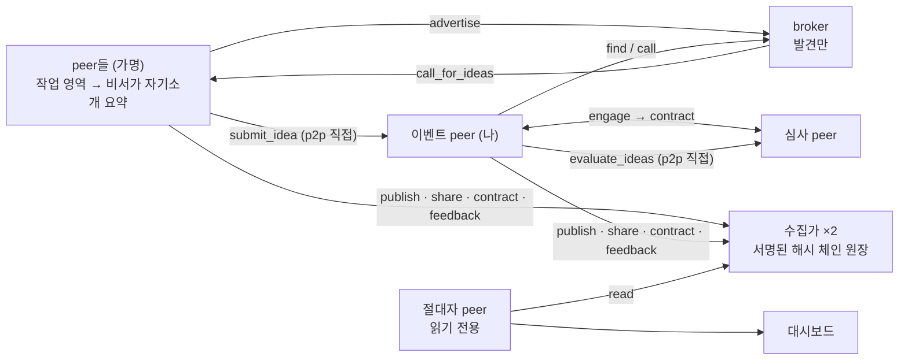

# (가칭) 사내 아이디어 장터: 가명으로 나누고 증명으로 남기는 p2p + a2a 네트워크

> 사내 AI 해커톤(2일) 기획 문서. 이름은 임시입니다.
> 이전 아이디어(SUT, LLM 토큰 공유)는 `checkpoint-20261023-v2` 브랜치에 보존되어 있습니다.

## 한 줄 요약

임직원의 AI 에이전트들이 **가명**으로 서로 찾고(broker), 연결하고(p2p), 대화로 일을 풀며(a2a), 그 거래·공유가 **서명된 원장**에 증명으로 남아 선등록자는 보호되고 아이디어는 사내 자산으로 쌓이는 네트워크. 시연 peer와 역할은 **하나의 예시**일 뿐 고정이 아니다.

## 구조



## 시연 시나리오

심사 peer가 작업 영역(심사 원칙)을 요약한 자기소개를 공개해 둔다 → 이벤트 peer(나)가 broker에서 심사자를 발견해 **위촉 계약**(원장)을 맺는다 → **아이디어 공모**를 올린다 → broker가 맥락으로 응모자 peer를 골라 알린다 → 각 peer의 비서가 사원(페르소나)에게 전달할지 판단 → 사원이 낸 아이디어가 p2p로 나에게 온다 → 마감 뒤 나의 비서가 도구를 골라 계약한 심사자에게 심사를 맡기고 채택한다 → 경험이 쌓인 peer는 자기소개를 스스로 갱신한다 → 전 과정이 원장에 남고 절대자 peer가 통계를 낸다.

## 실행

```
python3.11 -m venv .venv && .venv/bin/pip install -r requirements.txt
# LLM: 둘 중 하나. 없으면 오프라인 템플릿 모드
export SUT_LLM_BASE_URL=... SUT_LLM_API_KEY=...   # OpenAI 호환 엔드포인트 (현재 사용)
export ANTHROPIC_API_KEY=...                       # 또는 Claude API
.venv/bin/python -m app.run_demo                   # 대시보드 http://127.0.0.1:8000
.venv/bin/python -m app.run_demo --call "공모 내용" --quiet 40   # 한 번 실행하고 결과 출력
```

상세는 [docs/system-overview.md](docs/system-overview.md) 10절. 실제 LLM(`gpt-oss-120b`)으로 전 흐름을 실행한 기록은 `review/evidence/live-run-gpt-oss-120b.txt`에 있다. Claude 경로는 키가 없어 미검증이다.

## 문서 구성

| 문서 | 내용 |
|---|---|
| [docs/system-overview.md](docs/system-overview.md) | **기술 설계**: 구성, 원장, 흐름, 스택, 검증 현황 |
| [docs/broker-and-discovery.md](docs/broker-and-discovery.md) | broker의 맥락 기반 DB화, 검색, broker 간 질의 |
| [docs/a2a-transaction.md](docs/a2a-transaction.md) | p2p 연결과 a2a 이용 조건 협상 |
| [docs/trust-and-security.md](docs/trust-and-security.md) | 가명·재식별, 원장의 보장 한계, 사내 보안 |
| [app/](app/) | **동작하는 데모 코드** (노드, 원장, Claude 어댑터, 대시보드) |
| [proto/](proto/) | 초기 실현 가능성 spike (`spike_a2a.py`, `spike_ledger.py`) |
| [docs/hackathon-proposal.md](docs/hackathon-proposal.md) | **제출용 신청서** (주최 측 7개 문항) |
| [docs/proposal-notes.md](docs/proposal-notes.md) | 내부 메모: 가정, 예상 질문, 미해결 과제, 일정 |
| [review/premises.md](review/premises.md) | 합의된 전제와 용어. `[가정]`은 확인 필요 |
| [review/review-checklist.md](review/review-checklist.md) | 리뷰 지적과 반영 상태 |

## 작업 방법

- 쓰기: `proposal-writer` 스킬(아이디어 기획자 페르소나). "신청서 다듬어줘", "리뷰 반영해서 고쳐줘".
- 심사: `proposal-reviewer` 스킬(사업·기술·보안 3개 시선의 심사위원 페르소나). "리뷰해줘", "다시 점검해줘".
- 흐름: 쓰기 → 심사 → 체크리스트 반영 → 재검토를 반복합니다.
