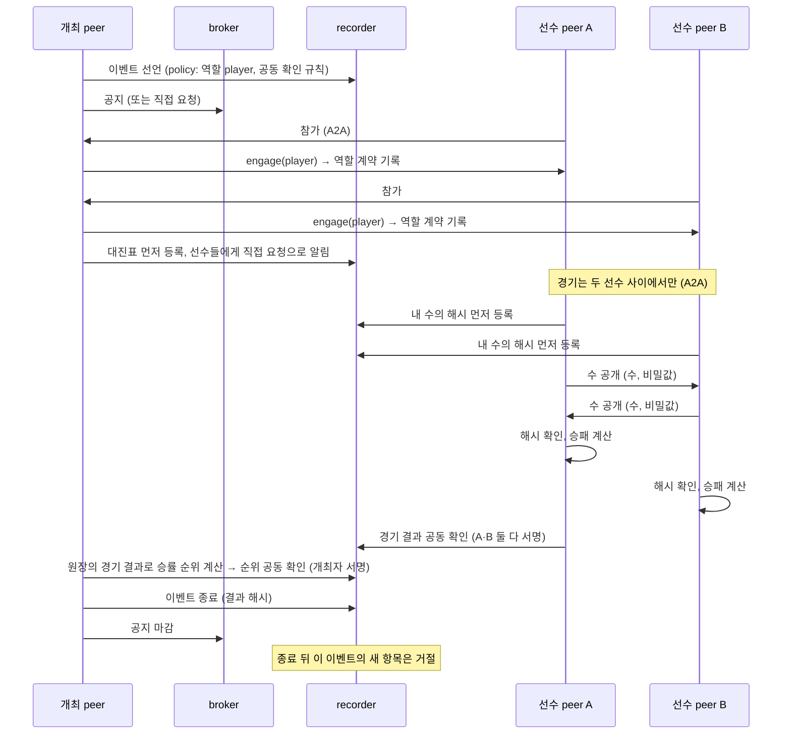

# 플랫폼 인수 확인: peer 간 가위바위보 이벤트

> 사용자 지정 (2026-10-30). 플랫폼이 완성되면, **순수 플랫폼 상태**에서 peer들이 A2A로만 가위바위보를 하고 승률 순위를 공증한 뒤 이벤트를 닫을 수 있는지 확인한다. 이 절차가 통과하면 플랫폼 완성으로 본다.

## 1. 원칙

- **플랫폼 코드에 가위바위보가 없다.** 이벤트, 역할 계약, 직접 요청, 먼저 등록, 공동 확인, 종료는 모두 범용 기능이다. 가위바위보 규칙과 수를 고르는 판단은 인수 테스트 안의 얇은 참가자 앱에만 있다(경연 모티브와 같은 방식).
- **경기는 순수하게 A2A**다. 두 선수 peer가 서로 직접 주고받는다. 개최 peer도 broker도 경기 메시지를 거치지 않는다.
- **순위는 누구나 다시 계산할 수 있다.** 경기 결과는 두 선수가 함께 서명해 원장에 남긴다. 관전용 절대자 peer가 원장만 읽고 같은 순위를 다시 계산해 개최 peer가 공증한 순위와 맞춰 본다.
- **공정한 동시 공개**: 각 선수는 수를 보이기 전에 (수 + 비밀값)의 해시를 원장에 먼저 등록한다. 그 뒤에 서로 수를 공개하고 해시와 맞춰 본다. 상대 수를 보고 내 수를 바꿀 수 없다.

## 2. 흐름

## 3. 플랫폼에 더할 것 (지금은 없음)

| 항목 | 내용 | 범용으로 본 이유 |
|---|---|---|
| **이벤트 종료**(`close`) | 발행자(와 결재자)가 서명하는 원장 항목. 결과 문서의 해시를 담을 수 있다. 종료 뒤 그 이벤트를 가리키는 계약·등록·판정·공동 확인은 거절 | 모든 이벤트에 끝이 있다(공모 마감, TF 해산, 상담 종료) |
| **공동 확인**(`attest`) | 여러 당사자가 같은 내용(종류, 대상, 값)에 모두 서명하는 항목. 이벤트 policy가 종류별로 누가 서명해야 하는지 정한다(예: 경기 결과는 `player` 역할 계약자 둘, 순위는 발행자) | 합의 결과, 회의 결론, 납품 검수처럼 "여럿이 함께 확인했다"는 공증은 어디에나 있다 |
| policy 확장 | `attest_roles`: 공동 확인 종류 → 서명해야 하는 역할(또는 `issuer`) | 기존 `verdict_roles`와 같은 방식 |

공정한 동시 공개는 기존 기능(먼저 등록)으로 된다. 원장에는 해시만 있고, 경기 결과의 공동 확인에는 결과를 다시 계산하는 데 필요한 최소 값(두 수와 비밀값)만 싣는다.

## 4. 통과 조건

| 번호 | 조건 |
|---|---|
| RPS-1 | 개최 peer가 이벤트를 선언하고 공지(또는 직접 요청)로 참가자를 모은다. 참가자마다 `player` 역할 계약이 원장에 있다 |
| RPS-2 | 모든 대진의 경기가 두 선수 사이의 A2A 메시지로만 진행된다(개최 peer·broker를 거친 경기 메시지 0건) |
| RPS-3 | 모든 수는 공개 전에 해시가 원장에 먼저 등록되어 있고, 공개된 수가 해시와 맞는다. 맞지 않으면 그 경기는 몰수로 기록된다 |
| RPS-4 | 경기 결과마다 두 선수가 함께 서명한 공동 확인이 있다. 한쪽만 서명한 결과는 원장이 거절한다 |
| RPS-5 | 개최 peer가 공증한 승률 순위와, 관전용 절대자 peer가 원장만으로 다시 계산한 순위가 같다 |
| RPS-6 | 이벤트 종료가 원장에 기록되고, 그 뒤 이 이벤트에 대한 항목은 거절된다. broker 공지도 마감된다 |
| RPS-7 | 실제 프로세스(broker·recorder 별도 프로세스, peer는 A2A 서버)로 돈다. 수를 고르는 판단은 실제 LLM으로도 한 번 돌린다 |

## 5. 위치

계획(`dev/plan.md`)의 5단계(검증 = 플랫폼 완성)에서 한다. 순서는 ① 이벤트 종료·공동 확인 추가 ② 반복 안정성·변조·비인가 열람 검증 ③ 이 인수 절차다.
