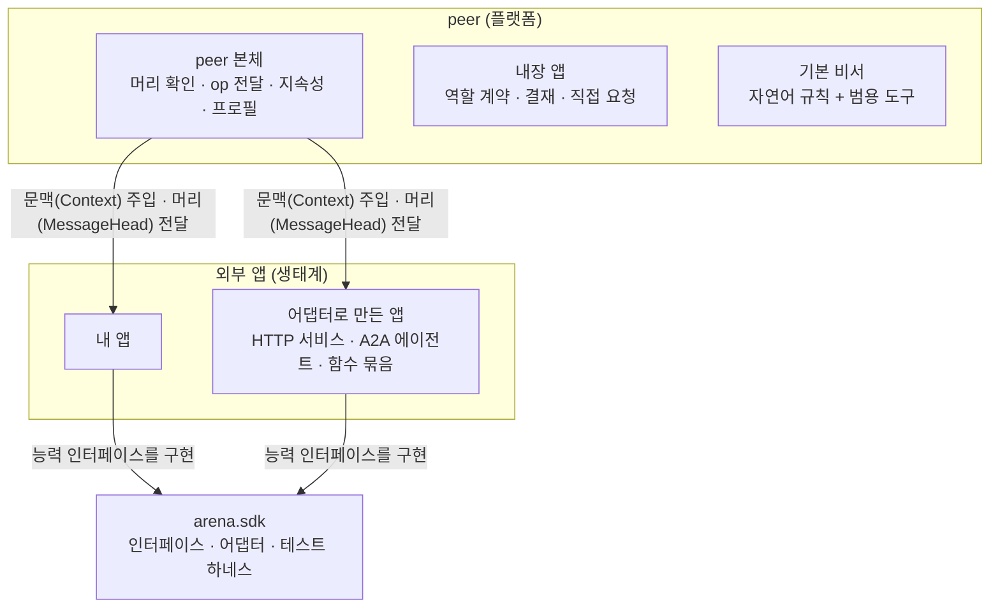

# 에이전트 아레나 앱 개발 규약집

> 대상: 에이전트 아레나 위에 앱을 만드는 개발자. 앱은 플랫폼 밖의 생태계에서 자유롭게 만들어진다. 이 문서와 SDK(`arena.sdk`)만 지키면 어느 peer에든 꽂을 수 있다.
> SDK 버전: 1.0. 이 문서의 규칙은 테스트(`tests/test_plugin.py`, `tests/test_sdk.py`)로 지켜진다.

## 1. 앱이란

플랫폼의 **가장 원초적인 방식**은 앱 없이도 돈다. 이벤트 공지에 자연어 규칙을 싣고, 각 peer의 기본 비서가 그 글을 읽어 범용 도구로 처리한다. **앱은 그 위의 특화**다. 자주 쓰는 절차를 코드로 굳혀 더 빠르고 확실하게 만들거나, 기존 시스템을 아레나에 연결한다.



## 2. 가장 작은 앱

```python
from arena.sdk import BaseApp, Context, MessageHead

class Greeter(BaseApp):
    name, version, sdk = "greeter", "0.1.0", "1"
    app_id = "5f0c8a52-2c1e-4c55-8f3d-1a2b3c4d5e6f"   # 고정 UUID: 이벤트가 이 앱을 이 값으로 지정한다

    def ops(self):
        return {"greeter.hello": self.hello}

    async def hello(self, ctx: Context, msg: dict, head: MessageHead) -> dict:
        return {"ok": True, "hello": msg.get("who"), "from": ctx.pen, "group": head.group_id}

def make_app(settings):          # 팩토리: 설정을 받아 앱을 돌려준다
    return Greeter()
```

## 3. 앱의 조건

| 조건 | 어기면 |
|---|---|
| `name`(peer 안에서 유일), `version`이 있다 | 조립 시 오류 |
| `app_id`(UUID)가 있고 peer 안에서 유일하다. **배포하는 앱은 한 번 만든 UUID를 고정해 적는다**(`python -c "import uuid; print(uuid.uuid4())"`). `BaseApp`의 기본값(클래스 경로에서 만든 값)은 개발용이다 | 조립 시 오류 |
| 능력 인터페이스를 **하나 이상** 구현한다 | 조립 시 오류 |
| `sdk`를 밝히면 SDK 주 버전이 같아야 한다 | 조립 시 오류 |
| op 이름이 다른 앱과 겹치지 않는다 | 조립 시 오류 |
| 예약 op(`engage`, `approve`, `solicit`)를 쓰지 않는다 | 조립 시 오류 |

## 4. 능력 인터페이스 (필요한 것만 구현)

| 인터페이스 | 메서드 | 언제 불리나 |
|---|---|---|
| `OpProvider` | `ops() -> {op: handler}` | 다른 peer가 그 op로 메시지를 보낼 때. `handler(ctx, msg, head) -> dict` |
| `OfferProvider` | `offers() -> [역할]` | 프로필의 공개 역할을 만들 때 |
| `RoleAcceptor` | `accept_role(ctx, role, request) -> Decision \| None` | 누가 역할 계약(engage)을 청할 때. 모르는 역할이면 `None` |
| `EventApprover` | `approve_event(ctx, event, request) -> Decision \| None` | 내가 결재자로 적힌 이벤트의 결재 요청이 올 때 |
| `RequestReceiver` | `on_request(ctx, request, sender)` | 직접 요청이 받은 편지함에 들어온 뒤(뒤에서 실행, 보낸 쪽은 기다리지 않음) |
| `ProfileContributor` | `profile_extra() -> dict` | 프로필을 게시할 때 덧붙일 항목 |
| `Lifecycle` | `start(ctx)` | peer가 시작하거나 앱이 실행 중에 설치될 때 |
| `EventHandler` | `on_event(ctx, notice, change)` | 이벤트 배정기가 이 앱을 지정한 이벤트를 넘길 때(`change`: `new`·`updated`·`closed`) |

## 5. 문맥(Context): 앱이 쓸 수 있는 것

앱은 peer 객체를 받지 않는다. 플랫폼이 주입하는 **문맥**만 쓴다(인터페이스: `arena.sdk.Context`).

| 구분 | 항목 |
|---|---|
| 나 | `pub`, `pen`, `url`, `labels`, `identity`, `sign(payload)` |
| 플랫폼 서비스 | `settings`, `clock()`, `log`, `llm`, `owner`(사람), `area`(공개 영역), `brokers`(그룹별 broker), `recorder(url)`, `receipts`, `known_recorders` |
| 통신 | `call(url, msg, group=, event=)`, `solicit(targets, request)`, `group_id(그룹 이름)` |
| 프로필 | `offers()`, `advertise()`, `add_experience(note)` |
| 앱 전용 저장 | `state.load()` / `state.save(dict)`(재시작 뒤에도 유지), `data_dir`(이 앱만 쓰는 폴더) |

**하면 안 되는 것**

- 문맥 밖의 peer 내부(전송, 다른 앱, 홈 폴더)에 손대지 않는다. 문맥에는 그런 길이 없다.
- 공개 영역의 소유자 전용 문서(`_`로 시작)를 남에게 보내지 않는다.
- 자산·권한 같은 것을 소유자 확인 없이 쓰지 않는다. 확인이 필요하면 `ctx.owner.ask`.
- 모듈 수준의 전역 상태를 두지 않는다. 한 프로세스에 peer가 여럿일 수 있다.

## 6. 메시지 규약

- **op 이름**: 외부 앱은 `앱이름.동작`처럼 앱 이름을 앞에 붙인다(겹침 방지).
- **응답 모양**: 항상 JSON 객체 `{"ok": true, ...}` 또는 `{"ok": false, "error": "이유"}`. 예외를 던지면 플랫폼이 `{"ok": false, "error": ...}`로 바꾸지만, 일부러 기대지 않는다.
- **머리(`MessageHead`)**: 이벤트나 broker 그룹에 관한 통신이면 보낼 때 `ctx.call(url, msg, group=..., event=...)`로 실어 보낸다. 받는 peer는 본문을 열기 전에 내가 그 그룹에 속하는지, 본문의 `group_id`·`event_id`가 머리와 같은지 확인하고, 아니면 거절한다. 처리 함수는 `head`로 그룹·이벤트를 받는다.
- **서명**: 누가 보냈는지가 중요한 메시지는 본문에 서명한다(`arena.signing.sign_message` 또는 본문 전체 서명). 그룹·이벤트를 서명 범위에 넣는다.
- **시간**: 오래 걸리는 일은 먼저 받았다고 답하고(`{"ok": true, "received": true}`), 결과는 새 메시지로 돌려준다.

## 7. 원장 규약

- 원장의 **모든 항목에 `group_id`**(그 일이 일어난 broker 그룹)를 넣는다. 선언되지 않은 그룹은 기록자가 거절한다(만민 그룹 `public`은 제네시스가 만든다).
- 이벤트에 관한 항목은 `event_id`를 넣고, 이벤트 선언의 policy(역할, 판정, 공동 확인)를 따른다. 닫힌 이벤트에는 기록할 수 없다.
- **내용은 원장에 올리지 않는다.** 해시만 올리고 본문은 각자 보관한다.
- 기록 응답은 `ctx.receipts.keep(...)`으로 영수증을 남긴다(나중에 원장이 잘려도 증명).
- 새 항목 종류가 필요하면 플랫폼에 `EntryType`을 등록한다(플랫폼 기여로 다룸).

## 8. 지속성

- 앱 상태는 `ctx.state`(작은 dict)와 `ctx.data_dir`(파일)에 둔다. 둘 다 peer의 홈 아래라 재시작 뒤에도 남는다.
- 비밀값은 `data_dir` 안에 권한 0600 파일로 둔다.
- 메모리에만 두는 상태는 재시작하면 사라진다는 전제로 짠다.

## 8-1. 이벤트의 블록: 규칙, 역할, 실행 방식, 앱 목록

이벤트를 게시할 때는 블록을 나눠 명시한다. 규칙 해시, 실행 방식, 앱 목록은 원장의 이벤트 선언에 들어가 공증된다.

| 블록 | 내용 |
|---|---|
| `rules` | 자연어 규칙 글(해시가 원장에 공증) |
| `policy` | 역할·판정·공동 확인 규칙(원장이 집행) |
| `mode` | 실행 방식: `assistant` / `app` / `app_or_assistant` |
| `apps` | **앱 목록**: `[{id, name, version, hash?, required?}, ...]`. 앱을 쓰는 방식이면 비어 있으면 안 된다 |

```python
from arena.sdk import announce_event, app_ref

await announce_event(ctx, group="public", title="...", kind="...", rules=자연어_규칙, policy={...},
                     mode="app_or_assistant", apps=[app_ref(LogicApp()), app_ref(ViewApp(), required=False)])
```

| 실행 방식 | 뜻 |
|---|---|
| `assistant` | 앱 없이 각 peer의 기본 비서가 자연어 규칙으로 처리한다(원초적 방식). 앱 목록은 비어도 된다 |
| `app` | 목록의 **필수 앱이 모두** 설치되어 있어야 참여한다 |
| `app_or_assistant` | 필수 앱이 모두 있으면 앱들이, 아니면 기본 비서가 처리한다 |

받는 쪽은 플랫폼의 **이벤트 배정기**(내장 앱)가 **코드로만** 처리한다. LLM은 앱 식별자를 보지 않는다. 배정기는 공지의 규칙 해시·실행 방식·앱 목록이 원장과 같은지 확인하고, 목록의 앱을 `app_id`로 찾는다. 버전은 주 버전이 같고 지정 버전 이상이어야 하고, `hash`가 있으면 내 앱의 코드 해시(`app_fingerprint`)와 같아야 한다. 조건이 맞으면 목록에서 이벤트를 받는 앱(`EventHandler`) **모두에게** 넘긴다. 맞지 않으면 넘기지 않고 이유를 로그에 남긴다.

앱 배포 peer(선택, 필수 아님): 목록의 앱이 없을 때 앱 식별자로 앱을 받아 오는 peer를 누구나 만들 수 있다. 쓸지는 각 peer가 정하며, 받은 코드는 코드 해시·배포자 서명·소유자 승인을 거쳐 설치한다(5단계 마지막에 만든다).

## 9. 설정

- 하드코딩 금지: 앱의 설정은 `arena.config.EnvSettings`를 상속한 자기 설정 클래스로 `.env`에서 읽는다.
- 키 이름은 `ARENA_APP_<앱이름>_<항목>`.
- 앱 팩토리는 `factory(settings) -> app` 모양이다.

## 10. 등록과 배포

| 방법 | 쓰는 곳 |
|---|---|
| `Peer(..., apps=[MyApp()])` | peer를 조립하는 코드 |
| `await peer.install(app)` | 실행 중인 peer에 꽂기(조립 때와 같은 검사 뒤 시작) |
| 설정 `모듈:팩토리` 목록 → `arena.sdk.load_apps` | 단독 실행 peer |
| 패키지 진입점 `arena.apps` → `arena.sdk.discover_apps` | 설치한 앱 패키지 찾기 |

패키지 진입점 예(`pyproject.toml`):

```toml
[project.entry-points."arena.apps"]
greeter = "my_pkg.greeter:make_app"
```

## 11. 어댑터: 앱 인터페이스를 모르는 것을 앱으로

| 어댑터 | 바꾸는 대상 | 예 |
|---|---|---|
| `function_app(name, ops=..., offers=..., accept_role=...)` | 함수 몇 개 | 클래스 없이 작은 앱 |
| `HttpServiceAdapter(name, version, base_url, routes, allow_groups=, require_signed=)` | 기존 HTTP API, 기간계 시스템 | 인사 시스템 `GET /employees/{id}`를 op `employee`로. 시스템은 고치지 않고, 묻는 쪽 확인·그룹 제한·발견은 peer가 맡는다(서비스 peer 모델) |
| `A2AAgentAdapter(name, version, agent_url)` | 아레나 peer가 아닌 A2A 에이전트 | 다른 회사·도구의 A2A 에이전트를 op `ask`로 |

## 12. 기본 비서 확장

기본 비서의 도구는 등록식이다. `arena.sdk.Tool(name, description, args, run, host_only=, after_close=)`을 만들어 `EventAssistant.add_tool(tool)`로 더한다. 비서를 고치지 않는다. 도구는 특정 이벤트 종류를 몰라야 한다.

## 13. 테스트

```python
from arena.sdk.testing import AppHarness

async def test_hello(tmp_path):
    h = AppHarness(make_app(None), tmp_path)
    assert (await h.call("greeter.hello", {"who": "you"}))["hello"] == "you"
```

`AppHarness`는 메모리 broker·recorder·전송 위에 peer 하나를 세우고 앱을 꽂는다. `group_id=`로 broker 그룹을, `owner=`·`llm=`로 사람과 LLM 대역을 바꾼다. 실제 LLM이 필요한 판단은 따로 실제 LLM 테스트로 확인한다.

## 14. 점검표

- [ ] `name`, `version`, `sdk`, 고정 `app_id`(UUID)가 있고 능력 인터페이스를 하나 이상 구현했다
- [ ] 이벤트를 열 때 실행 방식(`mode`)과 앱 목록(`apps`) 블록을 명시했다
- [ ] 문맥만 쓰고 peer 내부에 기대지 않는다
- [ ] op 이름에 앱 이름을 붙였고 예약 op를 쓰지 않는다
- [ ] 응답은 `{"ok": ...}` 모양이다
- [ ] 그룹·이벤트에 관한 통신에 머리를 싣고, 받을 때 `head`를 확인한다
- [ ] 원장 항목에 `group_id`(와 `event_id`)를 넣고 내용 대신 해시를 올린다
- [ ] 상태는 `ctx.state`·`ctx.data_dir`에 두어 재시작 뒤에도 이어진다
- [ ] 설정값은 `.env`에서 읽는다
- [ ] `AppHarness`로 테스트했다
