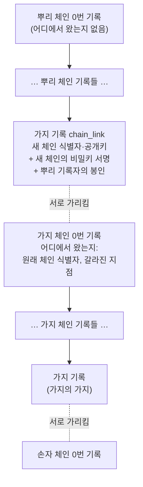
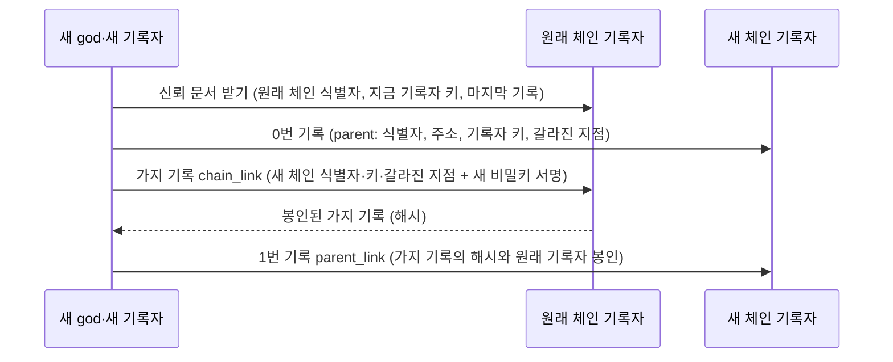
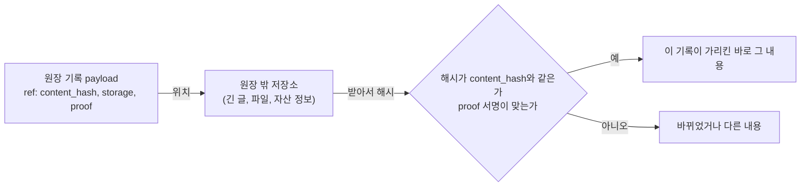

# 원장 체인 확장 정책

> 판 0 · 2026-11-02. 사용자가 정한 원칙(아래 1절)을 정책으로 적고, 지금 코드가 어디까지 하는지와 더 할 일을 나눴다. 규약의 바이트 단위 모양은 `dev/protocol.md`(4.5절 진짜 원장 증명)에 있고, 이 문서는 그 위의 **정책**이다. 이 문서와 코드가 다르면 표의 "상태"를 고친다.

상태 표시: **구현·테스트됨**(코드와 자동 테스트가 있음), **정책 확정·구현 예정**(원칙은 정했고 아직 코드가 없음), **미정**(사용자 결정 필요).

## 1. 원칙 (사용자 2026-11-02)

> "전 우주에 태초부터 존재했던 첫 번째 원장이 있다. 어떤 기록의 분류가 원장 체인의 가지일 때, 서로 알아볼 수 있는 서명 정보가 payload에 담긴다. 갈라져 나간 원장 체인의 첫 기록은 언제나 이 기록이 어디에서 왔는지를 밝히면서 시작한다. 또, 긴 글이나 자산의 위치 정보를 링크로 남길 때는 payload 안에 저장소와 증명 방법(서명과 서명 확인 방법, 링크 등)을 적는다."

이전 결정(2026-11-02): "원장 체인이 독립된 커뮤니티에서 독립적으로 시작되었다 하더라도 최초의 시작은 원래 체인 어딘가에 연결되어야 한다." 그 연결에는 새 체인의 공개키와 새 체인의 **비밀키 서명**이 함께 있어야 한다.

이 원칙을 네 가지 정책으로 나눈다.

| 정책 | 한 줄 |
|---|---|
| P1 뿌리 원장 | 태초의 원장(뿌리 체인)은 하나다. 그 0번 기록만 "어디에서 왔는지"가 없다 |
| P2 가지 기록 | 뿌리나 다른 체인에서 새 체인이 갈라질 때, 원래 체인에 가지 기록을 남긴다. payload에는 양쪽이 서로를 알아볼 수 있는 식별자와 서명이 담긴다 |
| P3 가지의 첫 기록 | 갈라져 나간 체인의 0번 기록은 언제나 "어느 체인의 어느 지점에서 왔는지"를 밝힌다 |
| P4 원장 밖 내용의 링크 | 긴 글이나 자산의 위치를 원장 밖에 두고 링크로 남길 때, payload에 저장소, 내용 해시, 증명 방법(서명, 서명 확인 방법)을 적는다 |

## 2. P1 뿌리 원장

| 항목 | 정책 | 상태 |
|---|---|---|
| 뿌리는 하나 | 기준 네트워크의 첫 제네시스가 뿌리 체인이다. 그 0번 기록(`genesis`)에는 `parent`가 없다 | 구현·테스트됨(모양). 기준 네트워크의 실제 제네시스는 아직(미정: god 비밀키 보관, 운영 위치) |
| 뿌리 값은 원장 밖에 | 뿌리 체인의 제네시스 해시와 god 첫 공개키를 백서, 설정 기본값, README, 서명된 태그에 함께 공개한다 | 구현·테스트됨(`anchor_block`, `ARENA_TRUST_GENESIS_HASH`, `ARENA_TRUST_GOD_PUB`). 공개는 제네시스 뒤 |
| 뿌리가 아닌데 출처가 없는 체인 | 뿌리 값으로 증명되지 않고 `parent`도 없는 체인은 믿지 않는다 | 구현·테스트됨(뿌리 값을 설정한 peer는 그런 기록자를 거절). 뿌리 값을 설정하지 않은 peer는 지금 모든 체인을 받는다(시험·폐쇄 환경용) |
| 키 이어받기 | 기록자·god 키를 바꿀 때는 옛 키와 새 키(기록자면 god도)가 서명한 `key_rotate`를 남긴다 | 구현·테스트됨 |

## 3. P2 가지 기록 (`chain_link`, 원래 체인에 남김)

새 체인이 갈라질 때 **원래 체인**에 남기는 기록이다. payload에 서로를 알아볼 수 있는 정보가 담긴다.

| payload 칸 | 뜻 | 상태 |
|---|---|---|
| `child_ledger_id` | 새 체인의 식별자(새 체인 0번 기록의 해시) | 구현·테스트됨 |
| `child_god`, `child_recorder` | 새 체인의 god 첫 공개키, 첫 기록자 공개키 | 구현·테스트됨 |
| 서명(`sigs`) | 새 god과 새 첫 기록자의 **비밀키 서명**. 남이 내 공개키를 자기 가짜 체인에 붙이지 못하게 한다 | 구현·테스트됨 |
| 원래 기록자의 봉인 | 원래 체인 기록자가 그 시점의 유효한 키로 봉인한다 | 구현·테스트됨 |
| `ledger_id`, `group_id` | 이 기록이 원래 체인의 것임(원장 식별자), 원래 체인의 만민 그룹 | 구현·테스트됨 |
| `name` | 새 체인(커뮤니티)의 이름 | 구현·테스트됨 |
| `branch_point` | 새 체인 0번 기록이 밝힌 "갈라진 지점"(4절)을 그대로 되풀이해, 양쪽이 같은 지점을 말하는지 대조한다 | 정책 확정·구현 예정 |

규칙: 한 새 체인은 한 번만 연결된다(구현·테스트됨). 원래 체인에서 `GET /links/{새 체인 식별자}`로 누구나 가지 기록을 받는다(구현·테스트됨).

## 4. P3 가지의 첫 기록 (가지 체인의 0번 기록)

갈라져 나간 체인의 0번 기록(`genesis`)은 언제나 출처를 밝히며 시작한다.

| `parent` 칸 | 뜻 | 상태 |
|---|---|---|
| `ledger_id` | 원래 체인의 식별자 | 구현·테스트됨 |
| `recorder_url` | 원래 체인 기록자의 주소(가지 기록을 받아 볼 곳) | 구현·테스트됨 |
| `recorder` | 갈라질 때 원래 체인 기록자의 공개키(그 시점에 유효한 키) | 정책 확정·구현 예정 |
| `branch_point` | 갈라진 지점: 갈라질 때 원래 체인의 마지막 기록 번호(`seq`)와 해시. "이 체인은 원래 체인의 이 기록 다음에 갈라졌다" | 정책 확정·구현 예정 |

**서로 알아보기**: 새 체인 0번 기록의 해시가 새 체인의 식별자이므로, 0번 기록은 가지 기록의 해시를 미리 담을 수 없다(가지 기록이 0번 기록의 해시를 담기 때문). 그래서 이렇게 잇는다.

| 단계 | 정책 | 상태 |
|---|---|---|
| 0번 기록이 원래 체인을 가리킴 | 위 표 | 구현·테스트됨(`ledger_id`, `recorder_url`). 기록자 키·갈라진 지점은 구현 예정 |
| 원래 체인에 가지 기록 | 3절 | 구현·테스트됨 |
| 새 체인 1번 기록이 가지 기록을 가리킴(`parent_link`) | 가지 기록의 해시와 원래 기록자의 봉인을 새 체인에 남겨, 새 체인만 받은 사람도 원래 체인의 어느 기록을 찾아보면 되는지 안다. 가지 기록이 남기 전에는 새 체인이 다른 기록을 받지 않는다 | 정책 확정·구현 예정. 지금은 제네시스 프로그램이 0번 기록 바로 뒤 가지 기록을 남기고, 남기지 못하면 오류로 멈춘다. 다시 띄우면 연결부터 다시 시도한다(구현·테스트됨) |

**확인하는 법**(peer가 코드로): 뿌리 체인을 뿌리 값으로 증명 → 가지 체인 0번 기록의 `parent`를 따라 원래 체인에서 가지 기록을 받음 → 가지 기록의 새 체인 식별자·공개키가 0번 기록과 같고, 새 체인 비밀키 서명과 원래 기록자 봉인이 맞는지 확인 → (구현 예정) 갈라진 지점이 양쪽에서 같은지, 새 체인 1번 기록이 그 가지 기록을 가리키는지 확인 → 가지 체인의 키 이어받기를 따라감. 가지의 가지는 위로 따라가며 되풀이한다(상한 `ARENA_TRUST_MAX_LINK_DEPTH`). 지금 구현: `arena/ledger/trust.py`의 `verify_linked`, `Peer.recorder_trust`.

## 5. P4 원장 밖 내용의 링크

원장에는 내용 자체가 아니라 내용의 해시를 남긴다(먼저 등록 `publish`, 전달 `share`). 긴 글, 파일, 자산(문서, 데이터, 실물 자산의 소재)은 원장 밖 저장소에 두고, 원장에는 **어디에 있고 어떻게 맞는지 확인하는지**를 남긴다.

| payload 칸(`ref`) | 뜻 |
|---|---|
| `content_hash` | 원장 밖 내용의 해시(SHA-256). 원장이 묶는 것은 이 값이다 |
| `storage` | 저장소 목록. 각 항목은 종류(예: `https`, `peer`(어떤 peer의 공개 영역), `ipfs`, `git`, 실물이면 소재 설명)와 위치. 여러 곳에 두어도 해시는 같다 |
| `size`, `media_type` | 크기와 형식(받는 쪽이 받기 전에 판단) |
| `proof` | 증명 방법: 방법 이름(미리 정한 목록에서), 서명자 공개키, 서명, 서명 대상(정규 JSON으로 만든 `{content_hash, storage}` 등), 확인하는 법을 적은 링크(규약 문서) |

| 항목 | 정책 | 상태 |
|---|---|---|
| 내용은 해시로 묶는다 | 원장은 `content_hash`만 믿는다. 위치(`storage`)가 바뀌거나 늘어도 내용이 같으면 해시는 같다 | 해시 묶기는 구현·테스트됨(`publish`, `share`). `ref` 블록은 구현 예정 |
| 증명 방법은 미리 정한 목록에서 | 연결 방식처럼 플랫폼이 등록한 방법만 쓴다. 처음 둘: `sha256`(해시 대조만), `ed25519`(서명자 공개키가 정규 JSON에 서명). 다른 방법(인증서, 외부 분산 신원)은 등록해서 더한다 | 정책 확정·구현 예정 |
| 원장이 확인하는 것 | 모양(칸, 방법 이름이 목록에 있는가), 서명이 있으면 서명 확인. 원장 밖 저장소에 실제로 내용이 있는지는 원장이 확인하지 않는다(받는 쪽이 받아서 해시로 확인) | 정책 확정·구현 예정 |
| 위치 공개 범위 | 위치가 비밀인 내용(닫힌 그룹의 자료, 자산 소재)이 있다. 원장의 공개 정보에 `storage`를 보일지 감출지 | **미정** |
| 위치가 사라지면 | 링크가 끊겨도 원장 기록은 그대로다(해시는 남는다). 다른 곳에서 같은 해시의 내용을 찾으면 그대로 증명된다 | 정책 확정 |

## 6. 할 일 (구현 예정)

| 번호 | 할 일 | 정책 |
|---|---|---|
| CP-1 | 가지 체인 0번 기록의 `parent`에 원래 기록자 키와 갈라진 지점(`seq`, 해시)을 넣고, 가지 기록에 같은 갈라진 지점을 넣어 대조 | P2, P3 |
| CP-2 | 새 체인 1번 기록 `parent_link`(가지 기록 해시와 원래 기록자 봉인), 그 전에는 다른 기록을 받지 않음 | P3 |
| CP-3 | 뿌리 값을 설정하지 않은 peer의 기본 동작을 정한다(지금은 모든 체인을 받음) | P1, **미정** |
| CP-4 | 원장 밖 내용의 `ref` 블록, 증명 방법 목록(`sha256`, `ed25519`), 원장의 모양·서명 확인 | P4 |
| CP-5 | `ref`의 위치 공개 범위 | P4, **미정** |

관련 문서: `dev/protocol.md` 4.5절(진짜 원장 증명), `docs/whitepaper.md` 5.3절, `dev/phase5/requirements.md` P5-G.
