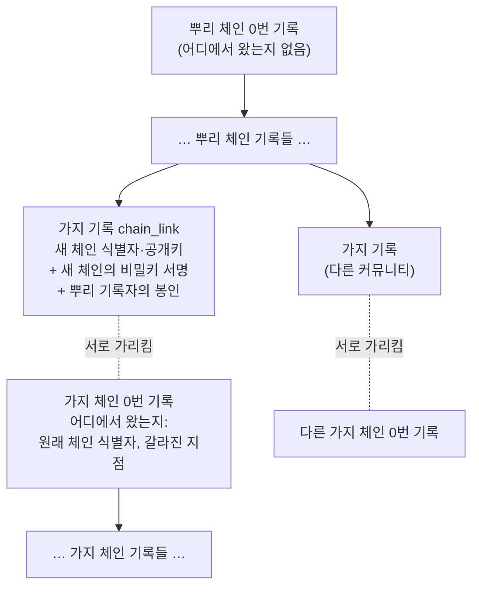
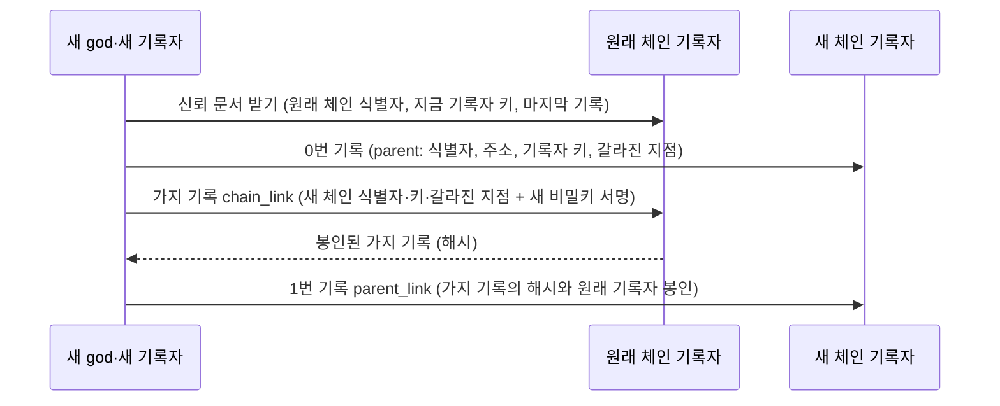
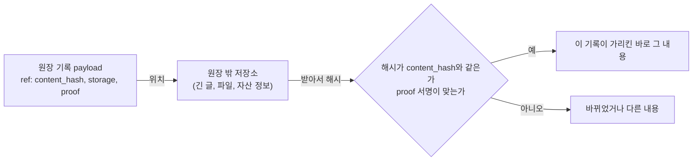
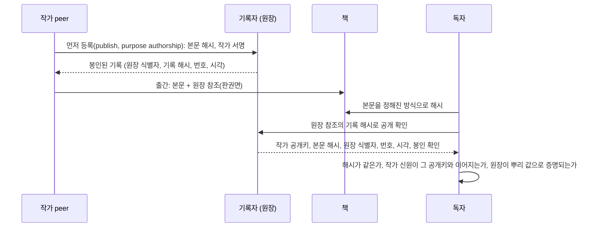
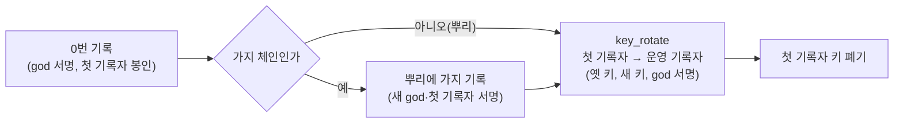
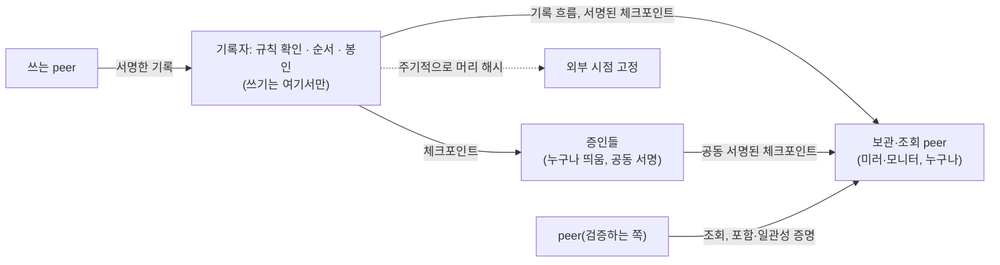

# 원장 체인 확장 정책

> 판 0 · 2026-11-02. 사용자가 정한 원칙(아래 1절)을 정책으로 적고, 지금 코드가 어디까지 하는지와 더 할 일을 나눴다. 규약의 바이트 단위 모양은 `dev/protocol.md`(4.5절 진짜 원장 증명)에 있고, 이 문서는 그 위의 **정책**이다. 이 문서와 코드가 다르면 표의 "상태"를 고친다.

상태 표시: **구현·테스트됨**(코드와 자동 테스트가 있음), **정책 확정·구현 예정**(원칙은 정했고 아직 코드가 없음), **미정**(사용자 결정 필요).

## 1. 원칙 (사용자 2026-11-02)

> "전 우주에 태초부터 존재했던 첫 번째 원장이 있다. 어떤 기록의 분류가 원장 체인의 가지일 때, 서로 알아볼 수 있는 서명 정보가 payload에 담긴다. 갈라져 나간 원장 체인의 첫 기록은 언제나 이 기록이 어디에서 왔는지를 밝히면서 시작한다. 또, 긴 글이나 자산의 위치 정보를 링크로 남길 때는 payload 안에 저장소와 증명 방법(서명과 서명 확인 방법, 링크 등)을 적는다."

이전 결정(2026-11-02): "원장 체인이 독립된 커뮤니티에서 독립적으로 시작되었다 하더라도 최초의 시작은 원래 체인 어딘가에 연결되어야 한다." 그 연결에는 새 체인의 공개키와 새 체인의 **비밀키 서명**이 함께 있어야 한다.

가지를 어디서 낼 수 있는가(사용자 2026-11-02): "뿌리에서만으로 하자." 가지 체인이 또 가지 체인을 만들지 않는다. 커뮤니티 안을 나누는 일은 체인 안의 broker 그룹으로 한다.

이 원칙을 다섯 가지 정책으로 나누고, 제네시스 키 절차(7절)와 원장 보관과 운영 역할(8절)을 더한다.

| 정책 | 한 줄 |
|---|---|
| P1 뿌리 원장 | 태초의 원장(뿌리 체인)은 하나다. 그 0번 기록만 "어디에서 왔는지"가 없다 |
| P0 가지는 뿌리에서만 | 모든 가지 체인은 뿌리 체인(trunk)에서 바로 갈라진다. 가지의 가지는 없다 |
| P2 가지 기록 | 뿌리나 다른 체인에서 새 체인이 갈라질 때, 원래 체인에 가지 기록을 남긴다. payload에는 양쪽이 서로를 알아볼 수 있는 식별자와 서명이 담긴다 |
| P3 가지의 첫 기록 | 갈라져 나간 체인의 0번 기록은 언제나 "어느 체인의 어느 지점에서 왔는지"를 밝힌다 |
| P4 원장 밖 내용의 링크 | 긴 글이나 자산의 위치를 원장 밖에 두고 링크로 남길 때, payload에 저장소, 내용 해시, 증명 방법(서명, 서명 확인 방법)을 적는다 |

## 2. P0 가지는 뿌리에서만

| 항목 | 정책 | 상태 |
|---|---|---|
| 가지 기록은 뿌리 체인에만 | 0번 기록에 `parent`가 있는 체인(가지 체인)의 원장은 가지 기록(`chain_link`)을 받지 않는다 | 구현·테스트됨(P5-G10) |
| 가지 체인의 출처는 뿌리 | 가지 체인 0번 기록의 `parent.ledger_id`는 뿌리 체인의 식별자여야 한다. 뿌리 값을 설정한 peer는 다른 체인을 출처로 밝힌 체인을 믿지 않는다 | 구현·테스트됨 |
| 제네시스가 먼저 막음 | 새 커뮤니티의 제네시스는 `ARENA_GENESIS_PARENT_RECORDER_URL`이 가지 체인의 기록자를 가리키면 0번 기록을 만들기 전에 멈춘다 | 구현·테스트됨 |
| 증명은 늘 한 단계 | 뿌리 → 가지. 그래서 단계 상한 설정(`ARENA_TRUST_MAX_LINK_DEPTH`)을 없앴다 | 구현·테스트됨 |
| 커뮤니티 안의 구분 | 회사 → 부서 같은 위계는 한 체인 안의 broker 그룹으로 나눈다(그룹 선언은 원장에 공증되고, 모든 기록에 `group_id`가 붙는다) | 구현·테스트됨(그룹) |

**왜 뿌리에서만인가**: 증명이 늘 한 단계라 단순하다. 한 가지의 키가 새거나 운영을 멈춰도 그 가지만 영향을 받고, 그 아래에 매달린 체인이 증명 경로를 잃는 일이 없다. 원장 체인은 신뢰의 뿌리를 따로 두는 단위이고, 커뮤니티 안의 세부 구분은 신뢰의 뿌리를 따로 둘 이유가 없다. 뿌리 기록자는 갈라질 때 한 번만 쓰이고, 그 뒤 가지는 독립이다. 필요해지면 나중에 열 수 있지만, 처음부터 열어 두면 닫기 어렵다.

## 3. P1 뿌리 원장

| 항목 | 정책 | 상태 |
|---|---|---|
| 뿌리는 하나 | 기준 네트워크의 첫 제네시스가 뿌리 체인이다. 그 0번 기록(`genesis`)에는 `parent`가 없다 | 구현·테스트됨(모양). 기준 네트워크의 실제 제네시스는 아직(미정: god 비밀키 보관, 운영 위치) |
| 뿌리 값은 원장 밖에 | 뿌리 체인의 제네시스 해시와 god 첫 공개키를 백서, 설정 기본값, README, 서명된 태그에 함께 공개한다 | 구현·테스트됨(`anchor_block`, `ARENA_TRUST_GENESIS_HASH`, `ARENA_TRUST_GOD_PUB`). 공개는 제네시스 뒤 |
| 뿌리가 아닌데 출처가 없는 체인 | 뿌리 값으로 증명되지 않고 `parent`도 없는 체인은 믿지 않는다 | 구현·테스트됨(뿌리 값을 설정한 peer는 그런 기록자를 거절). 뿌리 값을 설정하지 않은 peer는 지금 모든 체인을 받는다(시험·폐쇄 환경용) |
| 모든 기록에 시각 | 뿌리든 가지든 모든 기록에 기록자가 시각(`ts`)을 찍는다. 시각은 해시와 봉인 안에 들어가고, 원장은 앞 기록보다 이른 시각을 받지 않으며, 감사도 시각 순서를 본다. 시각은 기록자의 시계라서, 시각에 대한 믿음은 기록자에 대한 믿음과 같다(여러 기록자의 증인 확인은 7단계) | 구현·테스트됨(P5-G11) |
| 키 이어받기 | 기록자·god 키를 바꿀 때는 옛 키와 새 키(기록자면 god도)가 서명한 `key_rotate`를 남긴다 | 구현·테스트됨 |

## 4. P2 가지 기록 (`chain_link`, 원래 체인에 남김)

새 체인이 갈라질 때 **원래 체인**에 남기는 기록이다. payload에 서로를 알아볼 수 있는 정보가 담긴다.

| payload 칸 | 뜻 | 상태 |
|---|---|---|
| `child_ledger_id` | 새 체인의 식별자(새 체인 0번 기록의 해시) | 구현·테스트됨 |
| `child_god`, `child_recorder` | 새 체인의 god 첫 공개키, 첫 기록자 공개키 | 구현·테스트됨 |
| 서명(`sigs`) | 새 god과 새 첫 기록자의 **비밀키 서명**. 남이 내 공개키를 자기 가짜 체인에 붙이지 못하게 한다 | 구현·테스트됨 |
| 원래 기록자의 봉인 | 원래 체인 기록자가 그 시점의 유효한 키로 봉인한다 | 구현·테스트됨 |
| `ledger_id`, `group_id` | 이 기록이 원래 체인의 것임(원장 식별자), 원래 체인의 만민 그룹 | 구현·테스트됨 |
| `name` | 새 체인(커뮤니티)의 이름 | 구현·테스트됨 |
| `branch_point` | 새 체인 0번 기록이 밝힌 "갈라진 지점"(5절)을 그대로 되풀이해, 양쪽이 같은 지점을 말하는지 대조한다 | 정책 확정·구현 예정 |

규칙: 한 새 체인은 한 번만 연결된다(구현·테스트됨). 원래 체인에서 `GET /links/{새 체인 식별자}`로 누구나 가지 기록을 받는다(구현·테스트됨).

## 5. P3 가지의 첫 기록 (가지 체인의 0번 기록)

갈라져 나간 체인의 0번 기록(`genesis`)은 언제나 출처를 밝히며 시작한다.

| `parent` 칸 | 뜻 | 상태 |
|---|---|---|
| `ledger_id` | 원래 체인의 식별자 | 구현·테스트됨 |
| `recorder_url` | 원래 체인 기록자의 주소(가지 기록을 받아 볼 곳) | 구현·테스트됨 |
| `recorder` | 갈라질 때 원래 체인 기록자의 공개키(그 시점에 유효한 키) | 정책 확정·구현 예정 |
| `branch_point` | 갈라진 지점: 갈라질 때 원래 체인의 마지막 기록 번호(`seq`)와 해시. "이 체인은 원래 체인의 이 기록 다음에 갈라졌다" | 정책 확정·구현 예정 |

**서로 알아보기**: 새 체인 0번 기록의 해시가 새 체인의 식별자이므로, 0번 기록은 가지 기록의 해시를 미리 담을 수 없다(가지 기록이 0번 기록의 해시를 담기 때문). 그래서 이렇게 잇는다.

| 단계 | 정책 | 상태 |
|---|---|---|
| 0번 기록이 원래 체인을 가리킴 | 위 표 | 구현·테스트됨(`ledger_id`, `recorder_url`). 기록자 키·갈라진 지점은 구현 예정 |
| 원래 체인에 가지 기록 | 4절 | 구현·테스트됨 |
| 새 체인 1번 기록이 가지 기록을 가리킴(`parent_link`) | 가지 기록의 해시와 원래 기록자의 봉인을 새 체인에 남겨, 새 체인만 받은 사람도 원래 체인의 어느 기록을 찾아보면 되는지 안다. 가지 기록이 남기 전에는 새 체인이 다른 기록을 받지 않는다 | 정책 확정·구현 예정. 지금은 제네시스 프로그램이 0번 기록 바로 뒤 가지 기록을 남기고, 남기지 못하면 오류로 멈춘다. 다시 띄우면 연결부터 다시 시도한다(구현·테스트됨) |

**확인하는 법**(peer가 코드로): 뿌리 체인을 뿌리 값으로 증명 → 가지 체인 0번 기록의 `parent`를 따라 원래 체인에서 가지 기록을 받음 → 가지 기록의 새 체인 식별자·공개키가 0번 기록과 같고, 새 체인 비밀키 서명과 원래 기록자 봉인이 맞는지 확인 → (구현 예정) 갈라진 지점이 양쪽에서 같은지, 새 체인 1번 기록이 그 가지 기록을 가리키는지 확인 → 가지 체인의 키 이어받기를 따라감. 가지는 뿌리에서만 갈라지므로 증명은 늘 이 한 단계다. 지금 구현: `arena/ledger/trust.py`의 `verify_linked`, `Peer.recorder_trust`.

## 6. P4 원장 밖 내용의 링크

> 기본은 6.1절의 거꾸로 찾기(책에 원장 정보를 찍는다)다. 이 절의 `ref` 블록은 원장 쪽에서 내용을 꼭 가리켜야 할 때(예: 이벤트 안에서 넘긴 자료를 나중에 받아 볼 곳) 쓰는 선택 사항이다.

원장에는 내용 자체가 아니라 내용의 해시를 남긴다(먼저 등록 `publish`, 전달 `share`). 긴 글, 파일, 자산(문서, 데이터, 실물 자산의 소재)은 원장 밖 저장소에 두고, 원장에는 **어디에 있고 어떻게 맞는지 확인하는지**를 남긴다.

| payload 칸(`ref`) | 뜻 |
|---|---|
| `content_hash` | 원장 밖 내용의 해시(SHA-256). 원장이 묶는 것은 이 값이다 |
| `storage` | 저장소 목록. 각 항목은 종류(예: `https`, `peer`(어떤 peer의 공개 영역), `ipfs`, `git`, 실물이면 소재 설명)와 위치. 여러 곳에 두어도 해시는 같다 |
| `size`, `media_type` | 크기와 형식(받는 쪽이 받기 전에 판단) |
| `proof` | 증명 방법: 방법 이름(미리 정한 목록에서), 서명자 공개키, 서명, 서명 대상(정규 JSON으로 만든 `{content_hash, storage}` 등), 확인하는 법을 적은 링크(규약 문서) |

| 항목 | 정책 | 상태 |
|---|---|---|
| 내용은 해시로 묶는다 | 원장은 `content_hash`만 믿는다. 위치(`storage`)가 바뀌거나 늘어도 내용이 같으면 해시는 같다 | 해시 묶기는 구현·테스트됨(`publish`, `share`). `ref` 블록은 구현 예정 |
| 증명 방법은 미리 정한 목록에서 | 연결 방식처럼 플랫폼이 등록한 방법만 쓴다. 처음 둘: `sha256`(해시 대조만), `ed25519`(서명자 공개키가 정규 JSON에 서명). 다른 방법(인증서, 외부 분산 신원)은 등록해서 더한다 | 정책 확정·구현 예정 |
| 원장이 확인하는 것 | 모양(칸, 방법 이름이 목록에 있는가), 서명이 있으면 서명 확인. 원장 밖 저장소에 실제로 내용이 있는지는 원장이 확인하지 않는다(받는 쪽이 받아서 해시로 확인) | 정책 확정·구현 예정 |
| 위치 공개 범위 | 위치가 비밀인 내용(닫힌 그룹의 자료, 자산 소재)이 있다. 원장의 공개 정보에 `storage`를 보일지 감출지 | **미정** |
| 위치가 사라지면 | 링크가 끊겨도 원장 기록은 그대로다(해시는 남는다). 다른 곳에서 같은 해시의 내용을 찾으면 그대로 증명된다 | 정책 확정 |

### 6.1 거꾸로 찾기: 내용이 원장을 가리킨다 (사용자 2026-11-02)

> 사용자: "링크가 URL이라고 해 봐. 그것은 바뀔 수 있어. 하지만 긴 소설의 해시 값이고, 그 소설을 출간할 때 작가의 DID와 해당 원장 접근 정보를 책에 기재한다면 거꾸로 책에서 원장으로 접근이 가능한 거지. 그것이 이 생태계의 역발상이야."

> 사용자: "원장에 책 정보를 찍는 것이 아니라 책에 원장 정보를 찍는 거야."

원장이 내용을 가리키는 링크(위치)는 바뀔 수 있다. 바뀌지 않는 것은 내용의 해시와 원장 기록이다. 그래서 방향을 뒤집는다. **원장에 책 정보를 찍지 않고, 책에 원장 정보를 찍는다. 내용이 원장을 가리킨다.** 원장에는 본문 해시와 작가 서명만 남고(그것으로 "이 사람이 이 본문을 이 시각에 등록했다"가 선다), 제목, 출판사, 판, 판매처, 저장 위치 같은 책 정보는 원장에 적지 않는다. 그런 정보는 바뀌고 늘어나며, 책 쪽에 있으면 된다. 소설을 출간할 때 책에 작가의 신원(DID와 플랫폼 공개키)과 원장 참조를 함께 싣는다. 독자는 책에서 출발해 원장에 닿고, 책의 본문이 그 기록이 묶은 바로 그 내용인지, 누가 언제 등록했는지 스스로 확인한다. 저장소가 사라져도 책 자체가 내용이자 열쇠다.

**책에 싣는 원장 참조(판권면에)**

| 칸 | 뜻 | 바뀌나 |
|---|---|---|
| 원장 식별자(`ledger_id`) | 그 기록이 있는 원장 체인의 0번 기록 해시 | 바뀌지 않는다 |
| 기록 해시 | 본문 해시를 등록한 `publish` 기록의 해시 | 바뀌지 않는다 |
| 본문 해시와 해시 방식 | 본문의 SHA-256과, 본문을 어떻게 바이트로 만드는지(아래) | 바뀌지 않는다 |
| 작가 신원 | 플랫폼 공개키, 그리고 있으면 DID(그 DID가 공개키를 가리킨다는 증명과 함께) | 바뀌지 않는다 |
| 찾아갈 곳 | 지금 기록자 주소. 바뀔 수 있으므로 원장 식별자로 다시 찾는 길(아래 미정)을 함께 적는다 | 바뀔 수 있다 |

**규칙**

| 항목 | 정책 | 상태 |
|---|---|---|
| 해시는 본문만 | 원장 참조 자신은 해시에 넣지 않는다. 기록 해시가 본문 해시에 기대므로, 참조를 본문에 넣으면 닭과 달걀이 된다. 판권면의 원장 참조는 본문 밖에 둔다 | 정책 확정 |
| 본문을 바이트로 만드는 법 | 같은 소설도 판형·글꼴·줄바꿈이 다르면 해시가 달라진다. 해시할 본문(예: UTF-8 원고 파일, 줄바꿈 LF)을 정하고 그 방식을 참조에 적는다. 인쇄본만 가진 독자를 위해 원고 파일을 함께 내놓기를 권한다 | 정책 확정, 방식 목록은 구현 예정 |
| 원장 공개 확인이 "어디, 언제"를 알려 줌 | 기록 해시로 공개 확인(`GET /entries/{hash}`)하면 원장 식별자, 기록 번호, 기록자 시각, 봉인 확인, 작가 공개키, 본문 해시를 돌려준다 | 구현·테스트됨 |
| 먼저 있었음의 증명 | 기록자 시각과 봉인으로 "이 본문은 이 시각에 이미 있었다"를 보인다. 시각은 기록자의 시계다(3절 시각 항목) | 구현·테스트됨 |
| 본문 해시로 거꾸로 찾기 | 원장 참조가 없는 사본만 가진 사람도 본문 해시로 등록 기록을 찾게 하는 공개 조회 | 구현 예정 |
| 원장 식별자로 기록자 찾기 | 기록자 주소가 바뀌어도 원장 식별자만으로 지금 주소를 찾는 길(예: 뿌리 체인이나 broker가 체인별 지금 주소를 보관) | **미정**(7단계 여러 기록자와 함께) |
| 작가의 DID | DID 발급은 플랫폼의 일이 아니다. 이미 있는 DID를 쓰고, 그 DID가 플랫폼 공개키를 가리키게 한다(신원 증명서 모양은 6-K4, 미정) | 미정 |

## 7. 제네시스 키 절차: 첫 키는 쓰고 나서 없앤다 (사용자 2026-11-02)

### 7.1 첫 기록자 키 폐기 (권장)

0번 기록을 봉인한 첫 기록자 키는 할 일을 마치면 없애기를 **권장**한다(강제하지 않는다). 첫 키가 없으면 누구도 그 키로 "처음부터 다른 역사"를 봉인할 수 없어, 체인의 시작을 위조할 길이 영원히 닫힌다. 이미 만든 서명은 공개키만으로 확인하므로, 키를 없앤 뒤에도 0번 기록은 언제나 확인된다.

**순서가 중요하다.** 0번 기록 직후에 없애면 체인이 멈춘다. 새 기록을 봉인할 수 없고, 키를 넘기는 기록(`key_rotate`)에 옛 키 서명이 필요해 넘길 수도 없으며, 가지 체인이면 뿌리에 남길 가지 기록(`chain_link`)에 첫 기록자 서명이 들어가야 하기 때문이다.

| 항목 | 정책 | 상태 |
|---|---|---|
| 순서 | 0번 기록 → (가지면) 가지 기록 → 운영 키로 넘김 → 첫 키 폐기 | 뿌리 체인에 권장. 가지 체인은 커뮤니티가 정한다(7.2절 끝). 지금 코드로 이 순서 그대로 할 수 있다 |
| 폐기의 증명 | 키를 없앴다는 것은 수학으로 증명할 수 없다. 선언할 수 있을 뿐이다. 그래서 폐기는 여럿이 보는 자리에서 하고, 그 기록(누가, 언제, 어떻게)을 뿌리 값과 함께 원장 밖에 공개하기를 권한다 | 권장 |
| 운영 키를 잃으면 | 지금 규칙에서는 기록자 키를 넘길 때 옛 키 서명이 꼭 필요하므로, 운영 중인 기록자 키를 잃으면 체인이 멈춘다. 복구 경로는 기록자를 여럿으로 나누는 7단계에서 정한다 | **미정** |

### 7.2 god은 스스로 사라진다 (방향, 사용자 제안)

> 사용자: "서사적으로 god은 통제자가 아니라 자유를 부여하는 자이기 때문에 스스로 소멸했다고 하면 어떨까."

god은 세계를 다스리지 않는다. 제네시스로 세계를 열고, 첫 broker와 첫 기록자를 세우고, 넘겨줄 것을 다 넘겨준 뒤 스스로 사라진다. 그 뒤 원장은 god 없이, 참여자들의 서명과 서로의 확인으로 이어진다. god의 공개키는 0번 기록에 남아 "이 세계는 여기서 시작되었다"를 영원히 증명하지만, 그 키로 무언가를 새로 할 수 있는 자는 아무도 없다.

이 서사를 실제로 성립시키려면 god이 지금 하는 일을 먼저 넘겨야 한다.

| god이 지금 하는 일 | god이 사라진 뒤 | 상태 |
|---|---|---|
| 0번 기록 서명 | 한 번 하고 끝. 공개키로 영원히 확인된다 | 그대로 됨 |
| 가지 체인의 god이면, 뿌리에 남길 가지 기록 서명 | 연결한 뒤에는 쓸 일이 없다 | 그대로 됨 |
| 기록자 키를 바꿀 때 승인 서명 | god 대신 여러 기록자·참여자의 증인 서명으로 승인한다(7단계). 그 전에 god이 사라지면 기록자 키를 바꿀 수 없다 | 7단계 계획 |
| god 자신의 키 이어받기 | 필요 없어진다 | - |
| 원장 전체를 읽어 감사·통계 내기(god peer) | 통제가 아니라 관찰이므로 god 키가 아닌 별도의 관찰자 키로 넘긴다(기록자가 열람을 허용한 키) | 구현 예정 |

**지금 따르는 것**: 증인이 기록자 키 변경을 승인할 수 있게 될 때(7단계)까지 god 키는 오프라인에 보관하고, 쓰는 일은 기록자 키 변경 승인뿐이다. 그 조건이 갖춰지면 god 키를 없애고(7.1절과 같은 공개 폐기), 원장은 god 없이 이어진다.

**사라지는 시점(정함, 사용자 2026-11-02)**: "god 소멸은 public release 이후 내가 판단할 거야. 그때가 내가 플랫폼에서 떠나는 시점이야." 기준 네트워크 god의 소멸은 공개 출시 뒤 플랫폼을 만든 사람이 판단하고, 그것이 만든 사람이 플랫폼을 떠나는 때다. 그 전에 기록자 키 변경 승인이 증인에게 넘어가 있어야 한다(위 표).

**가지 체인의 god(정함, 사용자 2026-11-02)**: "가지 체인의 룰은 커뮤니티가 알아서 하는 거지." 가지 체인의 god을 남길지 없앨지, 그 키를 어떻게 보관할지, 첫 기록자 키를 없앨지는 그 커뮤니티가 정한다. 플랫폼이 정하는 것은 가지가 뿌리에 연결되는 방식(2~5절)뿐이다.

## 8. 원장 보관과 운영 역할 (사용자 2026-11-03)

> 사용자: "copy는 누구나 가능한데 쓰기를 할 때는 recorder를 통해서 써야 하고 실제 저장소는 분산되어 여러 군데 있을 거잖아." "peer들이 사본을 가질 필요가 없네. 조회 서비스도 전담하는 peer가 있으면 될 거고." "통상적인 인터넷 환경에서 분산 원장 관리 방식이 뭐고, 우리도 그걸 따라야 공신력이 있겠지." "물론 폐쇄형 커뮤니티에서는 또 다른 방식(central DB 등) 가능해." "이 투명성 기록부 역할도 아무나 할 수 있는 거야?" → "그렇게 정책 문서에 적어."

### 8.1 따르는 방식: 투명성 기록부

인터넷에서 원장을 나눠 관리하는 방식은 크게 넷이다.

| 방식 | 누가 쓰나 | 누가 보관하나 | 왜 믿나 | 예 |
|---|---|---|---|---|
| 공개 블록체인 | 누구나(합의로 순서) | 모든 노드 | 아무도 혼자 바꿀 수 없는 합의 | 비트코인, 이더리움 |
| 허가형 컨소시엄 원장 | 정해진 회원들의 순서 정하기 서비스(Raft, BFT) | 회원 노드 | 회원 여럿이 함께 순서를 정함 | Hyperledger Fabric, Corda, Besu |
| **투명성 기록부** | **운영자 한 곳**이 순서를 매기고 서명 | 운영자 + 누구나(미러·모니터) | **검증 가능성**: 머클 트리, 서명된 머리(체크포인트), 포함·일관성 증명, 독립된 증인의 공동 서명 | 인증서 투명성(RFC 6962·9162), Sigstore Rekor, Go 체크섬 DB, Sigsum |
| 시점 고정(앵커링) | 누구나 | 외부 공개 원장·시점 인증 기관 | 머리 해시를 더 믿을 만한 남의 곳에 박아 둠 | OpenTimestamps, RFC 3161 |

**뿌리 체인은 투명성 기록부 방식을 표준 모양 그대로 따른다.** 순서를 매기는 곳(기록자)이 하나이고 커뮤니티마다 원장을 두는 구조라, 무거운 합의(블록체인)나 회원제 순서 정하기(컨소시엄)보다 "누구나 검증하고, 독립된 여럿이 지켜보는" 쪽이 맞다. 표준 모양(공개 규격 C2SP의 `tlog-checkpoint`, `tlog-cosignature`, `tlog-witness`)을 따르면 남이 만든 검증 도구로도 우리 원장을 확인할 수 있다. 필요할 때 머리 해시를 외부에 고정해 "시각은 기록자의 시계"라는 한계를 메운다.

### 8.2 쓰기는 기록자를 통해서만, 보관과 조회는 전담 peer가

| 항목 | 정책 | 상태 |
|---|---|---|
| 쓰기 | 기록자만. 규칙을 확인하고 순서를 매기고 봉인한다. 기록자는 순서를 매기는 곳일 뿐 유일한 보관소가 아니다 | 구현·테스트됨(쓰기) |
| 보관과 조회 | 일반 peer는 사본을 가질 필요가 없다. 보관과 조회를 전담하는 peer(미러·모니터)가 기록 흐름을 끌어가 보관하고, 체크포인트가 앞뒤로 맞는지 감시하고, 조회와 포함·일관성 증명을 내놓는다. 믿을 필요가 없는 역할이라 누구나 한다(모든 것이 해시로 검증된다) | 계획 |
| 참여자의 영수증 | 각 peer는 자기가 관여한 기록의 영수증(기록자 봉인)을 남긴다. 원장이 사라져도 내 기록은 내가 증명한다 | 구현·테스트됨 |
| 머클 트리와 체크포인트 | 한 줄 해시 사슬 위에 머클 트리를 더하고, 기록자가 표준 모양의 체크포인트(원장, 기록 수, 머리 해시)에 서명해 낸다. 짧은 포함 증명으로 "이 기록이 들어 있다"를, 일관성 증명으로 "앞의 원장을 고치지 않고 덧붙이기만 했다"를 보인다. 기존 해시 사슬과 감사는 그대로 둔다 | 계획 |
| 비공개 칸 | 지금 원장 기록에는 공개 정보가 아닌 칸(자유 영역, 정책으로 숨긴 역할 등)이 있어 전체 열람은 허용된 키만 한다. 누구나 보관하게 하려면 기록을 공개 본체와 비공개 봉투로 나누고 해시와 서명을 "공개 본체 + 봉투의 해시"에 거는 방법(권함)과, 원장을 모두 공개로 보는 방법이 있다 | **미정** |

### 8.3 역할마다 누가 할 수 있나

| 역할 | 하는 일 | 누가 | 믿음은 어디서 |
|---|---|---|---|
| 기록자(쓰기) | 규칙 확인, 순서, 봉인, 체크포인트 서명 | 띄우는 것은 누구나 | **검증하는 쪽이 믿는 목록**에서. 뿌리 체인은 뿌리 값과 아래 목록, 가지 체인은 뿌리에 남긴 가지 기록과 그 커뮤니티의 선택 |
| 보관·조회(미러·모니터) | 기록 흐름 보관, 조회, 체크포인트 일관성 감시 | **누구나** | 필요 없다(해시로 검증) |
| 감사 | 포함·일관성 증명, 원장 감사, 뿌리 신뢰 확인 | **누구나**(모든 peer가 코드로) | 필요 없다 |
| 증인 | "이 체크포인트를 봤다" 공동 서명. 같은 번호에 다른 머리가 나오면 그것이 속임의 증거 | 띄우는 것은 누구나 | **검증하는 쪽의 정책**에서: 어느 증인 몇 곳 이상의 서명을 요구할지 각 peer(또는 커뮤니티)가 설정으로 정한다(예: 5곳 중 3곳) |

**뿌리 체인 기록자의 목록(제안)**: 인증서 투명성의 "믿는 기록부 목록"처럼 운영한다. 누구나 신청하고 → 일정 기간 증인과 모니터가 지켜보고(시간 안에 반영하는가, 갈래가 없는가, 가동률) → 통과하면 목록에 오르고, 약속을 어기면 빠진다. 목록 자체는 뿌리 체인에 기록해 공개한다(코드표 판처럼 누가 내고 따르느냐로 운영할 수도 있다). 이것이 그동안 미정이던 "broker와 recorder를 누구나 열 수 있는가"의 답의 틀이다. **목록을 누가 어떤 절차로 내는지는 미정.**

### 8.4 체인에 따라 보관 방식이 다르다

| | 뿌리 체인(공개, 기준 네트워크) | 가지 체인(폐쇄형 커뮤니티) |
|---|---|---|
| 믿음의 근거 | 아무도 믿지 않아도 되게: 누구나 검증, 독립된 증인 | 커뮤니티가 운영자를 믿음(예: 회사 IT) |
| 보관 방식 | 투명성 기록부 방식(8.1~8.3) | **커뮤니티 자유**: 중앙 DB, 파일, 복제 DB, 백업 정책. 투명성 기록부 방식을 써도 된다 |

**어느 쪽이든 플랫폼이 지키는 공통 규칙**: 덧붙이기만 한다(고치거나 지우지 않는다). 해시 사슬과 기록자 봉인으로 변조를 드러내고, 저장소를 열 때마다 감사한다. 가지 체인은 뿌리에 가지 기록을 남기고 0번 기록이 출처를 밝힌다. 참여자 영수증을 남긴다. 이 규칙을 지키면 무엇에 담든 진짜임은 똑같이 증명되고, 담는 곳은 사라지지 않게 지키는 방식의 차이일 뿐이다.

**코드**: 기록자의 저장소는 바꿔 끼우는 인터페이스(`LedgerStore`: 불러오기, 덧붙이기)다. 지금 구현은 메모리와 파일(JSONL)뿐이고, 파일은 기록할 때마다 디스크에 확실히 쓰는 처리(fsync)와 자동 백업이 없다(계획: 8.5). 중앙 DB는 이 인터페이스를 구현한 저장소를 꽂으면 된다.

### 8.5 할 일

| 번호 | 할 일 | 상태 |
|---|---|---|
| CP-12 | 머클 트리와 표준 모양의 체크포인트 서명, 포함·일관성 증명 API | 계획 |
| CP-13 | 보관·조회 전담 peer(미러·모니터): 기록 흐름 끌어가기, 체크포인트 일관성 감시, 조회 | 계획 |
| CP-14 | 증인 공동 서명과 검증하는 쪽의 증인 정책(몇 곳 이상), 같은 번호의 다른 머리를 속임의 증거로 | 계획(7단계) |
| CP-15 | 뿌리 체인 머리의 외부 시점 고정 | 계획 |
| CP-16 | 파일 저장소의 fsync, 주기적 사본. 중앙 DB 저장소 견본(SQLite) | 계획 |
| CP-17 | 비공개 칸의 처리(공개 본체 + 비공개 봉투, 또는 모두 공개) | **미정** |
| CP-18 | 뿌리 체인 기록자 목록을 누가 어떤 절차로 내는가 | **미정** |

## 9. 할 일 (구현 예정)

| 번호 | 할 일 | 정책 |
|---|---|---|
| CP-1 | 가지 체인 0번 기록의 `parent`에 원래 기록자 키와 갈라진 지점(`seq`, 해시)을 넣고, 가지 기록에 같은 갈라진 지점을 넣어 대조 | P2, P3 |
| CP-2 | 새 체인 1번 기록 `parent_link`(가지 기록 해시와 원래 기록자 봉인), 그 전에는 다른 기록을 받지 않음 | P3 |
| CP-3 | 뿌리 값을 설정하지 않은 peer의 기본 동작을 정한다(지금은 모든 체인을 받음) | P1, **미정** |
| CP-4 | 원장 밖 내용의 `ref` 블록, 증명 방법 목록(`sha256`, `ed25519`), 원장의 모양·서명 확인 | P4 |
| CP-5 | `ref`의 위치 공개 범위 | P4, **미정** |
| CP-6 | 제네시스 프로그램이 7.1절 순서(가지 기록 → 운영 키로 넘김)를 돕고, 폐기 기록 모양을 정한다 | 7.1 |
| CP-7 | god peer의 감사·통계를 god 키가 아닌 관찰자 키로 옮긴다 | 7.2 |
| CP-9 | 본문을 바이트로 만드는 방식 목록과 책에 싣는 원장 참조의 모양 | 6.1 |
| CP-10 | 본문 해시로 등록 기록을 찾는 공개 조회 | 6.1 |
| CP-11 | 원장 식별자로 지금 기록자 주소를 찾는 길 | 6.1, **미정** |
| CP-8 | 기록자 키 변경을 god 대신 증인이 승인(7단계와 함께). god 키 폐기는 공개 출시 뒤 만든 사람이 판단 | 7.2 |

관련 문서: `dev/protocol.md` 4.5절(진짜 원장 증명), `docs/whitepaper.md` 5.3절, `dev/phase5/requirements.md` P5-G.
