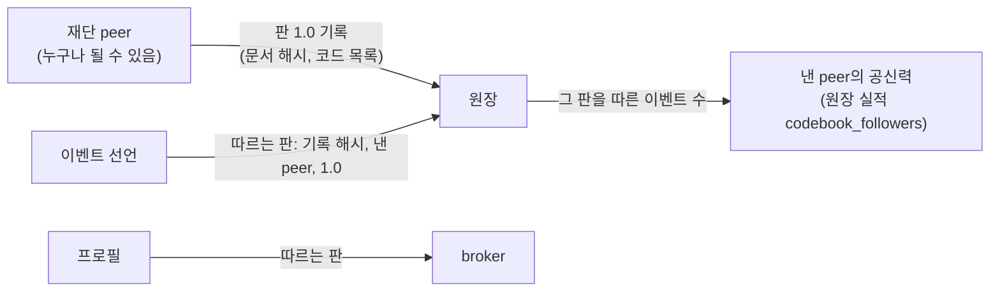

# 코드표와 판: 기본을 미리 정의하되 묶지 않는다

> 판 0 · 2026-11-02. 코드 칸의 정책은 `dev/entry-columns.md`, 바이트 모양은 `dev/protocol.md` 4.4절에 있다. 이 문서는 코드표를 **누가 어떻게 내고, 어떻게 따르는가**의 정책이다.

## 1. 원칙 (사용자 2026-11-02)

> "새 판을 내는 권한을 가진 peer(예를 들면 agent arena foundation)가 자연스럽게 공신력을 가져서 새 판을 내고, 다른 peer들은 이벤트나 프로필 등을 제출할 때 그 peer의 판 version x.x를 기준으로 했다는 뭔가를 남기면 멋있지 않을까?"
> "특수 목적 peer에 agent arena foundation도 추가하자." "필수는 아니지만 생태계를 견고하게 하기 위해 기본적인 걸 미리 정의하는 거지."

- **코드표**: 플랫폼이 미리 정해 둔 이름들의 목록이다. 항목 종류(`type`), 목적 코드(`purpose`), 기본 요소, 연결 방식이 들어간다. 각 코드의 뜻도 함께 적는다.
- **판**: 코드표의 한 번 낸 모양이다. 판 번호 `x.y`가 붙는다.
- **권한은 정해 주지 않는다. 따르는 이가 많아서 생긴다.** 누구나 판을 낼 수 있다. 어떤 판을 따른 이벤트와 프로필이 몇 개인지는 원장에서 누구나 센다. 많이 따르는 판을 내는 peer가 사실상의 표준을 낸다.
- **따르는 것은 선택이다.** 판을 밝히지 않은 이벤트와 프로필도 그대로 받는다. 기본을 미리 정의해 두는 것은 생태계를 튼튼하게 하려는 것이지, 누구를 묶으려는 것이 아니다.

## 2. 판 기록 (`codebook` 항목)

| 칸 | 뜻 | 원장이 확인하는 것 |
|---|---|---|
| `publisher` | 판을 낸 peer의 공개키(서명자) | 서명 |
| `name` | 코드표 이름(기본: `agent-arena`) | 비어 있지 않음 |
| `version` | 판 번호 `x.y` | 모양. 같은 낸 이·같은 이름·같은 번호는 한 번만 |
| `content_hash` | 코드표 문서(정규 JSON)의 해시. 문서는 낸 peer가 내준다 | 64자 |
| `codes` | 이 판의 코드 목록: `entry_types`, `purposes`, `elements`, `connections` | 모양 |
| `supersedes` | 이어받은 앞 판의 기록 해시(선택) | 이 원장의 판 기록일 것. 같은 낸 이·같은 이름이면 번호가 더 커야 함 |

판 번호의 뜻(권장): `y`는 코드를 더할 때 올린다(옛 기록과 그대로 맞음). `x`는 코드를 "더 이상 쓰지 않음"으로 표시하는 등 호환이 깨질 때 올린다. 코드의 뜻은 바꾸지 않는다. 뜻이 달라지면 새 이름을 쓴다. 옛 기록은 영원히 옛 뜻으로 읽혀야 하기 때문이다. 다른 peer가 어떤 판을 이어받아 자기 판을 내도 된다(갈래). 어느 쪽이 살아남을지는 따르는 수가 정한다.

## 3. 따르는 판 밝히기

| 어디에 | 칸 | 확인 |
|---|---|---|
| 이벤트 선언 | `codebook: {entry, publisher, version}`(선택) | 원장: `entry`가 이 원장의 판 기록이고 낸 이·번호가 맞을 것, 이벤트의 기본 요소가 그 판의 코드일 것, **이 기록자의 소프트웨어가 그 판의 원장 코드를 모두 구현했을 것**. 공지의 판은 원장의 선언과 같아야 peer가 받는다 |
| 프로필 | `codebook: {entry, publisher, version}`(선택, `PeerConfig.codebook`) | broker: 모양 |

**판은 이름과 뜻의 목록이고, 확인은 소프트웨어가 한다.** 예를 들어 `submission`은 이벤트를 가리켜야 한다는 확인은 기록자의 코드가 한다. 그래서 기록자는 자기가 구현한 코드를 `GET /codes`로 밝히고, 구현하지 않은 코드가 든 판을 따른다는 이벤트는 받지 않는다. 새 판이 실제로 쓰이려면 기록자들이 그 판을 구현해야 하고, 이것도 따르는 이가 많아야 공신력이 서는 구조와 맞물린다.

## 4. 재단 peer (특수 목적 peer, 선택)

| 항목 | 내용 | 상태 |
|---|---|---|
| 하는 일 | 이 소프트웨어에 든 기본 코드표(`arena/codebook.py`, 판 `agent-arena 1.0`)를 판 기록으로 원장에 남기고, 각 판의 문서를 내준다(op `codebook.get`). 프로필에 낸 판 목록을 싣는다 | 구현·테스트됨 |
| 권한 | 없다. 공신력은 원장 실적(`codebook_followers`: 그 판을 따른 이벤트 수)으로만 생긴다 | 구현·테스트됨 |
| 띄우기 | `python -m arena.peers.foundation`(설정 `ARENA_FOUNDATION_PEER_*`, 시작할 때 판을 기록할 기록자 `ARENA_FOUNDATION_PEER_RECORDER_URL`) | 구현·테스트됨 |
| 누가 띄우나 | 누구나 띄울 수 있다. 기준 네트워크에서는 플랫폼을 만든 사람이 처음 띄우고, 공개 출시 뒤 god이 사라질 때(`dev/chain-policy.md` 7.2절)에도 재단 peer는 남아 판을 이어 낼 수 있다. 다른 이가 다른 판을 내도 된다 | 정책 |

## 5. 할 일과 정할 것

| 번호 | 내용 | 상태 |
|---|---|---|
| CB-1 | 감사할 때 각 기록을 그 기록이 따른 판으로 확인(판마다 다른 소프트웨어 판정이 필요해지면) | 계획 |
| CB-2 | 판의 "더 이상 쓰지 않음" 표시 모양과, 그 판을 따른 이벤트에서 그 코드를 거절하는 규칙 | 계획 |
| CB-3 | 가지 체인의 자체 코드(커뮤니티 이름이 붙은 코드, 예: `x-<커뮤니티>.<코드>`) 허용 여부 | **미정**(권장: 허용. 가지 체인의 룰은 커뮤니티 몫) |
| CB-4 | 뿌리 체인의 판을 가지 체인에서 따르는 방법(지금은 판 기록이 같은 원장에 있어야 함) | **미정** |
