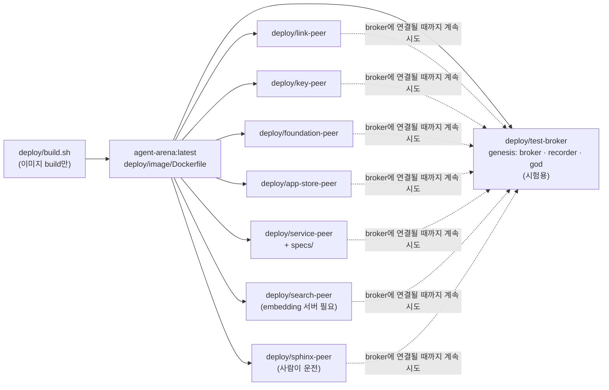
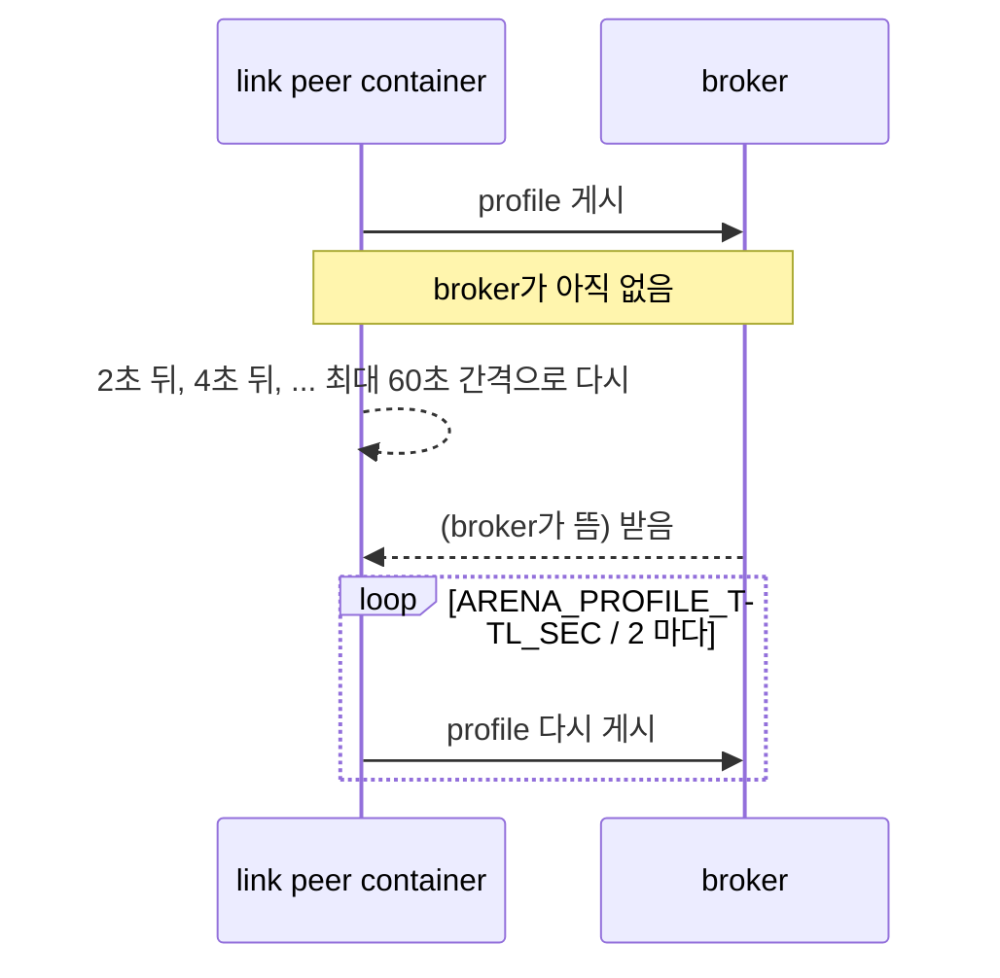

# Docker로 API 서버 peer 띄우기

> 2026-11-03. 사용자: "독립 peer들은 docker container로 활성화되도록 구성해", "api 서버 peer들은 독립된 장소에서 따로 실행되니 실행용 디렉토리 분할하고 각각 docker compose 배치해", "broker도 test용으로 별도 디렉토리에", "build 옵션은 docker compose에 넣지 마, 분리해".

API를 제공하는 특수 목적 peer들은 서로 다른 곳에서 따로 운영된다. 그래서 peer마다 실행 디렉토리가 따로 있고, 각자 `docker-compose.yml`과 `.env.example`을 가진다. 이미지는 하나이고, build는 compose 밖의 스크립트가 맡는다.

## 1. 구성



| 디렉토리 | 실행 | 기본 포트 | 필요한 것 |
|---|---|---|---|
| `deploy/test-broker` | `arena.genesis` | broker 9100, recorder A2A 9101, recorder API 9102, god 9103 | 없음. **시험용**(진짜 원장은 release 세리머니) |
| `deploy/link-peer` | `arena.peers.link_peer` | api 9191 | broker, recorder API(key rotation 확인) |
| `deploy/key-peer` | `arena.peers.key_peer` | A2A 9180 | broker |
| `deploy/foundation-peer` | `arena.peers.foundation` | A2A 9170 | broker, recorder API(codebook edition 기록) |
| `deploy/app-store-peer` | `arena.peers.app_store` | A2A 9150 | broker |
| `deploy/service-peer` | `arena.peers.service --spec specs/<파일>` | api 9161 | broker, `specs/`의 spec 파일과 함수 |
| `deploy/search-peer` | `arena.peers.search` | A2A 9130 | broker, embedding 서버(`ARENA_EMBED_URL`) |
| `deploy/sphinx-peer` | `arena.peers.sphinx` | A2A 9195, 사람의 창(console) 9196 | broker, 사람(신청자를 만나 정함). 창의 토큰은 home의 `web-token` |

## 2. 쓰는 법

```bash
deploy/build.sh                         # 이미지 한 번 build (compose에는 build가 없다)
cd deploy/test-broker && docker compose up -d      # 시험용 broker
cd deploy/link-peer && cp .env.example .env         # broker와 주소를 적는다 (key·secret도 .env에만)
docker compose up -d                                 # 그 자리에서 이 peer만
docker compose logs -f                               # "프로필 게시"가 보이면 broker에 연결됨
docker compose down                                  # 멈춤 (-v는 key와 데이터까지 지움)
```

- **build**: `deploy/build.sh [이미지 태그]`. 이 기기의 proxy 환경 변수(`HTTP_PROXY`, `HTTPS_PROXY`, `NO_PROXY`, 소문자 포함)를 이름만 넘기고(값은 docker가 환경에서 읽음, 이미지에 남지 않음), `--network host`로 이 기기와 같은 길로 package index에 닿는다. 다른 태그를 쓰면 각 `.env`에 `ARENA_IMAGE=`.
- **설정**: 각 디렉토리의 `.env`(git이 무시)를 실행할 때 읽는다. 이미지에는 넣지 않는다.
- **데이터**: 디렉토리마다 named volume(`<디렉토리>_data`)의 `/app/data`에 key, 원장, 상태가 남는다. container는 root가 아닌 사용자로 돈다. key는 파일(0600)에 둔다(`ARENA_KEY_STORE=file`, container 안에는 OS key store가 없다).

## 3. 주소: 듣는 곳과 알리는 곳

- 기본은 **host network**다. 같은 기기의 peer와 container가 서로 같은 주소로 닿고, `ARENA_HOST`(기본 `127.0.0.1`) 밖으로는 열리지 않는다.
- 남에게 서비스하려면 `ARENA_HOST=0.0.0.0`(모든 곳에서 듣기)과 `ARENA_PUBLIC_HOST=<이 서버 주소>`(profile과 recorder 주소에 적혀 남이 찾아올 주소)를 함께 준다. 듣는 주소와 알리는 주소를 나눈 것은 `0.0.0.0`을 profile에 적으면 아무도 닿을 수 없기 때문이다.
- broker 주소는 `ARENA_<PEER>_BROKERS=public=http://<broker>:9100`(여럿이면 `|`로, 첫째가 주 broker).

## 4. broker에 연결될 때까지 계속 시도

peer는 broker가 아직 뜨지 않았거나 잠깐 끊겨도 멈추지 않는다(사용자 2026-11-03: "peer들은 기본적으로 broker가 커넥트될 때까지 계속 시도하지?"). `Presence`가 profile 게시를 되풀이한다. 닿지 않으면 `ARENA_BROKER_RETRY_SEC`(기본 2초)부터 두 배씩 늘려 `ARENA_BROKER_RETRY_MAX_SEC`(기본 60초)까지 기다리며 다시 시도하고, 닿으면 profile이 만료되기 전에(`ARENA_PROFILE_TTL_SEC`의 절반마다) 다시 게시한다. 앱 하나가 시작하지 못해도(예: recorder가 아직 없음) peer 전체는 멈추지 않는다.



## 5. 확인 (2026-11-03, 이 서버)

이미지를 build하고, link peer를 broker보다 **먼저** 띄웠다. link peer는 "아직 연결되지 않음"을 남기며 다시 시도하다가, test-broker가 뜨자 profile을 게시했다. 이어서 foundation peer(시험 recorder에 codebook edition 기록), service peer(`specs/`의 `add`가 receipt와 함께 답함), key peer, app store peer를 띄웠고, 모두 다시 시작 없이 돌았다. 확인한 뒤 모두 `down -v`로 지웠다. 테스트: `tests/test_deploy.py`(늘 도는 구성 확인, 실제 build와 실행은 `ARENA_TEST_DOCKER=1`일 때만).
