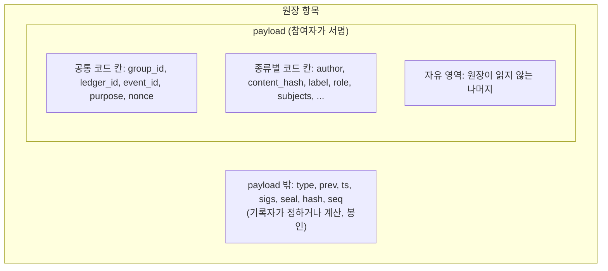

# 원장 항목의 칸: 코드 칸과 자유 영역

> 판 0 · 2026-11-02. 규약의 바이트 단위 모양은 `dev/protocol.md` 4.2~4.4절에 있다. 이 문서는 그 위의 **칸 정책**이다. 어떤 값을 코드로 관리할 칸으로 두고, 어떤 값을 자유 영역에 둘지 정한다.

## 1. 원칙 (사용자 2026-11-02)

> "payload 영역은 자율성을 보장하되, 코드화할 가치가 있는 것들은 payload 밖 또는 payload 내 독립적인 칼럼을 부여해. 예를 들어 원장의 유형(저작 내용과 시점 명시 목적, 가지 체인 시작점, ...) 이런 분류는 코드화하고 별도 칼럼으로 관리하는 것이 좋겠지."

- **자유 영역**: payload에서 원장이 칸으로 정하지 않은 값이다. 원장은 그 값을 읽지 않고 뜻을 따지지 않는다. 서명 범위 안에 있으므로 바꿀 수는 없다. 공개 확인에는 보이지 않는다.
- **코드 칸**: 원장이 이름과 허용 값을 정해 두고 기록 전에 확인하는 칸이다. 공개 확인에 보이고, 찾기와 통계에 쓸 수 있다.
- 어떤 값이 여러 이벤트나 여러 앱에서 같은 뜻으로 되풀이되면 코드 칸으로 올린다. "명확한 일은 코드로"(`dev/plan.md`)와 같은 원칙이다.

## 2. 칸이 놓이는 세 자리

| 자리 | 누가 정하나 | 누가 서명하나 | 무엇을 둘까 |
|---|---|---|---|
| payload 밖 | 기록자(규칙에 따라) | 기록자 봉인 | 행위의 종류(`type`), 순서(`prev`, `seq`), 시각(`ts`), 서명 묶음, 해시 |
| payload 안 코드 칸 | 서명하는 참여자 | 참여자 서명 + 봉인 | 참여자가 **주장**하는 분류와 연결(어느 그룹, 어느 원장, 어느 이벤트, 무슨 목적) |
| payload 안 자유 영역 | 서명하는 참여자 | 참여자 서명 + 봉인 | 그 밖의 모든 것. 원장은 뜻을 따지지 않는다 |

**왜 목적 칸은 payload 안에 두나**: 참여자의 서명은 payload에만 걸린다. "이 등록은 저작 증명이다" 같은 목적은 등록한 사람의 주장이므로 그 사람이 서명해야 한다. payload 밖에 두면 기록자만 봉인하고 등록한 사람은 서명하지 않은 값이 된다. 반대로 행위의 종류(`type`)는 원장 규칙 자체를 고르는 값이라, 지금처럼 payload 밖에 두고 기록자가 그 종류의 규칙으로 확인한다.

## 3. 사용자의 예가 놓이는 곳

| 예 | 칸 | 상태 |
|---|---|---|
| 원장(항목)의 유형 | `type`(payload 밖): `genesis`, `group`, `event`, `contract`, `publish`, `reveal`, `share`, `feedback`, `assign`, `attest`, `close`, `key_rotate`, `chain_link`, `parent_link`, `codebook`. 등록해서 더한다. 코드 목록 자체는 판으로 낸다(`dev/codebook.md`) | 구현·테스트됨 |
| 저작 내용과 시점 명시 목적 | `publish`의 `purpose: "authorship"` | 구현·테스트됨(이번에 넣음) |
| 가지 체인 시작점 | 뿌리 쪽은 `type: "chain_link"`, 가지 쪽은 `type: "genesis"` + `parent` 칸(갈라진 지점 포함)과 1번 기록 `type: "parent_link"`. 그 자체가 코드다 | 구현·테스트됨 |

## 4. 목적 코드(`purpose`)

한 종류가 여러 목적에 쓰일 때 목적을 코드로 밝히는 칸이다. 가지 체인은 자기 체인 안에서만 쓰는 자체 목적 코드(`x-<커뮤니티>.<코드>`)를 판 기록에 더할 수 있다(`dev/codebook.md` 5절). 원장은 등록된 코드만 받고, 그 코드를 쓸 수 있는 종류에만 받고, 코드마다의 확인을 한다. 목적이 없는 항목도 받는다(자율). 원본: `arena/ledger/purposes.py`, 테스트: `tests/test_purposes.py`.

| 코드 | 쓰는 종류 | 뜻 | 원장이 확인하는 것 | 상태 |
|---|---|---|---|---|
| `authorship` | `publish` | 저작 내용과 그 시점의 증명. 책에 원장 정보를 찍어 거꾸로 찾게 한다(`dev/chain-policy.md` 6.1절) | 이름표(`label`)가 없을 것(봉인 등록과 섞지 않음) | 구현·테스트됨 |
| `commit` | `publish` | 나중에 공개할 값의 봉인 등록 | 이름표가 있을 것 | 구현·테스트됨 |
| `delivery` | `share` | 자료 전달: 주는 쪽이 받는 쪽에게 이 내용을 넘겼다 | 없음 | 구현·테스트됨 |
| `submission` | `share` | 이벤트 제출. 제출 받기 요소(`intake`)가 받는 사람, 마감, 수를 확인한다 | 이벤트를 가리킬 것 | 구현·테스트됨(전에는 자유 문자열 `terms`) |
| `evaluation` | `share` | 평가 건넴. 평가 요소(`evaluation`)가 확인한다 | 이벤트를 가리킬 것 | 구현·테스트됨(전에는 자유 문자열 `terms`) |

전달의 목적은 사용자 결정(2026-11-02)으로 코드로 올렸다. `share`의 `terms`는 이제 자유 영역의 조건 설명이다.

**코드로 올리지 않는 것**(이벤트마다 뜻이 다름):

| 값 | 지금의 모양 | 두는 곳 |
|---|---|---|
| 공동 확인의 종류 | `attest`의 `kind`(이벤트 정책 `attest_kinds`가 허용 목록을 정함) | 이벤트마다 다르므로 지금처럼 정책이 정하는 칸으로 둔다 |
| 판정 | `feedback`의 `verdict` | 평가 요소가 정하는 칸으로 둔다 |

## 5. 공통 코드 칸

| 칸 | 뜻 | 상태 |
|---|---|---|
| `group_id` | 어느 broker 그룹에서 일어났나 | 구현·테스트됨(모든 항목) |
| `ledger_id` | 어느 원장의 기록인가(제네시스 해시). 서명을 이 원장에 묶는다 | 구현·테스트됨(0번 다음 모든 항목) |
| `event_id` | 어느 이벤트의 기록인가 | 구현·테스트됨(종류에 따라 필수·선택) |
| `purpose` | 무슨 목적의 기록인가(4절) | 구현·테스트됨(선택) |
| `nonce` | 같은 기록을 다시 쓰지 못하게 하는 값 | 구현·테스트됨(종류에 따라) |

## 6. 자유 영역

| 항목 | 정책 | 상태 |
|---|---|---|
| 원장은 읽지 않는다 | 칸으로 정하지 않은 값은 원장 규칙이 쓰지 않는다 | 구현·테스트됨 |
| 바꿀 수는 없다 | payload 전체가 서명 범위라 자유 영역도 바꾸면 서명이 깨진다 | 구현·테스트됨 |
| 공개 확인에는 안 보인다 | 공개 확인은 종류별로 정한 코드 칸만 보인다. 자유 영역은 원장 전체를 읽을 수 있는 키만 본다 | 구현·테스트됨 |
| 비공개 봉투(판 3) | 누구나 가져가는 공개 기록 흐름에 퍼지면 안 되는 칸은 비공개 봉투에 넣고, 공개 본체에는 그 해시(`private` 칸)만 둔다. 반드시 봉투에 넣을 칸은 종류가 정한다(`share`의 주고받은 쪽·내용 해시·조건, 숨긴 역할 계약의 계약자). 자유 영역은 봉투에 넣기를 권한다(`split_payload`) | 구현·테스트됨 |
| 크기 | 원장은 내용 자체가 아니라 해시를 담는 곳이다. 긴 글은 원장 밖에 두고 해시와 원장 참조로 잇는다(`dev/chain-policy.md` 6절) | 정책 확정. 자유 영역 크기 상한은 **미정** |
| 코드 칸으로 올리기 | 여러 이벤트·앱에서 같은 이름, 같은 뜻으로 되풀이되는 자유 영역 값은 코드 칸 후보로 올리고, 사용자가 정한 뒤 등록한다 | 정책 확정 |
