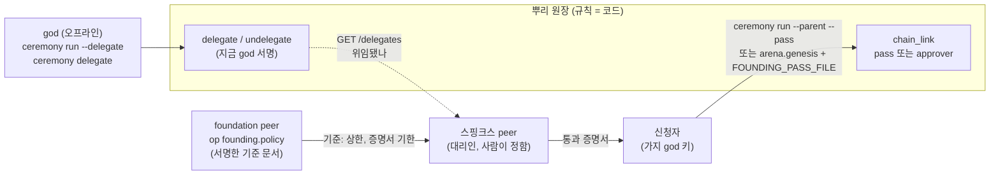

# 가지 그룹 창설 경로 설계 (구현 2차)

> 2026-11-05, 브랜치 `founding-path-20261105`. 요구사항: [requirements.md](requirements.md) 3-2절(FG-F1~F9, 모두 정함), FG-A·C의 정한 행. 이번에 하지 않는 것은 요구사항 3-2절 끝.

## 0. 한눈에



원장이 집행하는 것은 **누가 위임되었나**와 **증명서가 그 위임으로 서명되었고 그 founder의 것인가**뿐이다. 얼마나 자주 줄지(상한)와 증명서를 며칠 쓸 수 있는지(기한)는 foundation이 정하고 스핑크스가 집행한다(FG-A5). 원장은 증명서에 적힌 `until`만 본다.

## 1. 원장

### 1.1 새 항목 종류

| 항목 | 서명자 | 코드 field | 규칙 |
|---|---|---|---|
| `delegate` | `god` | `god`(지금 god 키), `delegate`(대리인 공개키), `scope`(코드, 지금은 `found_branch`) + 공통(`group_id`, `ledger_id`, `nonce`) | 뿌리 체인에서만(`is_branch`면 거부). `god`이 `current_keys(chain)["god"]`. `delegate`는 키, god 키와 다름. 같은 `delegate`가 이미 위임되어 있으면 거부(철회 뒤 다시는 됨). `scope`는 등록된 코드 |
| `undelegate` | `god` | `god`, `delegate` + 공통 | 뿌리 체인에서만, 지금 god, 그 `delegate`가 지금 위임되어 있음 |

공개 모양(`/log`, `/entries`): 두 항목 모두 `god`, `delegate`, (`delegate`는) `scope`. 원장 크기 상한(4,096 bytes) 안이다.

`scope` 코드는 표 `DELEGATE_SCOPES = {"found_branch": "가지 그룹을 만드는 통과 증명서를 낸다"}`로 두고 code table의 `meanings`에 싣는다. 새 항목 종류 둘과 scope 코드가 더해지므로 기본 edition을 **`agent-arena 1.2`**로 올린다.

### 1.2 `chain_link`에 더하는 전용 field

| field | 뜻 | 서명자에 더해지나 |
|---|---|---|
| `pass` | 통과 증명서 전체(`arena-founding-pass` v1, `arena/ledger/founding.py`) | 아니요(증명서 안의 서명은 대리인의 것이고, 원장이 규칙으로 확인) |
| `approver` | 뿌리의 지금 god 키(FG-C4 예외) | **예**: `signers = [child_god, child_recorder] + [approver]` |

`chain_link` 규칙에 더하는 확인(`_link_rule`, 지금 확인 뒤에):

1. `pass`와 `approver` 가운데 **정확히 하나**. 둘 다 없음: "a chain_link needs a founding pass or the current god's approval". 둘 다: 거부.
2. `approver`면: `approver == current_keys(chain)["god"]`(서명은 서명자 확인이 이미 함).
3. `pass`면, 기존 `pass_error(pass, founder=child_god, now=now)`(모양, 대리인 서명, founder 일치, 기한) 그리고:
   - 서명한 키 `body.sphinx`의 계보(`lineage(chain, sphinx)`)의 **처음 키가 지금 위임되어 있다**(`delegate` 있고 `undelegate` 없음, scope에 `found_branch`).
   - `body.sphinx`는 그 계보의 **지금 키**다(`peer_rotate`로 물러난 키의 서명은 받지 않음: 지금 키만 훔친 사람이 이어받은 뒤의 옛 키, 또는 이어받은 뒤 옛 키로 서명한 증명서).
   - 같은 `pass.body.nonce`를 쓴 `chain_link`가 없다(한 번만).
4. 상한(기간당 개수)은 **세지 않는다**(FG-A5).

### 1.3 위임 조회 (기록자 공개 API)

`GET /delegates` → `{ok, delegates: [{delegate, scope, entry, seq, current}]}`: 지금 위임되어 있는 것만, `current`는 그 계보의 지금 키. 가지 체인의 기록자는 빈 목록. `RecorderClient.delegates()`, 메모리 client도 같은 이름. 원장 함수 `active_delegates(chain) -> {first_key: {scope, entry, seq}}` 하나를 규칙과 API가 함께 쓴다.

## 2. foundation의 기준 문서 (FG-F6)

```json
{"format": "arena-founding-policy", "version": 1,
 "body": {"foundation": "<foundation 공개키>", "cap": {"count": 20, "days": 30}, "pass_days": 30, "issued_at": 1793900000.0},
 "sig": "<foundation 키의 body 서명>"}
```

- `arena/ledger/founding.py`에 `policy_body`, `make_policy`, `policy_error(doc, foundation=None)`(모양, 서명, 내 foundation인가, 값의 범위: count ≥ 0 정수, days > 0, pass_days > 0).
- `FoundationRole`에 op `founding.policy` → `{ok, policy}`. 값은 설정 `ARENA_FOUNDATION_FOUNDING_CAP_COUNT`(20), `_CAP_DAYS`(30), `_PASS_DAYS`(30). 부를 때마다 지금 시각으로 서명한 새 문서(값이 같으면 body의 값도 같다). 원장에는 남기지 않는다.
- 기준이 바뀌는 길: foundation 운영자가 설정을 바꾸고 다시 띄운다. 스핑크스는 다음 갱신 때 새 값을 쓴다.

## 3. 스핑크스 (FG-F7, F8)

| 무엇 | 어떻게 |
|---|---|
| 기준 받기 | 설정 `ARENA_SPHINX_FOUNDATION_URL`(foundation peer의 A2A 주소)과 `ARENA_SPHINX_FOUNDATION_PUB`(그 공개키)가 있으면 `founding.policy`를 불러 `policy_error(doc, foundation=PUB)`로 확인한다. `ARENA_SPHINX_POLICY_REFRESH_SEC`(3600)마다 다시(쓸 때 오래되었으면). 실패하면 직전에 받은 기준, 그것도 없으면 자기 설정(`ARENA_SPHINX_CAP_*`, `_PASS_DAYS`) |
| 집행 | 지금의 `_issued_in_window`, 신청 때·승인 때 상한 확인, 증명서 `until`이 모두 `policy()`의 값을 쓴다(지금은 `self.s.sphinx_*`를 바로 읽는다) |
| 위임됐나 | 설정 `ARENA_SPHINX_TRUNK_RECORDER_URL`이 있으면 `GET /delegates`에서 자기 키(`current`)를 찾는다. 같은 갱신 주기 |
| 보이기 | `sphinx.info`에 `policy: {cap, pass_days, source: "foundation" \| "settings", foundation?}`, `delegated: true \| false \| null`(알 수 없음). 프로필 `sphinx` 블록도 같은 값. 사람의 창(console)에는 시작할 때와 값이 바뀔 때 **알림 카드**(desk의 `notice`) 하나: "위임됨 · 기준 foundation(필명) 30일 20개, 증명서 30일" 또는 "위임 안 됨: 뿌리 원장이 이 스핑크스의 증명서를 받지 않는다" |
| 신청자에게 | 위임 안 됨(`false`)이면 `sphinx.apply`의 답 `note`에 "이 스핑크스는 지금 위임되어 있지 않아 뿌리 원장이 증명서를 받지 않는다"를 붙인다(신청은 받는다: 사람이 정할 일) |

## 4. 가지 god이 증명서를 쓰는 길 (FG-F4)

| 길 | 바뀜 |
|---|---|
| `arena.ledger.trust.chain_link_payload` | 인자 `pass_doc=None`, `approver=None`. 있으면 그 field를 payload에 |
| `arena.genesis`(가지, `ARENA_GENESIS_PARENT_RECORDER_URL`) | `ARENA_GENESIS_FOUNDING_PASS_FILE`이 있으면 그 증명서를 `chain_link`에. 시험용으로 뿌리 god 키를 같은 기계에 둔 경우 `ARENA_GENESIS_PARENT_APPROVER_KEY_FILE`(뿌리 god 키 파일)이면 `approver`로 그 키가 함께 서명. 둘 다 없으면 시작 때 "a branch needs a founding pass (ARENA_GENESIS_FOUNDING_PASS_FILE) or the trunk god's approval" |
| `ceremony run --parent` | `--pass FILE`(증명서) 또는 `--approver PUB`(뿌리 god 공개키: 2라운드 `chain_link` 항목의 `signers`에 뿌리 god이 더해져, 그 키가 오프라인에서 따로 서명 파일을 낸다). 둘 다 없으면 키를 만들기 전에 멈춘다. 증명서의 founder가 `--god-pub`과 다르면 시작 전에 멈춘다 |
| 신청자 명령 | 그대로(`python -m arena.groups pass --out FILE`) |

## 5. 세리머니에 위임 (FG-F5)

- `ceremony run --delegate PUB`(반복, 뿌리 체인만): 2라운드 요청에 `delegate-1`, `delegate-2` … 항목(서명자 god)을 함께 넣는다. 기록 순서는 FG-A6: `key_rotate`(운영 키로 넘김) 다음에 `delegate`들. 폐기 선언의 `head`는 마지막 항목.
- 실행 기록 단계 코드에 `delegated` 추가.
- 세리머니 뒤: 멈춘 genesis 폴더에서 `ceremony delegate-request --dir DIR --delegate PUB [--undo]` → 오프라인 `sign` → `ceremony delegate --dir DIR --request R --signatures S`(`rotate`와 같은 모양, `arena/ceremony/rotate.py`에 함께).

## 6. 바뀌는 기존 코드와 테스트

| 파일 | 바꿈 |
|---|---|
| `arena/ledger/types.py` | `delegate`, `undelegate` 항목, `chain_link`의 `pass`·`approver` field와 서명자, 규칙 1.2 |
| `arena/ledger/delegation.py`(새) | `DELEGATE_SCOPES`, `active_delegates(chain)`, 증명서 확인의 계보 부분 |
| `arena/ledger/founding.py` | 기준 문서 함수 |
| `arena/recorder/service.py`, `api.py`, `client.py` | `delegates()`, `GET /delegates` |
| `arena/peer/foundation_role.py` | op `founding.policy` |
| `arena/peer/sphinx_role.py` | 기준 받기와 집행, 위임 확인, 알림 카드, `info`·프로필 |
| `arena/ledger/trust.py`, `arena/genesis.py` | 4절 |
| `arena/ceremony/run.py`, `rotate.py`, `cli.py`, `formats.py`(단계 코드) | 4·5절 |
| `arena/codebook.py` | edition 1.2, `delegate_scopes` meanings |
| `arena/config.py`, `.env.example` | 7절 |
| 기존 가지 테스트(`test_trust`, `test_branch_link`, `test_refusals`, `test_ceremony_process` 가지, 그룹·스핑크스 프로세스 테스트 중 가지를 만드는 것) | `approver`(뿌리 god이 같은 테스트 안에 있음)나 증명서로 고친다. 어느 테스트를 어떻게 고쳤는지 `test-results.md`에 적는다 |
| 문서 | `dev/protocol.md`(항목 표, `/delegates`, 4.10에 `--delegate`·`--pass`, 스핑크스 절의 "아직 없다" 지움), `dev/chain-policy.md`, `dev/codebook.md`, `docs/internal-network-test.md`(가지를 만드는 시험이 있으면) |

## 7. 설정

| 키 | 기본 | 뜻 |
|---|---|---|
| `ARENA_FOUNDATION_FOUNDING_CAP_COUNT` | 20 | foundation 기준: 대리인 하나가 한 기간에 낼 증명서 수 |
| `ARENA_FOUNDATION_FOUNDING_CAP_DAYS` | 30 | 그 기간(일) |
| `ARENA_FOUNDATION_FOUNDING_PASS_DAYS` | 30 | 증명서 기한(일) |
| `ARENA_SPHINX_FOUNDATION_URL` | (비움) | 기준을 받을 foundation peer의 A2A 주소. 비면 자기 설정 |
| `ARENA_SPHINX_FOUNDATION_PUB` | (비움) | 그 foundation의 공개키(기준 문서 서명 확인). URL만 있고 이것이 없으면 설정 오류 |
| `ARENA_SPHINX_POLICY_REFRESH_SEC` | 3600 | 기준과 위임 상태를 다시 보는 주기 |
| `ARENA_SPHINX_TRUNK_RECORDER_URL` | (비움) | 위임을 확인할 뿌리 기록자 API 주소. 비면 "알 수 없음" |
| `ARENA_GENESIS_FOUNDING_PASS_FILE` | (비움) | 가지 genesis가 `chain_link`에 넣을 증명서 |
| `ARENA_GENESIS_PARENT_APPROVER_KEY_FILE` | (비움) | 시험용: 뿌리 god 키 파일(같은 기계). 있으면 `approver`로 함께 서명 |

## 8. 테스트

| 테스트 | 무엇 | 요구사항 |
|---|---|---|
| 원장 단위 | `delegate`: 지금 god만, 가지 체인 거부, 같은 키 두 번 거부, 철회 뒤 다시. `undelegate`: 위임 없는 키 거부 | FG-F1, F2 |
| 원장 단위 | `chain_link`: 증명서로 통과 · 둘 다 없음 · 둘 다 있음 · approver가 지금 god이 아님 · 위임 안 된 키의 증명서 · 철회된 대리인 · founder ≠ child_god · 기한 지남 · 같은 nonce 두 번 · 대리인이 키를 이어받은 뒤 새 키 증명서 통과, 옛 키 증명서 거부 | FG-F3, FG-C3, C4, A3 |
| 기록자 API | `/delegates`(위임·철회·이어받은 뒤 `current`) | FG-F1, F8 |
| 기준 문서 | 모양, 서명, 다른 foundation 거부, 값 범위 | FG-F6 |
| 스핑크스(메모리 세계) | foundation 기준을 받아 상한·기한을 그것으로 집행, foundation이 없거나 서명이 틀리면 자기 설정, 위임 여부와 알림 카드, 위임 안 됨이면 신청 답에 알림 | FG-F7, F8 |
| 세리머니 | `--delegate` 둘이 2라운드에 함께 서명되어 넘김 뒤 기록, 가지 `--pass`와 `--approver`, 시작 전 거부(증명서 founder 불일치, 둘 다 없음), `delegate-request`/`delegate`(추가와 `--undo`) | FG-F5, F4 |
| **실제 프로세스** | 세리머니(`--delegate` 스핑크스 키) → 뿌리 genesis → foundation peer(기준) → 스핑크스 peer(뿌리·foundation 주소) → 신청자 `groups apply` → 사람 승인(창 API) → `groups pass --out` → 가지 genesis(`FOUNDING_PASS_FILE`) 연결 → 뿌리에 그 `chain_link`와 `pass` · 같은 증명서로 두 번째 가지 거부 | FG-F9 |

## 9. 한계

- 원장은 대리인이 너무 많이 내는 것을 막지 않는다(FG-A5 결정). 막는 것은 스핑크스의 코드와 사람, 그리고 foundation의 기준이다. 스핑크스가 이를 어기면(코드를 바꿔 띄우면) 원장은 받는다. 그때 할 수 있는 일은 god이 살아 있는 동안의 `undelegate`, 그 뒤에는 7단계의 대리인 교체 절차(아직 없음)다.
- 기준 문서는 원장에 없으므로 "그때 어떤 기준이었나"는 스핑크스의 기록(home)에만 남는다.
- foundation의 공개키는 스핑크스 설정으로 정한다. 어느 foundation을 믿을지는 운영자의 선택이다(foundation은 권한이 없고, 따르는 수로 공신력을 얻는다는 지금 원칙과 같다).

## 10. 구현하며 정한 것 (2026-11-05)

| 무엇 | 설계 | 구현 |
|---|---|---|
| `chain_link`의 확인을 어디에 두나 | `_link_rule`에 더함 | `types.py`에 `LINK_CHECKS`(등록 목록)를 두고 `delegation.py`가 확인을 등록한다. `types.py`가 `peer_keys`·`founding`을 import하지 않게(순환 없이, 원장 항목을 등록으로 더하는 지금 방식과 같게) |
| 스핑크스의 알림 카드 | 시작할 때와 바뀔 때 | foundation 주소나 뿌리 기록자 주소를 **준 때만**. 아무것도 주지 않은 스핑크스는 자기 설정·위임 알 수 없음이 기본이라 알릴 것이 없다(그 값은 `sphinx.info`에) |
| foundation이 조용해지면 | 직전에 받은 기준 | 같음. 처음부터 받지 못하면 자기 설정. 받지 못한 이유는 그 peer의 이벤트 기록에 |
| 세리머니의 사전 확인 | 증명서 founder 불일치, 둘 다 없음 | 더해서: 뿌리 세리머니에 `--pass`·`--approver`는 거부, 가지 세리머니에 `--delegate`는 거부, 대리인 목록이 서로 다르고 god 키가 아님. 모두 키를 만들기 전에 |
| `--approver` | 뿌리 god 공개키 | 같음. 그 키가 2라운드 `chain_link` 항목의 `signers`에 들어가, 오프라인에서 따로 서명 파일(`round-2.signatures-*.json`)을 낸다 |
| 가지 genesis의 허락 확인 | 연결할 때 | **0번을 만들기 전에도** 확인한다(증명서도 승인 키도 없으면 가지를 시작하지 않는다). 연결할 때 다시 읽어 쓴다 |
| 2라운드 항목 순서 | | `key_rotate`, `delegate-1`, `delegate-2`, … (가지면 맨 앞에 `chain_link`). 기록 순서는 `key_rotate` 다음에 `delegate`들 |
