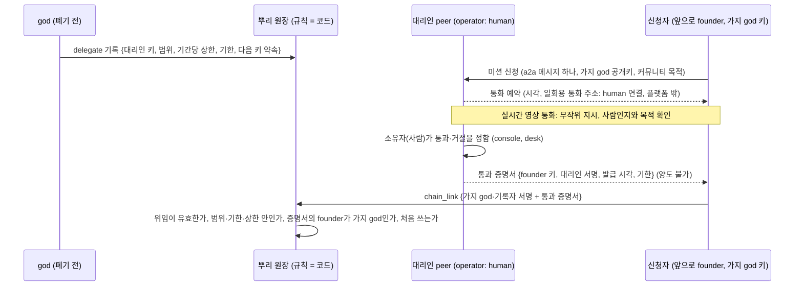

# 가지 그룹 생성 자격: god 대리인의 미션 (요구사항)

> 2026-11-04 초안, 브랜치 `sim-group-rights-20261104`. 구현 전이다. 상태 표시: **정함**(사용자가 정함), **제안**(정하지 않았고 제안값을 적음), **미정**(사용자 결정 필요).

## 0. 여기까지 정한 것

| 정한 것 | 사용자(2026-11-04) |
|---|---|
| 원장을 쓰는 그룹은 자기 가지 체인이다. 뿌리 원장에는 가지 기록(`chain_link`)만 남고, 가지를 쓰지 않는 그룹(뿌리에 `group`만 선언)은 없앤다 | "가지를 쓰지 않는 그룹을 없애는 것이 좋겠지" |
| 그룹을 허용하는 것은 사람의 판단이 아니라 뿌리 원장의 규칙(코드)이다. 서명은 맡을 사람들의 약속이다 | (앞 대화의 정리) |
| god의 대리인은 god 키를 폐기하기 전에 god이 서명해 둔 위임으로 정해지고, god 공개키로 언제든 확인한다 | "god 키 폐기 전 서명을 해두고 god 공개키로 언제든 확인할 수 있으면 되겠지" |
| 대리인이 미션을 주고, 사람이 해야만 하는 미션을 완수하면 자격을 발급한다 | "신의 대리인이 미션을 주고 미션을 완수하면 발급하는데 사람이 수행할 수 밖에 없는 것을 시키는 거야" |
| 미션의 핵심 단계는 **실시간 영상 통화**다(사진 올리기가 아님) | "실시간 영상 통화로 하고" |

모의 실험(`dev/sim-rights.md`)에서 가져온 원칙: 사람의 길로 얻은 권리는 양도할 수 없어야 한다(4번 결과). 피해와 증가 속도는 기간당 상한으로 묶는다(3번 결과).

## 1. 전체 흐름

## 2. 요구사항

### 2-A. 대리인 위임 (god → 대리인)

| 번호 | 요구사항 | 상태 |
|---|---|---|
| FG-A1 | 새 항목 `delegate`: god이 서명하고 뿌리 원장에만 기록한다. 칸: `delegate`(대리인 공개키), `scope`(코드: 지금은 `found_branch` 하나), `cap`(`{count, days}`: 기간당 발급 상한), `until`(위임 기한), `next_key_hash`(대리인의 다음 키 해시) | 제안 |
| FG-A2 | 위임은 그때의 god 키가 서명해 원장에 기록된 것만 인정한다. 원장은 `key_rotate`의 승인처럼 `delegate`도 지금 god 키(`current_keys`)의 서명만 받으므로, god 키를 폐기한 뒤에는 새 위임이 생기지 않고, 날짜를 앞당긴 가짜 위임도 원장에 끼워 넣을 수 없다. 원장 밖 위임 문서는 인정하지 않는다 | 정함(원칙), 제안(모양) |
| FG-A3 | 대리인은 약속한 다음 키로 스스로 키를 이어받는다(`peer_rotate`와 같은 방식). god이 없어도 키를 바꿀 수 있고, 지금 키만 훔친 사람은 넘겨받지 못한다 | 제안 |
| FG-A4 | 대리인 수와 함께 서명하는 수: 한 명의 서명으로 발급할지, n명 가운데 k명이 서명해야 발급할지 | **미정** (제안: 처음에는 대리인 2명, 1명 서명) |
| FG-A5 | 기간당 상한과 위임 기한의 값 | **미정** (제안: 30일에 20개, 기한 2년) |
| FG-A6 | 위임은 세리머니(CP-6) 순서 안에 들어간다: 가지 기록 → 운영 키로 넘김 → **대리인 위임 기록** → god 첫 키 폐기 | 제안 |

### 2-B. 미션 묶음

| 번호 | 요구사항 | 상태 |
|---|---|---|
| FG-B1 | **신청**: 신청자는 대리인 peer에 a2a 메시지 하나로 신청한다. 전용 field: `founder`(가지 god이 될 공개키), `purpose`(짧은 글, free-form), `contact`(통화할 연락처 종류: 일회용 주소를 받을 방법). 대리인은 사람의 속도로 답하므로 느린 답(task)이 된다 | 제안 |
| FG-B2 | **통화 예약**: 대리인이 시각을 정해 답하고, 양쪽 peer의 예약 장치가 그 시각에 깨운다(기존 schedule, timer). 통화 주소는 일회용이고 a2a 메시지 본문에 담겨 대리인이 서명한다 | 제안 |
| FG-B3 | **영상 통화는 플랫폼 밖**이다. peer끼리 세션을 붙잡지 않는다는 원칙(a2a는 무전기 방식)을 지키기 위해, 영상은 사람끼리의 연결(`human` 연결 방식)로 하고 플랫폼은 영상을 나르지 않는다. 쓰는 화상 서비스는 대리인이 고른다 | 정함(원칙: a2a 무전기 방식), 제안(방법) |
| FG-B4 | **통화 안의 무작위 지시**: 통화를 시작할 때 대리인이 정하는 지시(예: 오늘의 코드 읽기, 손동작, 카메라로 주변 비추기)를 따르게 해 녹화본이나 합성 영상을 거른다. 지시 목록과 고르는 방법은 대리인이 정하고 공개하지 않는다 | 제안 |
| FG-B5 | **판단은 사람**: 통과와 거절은 대리인 peer의 소유자(사람)가 정한다(desk와 console의 물음, 소유자 결정). 판단 근거로 확인할 것: 살아 있는 사람인가, 지시를 그 자리에서 따랐는가, 목적이 플랫폼 규약에 어긋나지 않는가 | 제안 |
| FG-B6 | **한 사람이 여러 번**: 영상 통화만으로는 같은 사람이 다른 날 다시 신청하는 것을 막지 못한다. 묶는 장치: 기간당 발급 상한(FG-A1), 통과 증명서는 양도 불가(FG-C2). 얼굴로 중복을 가리는 것은 하지 않는다(생체 정보를 모으지 않음) | 제안(알려진 한계) |
| FG-B7 | 다른 미션(우편 엽서 코드, 기존 회원의 대면 서명)을 함께 묶을지 | **미정** (제안: 1차는 영상 통화 하나, 대면 서명은 커뮤니티 보증 길에서) |
| FG-B8 | **접근성**: 영상 통화를 할 수 없는 사람의 길(커뮤니티 보증 길, 다른 미션)을 둘지 | **미정** |

### 2-C. 통과 증명서와 가지 생성

| 번호 | 요구사항 | 상태 |
|---|---|---|
| FG-C1 | 통과 증명서: `{format: "arena-founding-pass", version, founder, delegate, issued_at, until, nonce}`에 대리인이 서명한다. 원장 밖 토큰이고, 쓰일 때 `chain_link` 안에 들어가 원장에 남는다 | 제안 |
| FG-C2 | **양도 불가**: 증명서의 `founder`는 `chain_link`의 `child_god`과 같아야 한다. 다른 키는 쓸 수 없다 | 정함(모의 실험의 원칙), 제안(모양) |
| FG-C3 | 뿌리 원장이 `chain_link`에서 확인하는 것: 증명서 모양과 서명, 그 대리인의 위임이 원장에 있고 기한 안이며 범위에 `found_branch`가 있음, 발급 시각이 위임 기한과 증명서 기한 안, 같은 증명서(`nonce`)를 처음 씀, 그 대리인의 기간당 상한 안(원장의 `chain_link`를 세어 확인) | 제안 |
| FG-C4 | 증명서 없는 `chain_link`는 받지 않는다(제네시스 세리머니가 만드는 처음 가지만 예외: god이 직접 서명) | 제안 |
| FG-C5 | 증명서 기한의 값(발급 뒤 며칠 안에 가지를 만들어야 하나) | **미정** (제안: 30일) |

### 2-D. 기록과 개인정보

| 번호 | 요구사항 | 상태 |
|---|---|---|
| FG-D1 | 원장에는 통과 증명서(공개키, 대리인 서명, 시각)만 남는다. 얼굴, 영상, 연락처, 통화 내용은 원장에 남기지 않는다 | 제안 |
| FG-D2 | 대리인은 통화를 녹화하지 않는다. 판단 메모를 남긴다면 대리인 peer의 home에만, 보관 기한(`.env`)을 두고 지운다 | 제안 |
| FG-D3 | 거절을 기록할지: 거절 건수만 공개하고(기간별), 누가 거절되었는지는 남기지 않는다 | **미정** (제안: 수만 공개) |
| FG-D4 | 심사 기준(확인하는 것, FG-B5)은 공개한다. 무작위 지시 목록은 공개하지 않는다 | 제안 |
| FG-D5 | 출시 전에 개인정보보호법상 의무(영상 통화로 얼굴을 보는 것, 연락처를 받는 것)를 확인한다. 법률 판단은 이 문서의 범위가 아니다 | 정함(확인할 일) |

### 2-E. 플랫폼 정리 (이 일의 앞 단계)

| 번호 | 요구사항 | 상태 |
|---|---|---|
| FG-E1 | 뿌리 원장은 만민 그룹 외의 `group` 항목을 받지 않는다. 가지 원장 안에서는 그 가지의 그룹 선언으로 쓴다 | 정함 |
| FG-E2 | 6-N의 "원장 붙이기"(`python -m arena.groups attach`)는 뿌리 원장에 `group`을 적는 대신 가지 체인을 가리키게 바꾼다: broker 선언의 `ledger`가 가지 원장이고, peer는 뿌리의 `chain_link`로 그 가지를 증명한다 | 정함(방향), 제안(모양) |

## 3. 확인 방법 (테스트 계획)

| 확인 | 방법 |
|---|---|
| 위임: god이 기록한 위임만 인정, 폐기 뒤 god 서명 거절, 대리인의 다음 키 이어받기 | 원장 단위 테스트 |
| 증명서: 모양, 서명, 양도 불가(founder ≠ child_god 거절), 다시 쓰기 거절, 기한, 대리인 상한 | 원장 단위 테스트 |
| 미션 흐름: 신청 → 예약 → (통화는 사람이 했다고 보고) 소유자 결정 → 증명서 → 가지 생성 | 메모리 안의 세계(LLM 없이), 그리고 진짜 제네시스 위의 실제 프로세스 |
| 대리인의 사람 판단 | 대리인 peer를 사람 모드로 띄워 console 화면에서 통과·거절(Playwright) |
| 세리머니 순서에 위임 기록이 들어감 | 제네시스 리허설 테스트(CP-6) |

## 4. 아직 다루지 않는 것

- 커뮤니티가 커뮤니티를 보증하는 길(주된 길이 될 것)과 그 모의 실험
- GPU 작업 증명 길(모의 실험 `dev/sim-rights.md`, 넣을지 미정)
- 대리인의 정당성과 교체: 세리머니 뒤 대리인을 더하거나 빼는 절차(7단계 증인, 코드표 판 가운데 어느 쪽인지 미정)
