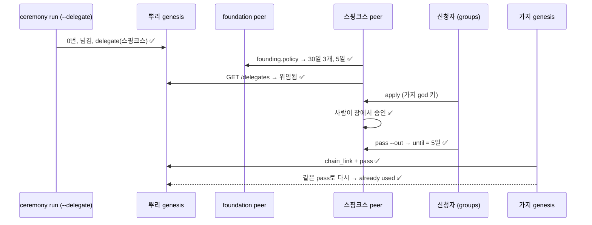

# 가지 그룹 창설 경로 시험 결과 (구현 2차)

> 2026-11-05, 브랜치 `founding-path-20261105`. 요구사항 [requirements.md](requirements.md) 3-2절, 설계 [design.md](design.md)(10절: 구현하며 정한 것).

## 1. 요약

- FG-F1~F9와 FG-A1·A3~A6·C2~C5 구현·테스트됨. 새 테스트 19개(원장 6, 기준·스핑크스 7, 세리머니 5, 실제 프로세스 1). 바꾼 기존 테스트 5곳(아래 3절).
- 전체 570개 테스트: 569 통과, 1 건너뜀(opt-in). 실제 LLM은 쓰지 않았다.
- 커버리지(프로세스 포함): **94.4%**(기준 92%). 새·바뀐 모듈: `ledger/delegation.py` 95.9%, `ledger/founding.py` 97.6%, `peer/sphinx_role.py` 98.0%, `peer/foundation_role.py` 92.1%, `ceremony/run.py` 91.1%.
- **처음부터 끝까지 실제 프로세스로**: 뿌리 세리머니가 스핑크스를 대리인으로 기록 → genesis가 이어 받음 → foundation peer가 기준(30일 3개, 증명서 5일)을 냄 → 스핑크스 peer가 그 기준을 받고 위임됨을 확인(창에 알림 카드) → 신청자가 가지 god 키로 신청 → 사람이 창에서 승인 → 증명서(기한 5일: foundation의 값) → 가지 genesis가 증명서로 뿌리에 연결 → 같은 증명서로 두 번째 가지는 거부.

## 2. 요구사항별

| 번호 | 확인한 것 | 테스트 |
|---|---|---|
| FG-F1 | `delegate`: 지금 god만, 가지 체인 거부, 같은 키 두 번 거부, scope 코드. `GET /delegates`(가지는 빈 목록) | `test_delegation.py` 1·2·6 |
| FG-F2 | `undelegate`: 위임 없는 키 거부, 철회 뒤 다시 위임, 철회된 대리인의 새 증명서 거부 | `test_delegation.py` 1·4 |
| FG-F3, C3, C4 | `chain_link`: 증명서로 통과(공개 모양에 `founding`), 둘 다 없음·둘 다 있음·지금 god 아닌 approver·위임 안 된 키·founder 다름·기한 지남·서명 틀림 거부, 같은 증명서 두 번 거부, 지금 god의 approver 통과 | `test_delegation.py` 3·4 |
| FG-A3 | 대리인이 키를 이어받으면(`key_commit`, `peer_rotate`) 새 키의 증명서는 통과, 옛 키의 증명서는 거부, `/delegates`의 `current`가 새 키 | `test_delegation.py` 5 |
| FG-F4 | 가지 세리머니: 증명서로, 뿌리 god 오프라인 승인으로(두 키의 서명 파일). 사전 거부 6가지(키를 만들기 전). 가지 genesis: `FOUNDING_PASS_FILE`, `PARENT_APPROVER_KEY_FILE` | `test_ceremony_delegation.py` 3·4·5, `test_ceremony_process.py`(가지), `test_processes.py`(가지 genesis), `test_founding_process.py` |
| FG-F5 | 뿌리 세리머니 `--delegate` 둘이 2라운드에 함께 서명, 넘김 뒤 기록, 선언의 head는 마지막 위임. 나중에 `delegate-request`/`delegate`, `--undo` | `test_ceremony_delegation.py` 1·2, `test_founding_process.py` |
| FG-F6 | 기준 문서 모양·서명·다른 foundation·값 범위, foundation op `founding.policy` | `test_founding_policy.py` 1·2 |
| FG-F7 | 스핑크스가 foundation 기준의 상한과 증명서 기한을 집행, 서명이 다른 foundation이거나 없으면 자기 설정, foundation이 조용해지면 직전 기준, 주소만 있고 공개키가 없으면 설정 오류 | `test_founding_policy.py` 3·4·5·7, `test_founding_process.py` |
| FG-F8 | 위임 안 됨 → 알림 카드와 신청 답의 note, 위임됨 → 새 카드(바뀔 때만) | `test_founding_policy.py` 6, `test_founding_process.py` |
| FG-F9 | 처음부터 끝까지 실제 프로세스(1절) | `test_founding_process.py` |

## 3. 바뀐 기존 동작과 고친 테스트

| 무엇 | 전 | 후 |
|---|---|---|
| 뿌리의 `chain_link` | 가지의 god·첫 기록자 서명만 있으면 받음 | 증명서(`pass`) 또는 뿌리 god 승인(`approver`)이 정확히 하나 있어야 받음 |
| 가지 genesis | `ARENA_GENESIS_PARENT_RECORDER_URL`만으로 연결 | `ARENA_GENESIS_FOUNDING_PASS_FILE` 또는 `ARENA_GENESIS_PARENT_APPROVER_KEY_FILE`이 있어야 시작 |
| 스핑크스의 상한·기한 | 자기 설정만 | foundation 기준이 있으면 그것, 없으면 자기 설정 |
| 기본 code table edition | `agent-arena 1.1` | `agent-arena 1.2`(`delegate`, `undelegate`, `delegate_scopes`) |

고친 테스트: `tests/test_trust.py`의 `Child`(뿌리 god이 approver), 같은 파일의 손으로 쓴 `chain_link`(approver 서명 더함)와 서명자 확인(approver 포함), `tests/test_branch_link.py`(늦은 연결에 approver), `tests/test_processes.py`의 가지 genesis(뿌리 god 키 파일), `tests/test_ceremony_process.py`의 가지 세리머니(뿌리 god이 오프라인에서 승인). 모두 "가지를 허락한 쪽"을 더한 것이고, 확인하던 내용은 그대로다.

## 4. 한계

- 원장은 대리인이 너무 많이 내는 것을 막지 않는다(FG-A5 결정). 막는 것은 스핑크스의 코드, 그 사람, foundation의 기준이다. 스핑크스가 코드를 바꿔 띄우면 원장은 받는다. 그때의 수단은 god이 살아 있는 동안의 `undelegate`, 그 뒤에는 7단계의 대리인 교체 절차(아직 없음).
- 기준 문서는 원장에 없다. "그때 어떤 기준이었나"는 스핑크스의 기록에만 남는다.
- 대리인 2명은 세리머니의 약속이다(원장은 대리인 수를 세지 않는다).
- 이번에 하지 않은 것: FG-E(뿌리 원장의 `group` 금지), FG-B2·B4·B7·B8, FG-D3.
