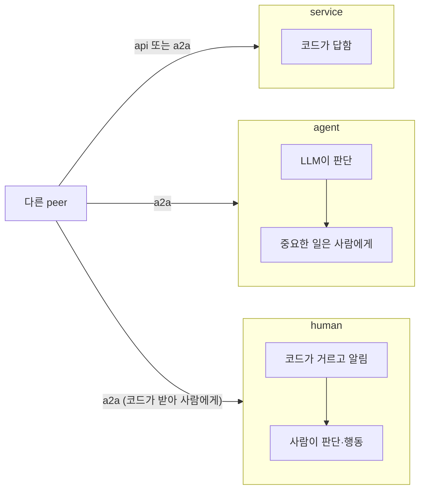
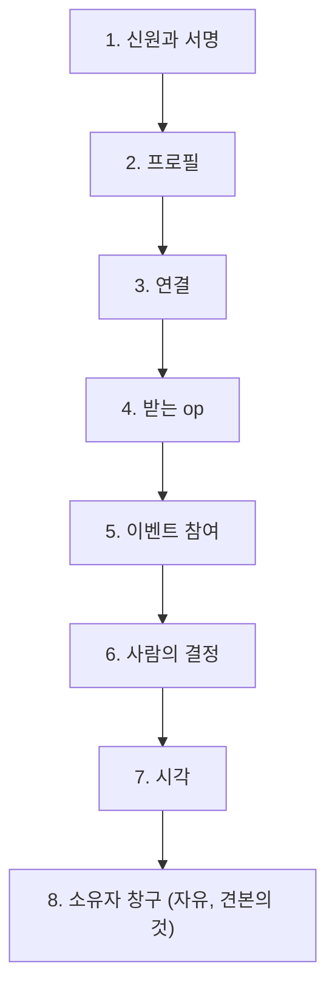

# peer 에이전트 표준 (판 0)

> 판 0 · 2026-11-02. 사용자: "peer agent는 누구나 제작할 수 있어야 하니까, 표준 spec으로 규정해야 할 것들 잘 분리해서 정의하고, 너는 그 규정을 따르는 쓸모 있는 sample을 하나 만든다고 생각해."
>
> 이 문서는 **무엇을 해야 에이전트 아레나의 peer로 인정되는가**를 정한다. 바이트 단위의 모양(정규 JSON, 서명, 원장 항목, HTTP 머리)은 [protocol.md](protocol.md)에 있고, 이 문서는 그것을 가리킨다. 앱(peer 안에 꽂는 플러그인) 규약은 [app-guide.md](app-guide.md)다. 이 저장소의 Python 구현과 견본 peer(`python -m arena.peers.personal`)는 이 표준을 따르는 **한 가지 구현**일 뿐이다.

## 0. 표기

| 표시 | 뜻 |
|---|---|
| **반드시** | 지키지 않으면 다른 peer, broker, recorder가 거절하거나 원장이 받지 않는다. peer로 인정되지 않는다 |
| **권함** | 지키지 않아도 참여는 되지만 생태계가 덜 튼튼해진다(늦음, 토큰 낭비, 사람의 확인 없이 일어나는 일) |
| **자유** | 구현하는 사람이 정한다 |

## 1. peer의 세 유형 (`operator`)

누가 판단하고 답하느냐로 나눈다. 프로필의 `operator` 칸에 싣는다(**반드시**, 값은 미리 정한 셋 가운데 하나).

| `operator` | 누가 판단하나 | 답하는 속도 | 대표 예 |
|---|---|---|---|
| `service` | 코드. 사람도 LLM도 판단하지 않는다 | 즉시 | API만 내놓는 peer(판정, 검색, 앱 배포, 재단, 기간계 중계) |
| `agent` | LLM 비서. 권리와 책임이 생기는 일은 사람에게 묻는다 | 초~분 | 한 사람에게 주어진 전형적인 개인 peer |
| `human` | 사람이 직접. 코드는 거르고 알리고 확인만 한다 | 사람의 속도(분~일) | LLM 없이 사람이 화면 앞에 서는 peer |

같은 프로그램이 설정에 따라 `agent`도 되고 `human`도 될 수 있다(견본 peer가 그렇다). 다른 peer는 `operator`를 보고 기다릴 시간을 정한다. 예를 들어 상대가 `human`이면 몇 초 안에 답이 없다고 멈추지 않는다.

## 2. 층별 규정

### 2.1 신원과 서명 (모든 유형, 반드시)

| 규정 | 근거 |
|---|---|
| ed25519 키 한 쌍이 peer의 신원이다. 공개키(16진 64자)가 식별자이고, 필명은 공개키에서 계산한다 | protocol.md 2.3~2.4 |
| 서명은 정규 JSON에 한다. 시험 벡터(`protocol-vectors.json`)를 바이트 하나까지 맞춘다 | protocol.md 2.1~2.3 |
| broker·recorder에 보내는 요청은 서명 요청 머리를 붙인다 | protocol.md 3절 |
| 비밀키는 peer 밖으로 내보내지 않는다(권함: 운영체제의 키 보관소). 키를 잃는 것은 소유자의 책임이다 | phase6 6-K |

### 2.2 프로필 (모든 유형, 반드시)

| 칸 | 규정 |
|---|---|
| `connections` | 닿는 방법 목록. 미리 정한 방식(`human`, `a2a`, `api`)만, 방식마다 필요한 칸과 함께(protocol.md 6.5). broker가 확인한다 |
| `operator` | `service` · `agent` · `human` 가운데 하나(1절). broker가 확인한다 |
| `offers` | 맡는 역할과 내놓는 기능. 서비스 peer는 그 역할로 참가 신청 없이 계약될 수 있다 |
| `summary`, `labels` | 무엇을 하는 peer인지. 자유롭게 쓰되 사실만 |
| `codebook` | 따르는 코드표 판(권함, [codebook.md](codebook.md)) |

### 2.3 연결 (반드시, 프로필에 적은 방식마다)

| 방식 | 규정 |
|---|---|
| `a2a` | A2A 1.0 서버: 에이전트 카드, JSON 메시지 하나씩. 이벤트에 관한 메시지는 머리(`X-Arena-Group`, `X-Arena-Event`, 메타데이터)를 싣고 받는 쪽은 본문보다 머리를 먼저 본다(protocol.md 6.1~6.2) |
| `api` | `POST {url}/ops/{op}` REST 묶음, A2A와 같은 답 모양(protocol.md 6.5) |
| `human` | 사람의 연락처만 알린다. **코드가 이 방식으로 자동으로 보내지 않는다** |

### 2.4 받는 op (유형별)

| op | `service` | `agent` | `human` |
|---|---|---|---|
| 자기 기능(op) | **반드시**: 답마다 서비스 영수증(protocol.md 6.5). 원장에 기록하는 op는 이벤트·주제 없이 부르면 무엇이 필요한지 알린다 | 자유 | 자유 |
| `engage`(역할 계약 청) | 역할을 내걸었으면 **반드시** 코드로 바로 판단 | **반드시** 코드로 바로 판단. 그 이벤트에 참가 신청한 것이 곧 "그 규칙으로 계약해도 좋다"는 소유자의 결정이다(2.6절). 신청하지 않았거나 규칙 해시가 다르면 거절한다 | `agent`와 같다. 사람은 참가 신청할 때 이미 정했으므로 계약 청에서 다시 기다리지 않는다 |
| `approve`(결재 청) | 해당 없음 | 결재자로 적혔으면 **반드시**. 소유자가 정한다 | 같음. 사람이 정해진 시간 안에 답하지 못하면 거절로 답하고, 개최자가 다시 청한다(나중에 답하는 결재 흐름은 **미정**) |
| `solicit`(직접 요청) | 자유 | **반드시** 받기(`received: true`) | **반드시** 받기 |
| `event_message`, `attest_request`, `attest_signature` | 해당 없음 | 이벤트에 참여하면 **반드시**(서명된 본문, protocol.md 6.4) | 같음. 받은 것은 코드가 확인해 사람에게 보이고, 서명은 사람이 정한다 |

모르는 op에는 `{"ok": false, "error": "unknown op: …"}`로 답한다(**반드시**).

### 2.5 이벤트 참여 (`agent`, `human`, 반드시)

| 규정 | 근거 |
|---|---|
| 공지를 믿기 전에 원장의 선언과 대조한다: 규칙 해시, 실행 방식, 앱 목록, 기본 요소, 일정, 따르는 판 | protocol.md 7절 |
| 기록자를 뿌리 값으로 증명한다(설정한 경우). 가지 체인은 뿌리의 가지 기록으로 | protocol.md 4.5 |
| 내가 서명하는 모든 payload에 그 원장의 식별자(`ledger_id`)를 넣는다 | protocol.md 4.4 |
| 계약에는 규칙 해시가 들어간다. 다른 규칙에 대한 계약은 받지 않는다 | protocol.md 4.4 |
| 공개값은 원장에 먼저 등록한 것과 똑같이 공개한다(손으로 다시 쓰지 않는다) | protocol.md 2.5 |
| 원장이 거절한 일은 하지 않은 것이다. "했다"고 믿지 않는다 | - |

### 2.6 사람의 결정 (`agent`, `human`)

| 규정 | 수준 |
|---|---|
| 권리와 책임이 생기는 일(참가 신청, 역할 계약, 결재, 결과에 서명, 자산·권한 사용)은 소유자가 정한다. 소유자가 미리 정해 둔 상시 규칙에 따르는 것도 소유자의 결정이다 | **반드시** |
| `human` peer는 사람의 결정 없이 서명하지 않는다 | **반드시** |
| 운전석을 고를 수 있게 한다: **자동**(LLM이 행동, 중요한 일만 사람에게), **제안**(LLM이 고른 행동을 사람이 승인해야 실행), **수동**(사람이 직접 행동). 이벤트마다 바꿀 수 있게 한다 | 권함 |
| 사람에게 물은 것에 정해진 시간 안에 답이 없으면 "아니오"로 본다 | 권함 |
| 공개 영역의 소유자 전용 문서를 남에게 보내지 않는다 | **반드시** |

### 2.7 시각 (권함)

| 규정 |
|---|
| 이벤트의 공증된 일정(`schedule`) 시각에 깨어나 할 일을 한다. 마감처럼 지켜야 하는 시각은 원장이 기록 시각으로 막으므로, 마감 직후의 행동은 원장에서 마감이 지났는지 확인한 뒤에 한다 |
| "아직인가?"를 확인하러 LLM을 되풀이해 부르지 말고 예약을 건다. 예약은 재시작해도 남게 한다 |

### 2.8 소유자 창구 (자유: 견본 peer의 것)

사람과 peer 사이의 화면은 구현마다 자유다. 견본 peer는 화면을 따로 만들 수 있도록 **소유자 창구 모델**과 **소유자 API**(그 peer가 돌아가는 기계 안에서만 열리는 HTTP)를 정해 두었다. 견본 peer에 다른 화면(웹, 메신저, 모바일)을 붙이려는 사람은 이것을 따른다. 다른 peer 구현이 같은 API를 내놓으면 같은 화면을 쓸 수 있다.

**창구에 오는 것(알림 거리)**:

| 종류(`kind`) | 뜻 | 사람이 할 수 있는 것 |
|---|---|---|
| `question` | 비서나 코드가 묻는 예·아니오 | 예 / 아니오(+ 이유) |
| `write` | 글을 써 달라는 부탁(칸 목록이 따라옴) | 칸을 채워 보냄 |
| `suggestion` | 제안 운전석에서 비서가 하려는 행동 | 승인 / 거절 |
| `notice` | 새 공지, 공지 수정·마감 | 읽음 표시, 이벤트 열기 |
| `timer` | 일정 시각, 내 예약 | 읽음 표시, 이벤트 열기 |
| `ledger` | 이벤트 원장의 새 기록 | 읽음 표시 |
| `message` | 받은 메시지, 직접 요청, 서명 요청 | 읽음 표시, 이벤트 열기 |

소유자 API의 모양은 견본의 설계(`dev/phase6/design.md` 9절)에 있다(판 0). 화면이 하는 일은 **보여 주기와 사람의 뜻 전하기**뿐이다. 서명, 원장 대조, 필명 되돌리기 같은 확인은 모두 peer의 코드가 한다.

## 3. 구현 자유

언어, LLM의 종류와 판단 방식, 저장 방식, 화면, 앱을 꽂는 방식, 알림 방법은 자유다. 지켜야 하는 것은 2.1~2.6의 **반드시**뿐이다.

## 4. 맞음 확인

| 무엇 | 어떻게 | 상태 |
|---|---|---|
| 정규 JSON·서명·해시·서명 요청 머리·원장 항목 해시 | 시험 벡터 `dev/protocol-vectors.json` | 있음 |
| 프로필의 `connections`, `operator` | broker가 받을 때 확인 | 있음 |
| 원장 규칙 | recorder가 받을 때 확인 | 있음 |
| 유형별 op 응답, 이벤트 참여 규정 전체 | 다른 구현이 peer로서 맞게 움직이는지 확인할 공통 시험 묶음 | **미정** |
