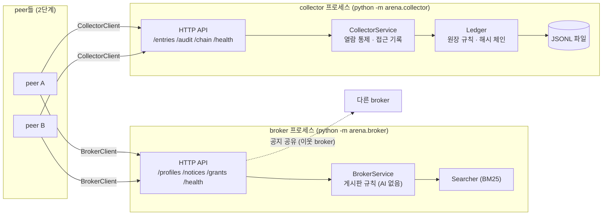
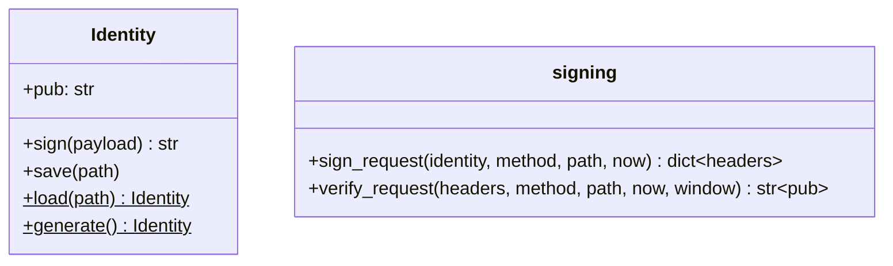
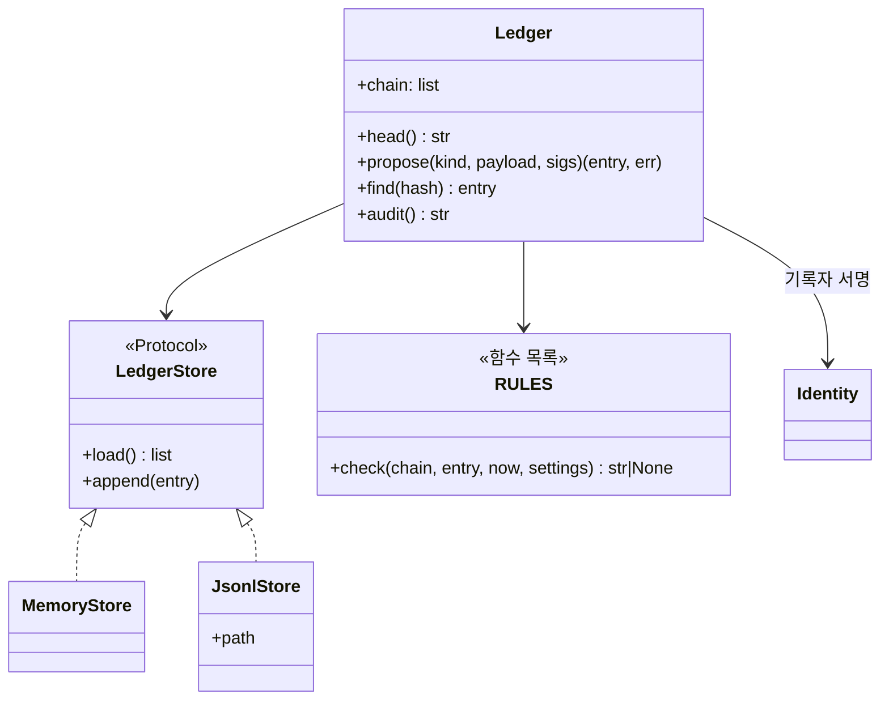
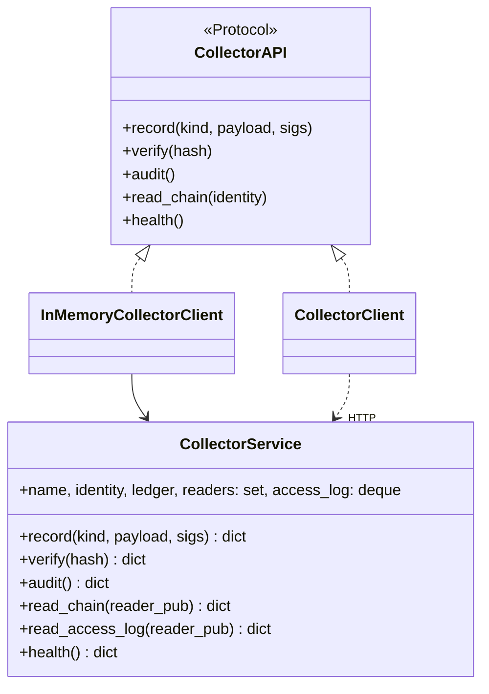
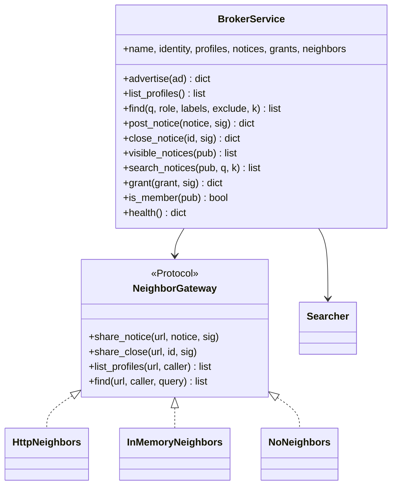
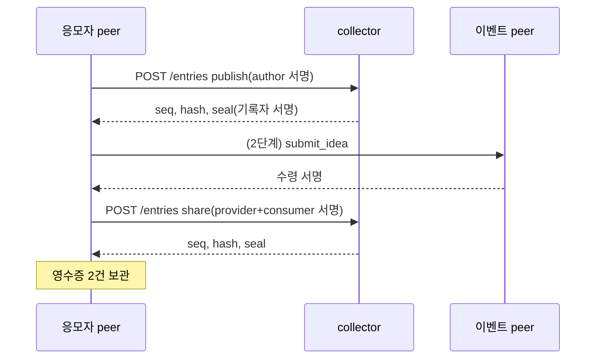
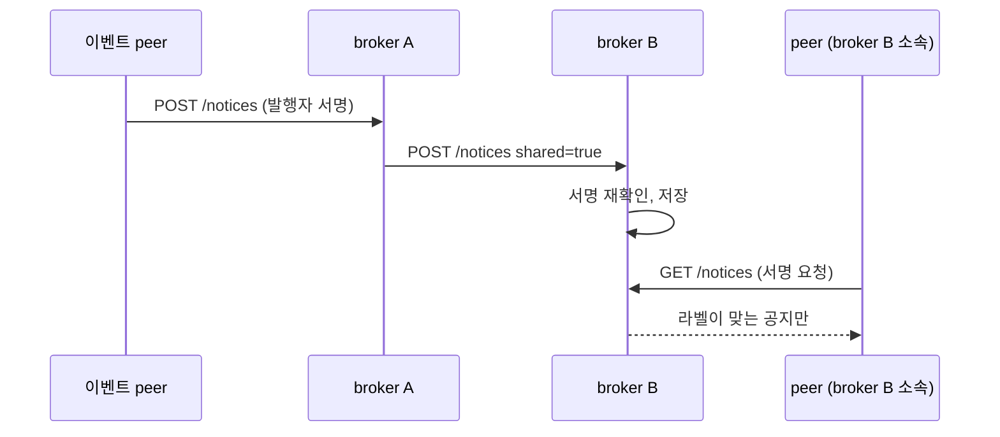

# 1단계 설계: 인프라 서비스 (broker · collector)

요구사항은 [requirements.md](requirements.md). 기술 스택은 Python 3.11, Starlette(HTTP API), httpx(클라이언트), `cryptography`(ed25519), pytest.

## 1. 전체 그림



두 서비스는 **라이브러리(규칙) + API(포장)** 두 겹이다. 규칙 층은 네트워크를 모르므로 네트워크 없이 테스트하고, 포장 층은 요청 해석·서명 확인·응답 변환만 한다. 구성원 peer가 자기 프로세스 안에 `BrokerService`나 `CollectorService`를 품고 같은 API를 열면 "역할을 맡은 peer"가 된다(2단계).

## 2. 패키지 구성

```
arena/
  __init__.py
  config.py            Settings: .env 읽기, 형 변환, 필수 키 검사
  crypto.py            Identity(생성·저장·불러오기·서명), verify, canon, h, pen_name
  search.py            Searcher(Protocol), BM25Searcher
  ledger.py            Ledger(규칙·체인·영속화), audit_chain, contribution, LedgerStore(Protocol), JsonlStore, MemoryStore
  signing.py           서명 요청 헤더 만들기·확인하기 (클라이언트와 서버가 함께 씀)
  http.py              Starlette 공통: JSON 본문 읽기, 오류 응답(400·401·403), 서명 확인
  serve.py             uvicorn 기동 공통(두 서비스의 __main__이 씀)
  broker/
    __init__.py
    service.py         BrokerService (프로필·공지·허가·가시성·검색·이웃 전달)
    neighbors.py       Caller, NeighborGateway(Protocol), HttpNeighbors, InMemoryNeighbors, NoNeighbors
    api.py             build_broker_app(service) -> Starlette
    client.py          BrokerAPI(Protocol), BrokerClient(httpx), InMemoryBrokerClient
    __main__.py        단독 실행
  collector/
    __init__.py
    service.py         CollectorService (Ledger + 열람 허용 목록 + 접근 기록)
    api.py             build_collector_app(service) -> Starlette
    client.py          CollectorAPI(Protocol), CollectorClient(httpx), InMemoryCollectorClient
    __main__.py        단독 실행
tests/
  conftest.py          설정 덮어쓰기, Identity·서비스·앱 fixture
  test_config.py  test_crypto.py  test_search.py  test_ledger.py
  test_collector_service.py  test_collector_api.py
  test_broker_service.py     test_broker_api.py
  test_processes.py    실제 프로세스 기동 통합 테스트
```

## 3. 설정 (`arena/config.py`, `.env.example`)

`Settings`는 데이터클래스이며 `Settings.load(env=os.environ)`로 만든다. 테스트는 `env`에 dict를 넘겨 격리한다. 값이 없으면 기본값, 기본값이 없는 필수 키가 비면 `ConfigError("ARENA_... 가 없습니다")`.

| 키 | 기본값 | 뜻 |
|---|---|---|
| `ARENA_HOST` | `127.0.0.1` | 서비스가 듣는 주소 |
| `ARENA_BROKER_PORT` | `9110` | broker 포트 |
| `ARENA_BROKER_NAME` | `broker` | broker 이름(로그·health) |
| `ARENA_BROKER_NEIGHBORS` | (빈 값) | 이웃 broker 주소, 쉼표 구분 |
| `ARENA_BROKER_OWNER_PUB` | (빈 값) | 닫힌 그룹의 소유자 공개키. 비어 있으면 열린 그룹 |
| `ARENA_BROKER_KEY_FILE` | `data/broker.key` | broker 키 파일 |
| `ARENA_COLLECTOR_PORT` | `9120` | collector 포트 |
| `ARENA_COLLECTOR_NAME` | `collector` | collector 이름 |
| `ARENA_COLLECTOR_KEY_FILE` | `data/collector.key` | 기록자 키 파일 |
| `ARENA_COLLECTOR_LEDGER_FILE` | `data/ledger.jsonl` | 원장 파일 |
| `ARENA_COLLECTOR_READERS` | (빈 값) | 전체 열람 허용 공개키, 쉼표 구분 |
| `ARENA_SIG_WINDOW_SEC` | `60` | 서명 요청의 시각 허용 폭 |
| `ARENA_CONTRACT_ROLES` | `record,review` | 역할 계약에 허용되는 역할 |
| `ARENA_ACCESS_LOG_SIZE` | `50` | 접근 기록 보관 건수 |
| `ARENA_SEARCH_K` | `3` | 검색 기본 상위 건수 |
| `ARENA_SEARCH_MAX_K` | `50` | 검색 최대 건수 |
| `ARENA_NEIGHBOR_TIMEOUT_SEC` | `10` | 이웃 broker 호출 제한 시간 |
| `ARENA_HTTP_TIMEOUT_SEC` | `60` | 클라이언트 기본 제한 시간 |
| `ARENA_PEN_NAME_PREFIX` | `필명-` | 표시용 이름 접두사 |
| `ARENA_PEN_NAME_LEN` | `6` | 표시용 이름에 쓰는 공개키 글자 수 |
| `ARENA_LLM_BASE_URL`, `ARENA_LLM_API_KEY`, `ARENA_LLM_MODEL_AGENT`, `ARENA_LLM_MODEL_PERSONA`, `ARENA_LLM_CONCURRENCY` | | 2단계에서 쓴다. `.env.example`에 자리만 둔다 |

`.env` 읽기는 `python-dotenv`로 한다(이미 설정된 환경변수가 우선).

## 4. 신원과 서명 (`arena/crypto.py`, `arena/signing.py`)



- `canon(obj)`: `json.dumps(sort_keys=True, separators=(",", ":"), ensure_ascii=False)`. `h(bytes)`: SHA-256 hex.
- `pen_name(pub, settings)`: 접두사 + 공개키 앞 N자.
- 키 파일은 개인키 32바이트 hex 한 줄. 권한 0600으로 저장.
- **서명 요청**: 헤더 `X-Arena-Pub`(공개키 hex), `X-Arena-Ts`(epoch 초), `X-Arena-Sig`(hex). 서명 대상 `{"op": "GET /chain", "ts": 1730...}`. 서버는 시각 차가 `ARENA_SIG_WINDOW_SEC` 안이고 서명이 맞으면 공개키를 돌려주고, 아니면 401. 경로에 경로 변수가 있으면 실제 경로(예: `POST /notices/call-abc/close`)를 그대로 쓴다. 재전송은 시각 폭으로만 막는다(1단계 범위).

## 5. 원장 (`arena/ledger.py`)



- 항목 모양은 기존과 같다: `{type, payload, sigs, prev, ts, seq, hash, seal:{pub, sig}}`. 해시는 `(type, payload, sigs, prev, ts)`의 canon.
- 규칙은 `RULES` 목록의 함수들이 순서대로 돈다(R2-1 ~ R2-9). 규칙 추가는 함수 추가로 한다(개방-폐쇄).
- 기록자는 하나다. 다른 기록자의 항목을 받아 검증하는 경로(validator)와 시각 편차 규칙은 마지막 단계(collector 분산)에서 넣는다.
- `Ledger(identity, store, settings, clock=time.time)`: 시작 시 `store.load()`로 체인을 읽고 `audit_chain`이 `ok`가 아니면 `LedgerCorrupt` 예외. `propose`가 통과하면 `store.append`.
- `JsonlStore`: 한 항목 한 줄. 열 때 `O_APPEND`. 디렉터리가 없으면 만든다.
- `audit_chain(chain)`, `contribution(chain)`은 모듈 함수(절대자·대시보드도 같은 함수를 쓴다).

## 6. collector 서비스와 API



| 메서드·경로 | 인증 | 요청 | 응답 |
|---|---|---|---|
| `POST /entries` | 없음(참여자 서명이 본문에) | `{type, payload, sigs}` | 200 `{ok, seq, hash, seal}` / 400 `{ok:false, error}` |
| `GET /entries/{hash}` | 없음 | | `{ok, exists, type, seal_ok, role, call_id, issuer, contractor}` |
| `GET /audit` | 없음 | | `{ok, status, length, head}` |
| `GET /chain` | 서명 요청 + 허용 목록 | | `{ok, chain}` / 403 |
| `GET /access-log` | 서명 요청 + 허용 목록 | | `{ok, log:[{ts, reader, granted}]}` |
| `GET /health` | 없음 | | `{ok, name, pub, pen_name, length, head}` |

`record`는 `asyncio.Lock`으로 직렬화한다. 거절 이유 문자열은 기존 원장의 영어 문구를 그대로 쓴다(테스트 비교).

## 7. broker 서비스와 API



이웃 호출을 `NeighborGateway`로 떼어 서비스 테스트에서는 메모리 안의 이웃(`InMemoryNeighbors`, 멈춘 broker 흉내 `kill(url)` 포함)으로 바꾼다(의존성 역전).

**호출자(`Caller`)**: 검증된 공개키와 원래 서명 헤더를 담는다. 닫힌 그룹의 검색을 이웃에 넘길 때 원래 서명 헤더를 그대로 전달하므로 이웃도 같은 호출자를 확인할 수 있다(서명 대상이 경로만이라 같은 경로면 유효). 서비스는 거절을 `None`으로 돌려주고, API가 403으로, 메모리 클라이언트가 `{ok:false, error}`로 바꾼다.

| 메서드·경로 | 인증 | 요청 | 응답 |
|---|---|---|---|
| `POST /profiles` | 본문 서명 + 그룹 회원 | `{pub, profile:{url, summary, offers, labels, until, ver}, sig}` (주소도 서명 대상) | `{ok, updated}` |
| `GET /profiles` | 닫힌 그룹이면 서명 요청 | `?local=1`이면 이웃에 묻지 않음 | `{ok, profiles}` |
| `GET /profiles/search` | 닫힌 그룹이면 서명 요청 | `q, role, label(반복), exclude(반복), k, local` | `{ok, peers:[{pub, pen_name, url, offers, labels, summary, score, broker}]}` |
| `POST /notices` | 본문 서명(발행자) | `{notice, sig, shared?}` | `{ok, visible_to}` |
| `POST /notices/{id}/close` | 본문 서명(발행자) | `{sig, shared?}` | `{ok}` |
| `GET /notices` | 서명 요청 + 이 broker에 프로필 | | `{ok, notices}` (대상 라벨 일치만) |
| `GET /notices/search` | 서명 요청 + 프로필 | `q, k` | `{ok, hits}` |
| `POST /grants` | 소유자 서명(본문) | `{grant:{pub, until}, sig}` | `{ok}` |
| `GET /health` | 없음 | | `{ok, name, pub, profiles, notices, neighbors, closed}` |

- **가시성 규칙**(R4-7): 공지 `audience`의 모든 `k:v`가 보는 이의 프로필 `labels`에 있어야 한다. 기계적 규칙이며 판단이 없다.
- **공지 공유**: `shared=true`가 아닌 게시·마감만 이웃에 한 번 전달한다(한 단계 전파). 받는 쪽은 서명을 다시 확인한다.
- **닫힌 그룹**: `owner_pub`가 있으면 `is_member(pub)`는 소유자 본인 또는 만기 전 허가가 있을 때만 참. 프로필 게시·목록·검색에 적용한다.

## 8. 클라이언트

`BrokerAPI`, `CollectorAPI`는 `typing.Protocol`이다. `httpx` 구현은 `Settings`의 제한 시간을 쓰고 서명 요청 헤더를 붙인다. `InMemory*` 구현은 서비스 객체를 직접 부르며 같은 dict를 돌려준다. 2단계의 peer는 Protocol에만 의존한다.

## 9. 단독 실행

```
python -m arena.broker      # ARENA_BROKER_* 설정으로 기동, 키 파일 없으면 만들고 저장
python -m arena.collector   # ARENA_COLLECTOR_* 설정으로 기동, 원장 파일 이어 쓰기
```

둘 다 uvicorn으로 `ARENA_HOST:포트`에서 듣는다. 시작 시 health 내용을 로그로 한 줄 찍는다.

## 10. 주요 흐름





## 11. SOLID 대응

| 원칙 | 적용 |
|---|---|
| 단일 책임 | 규칙(`Ledger`, `BrokerService`) / HTTP 포장(`api.py`) / 저장(`LedgerStore`) / 이웃 통신(`NeighborGateway`) / 설정(`Settings`) 분리 |
| 개방-폐쇄 | 원장 규칙은 함수 목록, 검색기·저장소·게이트웨이는 Protocol 구현 추가로 교체 |
| 리스코프 치환 | `InMemory*Client`와 `*Client`는 같은 Protocol, 같은 반환 모양. 테스트가 둘 다에 같은 검사를 돈다 |
| 인터페이스 분리 | `Searcher`(rank 하나), `LedgerStore`(load·append), `NeighborGateway`(share·ask) 작게 유지 |
| 의존성 역전 | 서비스는 `Settings`, `Identity`, `Searcher`, `LedgerStore`, `NeighborGateway`, `clock`을 생성자로 받는다 |

## 12. 테스트 계획

| 층 | 방법 | 예 |
|---|---|---|
| 단위 | 순수 함수·서비스 객체, 네트워크 없음, 시계 주입 | 원장 규칙 하나당 테스트 하나, 가시성 규칙, 만기, 허가 |
| API | Starlette 앱을 `httpx.ASGITransport`로 호출 | 서명 요청 401, 열람 403, 이웃 전달(가짜 게이트웨이) |
| 프로세스 | `subprocess`로 broker 2개 + collector 1개 기동, 실제 HTTP | 공지가 이웃에 보이고, 재시작 뒤 원장이 이어짐 |
| 회귀 | `app.run_demo` 실행 | 기존 데모가 그대로 돈다 |

테스트는 임시 디렉터리에 키·원장 파일을 두고, 포트는 빈 포트를 골라 쓴다.

## 13. 이번 단계에서 하지 않는 것

- 다단계 공지 전파(중복 걸러내기), **기록자 여럿(collector 분산: 복제·합의·상호 대조)은 마지막 단계**, 허가 회수, 재전송 방지용 nonce 저장, 인증 토큰(라벨 서명은 회사 로그인 연동 범위 밖).
- 기존 `app/`을 새 서비스로 바꾸는 일(2단계).
