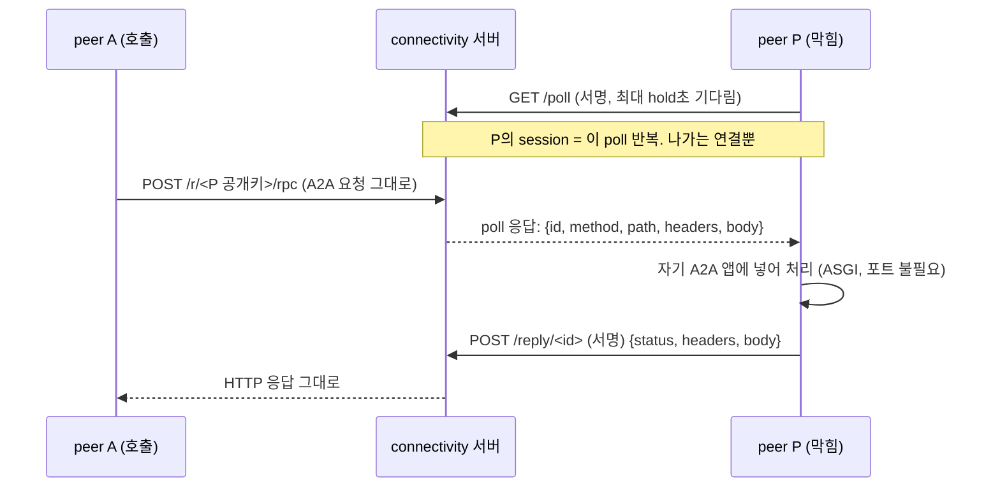
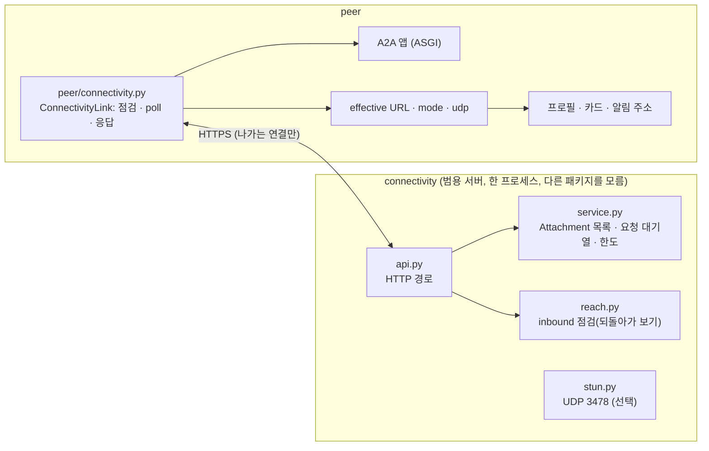
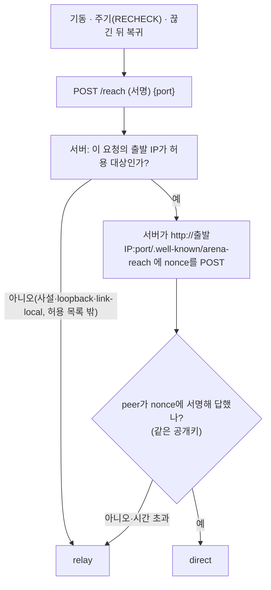

# 10단계 설계: connectivity 서버

> 2026-11-06. 요구사항 [requirements.md](requirements.md). 사용자 결정: "제안대로 해"로 Q1~Q7을 제안값으로 정함, "UDP 막힌 환경도 가능하게 해", "1번(우리 쪽에 얇게 직접 만들기)". 이미 있는 오픈소스를 찾아본 결과(a2a-relay 등)는 1절.

## 0. 두 원칙 (2026-11-06 사용자, 요구사항 P10-P1~P4)

1. **connectivity는 범용 서비스다.** 최상위 패키지 `connectivity/`이고 이 저장소의 다른 것을 import하지 않는다(`tests/test_layering.py`가 지킨다: import도, agent·peer·ledger·a2a라는 말도 없다). 설정은 `CONNECTIVITY_*`, 서명은 그 자신의 방식(`X-Conn-*`), 경로 허용 목록은 비어 있으면 모든 경로다. 무엇을 옮기는지는 배치하는 쪽이 설정으로 정한다(Arena의 배치는 A2A 경로만 연다).
2. **추상화 계층은 connectivity를 모른다**(broker와 같다). Arena 쪽에서 connectivity를 아는 곳은 peer의 **전송 어댑터 하나**뿐이다. 앱, assistant, 도구, 규약 메시지, 프로필의 뜻은 바뀌지 않는다. 프로필에는 주소 하나(`url`)만 있고, 그것이 relay 주소인지는 아무도 구분하지 않는다. 그래서 아래의 프로필 field `connectivity`와 broker 검사는 **취소**한다.

## 1. 이미 있는 것과 우리가 만드는 것

| 후보 | 판단 |
|---|---|
| a2a-relay (Go, Apache-2.0, beta) | 구조는 같다(나가는 연결 + 요청 전달). 그대로는 못 쓴다: A2A 경로가 옛 모양(`/message/send`, `agent.json`)이고, 인증이 서버 비밀 JWT이며, webhook을 다루지 않는다. 구조만 참고한다 |
| coturn | 성숙한 STUN·TURN. **UDP 경로를 더할 때 붙인다**(직접 만들지 않는다). 이 단계에는 쓰지 않는다 |
| frp·rathole·chisel | peer마다 포트를 여는 TCP 터널이라 서명 신원과 이어지지 않는다 |
| libp2p·AgentAnycast | 전송 계층을 통째로 바꾼다. 범위 밖 |

그래서 **Python으로 얇게 만든다.** 새 패키지 의존성은 없다(`httpx`, `starlette`, `uvicorn`만).

## 2. 핵심 아이디어: 서버는 투명한 HTTP 터널이다

peer의 A2A 서버는 HTTP다. 막힌 peer P는 서버 S로 **나가는 HTTPS 연결만** 만들고, S가 `https://S/r/<P의 공개키>/…`로 오는 요청을 P에게 전달한다. P는 받은 요청을 **자기 A2A 앱에 그대로 넣고**(프로세스 안에서, 포트를 열지 않아도) 응답을 S로 돌려준다.

이렇게 하면 얻는 것:
- **`Transport.call` 계약이 그대로다**(G1). A는 P의 A2A 주소가 `https://S/r/
`일 뿐이다. 앱, assistant, 창 코드는 바뀌지 않는다.
- **webhook도 같은 길로 간다**(G2). 호출한 쪽이 막혀 있으면 알림 주소가 `https://S/r/<호출한 쪽>/a2a/notify`이고, 답하는 쪽은 평범한 POST를 한다. `push_url_ok`(http(s)이고 경로가 `/a2a/notify`로 끝남)를 그대로 통과한다.
- **peer 사이에 session이 없다.** session은 peer와 서버 사이의 poll뿐이다. 무전기 방침(2026-11-04)을 지킨다.
- **UDP가 필요 없다.** 전부 HTTP(TCP)라서 HTTP proxy 뒤에서도 된다(P10-C5).

WebSocket 대신 **long poll**을 쓴다: 새 패키지가 없고, `httpx`가 환경 변수의 HTTP proxy를 이미 따르며, 구현이 작다. 요청이 오면 poll이 바로 끝나므로 지연은 왕복 한 번이다. WebSocket은 나중에 같은 서버 규약 위에 더할 수 있다.

## 3. 구성

| 단위 | 하나의 책임 |
|---|---|
| `connectivity/config.py` | `CONNECTIVITY_*` 설정(상수는 모두 여기) |
| `connectivity/signing.py` | 붙는 쪽의 서명(`X-Conn-Key`·`Ts`·`Sig`, ed25519) |
| `connectivity/service.py` | 붙은 키의 목록(Attachment), 요청 대기열, 응답 맞이, 한도. 입출력 없음(시계 주입) |
| `connectivity/api.py` | 경로와 서명 검사, service 호출. 얇다 |
| `connectivity/reach.py` | inbound 점검(되돌아가 보기)과 주소 제한 |
| `connectivity/stun.py` | 선택: STUN binding(UDP). 없어도 모든 일이 된다 |
| `connectivity/client.py` | 범용 클라이언트: 붙기, poll, 받은 요청을 주어진 ASGI 앱에 넣기, 점검. 누가 쓰는지 모른다 |
| `arena/peer/relay_link.py` | **Arena 쪽 어댑터(유일하게 connectivity를 아는 곳)**: peer 키로 클라이언트를 만들고 A2A 앱을 넘기며, 나온 주소를 peer의 알리는 주소로 쓴다 |

## 4. 서버 경로 (모두 TCP)

| 경로 | 누가 | 서명 | 하는 일 |
|---|---|---|---|
| `GET /poll?hold=N` | 막힌 peer | peer 키(`X-Conn-*`, connectivity의 방식) | session을 만들거나 이어 간다. 요청이 오거나 hold초가 지나면 `{"requests": [...]}`로 답. 첫 poll이 곧 attach이고, 응답에 `relay_base`(`https://S/r/<내 키>`)가 들어 있다 |
| `POST /reply/{id}` | 막힌 peer | peer 키 | 전달받은 요청의 응답 `{status, headers, body}` |
| `ANY /r/{pub}/{경로}` | 누구나(호출하는 peer) | 없음(A2A 메시지 안의 서명이 신원) | 붙어 있는 `pub`에게 전달하고 응답을 기다려 그대로 돌려준다. 붙어 있지 않으면 503 |
| `POST /reach` | peer | peer 키 | inbound 점검. 서버가 이 요청의 출발 IP로 되돌아가 본다 |
| `GET /health` | 누구나 | 없음 | 붙은 수, session 수, 중계한 바이트, 거절 횟수(내용은 없음) |

- **`/r/{key}/…`가 막은 경로**: 허용 목록(`CONNECTIVITY_PATHS`)이 있으면 그것만 전달하고 그 밖은 404다. 비어 있으면 모든 경로다(범용 서비스). **Arena의 배치(`deploy/connectivity`)는 `/.well-known/agent-card.json`, `/rpc`, `/a2a/notify`만 연다.** Arena 쪽 어댑터도 이 경로만 자기 앱에 넣는다(두 겹).
- **전달하는 것**: method, 경로, 쿼리, 헤더, body(base64). hop-by-hop 헤더(`connection`, `host`, `content-length` 등)와 `CONNECTIVITY_DROP_HEADERS`(기본 `cookie`, `set-cookie`)는 버린다. 서버가 특정 프로토콜의 헤더를 알지 않는다. **스트림(SSE)은 중계하지 않는다**: 요청 하나에 응답 하나다(Arena의 transport는 스트림을 쓰지 않는다).
- **요청과 응답은 메모리에서 바로 전달하고 저장하지 않는다**(H3). 로그에는 경로, 크기, 시간만 남기고 내용은 남기지 않는다.

## 5. 한도와 session (E1~E5, H1)

| 한도 | 설정 | 넘으면 |
|---|---|---|
| 붙은 peer 수(서버 전체) | `CONNECTIVITY_MAX_ATTACHED` | 새 attach 거절(429) |
| 한 peer의 처리 중 요청 수 | `CONNECTIVITY_MAX_INFLIGHT_PER_PEER` | 429 |
| 호출 출발 IP와 대상 peer별 초당 요청 | `CONNECTIVITY_RATE_PER_SEC` | 429 |
| 요청·응답 body 크기 | `CONNECTIVITY_MAX_BODY_BYTES` | 413 |
| 요청 대기 시간 | `CONNECTIVITY_REQUEST_TIMEOUT_SEC` | 504 |
| poll이 없는 시간 | `CONNECTIVITY_ATTACH_GRACE_SEC` | session을 닫는다. 이후 요청은 503 |
| 서명 시각 창 | 기존 `ARENA_SIG_WINDOW_SEC` | 거절 |
| 허용 키 목록(선택) | `CONNECTIVITY_ALLOW_KEYS`(파일, 비면 서명 있는 누구나) | 거절 |

- **session**(Attachment)은 키 하나에 하나다. 같은 키가 다시 붙으면 옛 것을 대체한다(서명으로 확인). session은 `since`, `last_seen`, 처리 중 요청, 대기열, 중계 바이트를 가진다.
- 응답을 올리는 쪽은 그 요청을 받은 session의 키여야 한다(남의 요청에 응답할 수 없다). 요청 id는 추측할 수 없는 값이다.

## 6. inbound 점검 (B1~B6)

- **되돌아가는 곳은 그 요청의 출발 IP뿐**이고 포트는 peer가 말한 하나(1024 이상)다. 요청이 적은 임의 주소로는 가지 않는다(SSRF 방지, SEC-4). 사설·loopback·link-local 출발 IP는 기본으로 점검하지 않고 `relay`로 본다. 사내망 시험을 위해 `CONNECTIVITY_PROBE_ALLOW`(CIDR 목록)로 허용한다.
- 점검받는 쪽은 `POST /.well-known/connectivity-reach`에서 `{nonce}`를 받아 `{key, sig("REACH <nonce>")}`로 답한다(connectivity의 범용 함수 `reach_endpoint`). Arena는 어댑터가 이 경로를 peer의 A2A 앱에 붙인다. 이 경로는 relay로는 닿지 않는다(A2A 경로만 넣는다).
- 한 키의 점검은 시간당 횟수 제한(`CONNECTIVITY_CHECK_PER_HOUR`).
- proxy 뒤의 peer는 서버가 보는 출발 IP가 proxy의 것이라 점검이 실패하고 `relay`가 된다. 맞는 결과다.
- **direct일 때는 붙지 않는다**(Q7). `direct`이면 poll을 하지 않고 지금처럼 자기 주소를 프로필에 올린다. `relay`이면 poll을 시작한다. 주기 점검에서 결과가 바뀌면 전환한다.

## 7. peer 쪽 (ConnectivityLink)

- **설정**: `ARENA_PERSONAL_PEER_CONNECTIVITY=주소,주소…`(쉼표 구분, 먼저 적은 것이 우선, 기본 비어 있음 = 꺼짐). 지금은 견본 개인 peer만 쓴다(특수 peer는 공인 주소에서 도는 것이 보통). 종류마다 `…_PEER_NICK`처럼 설정 항목을 더한다. 이것은 Arena peer의 설정이다(connectivity 서버의 설정이 아니다).
- **상태** `LinkState`: `mode`(`direct`, `relay`, `none`), `via`(붙은 서버 주소), `relay_base`, `udp`(`true`, `false`, `null`).
- **effective URL** `Peer.url`: `mode == relay`이면 `relay_base`, 아니면 `config.url`. 지금 `config.url`을 직접 쓰는 곳 가운데 **외부에 알리는 곳**이 이것으로 바뀐다: 프로필의 `connections`, 에이전트 카드, 호출할 때 알리는 알림 주소(`node.py:157, 261, 321`)와 `ctx.url`(`context.py:45`). 내 서버를 여는 곳(포트)은 `config.url` 그대로다.
- **에이전트 카드**는 `a2a-sdk`의 `card_modifier`(요청마다 카드를 고칠 수 있는 인자, 설치된 1.3의 `create_agent_card_routes`에 있음)로 현재 effective URL을 낸다. 점검은 앱이 떠 있어야 하므로 앱을 먼저 연 뒤 하고, 결과가 바뀌면 카드도 바뀐다.
- **받은 요청 처리**: poll이 요청을 주면 `httpx.ASGITransport(app=내 A2A 앱)`으로 그대로 넣고 응답을 `/reply/{id}`로 보낸다. 동시에 처리하는 수는 클라이언트의 인자이고 Arena는 `ARENA_PEER_RELAY_CONCURRENCY`로 준다. 한 요청의 실패가 다른 요청이나 poll을 멈추지 않는다.
- **붙기와 재시도**는 broker와 같은 규칙(처음 2초에서 최대 60초 간격, 서버가 없어도 peer는 멈추지 않는다)이고 `Presence`와 같은 틀로 만든다. 서버 여럿이면 앞에서부터 시도하고 붙은 서버가 죽으면 다음으로 간다.
- **프로필**: connectivity 전용 field는 **없다**(원칙 2). `url`과 `connections`의 a2a `url`이 effective URL일 뿐이다. 주소가 바뀌면 프로필을 다시 게시한다(요약을 새로 쓰지 않으므로 LLM 호출이 없다: 9단계 `set_nick`과 같은 방식).
- **창**: console와 desk 머리글에 `직접 연결됨`, `중계로 연결됨`, `연결 서버 없음`, 그리고 `udp 됨`·`udp 안 됨`(P10-B6, C7)을 보인다.
- **broker는 바뀌지 않는다**(원칙 2).

## 8. STUN (선택, UDP)

- 서버: `CONNECTIVITY_STUN_PORT`(0이면 열지 않음, 기본 3478/UDP)에서 STUN binding request(RFC 5389, 20바이트 머리 + `XOR-MAPPED-ADDRESS`)에만 답한다. 최소 구현이고, TURN은 하지 않는다.
- peer: 기동할 때 서버의 STUN 포트로 binding request를 한 번 보내 응답이 오면 `udp=true`와 바깥에서 보이는 주소를 얻는다. 제한 시간 안에 안 오면 `udp=false`다. 서버 주소에 STUN 포트가 없으면 `null`이다. **결과는 알리기만 하고 경로를 바꾸지 않는다**(이 단계에서는 UDP로 가는 경로가 없다).

## 9. 요구사항과 달라진 것 (설계하며 정한 것)

| 요구 | 설계 | 이유 |
|---|---|---|
| P10-C1의 (2) 구멍 뚫기 | **이 단계에서 하지 않는다.** 11단계 후보로 둔다 | ICE 구현(또는 `aioice` 같은 새 의존)이 필요하고, 두 peer가 모두 UDP를 쓸 때만 쓸모가 있다. relay가 모든 경우를 덮는다. 경로는 direct → relay 둘이다 |
| P10-F1 새 연결 방식 `relay` 등록 | **필요 없다** | 터널이 투명하므로 relay 뒤의 peer도 `a2a` 연결이고 `url`만 relay 주소다. `connections.py`는 바뀌지 않는다(Q4는 "등록 안 함"으로 정한다) |
| P10-F3 막힌 peer의 프로필에 a2a `url`이 없다 | **a2a `url`이 relay 주소다** | 위와 같은 이유. 부르는 쪽은 아무것도 달리하지 않는다 |
| P10-E3 relay를 쓰려면 짧게 사는 자격 | **호출하는 쪽은 자격이 필요 없다.** 대신 relay에 **붙으려면** 키 서명이 필요하고(선택 허용 목록), 터널로 닿는 곳은 붙은 peer뿐이다. 임의 주소로의 열린 중계가 아니다 | 호출은 일반 HTTP이고 신원은 A2A 메시지 서명이다. 열린 proxy가 되지 않게 막는 것은 "붙은 peer만"과 경로 허용 목록과 한도다 |
| P10-D3 닫힌 그룹이면 구성원만 | **허용 키 목록(선택)** 으로 한다. broker의 구성원 판정은 서버가 broker에 의존하게 되어 이 단계에서 하지 않는다 | 서버를 broker 없이 띄울 수 있게 한다. 구성원 연동은 서버 분산 때 다시 본다 |
| P10-E2 session을 일정 시간 아무것도 오가지 않으면 닫는다 | poll이 `ATTACH_GRACE_SEC` 동안 없으면 닫는다 | long poll에서는 peer가 살아 있는 한 poll이 계속 오므로 "idle"은 곧 "peer가 사라짐"이다 |

## 10. 구현 순서 (단계 안의 묶음)

| 묶음 | 내용 | 시험 |
|---|---|---|
| 10-A | `connectivity/` 패키지: 설정, 서명, `service.py`(Attachment, 요청 대기열, 한도), `api.py`(`/poll`, `/reply`, `/r/…`, `/health`), `python -m connectivity` | 단위: 한도, 만료, 남의 요청에 응답 못 함, 경로 허용 목록, 크기. 실제 loopback 서버 |
| 10-B | 범용 `connectivity/client.py`(poll, ASGI 앱에 넣기), Arena 어댑터, `Peer.url`(effective URL), 카드 `card_modifier` | 포트를 열지 않은 peer B를 A가 실제 loopback 서버를 거쳐 호출. 이벤트 개최·참가·계약·대화, 느린 답과 webhook |
| 10-C | inbound 점검(`/reach`, `/.well-known/arena-reach`), direct↔relay 전환, 주기 점검, 창 머리글 | 점검 결과별 동작, 출발 IP 제한, 횟수 제한, 전환 때 프로필과 카드 |
| 10-D | STUN(서버·peer), `udp` 상태 | 단위(패킷 모양), 응답 없음 → `udp=false` |
| 10-E | `deploy/connectivity`, docker로 막힌 환경(서로 닿지 않는 네트워크 둘) 시험, `docs/security-assessment.md`·`docs/internal-network-test.md` 포트, `dev/protocol.md`, README | 실제 프로세스(P10-I2, I4) |

## 11. 시험 설계

- **메모리/loopback**: 서버를 실제 loopback 포트에 띄우고, 막힌 peer는 포트를 열지 않는다(ASGI 직접 호출). 호출하는 peer는 실제 `A2ATransport`를 쓴다. 이렇게 하면 Agent Card 발견, JSON-RPC, task, webhook까지 진짜 경로로 시험된다.
- **실제 프로세스(docker)**: 네트워크 둘(`net-a`, `net-b`)을 만들고 connectivity 컨테이너만 둘에 모두 붙인다. peer A는 `net-a`, peer B는 `net-b`에 두면 서로 닿지 않는다(direct 불가). 둘이 relay로 이벤트 개최, 참가, 계약, 대화까지 한다. UDP는 쓰지 않으므로 UDP가 막힌 환경과 같다(P10-I4). `ARENA_TEST_DOCKER=1`일 때만 도는 시험 + 사용자가 따라 할 문서.
- LLM은 쓰지 않는다(사람 모드 peer끼리).

## 12. 구현하며 정한 것 (10-A, 10-B)

- **서명 함수**: `connectivity.signing.sign_headers(signer, key_hex, …)`는 키 객체가 아니라 서명하는 함수를 받는다. Arena는 `Identity.sign_bytes`를 넘긴다(개인키를 건네지 않는다).
- **A2A 앱은 하나**: `Peer.a2a_app()`은 한 번만 만든다. 포트와 relay가 같은 앱, 같은 task 저장소에 요청을 넣는다(느린 답을 한쪽에서 만들고 다른 쪽에서 확인해도 같다).
- **카드 주소**: `build_a2a_app`의 `url`은 함수일 수 있고, `card_modifier`로 요청마다 지금 주소를 넣는다(설치된 a2a-sdk 1.3에서 동작 확인).
- **다시 게시**: 주소나 닉네임이 바뀌면 `Peer.repost()`가 마지막 프로필에서 `nick`, `url`, `connections`만 바꿔 버전을 올려 게시한다(LLM 호출 없음).
- **서버가 사라지면** 클라이언트가 relay 주소를 거두고(`None`) peer는 자기 주소로 돌아가 다시 게시한다. 다음 서버를 차례로 시도한다.
- **주소 덮어쓰기는 `reach_url`**: relay 주소이거나, direct일 때 바깥에서 본 주소(`ARENA_PUBLIC_HOST`가 없을 때 서버가 본 출발 IP와 내 포트)다. 없으면 `config.url`.
- **점검이 아무 서버에도 닿지 않으면** 이미 정한 길을 그대로 둔다. 처음이면 relay를 시작한다(서버가 돌아오면 붙는다).
- **창 머리글**에 `직접 연결됨`·`중계로 연결됨`·`연결 확인 중`을 보인다(peer 안의 상태, 프로필에는 오르지 않음).
- 아직: 끊긴 relay 때문에 실패한 호출을 다시 시도하는 일(P10-C4)은 하지 않았다. 지금은 호출이 오류로 끝나고 다음 호출이 새 주소로 간다.
