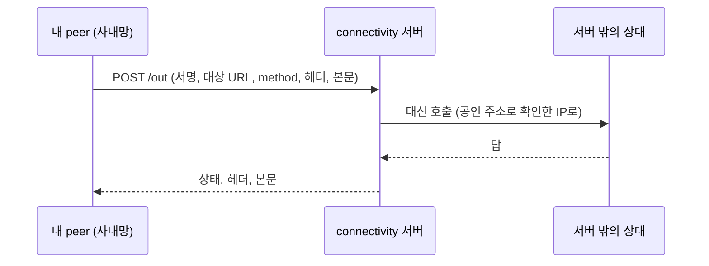
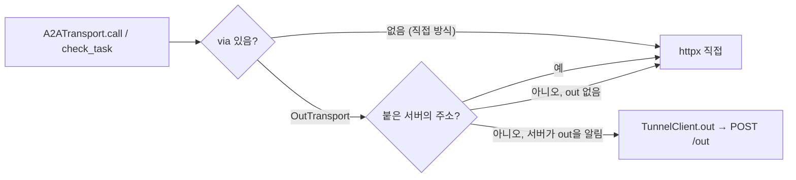

# 10-F: 나가는 방향 중계 (`/out`)

> 2026-11-11, 브랜치 `out-gateway-20261111`. 사용자: "그 프록시 역할도 connectivity가 해주는 것이 well define 아니야?", "connectivity는 범용이야. agent arena와 상관없이 동작해야 돼", "10-F 진행해".
> 10단계 본문: [requirements.md](requirements.md) · [design.md](design.md). 이 문서는 10-F 한 묶음의 요구사항, 설계, 시험 결과를 담는다.

## 1. 왜

10단계의 relay는 **남이 나를 부르는 방향**만 푼다. 사내망처럼 방화벽이 신청한 IP:포트로만 나가게 하는 곳의 peer는 **내가 남을 부르는 방향**(god, recorder, 서버 밖의 다른 peer)을 상대마다 신청해야 한다. connectivity 서버가 이 방향도 맡으면 서버 포트 하나로 모든 곳과 통한다.

## 2. 요구사항

| # | 요구 | 결정 |
|---|---|---|
| P10-F1 | `/out`은 **범용 HTTP 전달**이다. "서명한 클라이언트가 준 (URL, method, 헤더, 본문)을 대신 보내고 답을 돌려준다"가 전부이고 A2A·이벤트·peer를 모른다(P10-P1). 코드는 `connectivity/` 안에만 둔다 | 정함 |
| P10-F2 | **기본은 꺼져 있다**(`CONNECTIVITY_OUT=false`). 켜면 `GET /info`가 `out: true`를 알린다. 꺼져 있으면 클라이언트는 쓰지 않는다 | 정함 |
| P10-F3 | **서명한 키만** 쓴다. 서명이 **본문과 대상까지 묶는다**(요청 본문의 sha256을 서명에 넣는다). 같은 서명은 한 번만 받는다(재전송 거부). `CONNECTIVITY_ALLOW_KEYS_FILE`이 있으면 그 목록의 키만 | 정함 |
| P10-F4 | **서버가 내부망을 훑는 발판이 되지 않는다(SSRF).** 대상은 http·https만, 주소에 사용자 정보(`user:pw@`) 없음. 이름은 서버가 풀고 **풀린 모든 주소가 공인 주소**여야 하며(사설·loopback·link-local·예약 주소 거부), 연결은 **확인한 IP로** 한다(확인 뒤 이름이 바뀌어도 소용없다). 운영자가 `CONNECTIVITY_OUT_ALLOW`(CIDR)로 허용한 대역만 예외. `CONNECTIVITY_OUT_PORTS`가 있으면 그 포트만 | 정함 |
| P10-F5 | 한도: 키마다 초당 요청 수(`CONNECTIVITY_OUT_RATE_PER_SEC`), 동시 진행 수(`CONNECTIVITY_OUT_MAX_INFLIGHT`), 요청·응답 본문 크기(기존 `MAX_BODY_BYTES`), 제한 시간(`CONNECTIVITY_OUT_TIMEOUT_SEC`). 넘으면 거부(413, 429, 502, 504) | 정함 |
| P10-F6 | 리다이렉트를 따라가지 않는다(3xx를 그대로 돌려준다). 서버의 환경 프록시 설정을 쓰지 않는다. 쿠키 계열 헤더와 hop-by-hop 헤더는 양쪽으로 전달하지 않는다 | 정함 |
| P10-F7 | `/health`는 **개수만** 센다(호출 수, 거부 이유별 수, 바이트). 무엇을 불렀는지는 남기지 않는다 | 정함 |
| P10-F8 | 범용 클라이언트: `TunnelClient.out(...)`와 `httpx` transport(`OutTransport`). **붙은 서버의 주소(relay 주소 포함)는 서버를 거치지 않고 바로** 간다. 서버가 `out`을 알리지 않으면 바로 나간다 | 정함 |
| P10-F9 | **원칙: peer의 출구는 하나다.** 사용자 2026-11-11: "남은 곳이 아니라, 그냥 그래야 하는 거잖아". peer가 스스로 부르는 HTTP는 **모두** peer의 `Egress`(`arena/egress.py`) 하나를 지난다: A2A(다른 peer, god, 기록자), broker API, recorder API, api 연결(REST), 앱 받기, URL 영역, 느린 답 알림(webhook), LLM, embedding. relay 방식이고 서버가 `out`을 알리면 출구가 `OutTransport`가 되고, 직접 방식이면 httpx의 보통 길(환경 proxy 포함)이다. 위 계층은 모른다(P10-P3) | 정함 |
| P10-F10 | 출구가 호출마다 정한다: **서버 자신의 주소**(relay로 붙은 다른 peer 포함)와 **내 망 안의 주소**(사설·loopback·link-local 주소, 또는 그런 주소로만 풀리는 이름)는 바로 가고, 그 밖은 모두 `/out`. 그래서 사내 LLM 게이트웨이는 바로, 인터넷의 LLM API는 서버로 간다. 여기서 풀리지 않는 이름은 바깥으로 본다 | 정함 |
| P10-F11 | 하지 않는 것: 끝과 끝 암호화(SEC-13). peer가 아닌 프로그램(브라우저 등)의 proxy 노릇 | 한계로 밝힘 |

## 3. 설계

### 3.1 서명

기존 서명은 `"<METHOD> <path> <ts>"`이고 본문을 묶지 않는다. `/out`은 본문에 대상 URL이 들어 있어, 서명이 본문을 묶지 않으면 중간에서 대상만 바꿔 재전송할 수 있다. 그래서 선택 인자 `body_sha256`을 더했다.

- 본문 없이 서명하면 서명 대상은 이전과 **똑같다**(다른 경로는 그대로 호환).
- 본문과 함께 서명하면 `"<METHOD> <path> <ts> <sha256(본문)>"`이다. `/out`은 이것만 받는다.
- `/out`은 받은 서명(`X-Conn-Sig`)을 서명 허용 폭(`SIG_WINDOW_SEC`) 동안 기억하고, 같은 서명이 다시 오면 거부한다.

### 3.2 `/out` 요청과 응답

요청 `POST /out`, 본문 JSON `{"url", "method", "headers": {}, "body": base64}`. 응답은 성공이면 `200 {"ok": true, "status", "headers", "body": base64}`이고(상대가 4xx·5xx를 돌려줘도 `status`로 전한다), `/out` 자체의 거부는 `4xx/5xx {"ok": false, "error", "why"}`이다.

| 상태 | why | 뜻 |
|---|---|---|
| 401 | | 서명이 없거나 틀림, 본문과 안 맞음, 이미 쓴 서명 |
| 403 | `out_off` | 서버가 `/out`을 끔 |
| 403 | `not_allowed` | 허용 목록에 없는 키 |
| 403 | `bad_target` | 대상이 http·https가 아님, 사용자 정보, 포트 제한, 공인 주소가 아님 |
| 413 | `big_request` | 요청 본문이 상한을 넘음 |
| 429 | `out_rate`, `out_inflight` | 한도 |
| 502 | `unreachable`, `big_answer` | 상대에 못 닿음, 응답이 상한을 넘음 |
| 504 | `out_timeout` | 시간 초과 |

### 3.3 대상 확인과 IP 고정

1. URL을 풀어 scheme, host, port를 얻는다. 사용자 정보가 있으면 거부.
2. host가 이름이면 `getaddrinfo`로 모든 주소를 얻는다. 하나라도 공인이 아니고 `OUT_ALLOW`에도 없으면 거부.
3. 확인한 주소 하나로 연결한다: 요청 URL의 host를 그 IP로 바꾸고, `Host` 헤더와 TLS의 `sni_hostname`은 원래 이름으로 둔다(https 인증서 확인은 원래 이름으로 한다).

### 3.4 클라이언트와 Arena

- `connectivity/client.py`: `TunnelClient.out(...)`, `OutTransport(client)`. 붙은 직후 `GET /info`로 `out`을 알아 둔다(`client.out_ok`).
- `arena/egress.py`: `Egress`(`via`, `client()`), 오래 사는 client용 `EgressTransport`, 부품들에 하나를 나눠 주는 `share`. connectivity를 모른다.
- 호출하는 부품(`A2ATransport`, `BrokerClient`, `RecorderClient`, `RestTransport`, `AppInstaller`, `UrlArea`, `CompatLLM`, `ClaudeLLM`, `HttpEmbedder`, webhook 보내는 쪽)은 각자 `egress`를 갖고 그 `client()`로만 부른다. `Peer`가 만들어질 때 자기 `Egress` 하나를 모두에게 나눠 준다(나중에 만드는 recorder client도).
- `arena/peer/relay_link.py`: 방식이 relay이면 `peer.egress.via = OutTransport(self.client)`, 직접이면 None. 설정 `ARENA_PEER_USE_OUT`(기본 true)으로 끌 수 있다.

## 4. 시험 결과 (2026-11-11)

| 묶음 | 시험 | 방식 | 결과 |
|---|---|---|---|
| 서버 `/out` | `tests/test_p10_out.py` (P10-F1~F7) | 상대는 `httpx.MockTransport`, 이름 풀기는 가짜 표. 기본 꺼짐, 서명이 본문을 묶음, 재전송 거부, 허용 키, 전달 내용, **확인한 IP로 연결**(Host와 SNI는 원래 이름), 쿠키·hop 헤더, 리다이렉트 안 따름, 사설·loopback·link-local·`localhost`·사설로 풀리는 이름·공인과 사설이 섞인 이름 거부, scheme·사용자 정보, `OUT_ALLOW`, `OUT_PORTS`, 초당 수, 동시 수, 요청·응답 크기, 못 닿음·시간 초과, `/health`에 내용 없음 | 통과 |
| 범용 클라이언트 | `tests/test_p10_out.py` (P10-F8) | `OutTransport`가 제3자 호출을 서버로 보냄, 서버 자신의 주소는 바로, 서버에 `out`이 없으면 바로, 거부는 읽을 수 있는 오류 | 통과 |
| 서명 호환 | `test_p10f_signing_without_a_body_is_what_it_was` | 본문 없는 서명(poll, reply, reach)은 이전과 같음 | 통과 |
| 출구 규칙 | `tests/test_p10_out.py` (P10-F10) | 사설·loopback 주소는 바로, 이름은 풀린 주소로 판단, 풀리지 않는 이름은 바깥 | 통과 |
| Arena 연결 | `tests/test_p10_relay.py` 10-F (5) | **실제 loopback 소켓**: relay 뒤의 peer가 다른 peer의 주소를 `/out`으로 불러 계약 응답을 받음(`out_calls > 0`), **실제 HTTP broker에 프로필 게시도 `/out`으로**, 모든 부품이 peer의 출구 하나를 씀(나중에 만든 recorder client 포함), 서버가 끄면 바로 나감, `ARENA_PEER_USE_OUT=false`, relay 주소인 상대는 `/out`을 거치지 않음. 시험에서는 loopback을 "바깥"으로 친다 | 통과 |
| 계층 | `tests/test_layering.py` | `connectivity/`에 Arena 낱말·import 없음 | 통과 |
| 전체 | `pytest tests --ignore=tests/live` | | 통과 |

- 고친 것: `/info`에 `out`이 더해져 `tests/test_p10_stun.py`의 `/info` 비교를 새 모양으로 바꿨다.
- 시험하며 찾은 것: 같은 시각, 같은 본문이면 ed25519 서명이 똑같아 재전송으로 거부된다. 서명하는 쪽(`sign_headers`)이 한 프로세스 안에서 시각을 늘 늘려 쓰게 했다.
- LLM은 쓰지 않았다. docker로 실제 사내망 같은 환경(`deploy/relay-test`)에서 `/out`을 돌려 보지는 않았다.
