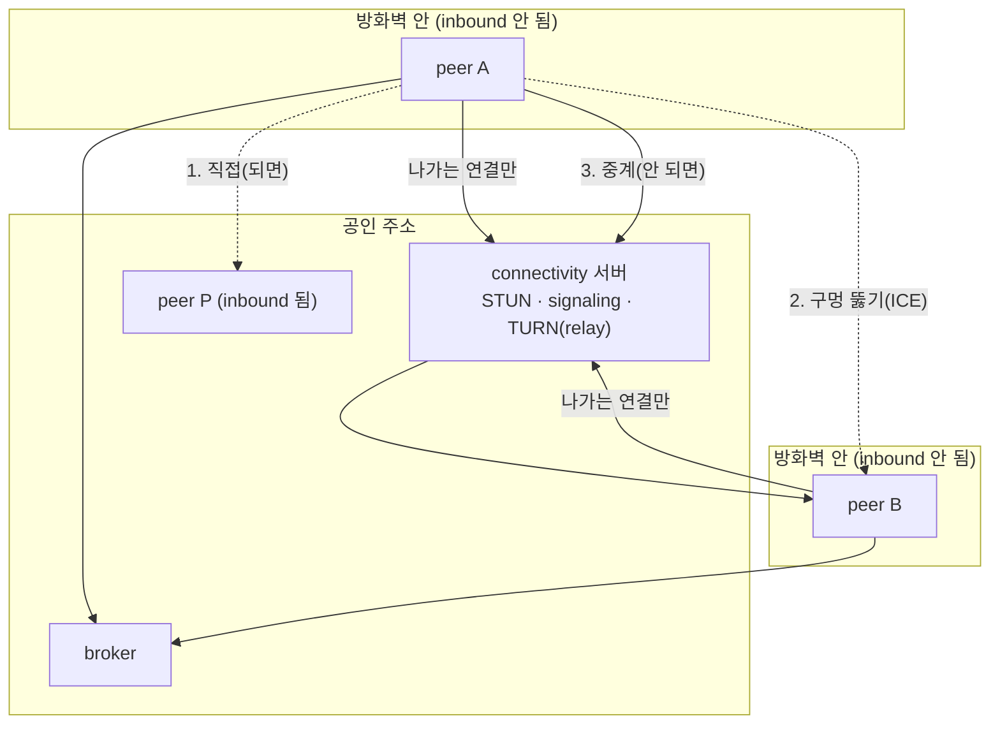

# 10단계 요구사항: connectivity 서버 (inbound가 안 되는 peer를 잇는다)

> 2026-11-06, 브랜치 `connectivity-20261106`. 사용자: "지금 대부분의 일반 peer는 public ip가 없고, 방화벽 등으로 inbound 허용도 안 돼, 그래서 STUN, TURN, Signaling 서버를 통해서 연결되게 할 거야. broker 주소처럼 peer가 기동시 이 주소가 있으면 붙는 거지. 그런데 TURN은 session 유지도 해줘야 하니까. 스스로 inbound 접근이 되는지 확인해서 안 되면 TURN도 사용하는 것으로 하자. 이름은 connectivity 서버라고 해. 이것도 분산 구성 해야겠지만(peer들이 서로 다른 connectivity 서버에 접근해도 connectivity 서버 간 통신으로 session을 맺어 줌) 당장은 제외하자. branch 따로 따고 phase 분리하고 요구사항 정의서 만들어".
>
> 상태 표기: ⬜ 미착수 · 🟡 진행 · ✅ 테스트 통과. 결정 표기: **정함**(사용자가 정함 또는 이미 정한 정책), **제안**(정하지 않았고 제안값), **미정**(사용자 결정 필요). 번호는 테스트 이름과 맞춘다(P10-A1 → `test_p10a1_...`).
>
> **이 문서는 요구사항까지다.** 설계와 코드는 3절의 미정 질문에 답을 받은 뒤에 시작한다.

## 0. 목표

지금 peer끼리는 상대의 A2A 주소(`http://주소:포트`)로 **바로 호출**한다. 느린 답이 올 때도 호출한 쪽의 webhook(`<A2A 주소>/a2a/notify`)으로 상대가 다시 호출한다. 그래서 **양쪽 모두 inbound를 받을 수 있어야** 한다. 일반 개인과 사내 PC의 peer는 그렇지 않다(공인 주소 없음, 방화벽이 inbound를 막음). 이 단계는 그런 peer가 **바깥으로 나가는 연결만으로** 다른 peer와 주고받게 하는 **connectivity 서버**를 만든다.

- **STUN**: peer가 바깥에서 보이는 자기 주소를 알게 한다.
- **signaling**: 두 peer가 서로 닿는 길(후보 주소)을 주고받는 중개.
- **TURN(relay)**: 직접 닿지 못할 때 서버가 두 peer 사이를 이어 주는 중계. 연결이 이어지는 동안 서버가 상태(session)를 들고 있어야 한다.
- 이 세 가지를 **한 서버(connectivity 서버)**가 맡는다. peer는 기동할 때 이 서버의 주소가 있으면 붙는다(broker 주소와 같은 방식).
- **스스로 inbound 점검**을 하고, 되면 지금처럼 직접 연결, 안 되면 relay를 쓴다.

## 1. 지금 코드의 모습 (2026-11-06, 읽어서 확인)

| 일 | 지금 | 문제 |
|---|---|---|
| peer 호출 | `arena/a2a.py` `A2ATransport.call(url, msg)`: 상대 프로필의 `url`로 A2A(JSON-RPC)를 직접 보낸다 | 상대가 inbound를 받아야 한다 |
| 느린 답 | `arena/a2a_push.py`: 답하는 쪽이 호출한 쪽의 `<A2A 주소>/a2a/notify`로 POST, 호출한 쪽은 `tasks/get`으로 다시 확인. 주소는 http(s)이고 경로가 `/a2a/notify`여야 한다(`push_url_ok`) | 호출한 쪽도 inbound가 필요하다 |
| 연결 방식 | `arena/connections.py` 등록부: `human`(contact), `a2a`(url), `api`(url). 프로필의 `connections`에 적고 broker가 검사한다 | 주소가 아닌 **다른 길**로 닿는 방식이 없다 |
| broker 주소 | peer 설정 `…_PEER_BROKERS=그룹=주소(\|주소…)`, `FailoverBrokerClient`, 기동 중 broker가 없어도 계속 시도(`Presence`) | connectivity 서버도 같은 틀로 붙일 수 있다 |
| 신원 | peer 요청은 공개키로 서명(`arena/signing.py`: `X-Arena-Pub`, `Ts`, `Sig`). 메시지는 서명되지만 **암호화되지는 않는다** | relay를 운영하는 쪽이 내용을 읽을 수 있다(H2) |
| 방침 | peer 사이에 열어 두는 session을 만들지 않는다. message 하나가 말 한 번이다(무전기 방식, 2026-11-04) | **TURN은 session을 들고 있어야 한다.** 이 방침과 어떻게 맞출지가 Q1이다 |
| 환경 | 이 서버처럼 외부로 나갈 때 HTTP proxy를 거치는 곳이 많다(`HTTP_PROXY` 환경 변수). 그런 곳은 보통 **UDP가 막혀** 있다 | STUN·TURN은 UDP가 기본이라 못 쓸 수 있다(Q2) |

## 2. 요구사항

### A. connectivity 서버와 주소

| # | 요구 | 결정 | 상태 |
|---|---|---|---|
| P10-A1 | 새 서버 **connectivity 서버**를 만든다(`python -m arena.connectivity`, docker 배치는 `deploy/connectivity`). 한 프로세스가 STUN, signaling, relay를 모두 맡는다 | 정함 | ⬜ |
| P10-A2 | peer는 설정에 connectivity 서버 주소가 **있으면** 기동할 때 붙는다. 없으면 지금과 똑같이 동작한다(기본은 꺼짐). 주소 형식은 broker와 같이 `그룹=주소(\|주소…)`이고 먼저 적은 것이 우선이다 | 정함(broker 주소처럼) | ⬜ |
| P10-A3 | 서버가 아직 없거나 중간에 죽어도 peer는 멈추지 않고 계속 붙으려 한다(처음 2초, 최대 60초 간격: broker와 같은 규칙). 붙기 전에도 peer의 다른 일은 한다 | 정함(기존 규칙) | ⬜ |
| P10-A4 | 서버 주소와 포트, 간격, 한도는 모두 `.env` 설정이다(상수 금지) | 정함 | ⬜ |
| P10-A5 | connectivity 서버 간 통신(분산 구성)은 **이 단계에서 하지 않는다**. 다만 나중에 붙일 수 있게, peer의 프로필이 **어느 connectivity 서버에 붙어 있는지**를 전용 field로 싣는다(P10-F2) | 정함(당장 제외) | ⬜ |

### B. inbound 점검

| # | 요구 | 결정 | 상태 |
|---|---|---|---|
| P10-B1 | peer는 기동할 때 **스스로 inbound가 되는지 확인**한다. 결과는 둘 중 하나: `direct`(바깥에서 이 peer의 A2A 주소로 들어올 수 있다), `relay`(못 들어온다) | 정함 | ⬜ |
| P10-B2 | 확인 방법: peer가 connectivity 서버에 "내 A2A 주소로 되돌아와 봐"라고 **서명해서** 요청하고, 서버가 그 주소로 서명된 확인 요청(nonce)을 보낸다. peer가 nonce에 서명해 답하면 `direct`다 | 제안 | ⬜ |
| P10-B3 | 서버가 되돌아와 보는 곳은 **그 요청이 들어온 연결의 출발 주소(IP)** 뿐이다. 요청이 적어 보낸 임의 주소나 사설·loopback·link-local 주소로는 가지 않는다(SSRF 방지, `docs/security-assessment.md` SEC-4) | 제안 | ⬜ |
| P10-B4 | 한 키가 점검을 요청하는 횟수를 제한한다(`…_CHECK_PER_HOUR`). 서버가 남을 두드리는 도구로 쓰이지 않게 한다 | 제안 | ⬜ |
| P10-B5 | 점검은 기동할 때만 하지 않고 **다시** 한다: 정해진 간격(`…_RECHECK_SEC`)과 연결이 끊겼다 돌아왔을 때. 결과가 바뀌면 프로필을 다시 게시한다 | 제안 | ⬜ |
| P10-B6 | 점검 결과는 소유자 창(console·desk 머리글)에 `직접 연결됨` / `중계로 연결됨` / `연결 서버 없음`으로 보인다 | 제안 | ⬜ |

### C. 연결 경로

| # | 요구 | 결정 | 상태 |
|---|---|---|---|
| P10-C1 | 경로는 순서대로 시도한다: **(1) direct**(상대가 inbound를 받는다) → **(2) 구멍 뚫기**(양쪽이 나가는 연결로 서로 닿게 함, STUN과 signaling을 쓴다) → **(3) relay**(서버가 중계). 앞 경로가 되면 뒤로 가지 않는다 | 제안 | ⬜ |
| P10-C2 | inbound 점검이 `relay`인 peer는 (1)로 받지 않는다. 이 peer를 부르는 쪽은 (2) 또는 (3)을 쓴다 | 정함 | ⬜ |
| P10-C3 | 두 peer가 모두 `direct`면 connectivity 서버를 거치지 않는다. 서버 부하는 못 닿는 경우에만 생긴다 | 정함 | ⬜ |
| P10-C4 | relay 연결이 끊기면 호출은 오류로 끝나지 않고 다시 연결한 뒤 이어서 시도한다(재연결 횟수와 간격은 설정). 그래도 안 되면 지금의 오류로 돌려준다 | 제안 | ⬜ |
| P10-C5 | **UDP가 막힌 환경에서도 모든 일이 된다**(정함: 사용자 "UDP 막힌 환경도 가능하게 해"). direct와 relay는 **TCP만으로** 동작한다. relay는 HTTPS/WebSocket으로 붙어 proxy를 거쳐 나갈 수 있다 | 정함 | ⬜ |
| P10-C6 | UDP는 **있으면 쓰는 선택 기능**이다. 쓰는 곳은 둘뿐이다: (1) STUN으로 바깥에서 보이는 내 주소 알기, (2) 두 peer가 모두 UDP를 쓸 수 있을 때 구멍 뚫기(P10-C1의 2번). 둘 다 안 되면 코드는 조용히 3번(relay)으로 간다 | 제안 | ⬜ |
| P10-C7 | UDP를 쓸 수 있는지는 기동할 때 STUN 응답이 오는지로 확인한다(제한 시간 설정). 결과(`udp 됨`, `udp 안 됨`)를 소유자 창과 로그에 보인다. 안 됨이 오류가 아니다 | 제안 | ⬜ |

### D. signaling과 신원

| # | 요구 | 결정 | 상태 |
|---|---|---|---|
| P10-D1 | 모든 signaling 요청은 peer의 공개키로 서명한다(기존 `arena/signing.py` 방식, 시각 창 포함). 서명이 없거나 틀리면 거절한다 | 정함(기존 방식) | ⬜ |
| P10-D2 | 서버는 **신원을 만들지 않는다**. 누가 누구인지는 공개키로만 알고, 서버가 중계하는 상대가 요청한 그 키가 맞는지는 받는 peer가 확인한다 | 제안 | ⬜ |
| P10-D3 | 어느 peer를 받을지(그룹 구성원인가)는 broker의 그룹 규칙과 같게 한다: 닫힌 그룹이면 구성원만 쓸 수 있다 | 제안 | ⬜ |

### E. relay(TURN) 운영

| # | 요구 | 결정 | 상태 |
|---|---|---|---|
| P10-E1 | relay는 연결이 이어진 동안 서버가 **session**을 들고 있다. session은 붙인 peer와 상대 peer, 시작 시각, 마지막으로 오간 시각을 가진다 | 정함(사용자: TURN은 session 유지도 해줘야 한다) | ⬜ |
| P10-E2 | session은 일정 시간(`…_SESSION_IDLE_SEC`) 아무것도 오가지 않으면 서버가 닫는다. 닫혔다는 것을 peer에게 알린다 | 제안 | ⬜ |
| P10-E3 | relay를 쓰려면 서버가 발급한 **짧게 사는 자격**(키 서명으로 받는다, 유효시간 설정)이 필요하다. 아무나 서버를 중계 서비스로 쓰지 못한다 | 제안 | ⬜ |
| P10-E4 | 한도를 설정한다: 키당 동시 session 수, 키당 초당 바이트, 서버 전체 동시 session 수. 넘으면 새 session을 거절하고 이유를 돌려준다 | 제안 | ⬜ |
| P10-E5 | 서버는 session 수, 중계한 바이트, 거절 횟수를 로그와 `/health`로 보여 준다 | 제안 | ⬜ |

### F. 프로필과 연결 방식

| # | 요구 | 결정 | 상태 |
|---|---|---|---|
| P10-F1 | `arena/connections.py`에 새 연결 방식(이름은 Q4)을 등록한다. 필드는 전용 field로 둔다(주소 문자열 하나에 서버·peer를 묶어 싣지 않는다) | 정함(원칙: 전용 field) | ⬜ |
| P10-F2 | 프로필에 이 peer가 붙은 connectivity 서버를 **전용 field**로 싣는다(분산 때 서버를 찾는 근거). 서버 주소와 점검 결과(`direct` 또는 `relay`)가 들어간다 | 제안 | ⬜ |
| P10-F3 | inbound가 안 되는 peer의 프로필에는 `a2a` 연결의 `url`이 없다(되지 않는 주소를 적지 않는다). 대신 위 연결 방식으로 닿는다 | 제안 | ⬜ |
| P10-F4 | broker가 새 field를 검사한다(모양이 틀리면 프로필을 거절). 프로필 검색 결과에도 보인다 | 제안 | ⬜ |

### G. 기존 a2a와의 관계

| # | 요구 | 결정 | 상태 |
|---|---|---|---|
| P10-G1 | 위로는 지금의 `Transport.call(url, msg)` 계약이 **그대로**다. 앱·assistant·창 코드는 바뀌지 않는다. 어느 경로로 갔는지는 transport 안에서만 안다 | 정함(SOLID: 인터페이스 유지) | ⬜ |
| P10-G2 | 느린 답(A2A task)과 webhook 알림이 relay로 연결된 peer에게도 똑같이 간다. 알림은 지금처럼 **신호일 뿐**이고 결과는 `tasks/get`으로 다시 확인한다 | 정함(기존 원칙) | ⬜ |
| P10-G3 | `push_url_ok`가 막는 임의 내부 주소로의 POST 규칙은 relay에서도 같다. relay는 서버가 정한 연결로만 보낸다 | 제안 | ⬜ |
| P10-G4 | 사람의 창(console·desk·chat)은 자기 peer와 로컬에서만 말한다. 이 단계에서 바뀌지 않는다 | 정함(기존) | ⬜ |

### H. 지킬 것(보안)

| # | 요구 | 결정 | 상태 |
|---|---|---|---|
| P10-H1 | 서버가 받는 모든 것(주소, 크기, 횟수)에 상한을 둔다. 서명이 없는 요청은 아무것도 하지 않는다 | 정함 | ⬜ |
| P10-H2 | **relay 운영자가 내용을 읽을 수 있는가**: 지금 메시지는 서명만 되고 암호화되지 않는다. relay를 거치는 내용을 운영자가 읽을 수 있다는 점을 문서로 밝히고, 끝과 끝 사이 암호화를 넣을지는 Q3이다 | 미정(Q3) | ⬜ |
| P10-H3 | 서버는 중계한 내용을 저장하지 않는다(메모리에서 바로 전달, 로그에 내용을 남기지 않는다) | 제안 | ⬜ |
| P10-H4 | 서버가 연 포트는 `deploy/connectivity`와 `docs/security-assessment.md`의 포트 목록에 올린다 | 정함 | ⬜ |

### I. 시험

| # | 요구 | 결정 | 상태 |
|---|---|---|---|
| P10-I1 | 메모리 안에서 서버와 peer를 가짜 네트워크(inbound 차단 흉내)로 시험한다: direct, 구멍 뚫기, relay 세 경로, 경로 바꾸기, 끊김과 재연결 | 정함 | ⬜ |
| P10-I2 | **실제 프로세스**로 inbound가 막힌 환경을 만든다(docker 네트워크에서 peer 컨테이너는 서버로 나가는 길만 둔다). 거기서 두 peer가 relay로 이벤트 개최·참가·계약·대화까지 해낸다(`real-genesis-tests` 방침) | 정함 | ⬜ |
| P10-I3 | LLM은 쓰지 않는다. 사람 모드 peer끼리 시험한다(LLM 호출 최소 방침) | 정함 | ⬜ |
| P10-I4 | HTTP proxy 환경(UDP 막힘)을 흉내 낸 시험을 둔다: UDP를 모두 막은 docker 네트워크에서 두 peer가 relay로 이벤트 개최·참가·계약·대화까지 한다 | 정함(Q2) | ⬜ |

## 3. 미정: 사용자 결정이 필요한 것

| # | 질문 | 제안 | 왜 중요한가 |
|---|---|---|---|
| Q1 | **peer 사이 session 방침과 relay의 session을 어떻게 맞출까.** (가) WebRTC식: peer끼리 ICE로 직접 길을 열고(못 열면 TURN) 그 위에 A2A를 싣는다. 세션은 peer 사이에 생긴다. (나) HTTP relay식: peer가 서버로 **나가는 연결 하나**(WebSocket·long poll)를 열어 두고, 서버가 A2A 메시지 하나하나를 상대의 연결로 **전달**한다. 세션은 peer와 서버 사이에만 있고, peer 사이에는 여전히 message 하나가 말 한 번이다 | **(나)를 기본으로, (가)는 두 peer가 모두 UDP를 쓸 수 있을 때만 구멍 뚫기로 더하는 방안.** 이유: 기존 무전기 방침(peer 사이에 session 없음)을 지킨다, 사내망·proxy 환경에서는 UDP가 막혀 (가)가 안 된다, Python에서 TURN 서버를 직접 만드는 것은 크다 | 설계 전체가 달라진다. 사용자는 STUN·TURN·signaling이라고 하셨는데, (나)만으로는 STUN·TURN이 필요 없을 수도 있다. 어느 쪽을 원하시는지 정해야 한다 |
| Q2 | ~~UDP를 쓸 수 있는 환경을 전제하나~~ | **정함**: 전제하지 않는다. UDP 없이도 모든 일이 된다(P10-C5). UDP는 있으면 쓰는 선택 기능(P10-C6) | 대부분의 일반 peer가 방화벽 뒤에 있어 UDP가 막힌 곳이 흔하다 |
| Q3 | **relay를 거치는 내용을 암호화할까.** 지금 메시지는 서명만 되고 평문이다. relay 운영자는 읽을 수 있다 | 이 단계에서는 **넣지 않고 한계로 문서에 밝힌다.** 끝과 끝 암호화는 relay와 무관하게 모든 a2a에 해당하는 일이라 별도 단계로 한다 | 신뢰할 수 없는 운영자의 서버를 쓰게 되면 중요하다. 암호화는 키 합의와 메시지 형식을 바꾸는 큰 일이다 |
| Q4 | 새 연결 방식의 이름 | `relay`(서버를 거쳐 닿는 a2a). 필드: `via`(connectivity 서버 주소), `peer`(상대에게 닿을 때 쓰는 공개키) | 프로필에 보이는 이름이라 정하면 바꾸기 어렵다 |
| Q5 | **STUN·TURN을 직접 구현하나 기존 것을 쓰나.** (가) coturn 같은 기존 서버를 같은 docker 배치에 함께 띄우고 connectivity 서버는 signaling과 자격 발급만 한다. (나) 전부 Python으로 직접 만든다 | Q1이 (나)이면 STUN·TURN 없이 시작하고, 필요해지면 (가)로 coturn을 붙인다 | 직접 구현은 크고 위험하다. 이름이 "connectivity 서버 하나"라서 배치는 하나로 보이게 한다 |
| Q6 | 서버가 어디에서 도는가: 사내 공인 주소, 인터넷 | 우선 이 서버(`10.10.20.11`) 안 docker에서 시험하고, 방화벽 규칙(어느 포트)을 문서로 낸다 | 방화벽 요청에 포트 목록이 필요하다 |
| Q7 | 점검 `direct`일 때도 relay 연결을 **붙여 둘까** | 붙이지 않는다. 필요할 때 붙는다 | 서버 session을 아낀다. 단 direct가 끊기면 늦게 붙는 시간이 생긴다 |

## 4. 이 단계에서 하지 않는 것

- connectivity 서버 사이의 통신(분산 구성). 프로필에 어느 서버에 붙었는지 적어 두는 것(P10-A5, F2)까지만 한다.
- 끝과 끝 암호화(Q3의 제안대로라면).
- 영상·음성 같은 큰 흐름의 중계. A2A 메시지(JSON)만 다룬다.
- peer의 소유자 인증이나 과금.

## 5. 영향 받는 곳 (읽어서 확인한 것, 설계 전 추정)

- `arena/a2a.py`(`A2ATransport`에 경로 선택을 얹거나 감싸는 transport), `arena/a2a_push.py`(알림 경로)
- `arena/connections.py`(새 연결 방식 등록), `arena/broker/service.py`(`advertise` 검사), `arena/peer/profile.py`(새 field)
- 새 패키지 `arena/connectivity/`(서버)와 peer 쪽 클라이언트, `arena/config.py`(설정), `.env.example`
- `arena/peer/presence.py` 또는 가까운 곳(붙기, 재시도, 점검 다시 하기)
- 창: console·desk 머리글(P10-B6)
- 배치: `deploy/connectivity/`, `docs/security-assessment.md`(포트와 위험), `docs/internal-network-test.md`(방화벽 표)
- 문서: `dev/protocol.md`(signaling·relay 메시지), `dev/peer-spec.md`(연결 방식)
