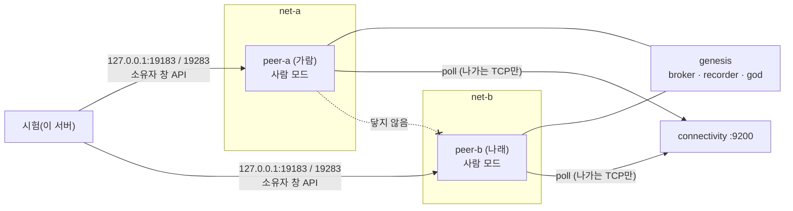

# 10단계 시험 결과: connectivity 서버

> 2026-11-08. 사용자: "10-E부터 진행해". 요구사항 [requirements.md](requirements.md), 설계 [design.md](design.md).

## 1. 무엇을 시험했나

| 묶음 | 시험 파일 | 방식 | 결과 |
|---|---|---|---|
| 10-A 서버 | `tests/test_p10_connectivity_service.py` (22) | 실제 loopback 서버. 한도, 만료, 남의 요청에 응답 못 함, 경로 허용 목록, 크기, 서명 | 통과 |
| 10-B relay | `tests/test_p10_relay.py` 10-B (6) | 포트를 열지 않은 peer를 실제 A2A로 호출. 느린 답과 webhook, 경로 제한, 서버 failover, 늦게 뜬 서버 | 통과 |
| 10-C 점검 | `tests/test_p10_relay.py` 10-C (7) | direct/relay 결정, 사설 출발지, 전환과 다시 게시, 출발 IP로만 되돌아감, 서명 검사, 횟수 제한, 창 표시 | 통과 |
| 10-E 고친 것 | `tests/test_p10_relay.py` 10-E (3) | 긴 poll 대기에도 relay 주소를 바로 앎, 첫 게시가 이미 닿는 주소, 게시 전 다시 게시는 아무것도 안 함 | 통과 |
| 10-E 배치 | `tests/test_p10_docker.py` (2 + docker 1) | `deploy/connectivity`의 설정이 connectivity 것뿐인지, `deploy/relay-test`에서 두 peer가 공유하는 네트워크가 없는지 | 통과 |
| **10-E 실제 프로세스** | `ARENA_TEST_DOCKER=1 pytest tests/test_p10_docker.py` | 아래 2절 | **통과** (약 1분, build cache 포함). 고친 뒤 5회 연속 통과 |
| 전체 | `pytest tests --ignore=tests/live` | | 통과 |
| 계층 | `tests/test_layering.py` | `connectivity/`는 저장소의 아무것도 import하지 않고 Arena 낱말이 없다. connectivity를 아는 곳은 `arena/peer/relay_link.py` 하나 | 통과 |

LLM은 쓰지 않았다(사람 모드 peer끼리).

## 2. 실제 프로세스 시험 (P10-I2, I4)

`deploy/relay-test/docker-compose.yml`. 이미지는 `agent-arena:relay-test` 태그로 따로 build해서, 이 서버에서 돌고 있는 시험 컨테이너의 이미지를 바꾸지 않는다.

- peer-a와 peer-b는 **공유하는 네트워크가 없다**. genesis와 connectivity만 둘 모두에 붙는다.
- UDP는 어디에도 쓰지 않는다. UDP가 막힌 환경과 같다(P10-I4).
- 서버는 사설 출발지로 되돌아가 보지 않는다(`CONNECTIVITY_PROBE_ALLOW` 없음). 그래서 두 peer 모두 "바깥에서 닿지 않음"으로 판정하고 relay로 붙는다.

확인한 것:

| # | 확인 | 결과 |
|---|---|---|
| 1 | 두 peer의 창 머리글 상태가 `relay`(중계로 연결됨) | ✅ |
| 2 | peer-a에서 `http://peer-b:9180`이 열리지 않음 | ✅ `ConnectError` |
| 3 | broker의 두 프로필 `url`이 `http://connectivity:9200/r/<공개키>`이고, **첫 게시(v1)부터** 그 주소 | ✅ |
| 4 | A가 이벤트를 열고 B가 공지를 봄(broker 경유) | ✅ |
| 5 | B의 `join_event`가 A의 relay를 거쳐 A에게 감 | ✅ A의 timeline에 `join` |
| 6 | A의 `contract`(member)가 B의 relay를 거쳐 B의 서명을 받아 옴, 원장에 기록 | ✅ `contracts_so_far: 1`, B 로그 "역할 계약 수락" |
| 7 | A→B, B→A 대화가 서로의 relay를 거쳐 감 | ✅ 양쪽 timeline에 `in` |
| 8 | 서버 `/health`: 붙은 키 2, 중계한 바이트 > 0, 거절 0 | ✅ |
| 9 | 카드의 `supportedInterfaces[0].url`이 relay 주소의 `/rpc` | ✅ (로그로 확인) |

직접 해 보기: `deploy/build.sh agent-arena:relay-test`, `cd deploy/relay-test && ARENA_IMAGE=agent-arena:relay-test docker compose up -d`, 브라우저(이 서버)에서 `http://127.0.0.1:19183/#token=relay-test`와 `http://127.0.0.1:19283/#token=relay-test`. 끝나면 `docker compose down -v`.

## 3. 실제 프로세스에서 찾아 고친 것

| # | 증상 | 원인 | 고침 | 시험 |
|---|---|---|---|---|
| F1 | 이미지 build가 `"/connectivity": not found`로 실패 | `Dockerfile.dockerignore`가 허용 목록 방식인데 `connectivity`가 없었다(10-A에서 Dockerfile만 고침) | `!connectivity` 추가 | `test_the_connectivity_server_has_its_own_deploy_directory` |
| F2 | 시작 뒤 **25초 동안** relay peer에 닿지 않음 | 첫 poll도 `HOLD_SEC`(25초)를 다 기다린 뒤에야 relay 주소를 알려 줬다. 메모리 시험은 hold를 2초로 줄여 가려졌다 | 붙은 뒤 첫 poll은 기다리지 않는다(`hold=0`), 그다음부터 긴 poll | `test_p10e_the_relay_address_is_known_at_once_even_with_a_long_poll_hold` |
| F3 | broker가 잠깐 아무도 열 수 없는 주소(`http://peer-a:9180`)를 보여 줌 | 프로필을 먼저 게시하고 그 뒤에 점검했다 | 개인 peer는 **첫 결정을 첫 게시보다 먼저** 한다(`RelayLink.start()`, relay면 붙기를 `ARENA_PEER_RELAY_ATTACH_WAIT_SEC`(5초)까지 기다림) | `test_p10e_the_first_profile_already_names_the_address_others_can_reach` |
| F4 | F3을 고치자 닉네임이 재시작 뒤 사라짐 | 닉네임 저장이 프로필 게시의 부수 효과였다. 게시 전에는 다시 게시하지 않게 바꾸자 저장도 빠졌다 | `set_nick`이 바로 저장한다. 게시 전의 `repost()`는 아무것도 하지 않는다(첫 게시가 지금 이름과 주소를 싣는다) | `test_p9a5_the_changed_nickname_survives_a_restart`, `test_p10e_a_repost_before_any_post_posts_nothing` |
| F5 | 시작 직후 창의 연결 상태가 비어 있음(시험이 가끔 실패) | 창이 먼저 열리고 `RelayLink`는 그 뒤에 만들어졌다. F3으로 첫 결정이 길어지자 드러났다 | `RelayLink`를 창보다 먼저 만든다. 창은 처음부터 `연결 확인 중`을 보인다. 시험은 결정을 기다린다 | docker 시험 5회 연속 통과 |

## 4. 남은 것 (고치지 않음, 기록)

- **P10-C4 + 이벤트 안의 주소 기억**: 기본 비서는 이벤트마다 상대의 주소를 기억한다(공지의 `issuer_url`, 받은 메시지의 `url`). 상대가 direct↔relay를 바꾸거나 다른 connectivity 서버로 옮기면, 상대가 무언가를 보내 올 때까지 옛 주소로 부른다(그 호출은 오류). 고치는 길: 호출이 연결 오류로 실패하면 broker에서 그 키의 지금 프로필 `url`을 읽어 한 번 다시 부른다. P10-C4와 함께 할 일이다.
- **처음 본 원장 기록**: 기본 비서는 이벤트 원장을 처음 볼 때 위치만 기억하고 알리지 않는다(이미 있던 설계). 계약이 그 전에 오르면 받는 쪽 timeline에 원장 줄이 없다. relay와 상관없다.
- **닉네임 표시 시점**: 받는 쪽 directory가 상대 닉네임을 읽기 전에 만든 줄에는 기본 닉네임(`필명-xxxxxx`)이 찍힌다. 뒤의 줄은 맞다. 9단계의 `Directory.refresh` 간격 문제이고 relay와 상관없다.
- **P10-H2 내용 열람**: relay 운영자는 지나가는 A2A 내용을 읽을 수 있다(서명은 되어 있어 바꾸면 들킨다). `docs/security-assessment.md` S15에 적었다.
- 10-D(STUN, `udp` 상태)는 10-E 뒤로 미뤘다(사용자 2026-11-08: "10-E부터 진행해").
