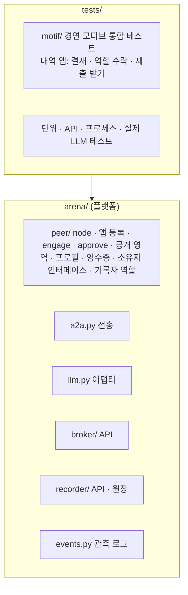
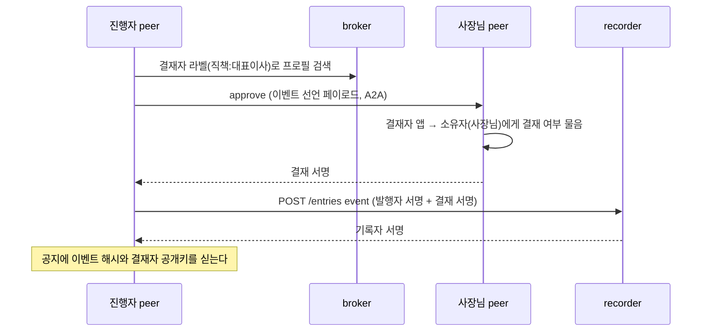
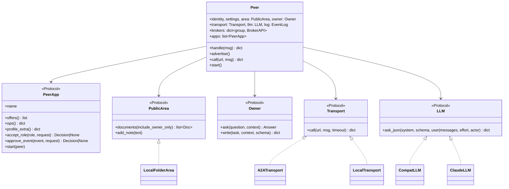
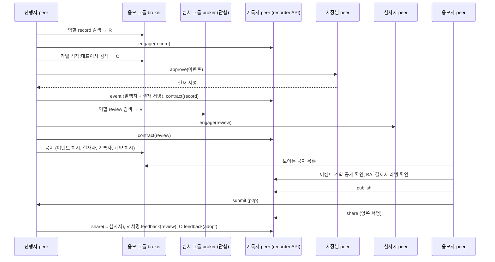

# 2단계 설계: 범용화와 peer 핵심

요구사항은 [requirements.md](requirements.md).

## 1. 범위와 의존 방향

개발 대상은 `arena/`(플랫폼)뿐이다. 앱과 시연 장치는 범위 밖이다(사용자 2026-10-30). 경연 흐름은 `tests/motif/`의 대역 앱으로만 재현한다.



의존은 아래로만 흐른다. `arena/`는 테스트나 어떤 앱도 import하지 않는다(테스트가 검사).

## 2. 2-A 범용 원장

### 항목 종류

| 종류 | 서명자 | 페이로드 | 범용 규칙 | 이벤트를 가리키면 더하는 규칙 |
|---|---|---|---|---|
| `event` | 발행자 + 결재자 전원 | `event_id, issuer, kind, policy, approvers[]` | `event_id` 한 번만, policy 모양 검사, 결재자 ≠ 발행자 | |
| `contract` | 발행자 + 계약자 | `event_id, role, issuer, contractor, nonce` | nonce 한 번만 | 선언된 이벤트, 발행자 일치, `role ∈ policy.roles` |
| `publish` | 작성자 | `author, content_hash, event_id?` | 같은 내용은 먼저 등록한 사람만 | 작성자가 `conflict_roles` 역할로 계약돼 있으면 거절 |
| `share` | 제공자 + 수령자 | `provider, consumer, content_hash, terms, nonce` | 등록된 내용만, nonce 한 번만 | |
| `feedback` | 평가자 | `evaluator, content_hash, verdict, event_id?, ...` | 등록된 내용만, (평가자, 내용, 판정) 한 번만, 평가자가 받은 내용만 | `verdict_roles[verdict]`가 있으면 그 역할 계약자만(`issuer`면 발행자만) |

### policy 모양

```json
{"roles": ["record", "review"], "conflict_roles": ["record", "review"],
 "verdict_roles": {"review": "review", "adopt": "issuer"}, "hidden_roles": ["review"]}
```

플랫폼은 역할 이름과 판정 이름의 뜻을 모른다. 문자열을 비교할 뿐이다. 경연 policy는 `apps/idea_contest/policy.py`에 있다.

### 결재



참여자는 `GET /entries/{이벤트 해시}`로 이벤트 선언이 있는지, 결재자 목록에 공지의 결재자가 있는지 보고, broker에서 그 결재자 프로필의 라벨을 확인한다.

### 기여 집계

`contribution(chain) -> {pub: {"published", "received_by", "verdicts_received": {판정: 수}, "verdicts_given": {판정: 수}, "roles": {역할: 수}, "events": 수, "approvals": 수}}`

### 공개 확인 응답

| 종류 | 공개 항목 |
|---|---|
| 공통 | `exists, type, seal_ok, event_id` |
| `event` | `issuer, kind, approvers` |
| `contract` | `role, issuer`, 그리고 `role ∉ hidden_roles`일 때만 `contractor` |
| 그 밖 | 없음 |

## 3. 2-B peer 핵심

### 구성



- **op 처리**: `Peer.handle`는 플랫폼 op(`engage`, `approve`)와 앱이 등록한 op를 한 사전으로 합쳐 고른다. 겹치면 조립 시 `ValueError`.
- **engage**: 역할이 `offers`에 없거나 계약자가 내가 아니면 거절 → 그 역할을 다루는 앱의 `accept_role`이 `Decision(accept, reason)`을 주면 그대로, 아무 앱도 없으면 거절 → 수락이면 계약 페이로드에 서명.
- **approve**: 페이로드의 `approvers`에 내가 없으면 거절 → `approve_event`를 주는 앱이 없으면 거절 → 승인이면 이벤트 페이로드에 서명.
- **프로필**: `ProfileBuilder`가 공개 문서(소유자 전용 제외, 최근 N개)를 LLM으로 요약한다. 실패하면 첫 문서의 첫 줄로 대신하고 로그에 남긴다. `offers`는 peer 설정 + 앱이 공개하는 역할, `labels`는 peer 설정, `until = now + ARENA_PROFILE_TTL_SEC`, 다시 게시할 때마다 `ver + 1`, 앱의 `profile_extra()`를 합친다.
- **기록자 역할**(`arena/peer/record_role.py`의 `RecordRole`): `RecorderService`를 품고 recorder API를 `recorder_port`로 연다. `offers=["record"]`, `profile_extra={"recorder_url": ...}`. 수락 판단(`accept_role("record")`)은 기록자 앱 생성 시 받은 함수에 맡기고, 없으면 수락.
- **영수증**(`Receipts`): `record()` 응답을 보관하고 `seal.pub`이 기대한 기록자인지, 서명이 맞는지 검사.
- **전송**: `A2ATransport`는 1단계 이전 코드(`app/common.py`)의 `rpc`를 옮긴 것. `LocalTransport`는 주소 → peer 사전.
- **LLM**: `build_llm(settings)`가 `ARENA_LLM_BACKEND`(`compat`|`claude`)로 고른다. `CompatLLM`은 `/v1/chat/completions`에 `response_format=json_schema`로 묻고, 빈 내용·JSON 아님·HTTP 오류면 `ARENA_LLM_RETRIES`번 다시 묻는다. 400이면서 `reasoning_effort`가 있으면 빼고 한 번 더. 끝내 실패하면 `LLMError`. 동시 호출은 세마포어. `ask_json(..., fallback=f)`는 실패 시 로그를 남기고 `f()`를 돌려주는 편의 함수.

### 공개 영역 폴더

```
data/demo/areas/p03/
  notes.md            지식·경험 노트 (한 줄 한 항목, 경험 노트는 여기에 덧붙임)
  onboarding.md       ...
  _owner_rules.md     소유자 규칙 (소유자 전용)
  _situation.md       현재 상황 (소유자 전용)
```

`Doc(name, text, owner_only)`. 판단에 쓰는 "노트 줄"은 문서를 줄 단위로 펼친 것이다.

## 4. 2-C 경연 모티브 통합 테스트

테스트 안의 대역 앱(`tests/motif/doubles.py`)은 세 가지만 한다. 나머지는 모두 플랫폼 API다.

| 대역 앱 | 플랫폼 확장 지점 | 하는 일 |
|---|---|---|
| `ApproveByOwner` | `approve_event` | 소유자(사장님)에게 결재 여부를 묻는다 |
| `AcceptRole(role)` | `offers`, `accept_role` | 그 역할을 공개하고, 수락 여부를 소유자에게 묻는다 |
| `Inbox` | op `submit` | 제출물의 해시·작성자 서명·수령자를 검사하고 수령 서명을 돌려준다 |

흐름(`tests/motif/flow.py`의 `run_contest`)은 메모리 세계와 실제 프로세스 세계가 같은 함수를 쓴다.



실제 프로세스 세계는 broker 두 곳을 `python -m arena.broker` 별도 프로세스로 띄우고(심사 그룹은 진행자 공개키를 소유자로), peer마다 A2A 서버를 열고, 기록자 peer가 recorder API를 연다. LLM은 삼성SDS Cloud AI 서비스이고, 사장님과 심사자의 소유자는 LLM이 사람 역할을 하는 테스트 대역(`LLMOwner`)이다.

## 6. 테스트 계획

| 층 | 대역 | 예 |
|---|---|---|
| 단위 | `ScriptedLLM`(정해진 답), `LocalTransport`, 메모리 broker·recorder | 원장 policy, engage·approve, 프로필, 공개 영역, LLM 재시도 |
| 경연 모티브 | 메모리 세계 / 실제 프로세스 세계 | 결재, 역할 계약, 공지, 응모, 심사, 채택, 기여, 감사, 변조 |
| 계층 검사 | 소스 검사 | `arena/`가 `apps`·`demo`를 import하지 않음, 플랫폼에 앱 용어 없음 |
| 실제 LLM | 삼성SDS Cloud AI 서비스 | 어댑터 JSON 응답, 프로필 요약, 경연 모티브 흐름(별도 프로세스 broker + A2A peer) |

실제 LLM 테스트는 `tests/live/`에 두고 `ARENA_LLM_BASE_URL`·`ARENA_LLM_API_KEY`가 있으면 `pytest` 기본 실행에 포함된다. 없으면 이유를 적고 건너뛴다.
