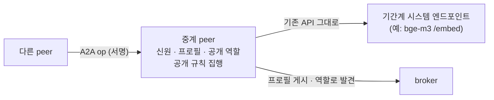
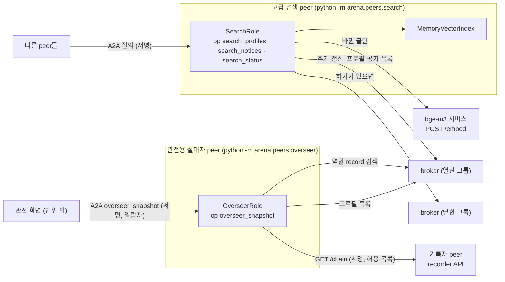
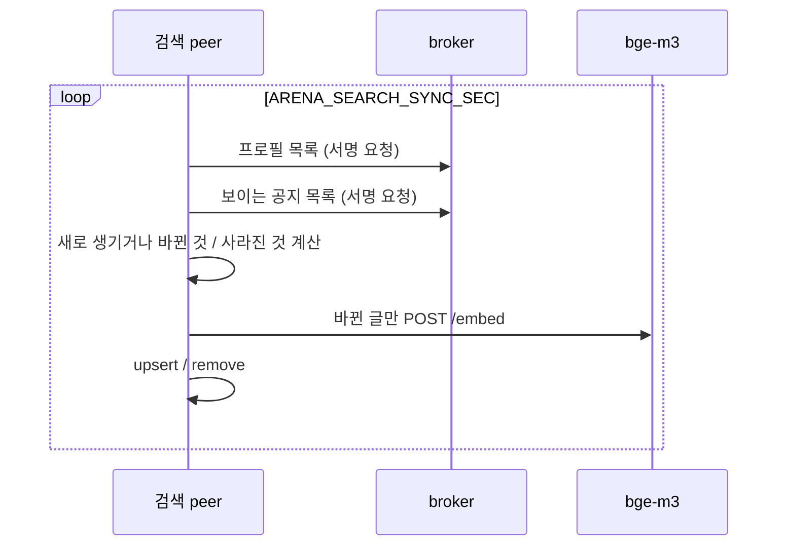
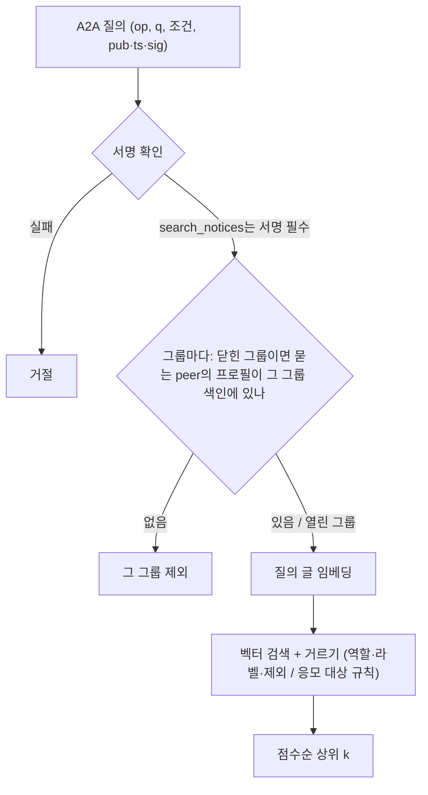

# 3단계 설계: 기본 서빙 peer

요구사항은 [requirements.md](requirements.md).

## 0. 이 단계가 보여 주는 모델: 서비스 peer (사용자 2026-10-30)

고급 검색 peer는 **기간계 시스템의 엔드포인트가 peer가 되는 모델**을 보여 준다. 방식은 두 가지다.

| 방식 | 뜻 | 이 단계의 예 |
|---|---|---|
| 시스템이 곧 peer | 기간계 시스템이 직접 신원(서명 키), 프로필, 공개 역할, A2A 창구를 갖고 아레나에 들어온다 | (해당 없음) |
| **하나의 peer가 서비스를 중계** | peer 하나가 기존 시스템의 API를 감싸 A2A op로 내놓는다. 시스템은 고치지 않는다 | 검색 peer가 bge-m3 임베딩 서비스(`POST /embed`)를 감싸 `search_profiles`·`search_notices`로 내놓는다 |

중계 peer가 시스템 대신 지켜 주는 것은 다음과 같다.

- 누가 물었는지 확인한다(서명 메시지).
- 아레나의 공개 규칙을 지킨다(닫힌 그룹, 응모 대상 라벨).
- 자신을 프로필과 공개 역할로 알려 broker에서 찾을 수 있게 한다.
- 필요하면 한 일을 원장에 남긴다.

시스템은 자기 API만 계속 제공하면 된다. 같은 틀로 인사·결재·자산 같은 기간계 엔드포인트도 peer로 들어올 수 있다. 이 틀을 플랫폼의 기본 기능("서비스 중계 peer 틀")으로 만드는 일은 6단계 후보에 넣는다.



## 1. 구성



## 2. 공통 부품

| 모듈 | 내용 |
|---|---|
| `arena/embedding.py` | `Embedder`(Protocol) `embed(texts) -> list[vector]`, `HttpEmbedder(settings, http=None)`, `EmbedError` |
| `arena/vector.py` | `VectorIndex`(Protocol) `upsert(key, vec, meta)`, `remove(key)`, `keys()`, `get(key)`, `search(vec, k, where=None) -> [(key, score, meta)]`, `MemoryVectorIndex` |
| `arena/signing.py` | `sign_message(identity, op, now=None) -> {pub, ts, sig}`, `verify_message(msg, now, window) -> pub` |
| `arena/peer/owner.py` | `NoOwner` |
| `arena/llm.py` | `NoLLM` |

### 설정 (`Settings`에 추가)

| 키 | 기본값 | 뜻 |
|---|---|---|
| `ARENA_EMBED_URL` | (빈 값) | bge-m3 서비스 주소 |
| `ARENA_EMBED_BATCH` | `32` | 한 번에 보내는 글 수 |
| `ARENA_EMBED_TIMEOUT_SEC` | `60` | 제한 시간 |
| `ARENA_EMBED_RETRIES` | `2` | 다시 묻는 횟수 |
| `ARENA_SEARCH_SYNC_SEC` | `5` | 색인 갱신 주기 |
| `ARENA_SEARCH_MIN_SCORE` | `0.0` | 이보다 낮은 유사도는 버림 |
| `ARENA_SEARCH_PEER_*` | | 검색 peer 단독 실행: `PORT`, `KEY_FILE`, `AREA`, `LABELS`, `BROKERS`(`그룹=주소` 쉼표 목록) |
| `ARENA_OVERSEER_PEER_*` | | 절대자 peer 단독 실행: 같은 항목 + `VIEWERS`(열람자 공개키 목록) |
| `ARENA_OVERSEER_CACHE_SEC` | `1` | 관전 결과 캐시 |
| `ARENA_OVERSEER_TOP_FLOWS` | `5` | 공유 흐름 상위 개수 |

## 3. 고급 검색 peer

### 색인 키와 갱신

| 항목 | 키 | 바뀜 판단 | 색인 글 |
|---|---|---|---|
| 프로필 | `그룹|profile|공개키` | `ver` | `summary + offers + labels` |
| 공지 | `그룹|notice|notice_id` | `h(canon(공지))` | `title + text + kind` |



- 공지 목록은 broker 규칙상 **검색 peer 자신의 라벨에 맞는 공지**만 온다. 검색 peer의 라벨을 넓게 주면 더 많이 색인한다.
- 그룹이 닫혀 있는지는 broker `GET /health`의 `closed`로 안다.

### 질의



- `search_profiles`는 서명이 없어도 열린 그룹은 답한다. 닫힌 그룹은 서명이 있어야 한다.
- `search_notices`는 서명이 필수다. 묻는 peer의 라벨은 **색인된 그 peer의 프로필**에서 가져온다(broker와 같은 근거).

## 4. 관전용 절대자 peer

- `OverseerRole(viewers, settings)`: `locate()`, `read_all()`, `snapshot()`.
- 통계는 `arena/stats.py`의 순수 함수(`ledger_stats(chain, top_flows)`, `per_peer(chain, profiles)`)로 두어 테스트하기 쉽게 한다. 기여 집계는 기존 `contribution`을 쓴다.
- 판정 페이로드의 숫자 항목 평균: `feedback`의 페이로드에서 bool이 아닌 int·float 값을 판정 이름별로 모아 평균을 낸다(예: 어떤 앱이 `score`를 쓰면 `score`의 평균).

## 5. 단독 실행 (`arena/peers/`)

```
python -m arena.peers.search     # ARENA_SEARCH_PEER_*, ARENA_EMBED_*
python -m arena.peers.overseer   # ARENA_OVERSEER_PEER_*
```

`arena/peers/common.py`의 `build_autonomous_peer(settings, prefix, apps)`가 키·공개 영역·라벨·broker 클라이언트를 설정에서 만들고, `NoOwner`·`NoLLM`(LLM 설정이 있으면 실제 LLM)으로 peer를 조립한다. 시작하면 A2A 서버를 열고, 프로필을 게시하고, 앱의 주기 작업을 돈다.

## 6. 테스트

| 층 | 대역 | 예 |
|---|---|---|
| 단위 | `HashEmbedder`(단어 해시 bag-of-words, 정규화) | 색인 갱신(바뀐 것만, 사라진 것 빼기), 거르기, 응모 대상 규칙, 닫힌 그룹, 서명, 통계 |
| HTTP | `httpx.MockTransport` | `HttpEmbedder` 나눔·재시도·오류 |
| 실제 임베딩 | bge-m3 | 뜻이 같은 다른 말 질의 |
| 실제 프로세스 | broker·검색 peer·절대자 peer 프로세스 | A2A 질의, 원장 감사 |
