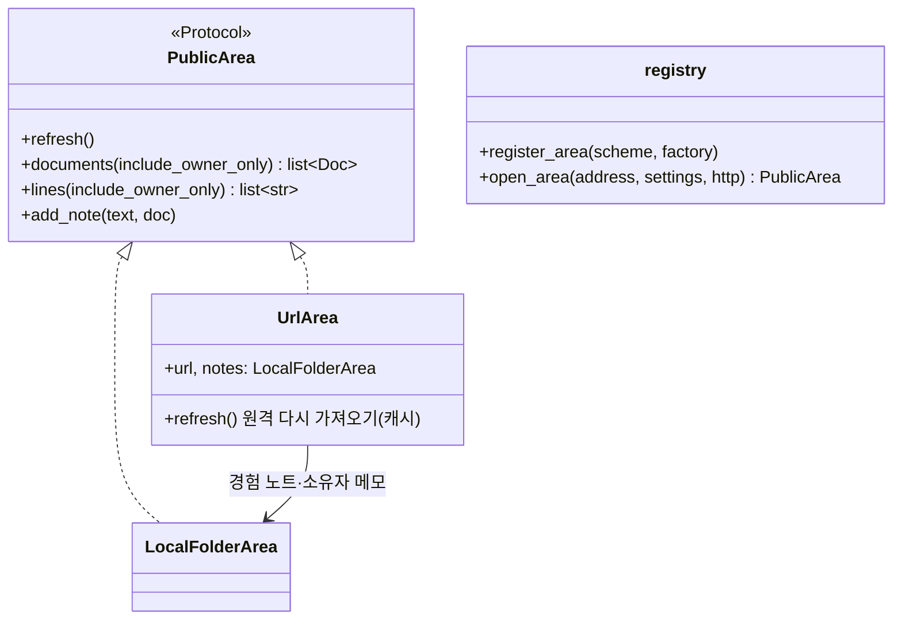
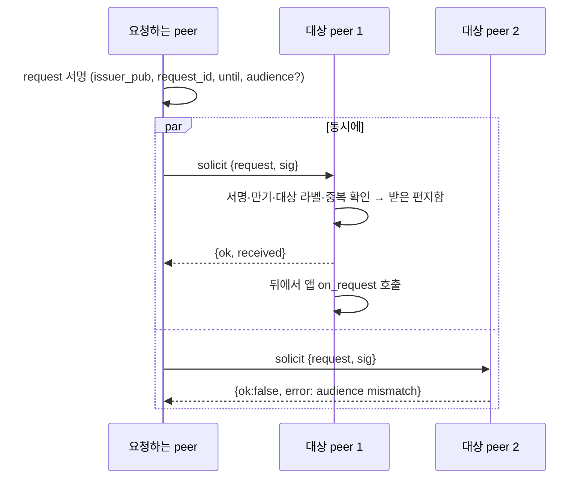
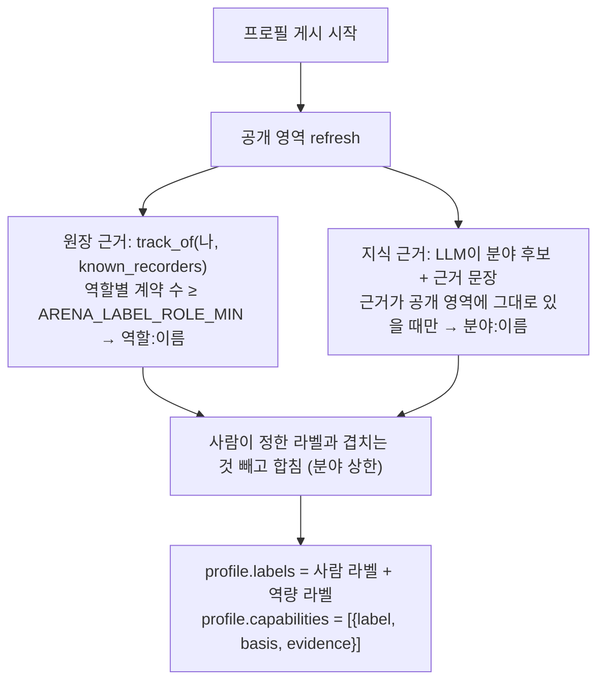
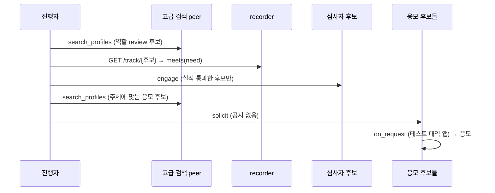

# 4단계 설계: 플랫폼 새 기능

요구사항은 [requirements.md](requirements.md).

## 1. 공개 영역 주소 연결 (`arena/peer/area.py`, `arena/peer/url_area.py`)

- 주소 형식: 경로 또는 `file:///경로` → `LocalFolderArea`. `http(s)://…/x.md` → 문서 하나. `http(s)://…/` → `index.json`(`{"documents":[{"name":"a.md","url":"…"}]}`, 주소가 상대 경로면 목록 주소 기준).
- 원격 문서 이름도 `_`로 시작하면 소유자 전용이다(규칙은 로컬과 같음).
- 설정: `ARENA_AREA_CACHE_SEC`(60), `ARENA_AREA_HTTP_TOKEN`(비면 인증 없음), `ARENA_AREA_LOCAL_NOTES_DIR`(URL 공개 영역의 로컬 노트 폴더, 기본 `data/area-notes`), `ARENA_AREA_HTTP_TIMEOUT_SEC`(10).
- `PublicArea`에 `async refresh()`를 더한다. `ProfileBuilder.build`가 맨 앞에서 부른다.

## 2. 공지 없는 P2P 직접 요청 (`arena/peer/node.py`, `arena/peer/app.py`)

- `PeerApp.on_request(peer, request, sender) -> None`(기본은 아무것도 안 함).
- `Peer.inbox`: 최근 요청(`deque`, `ARENA_SOLICIT_INBOX_SIZE`). `Peer.solicit(targets: list[url], request) -> {url: ack}`.
- 대상 라벨 확인에 쓰는 내 라벨은 **지금 게시된 프로필의 라벨**(사람이 정한 라벨 + 역량 라벨)이다.

## 3. 원장 실적 조회 (`arena/recorder/*`, `arena/peer/track.py`)

| 구성 | 내용 |
|---|---|
| `RecorderService.track(pub)` | `contribution(chain).get(pub)` 또는 0으로 채운 집계. `ARENA_RECORDER_PUBLIC_TRACK=false`면 `{ok:false}` |
| `GET /track/{pub}` | 위 결과. 꺼져 있으면 404 |
| `RecorderAPI.track(pub)` | HTTP·메모리 클라이언트 모두 |
| `track_of(peer, pub, urls)` | 여러 기록자 합산: 숫자는 더하고, 판정·역할 사전은 이름별로 더함. `sources`에 기록자별 성공·실패 |
| `meets(track, need)` | `need` 예: `{"roles": {"review": 1}, "approvals": 1}`. `(통과, 모자란 항목 목록)` |
| `Peer.known_recorders` | `peer.recorder(url)`을 쓸 때마다 기억 + 설정 `ARENA_PEER_TRACK_RECORDERS` |

## 4. 역량 라벨 자율 갱신 (`arena/peer/labels.py`)

- `CapabilityLabeler(settings).compute(peer) -> list[{label, basis: "ledger"|"area", evidence}]`.
- 근거 문장 확인은 공백을 정규화한 부분 문자열 비교, 최소 길이 설정값(`ARENA_LABEL_EVIDENCE_MIN_LEN`, 8).
- 설정: `ARENA_LABEL_ROLE_PREFIX`(`역할:`), `ARENA_LABEL_FIELD_PREFIX`(`분야:`), `ARENA_LABEL_ROLE_MIN`(1), `ARENA_LABEL_FIELD_MAX`(5), `ARENA_LABEL_AUTO`(true; 끄면 역량 라벨을 만들지 않음).

## 5. 경연 모티브, 수집 방식 (테스트 안에서만)

## 6. 테스트 계획

| 층 | 대역 | 예 |
|---|---|---|
| 단위 | `httpx.MockTransport`, `ScriptedLLM`/`RoutedLLM`, 메모리 recorder | 주소 고르기·등록, URL 목록·캐시·실패, 직접 요청 확인 규칙, 실적 합산·비교, 라벨 근거 |
| API | ASGI | `GET /track/{pub}` |
| 경연 모티브 | 메모리 세계 + 검색 peer(결정적 임베딩) | 수집 방식 전 과정 |
| 실제 | 삼성SDS LLM, recorder 프로세스 | 근거 있는 분야 라벨, 실적 조회 |
