# 5단계 설계: 검증과 플랫폼 완성

요구사항은 [requirements.md](requirements.md).

## 1. 원장: 종료와 공동 확인

| 종류 | 서명자 | 페이로드 | 규칙 |
|---|---|---|---|
| `close` | 발행자 | `event_id, issuer, result_hash?` | 선언된 이벤트, 발행자 일치, 한 번만 |
| `attest` | `parties` 전원 | `event_id?, kind, subject, value, parties[], nonce` | 당사자 1명 이상·중복 없음, nonce 한 번, 이벤트 안에서 (종류, 대상) 한 번, policy `attest_roles` |

- 모든 규칙 앞에 "가리키는 이벤트가 닫혔으면 거절"이 붙는다(종료 항목 자신은 제외).
- policy 키: `roles`, `conflict_roles`, `verdict_roles`, `hidden_roles`, **`attest_roles`**.
- 기여 집계: `attested`(종류별), `closed`(수).

### broker 그룹 식별자

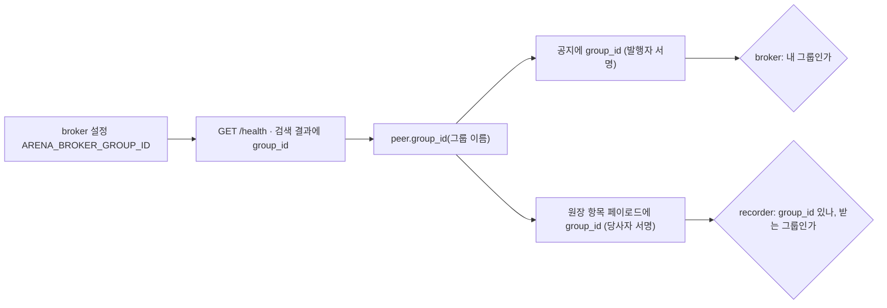

- 한 이벤트가 여러 그룹에 걸치면 항목마다 **그 일이 일어난 그룹**을 적는다. 경연 예: 이벤트 선언·응모·채택은 응모 그룹, 심사자 계약·심사 판정은 심사 그룹.

### 제네시스 (`arena/genesis.py`)

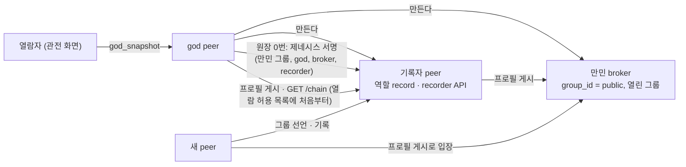

- 순서: god 키 → broker → 기록자(열람 허용 목록에 god) → 원장이 비었으면 제네시스 기록(있으면 god·broker·기록자 키와 같은지 확인) → broker·recorder API → 프로필 게시 → peer A2A 창구. god의 창구가 열리면 제네시스가 끝난 것이다.
- 설정 `ARENA_GENESIS_*`: 폴더(키·원장·공개 영역), broker 포트, 기록자 A2A 포트, recorder API 포트, god 포트.

## 2. 역량 분야 표준 목록

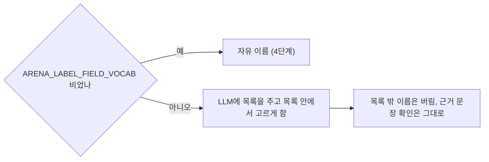

## 3. 검증 점검표

| 공격 | 탐지 수단 | 테스트 |
|---|---|---|
| 과거 항목 내용·서명·기록자 서명 변경 | 감사(해시 재계산, 서명 재검증) | `tests/test_security.py` |
| 끼워 넣기, 순서 바꾸기, 가운데 삭제 | 감사(이전 해시 연결) | 같음 |
| 끝 잘라내기 | **영수증 대조** `Receipts.missing_from(chain)` | 같음 |
| 허용 목록 밖 전체 열람, 서명 없음, 다른 경로 서명, 오래된 서명 다시 보내기 | recorder 서명 요청 확인 + 허용 목록, 접근 기록 | 같음 |
| 닫힌 그룹 검색, 관전 결과 열람 | broker 그룹 허가, god 열람자 목록 | 같음 |

반복 안정성은 `scripts/repeat_live.py`가 지정한 실제 LLM 테스트를 N번 돌려 통과 수·시간·대체값 횟수를 표로 남긴다.

## 4. 가위바위보 인수 (테스트 안에서만, `tests/acceptance/`)

### 대역 앱

| 앱 | 쓰는 플랫폼 확장 지점 | 하는 일 |
|---|---|---|
| `RpsHost` | op `join`, `result`, `report` | 참가 받기(→ engage), 대진표 먼저 등록·직접 요청으로 알림, 결과 확인(공개 확인), 순위 공동 확인, 종료 |
| `RpsPlayer` | `on_request`, `accept_role`, op `rps_challenge`, `rps_reveal`, `rps_sign` | 소유자에게 참가 묻기, 경기(해시 먼저 등록 → 공개 → 확인 → 공동 확인), 결과 보고 |

### 경기 한 판

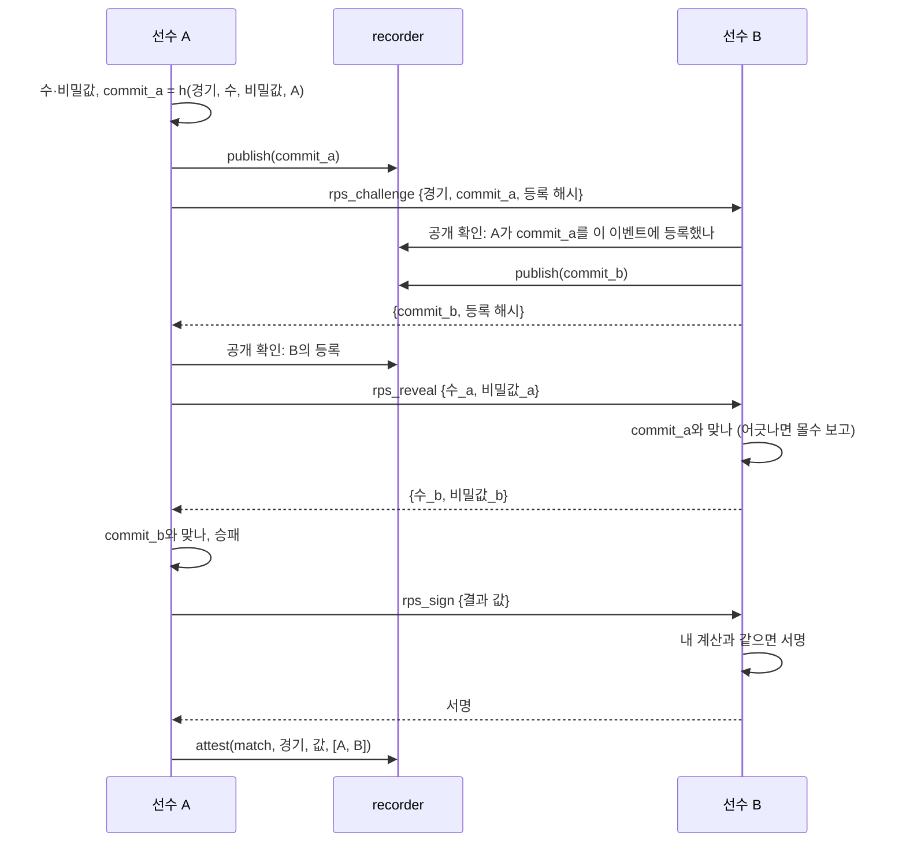

- 비기면 같은 경기를 다시 한다(상한은 테스트 상수). 상한까지 비기면 무승부로 공동 확인한다.
- 몰수: 공개가 해시와 어긋나면 정직한 쪽이 개최 peer에 `report`(두 등록 해시와 공개값)를 보낸다. 개최 peer가 공개 확인으로 따져 보고 `forfeit`를 발행자 혼자 공동 확인한다.
- 승률 = 승 / 경기 수, 같으면 승 수, 그다음 공개키 순.
- 개최 peer는 선수들이 보고한 공동 확인 해시를 공개 확인으로 검증해 순위를 계산한다(원장 전체 열람 권한이 없음).
- 경기 메시지 계수: 전송을 감싸 (보낸 peer, 받는 주소, op)를 센다. `rps_*` op가 개최 peer나 broker 주소로 간 횟수가 0이어야 한다.

### policy

```json
{"roles": ["player"], "conflict_roles": [], "verdict_roles": {},
 "attest_roles": {"match": "player", "forfeit": "issuer", "ranking": "issuer"}, "hidden_roles": []}
```


## 5. peer 재시작 지속성 (`arena/peer/home.py`)

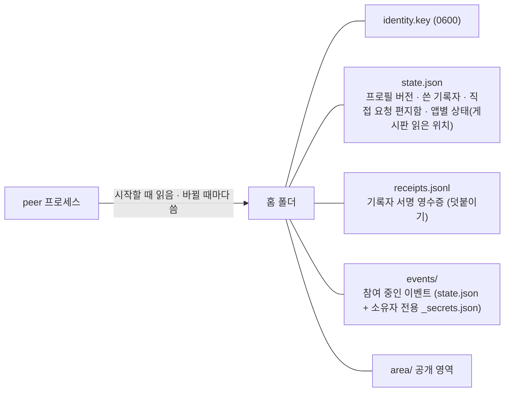

- `Peer(..., home=PeerHome(...))`면 위 상태를 읽고 쓴다. 홈이 없으면 예전처럼 메모리에만 둔다(단위 테스트).
- 제네시스의 god·기록자 peer는 제네시스 폴더 아래 `homes/`를 홈으로 쓴다(키는 제네시스에 서명된 키 파일 그대로).


## 6. broker 장애 대비 (`arena/broker/failover.py`)

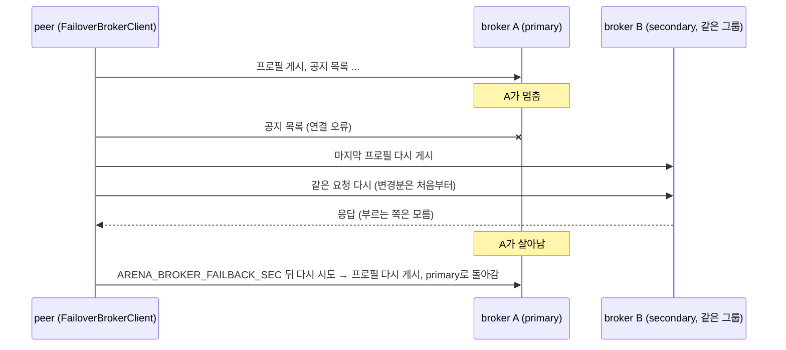

- `FailoverBrokerClient(clients)`는 `BrokerAPI`를 그대로 따르므로 peer와 기본 비서는 바뀌지 않는다.
- 공지는 같은 그룹의 broker끼리 공유되므로 secondary에도 있다. 프로필은 각 peer의 기본 broker에만 있으므로 넘어갈 때 다시 게시한다.
- 설정 형식: `ARENA_SEARCH_PEER_BROKERS=public=http://a:9110|http://b:9111`.


## 7. 플러그인 구조와 SOLID 정리

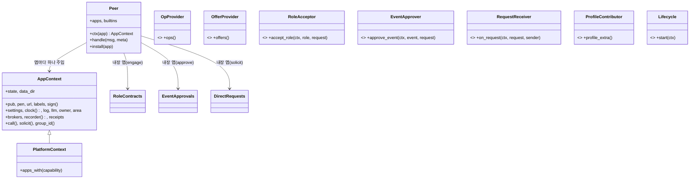

| SOLID | 이전 | 이후 |
|---|---|---|
| 단일 책임 | peer가 op 분기·플랫폼 op·지속성을 함께, 기본 비서가 한 파일 511줄 | peer는 조립·전달·지속성만, 플랫폼 op는 내장 앱 셋, 기본 비서는 상태·도구·핵심으로 나눔 |
| 개방-폐쇄 | 원장 항목 종류를 더하면 다섯 곳 수정, 도구를 더하면 비서 수정 | `EntryType` 등록, `Tool` 등록, 앱 `install` |
| 리스코프 치환 | (유지) | 장애 대비 클라이언트·메모리·HTTP 클라이언트가 같은 broker 인터페이스 |
| 인터페이스 분리 | 앱 기반 클래스 하나에 확장 지점 6개, broker 인터페이스 10개 메서드 | 능력 인터페이스 7개 중 필요한 것만, broker는 `ProfileBoard`·`NoticeBoard`·`GroupAdmin`·`Health` |
| 의존성 역전 | 앱이 peer 객체에 직접 기댐, 메시지 머리를 peer 인스턴스 변수로 전달 | 앱은 `Context` 인터페이스에만 기대고, 머리는 인자로 받음 |

외부 개발자용 공개 면은 `arena.sdk`(인터페이스, 어댑터, 진입점 찾기, 테스트 하네스)이며 규약은 [../app-guide.md](../app-guide.md)에 있다.


## 8. 이벤트의 앱 지정과 이벤트 배정기

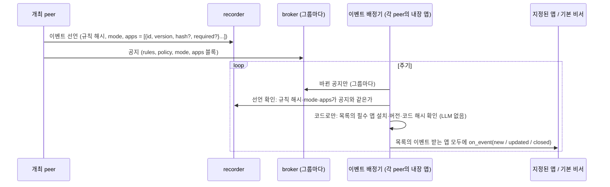

- 앱 식별자는 UUID다. 플랫폼 앱은 고정 값을 쓴다(내장 넷, 기본 비서, 기록자, 검색, god).
- 기본 비서는 더 이상 게시판을 직접 읽지 않는다. 배정기가 넘겨준 이벤트만 처리한다(`EventHandler`).
- 배정기가 읽은 위치(그룹별)와 넘긴 이벤트는 앱 전용 저장소에 남아 재시작 뒤에도 이어진다.


## 9. 이벤트 진행 현황 (실제 실행 6에서 발견)

실행 6에서는 선수 셋이 모두 "상대가 먼저 등록하기를" 기다리며 멈췄다. 한 선수는 상대의 등록을 원장에서 확인하려다 내용 해시를 원장 항목 해시로 착각해 "없다"고 판단했고, 다른 선수는 자기가 받은 등록 알림을 놓쳤다. 누구도 이벤트 전체에서 누가 무엇을 했는지 볼 방법이 없었다. 이를 이벤트 종류와 상관없는 기능으로 넣었다.

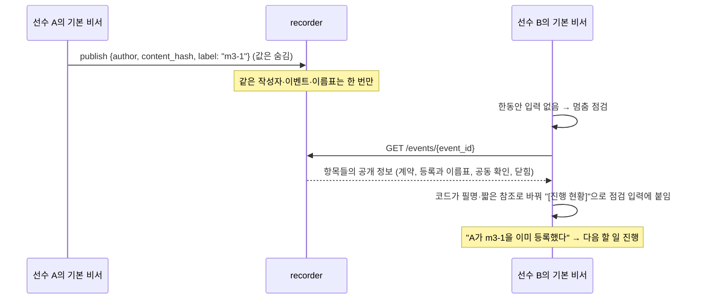

- 이름표는 공개 정보다. 무엇에 대한 등록인지(예: 몇 번째 판)만 알리고 값은 알리지 않는다. 같은 이름표로 두 번 등록할 수 없으므로 먼저 등록한 값을 바꿔치기할 수 없다.
- 진행 현황에 나온 사람(작성자, 계약자, 발행자, 당사자, 결재자)은 명단에 올라 LLM에게 필명으로만 보인다.
- `verify`에 내용 해시가 들어오면 "이 값은 내용 해시이고, 담은 항목은 #…"이라고 코드가 알려 준다.
- 기다림 판단은 로그에 남아 다음 실패의 원인을 바로 볼 수 있다.


## 10. 공개값은 코드가 나른다 (실제 실행 7에서 발견)

실행 7은 처음으로 끝까지 통과했다(이벤트 종료, 공증된 승률 순위 = 원장에서 다시 계산한 순위). 그러나 경기 m1에서 한 선수의 에이전트가 자기 공개값을 손으로 옮기며 다른 판(m3-1)의 비밀값을 붙였고, 원장 대조에 실패해 규칙 6(몰수)에 따라 졌다. 원장은 맞게 막았지만 정직한 선수가 진 것이다. 비밀값·해시처럼 사람이 읽을 필요 없는 값은 LLM이 옮기지 않게 했다.

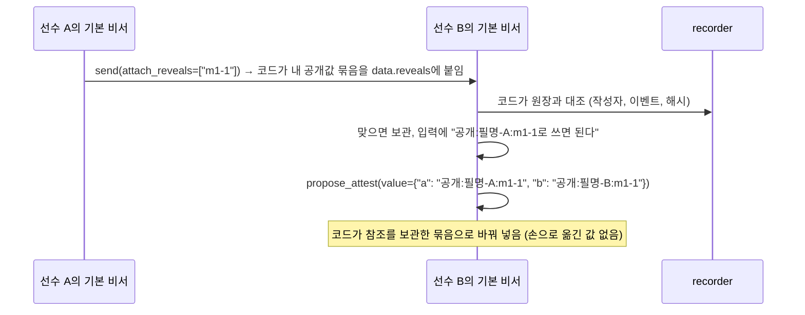


## 11. 원장 공개 (실제 실행 8에서 발견)

메시지로 공개값을 주고받으면 "보냈다"는 사실이 LLM의 기억에만 남는다. 실행 8에서 한 선수는 빈 메시지를 보내고 보냈다고 믿었다. 공개 자체를 원장 항목으로 만들어, 보냈는지 받았는지를 원장이 답하게 했다.

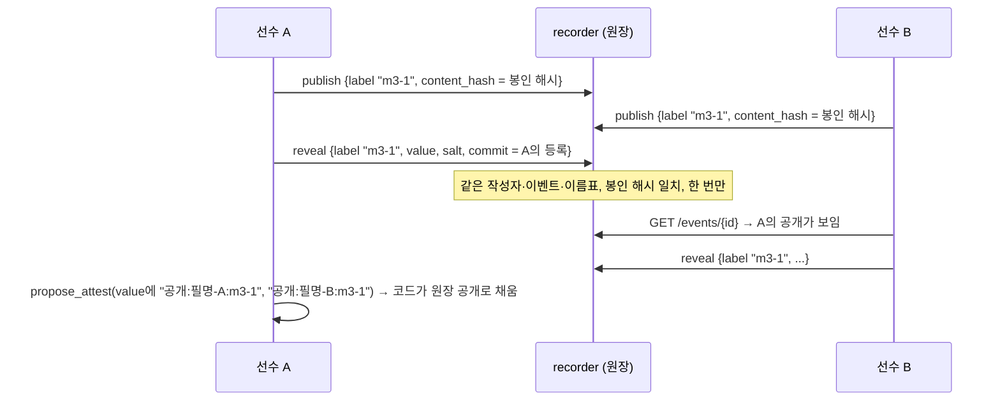

가위바위보 규칙 글(`dev/acceptance-rps-rules.md`)도 메시지 대신 원장 공개를 쓰도록 바꿨다. 플랫폼이 새 기능을 얻었고, 규칙 글은 그 기능을 쓰는 소재일 뿐이다.


## 12. 한 사람 한 이름, 값 목록, 원장 새 기록 알림 (실제 실행 9에서 발견)

- **한 사람 한 이름**: 입력이 LLM에게 가기 전에, 모르는 64자 값을 이벤트 원장(계약자, 작성자, 당사자)과 broker 프로필에서 찾아 공개키면 명단에 올린다. 그 뒤 줄이기에서 필명이 된다. 해시 참조(`#…`)와 필명이 같은 사람을 가리키는 일이 없어진다.
- **값 목록**: 정책 블록의 `reveal_values`. 정책은 원장의 이벤트 선언에 들어가므로 원장 규칙이 공개 시점에 확인할 수 있다(등록 시점에는 값이 숨겨져 있어 원장은 모른다. 그때는 비서 코드가 막는다).
- **원장 새 기록 알림**: 비서의 감시 고리가 이벤트마다 마지막으로 본 원장 순번(`ledger_seen`, 저장됨)을 기억하고, 그 뒤 다른 사람의 기록만 입력으로 넣는다.

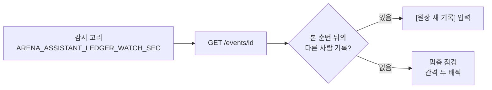


## 13. 배정 (실제 실행 10에서 발견)

여러 경기를 한꺼번에 치르면 "나는 어느 경기에서 누구와 붙는가"를 LLM이 기억해야 했다. 실행 10에서는 대진표와 다른 상대와 경기를 치르고 그 결과에 서명까지 했다. 배정을 원장 항목으로 만들고, 배정된 종류의 공동 확인은 원장이 배정과 대조한다. 심사위원 배정, 짝 지정처럼 다른 이벤트에도 그대로 쓰인다.

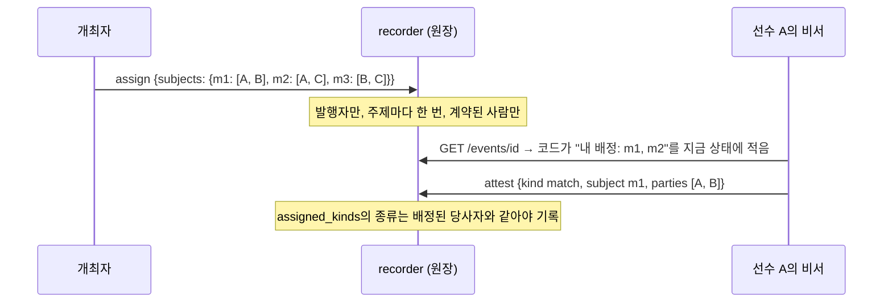

실행 시간 상한: 실행 10은 세 경기에 비긴 판이 여럿 나오고 LLM 서비스 바쁨(429)으로 쉬는 시간이 겹쳐 900초 안에 끝나지 않았다. 인수 테스트의 상한을 1500초로 늘렸다(플랫폼 동작은 바뀌지 않음).


## 14. 앱 배포 peer (5단계 마지막, 선택 기능)

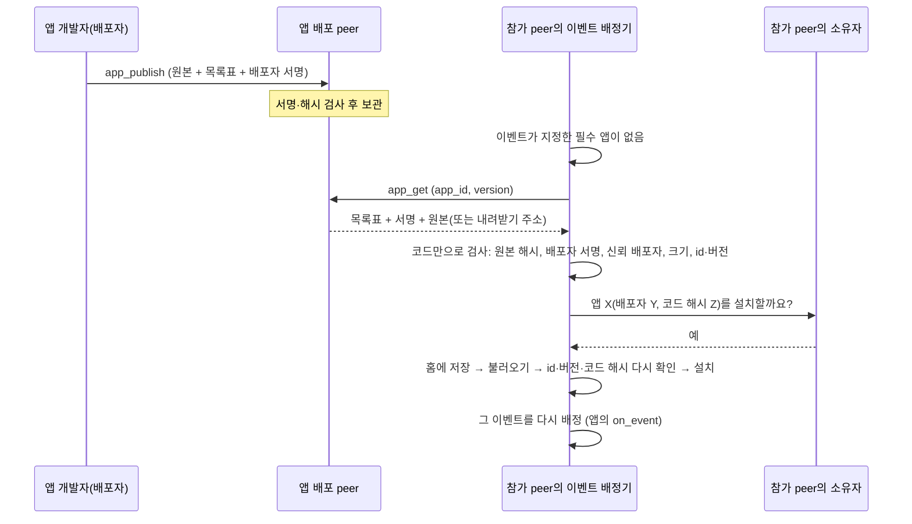

- **나눈 책임**: 꾸러미 만들기·검사는 `arena/sdk/packaging.py`(개발자와 플랫폼이 같은 규칙을 씀), 배포 peer 역할은 `arena/peer/app_store.py`, 받아서 설치하기는 `arena/peer/app_install.py`. 이벤트 배정기는 설치기를 주입받아 쓰고(`EventRouter(settings, installer)`), 설치기가 없으면 지금처럼 "설치되어 있지 않음"으로 끝난다.
- **원본 한 파일**: 꾸러미는 모듈 원본 한 파일이다. 불러올 때 앱마다 겹치지 않는 모듈 이름을 붙인다. 이벤트의 코드 해시(`app_fingerprint`)는 앱 클래스 원본의 해시이므로, 꾸러미 해시(파일 전체)와 따로 확인한다.
- **배포 peer 찾기**: 지금은 설정(`ARENA_APP_STORE_URLS`)으로만 정한다. 배포 peer를 broker에서 찾는 일은 이후 과제다.
- **격리 없음**: 설치한 코드는 peer 프로세스 안에서 그대로 실행된다. 승인 질문에 이 사실을 함께 보여 준다.
