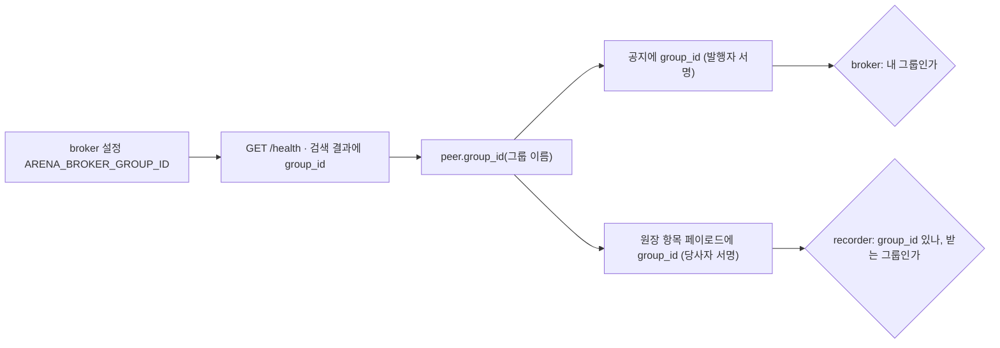
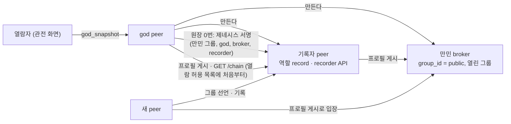
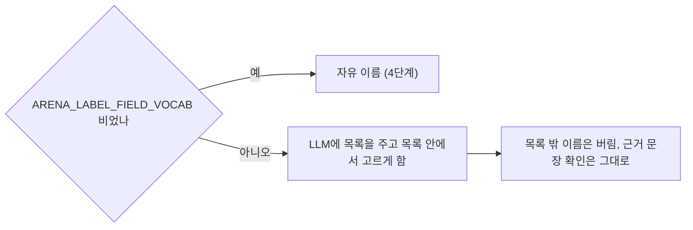
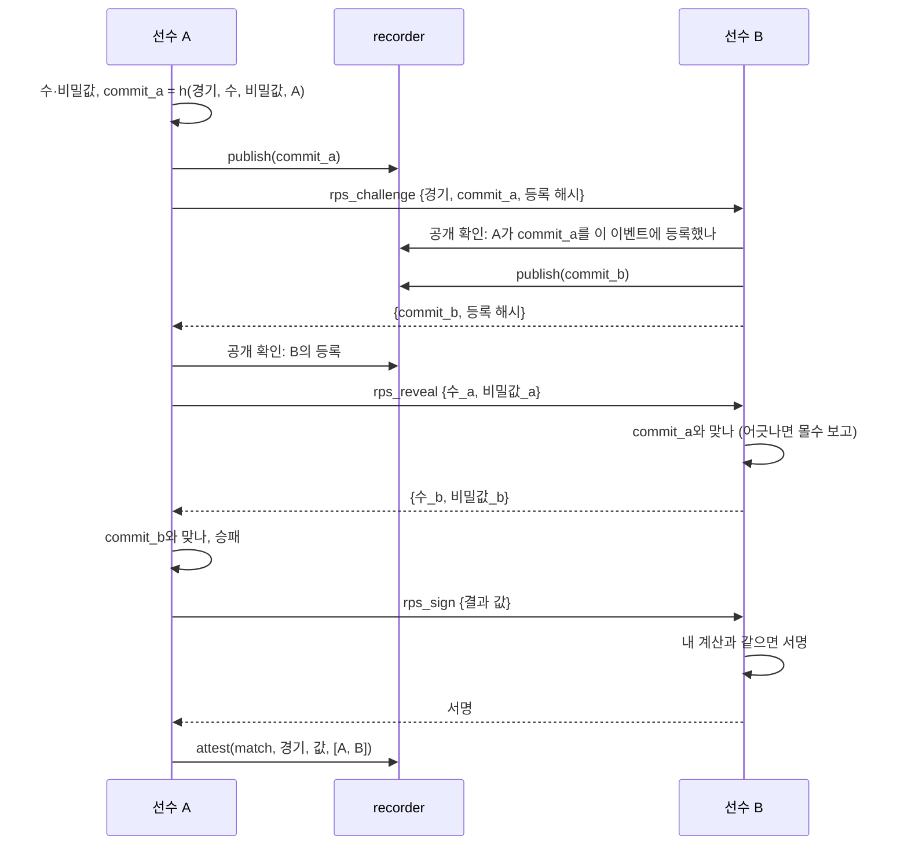

# 5단계 설계: 검증과 플랫폼 완성

요구사항은 [requirements.md](requirements.md).

## 1. 원장: 종료와 공동 확인

| 종류 | 서명자 | 페이로드 | 규칙 |
|---|---|---|---|
| `close` | 발행자 | `event_id, issuer, result_hash?` | 선언된 이벤트, 발행자 일치, 한 번만 |
| `attest` | `parties` 전원 | `event_id?, kind, subject, value, parties[], nonce` | 당사자 1명 이상·중복 없음, nonce 한 번, 이벤트 안에서 (종류, 대상) 한 번, policy `attest_roles` |

- 모든 규칙 앞에 "가리키는 이벤트가 닫혔으면 거절"이 붙는다(종료 항목 자신은 제외).
- policy 키: `roles`, `conflict_roles`, `verdict_roles`, `hidden_roles`, **`attest_roles`**.
- 기여 집계: `attested`(종류별), `closed`(수).

### broker 그룹 식별자



- 한 이벤트가 여러 그룹에 걸치면 항목마다 **그 일이 일어난 그룹**을 적는다. 경연 예: 이벤트 선언·응모·채택은 응모 그룹, 심사자 계약·심사 판정은 심사 그룹.

### 제네시스 (`arena/genesis.py`)



- 순서: god 키 → broker → 기록자(열람 허용 목록에 god) → 원장이 비었으면 제네시스 기록(있으면 god·broker·기록자 키와 같은지 확인) → broker·recorder API → 프로필 게시 → peer A2A 창구. god의 창구가 열리면 제네시스가 끝난 것이다.
- 설정 `ARENA_GENESIS_*`: 폴더(키·원장·공개 영역), broker 포트, 기록자 A2A 포트, recorder API 포트, god 포트.

## 2. 역량 분야 표준 목록



## 3. 검증 점검표

| 공격 | 탐지 수단 | 테스트 |
|---|---|---|
| 과거 항목 내용·서명·기록자 서명 변경 | 감사(해시 재계산, 서명 재검증) | `tests/test_security.py` |
| 끼워 넣기, 순서 바꾸기, 가운데 삭제 | 감사(이전 해시 연결) | 같음 |
| 끝 잘라내기 | **영수증 대조** `Receipts.missing_from(chain)` | 같음 |
| 허용 목록 밖 전체 열람, 서명 없음, 다른 경로 서명, 오래된 서명 다시 보내기 | recorder 서명 요청 확인 + 허용 목록, 접근 기록 | 같음 |
| 닫힌 그룹 검색, 관전 결과 열람 | broker 그룹 허가, god 열람자 목록 | 같음 |

반복 안정성은 `scripts/repeat_live.py`가 지정한 실제 LLM 테스트를 N번 돌려 통과 수·시간·대체값 횟수를 표로 남긴다.

## 4. 가위바위보 인수 (테스트 안에서만, `tests/acceptance/`)

### 대역 앱

| 앱 | 쓰는 플랫폼 확장 지점 | 하는 일 |
|---|---|---|
| `RpsHost` | op `join`, `result`, `report` | 참가 받기(→ engage), 대진표 먼저 등록·직접 요청으로 알림, 결과 확인(공개 확인), 순위 공동 확인, 종료 |
| `RpsPlayer` | `on_request`, `accept_role`, op `rps_challenge`, `rps_reveal`, `rps_sign` | 소유자에게 참가 묻기, 경기(해시 먼저 등록 → 공개 → 확인 → 공동 확인), 결과 보고 |

### 경기 한 판



- 비기면 같은 경기를 다시 한다(상한은 테스트 상수). 상한까지 비기면 무승부로 공동 확인한다.
- 몰수: 공개가 해시와 어긋나면 정직한 쪽이 개최 peer에 `report`(두 등록 해시와 공개값)를 보낸다. 개최 peer가 공개 확인으로 따져 보고 `forfeit`를 발행자 혼자 공동 확인한다.
- 승률 = 승 / 경기 수, 같으면 승 수, 그다음 공개키 순.
- 개최 peer는 선수들이 보고한 공동 확인 해시를 공개 확인으로 검증해 순위를 계산한다(원장 전체 열람 권한이 없음).
- 경기 메시지 계수: 전송을 감싸 (보낸 peer, 받는 주소, op)를 센다. `rps_*` op가 개최 peer나 broker 주소로 간 횟수가 0이어야 한다.

### policy

```json
{"roles": ["player"], "conflict_roles": [], "verdict_roles": {},
 "attest_roles": {"match": "player", "forfeit": "issuer", "ranking": "issuer"}, "hidden_roles": []}
```
