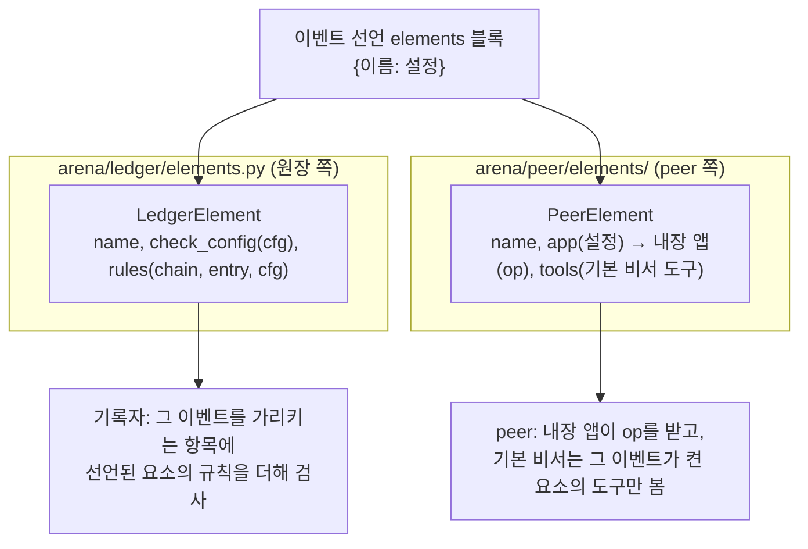
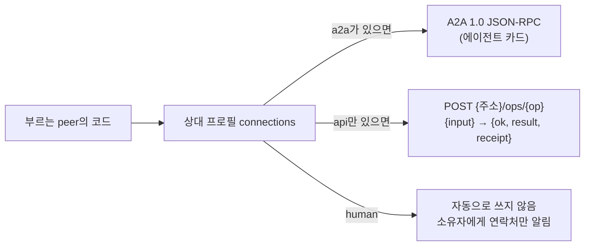
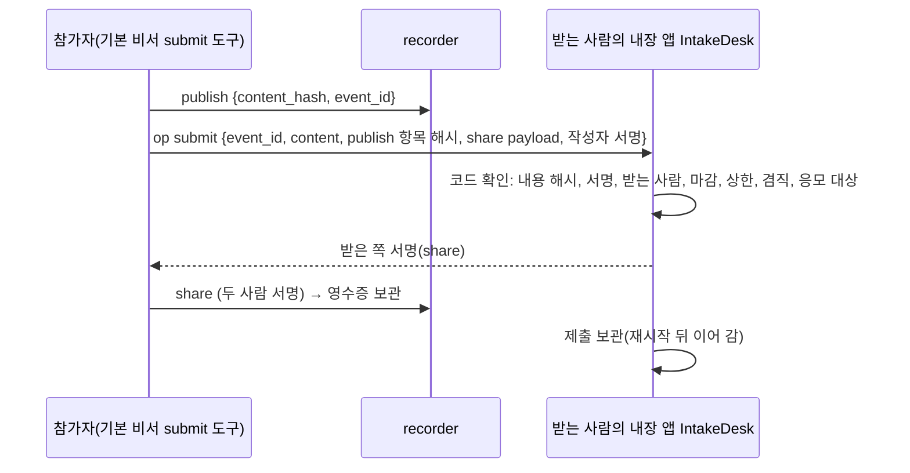

# 6단계 설계: 여러 이벤트에 공통인 요소의 기본 탑재

요구사항: [requirements.md](requirements.md). 구현 순서는 6-0 → 6-A → 6-B → 6-C → 6-D → 6-V → 6-E이고, 요소마다 테스트를 먼저 쓴다.

## 0. 층 나눔

요소 하나는 원장 쪽(무엇을 받을지)과 peer 쪽(무엇을 할지)에 걸친다. 원장 코드가 peer 코드를 알면 안 되므로(지금 구조와 같은 방향), 같은 이름으로 두 곳에 나눠 등록한다.



- 요소를 더할 때 원장(`rules.check`), 기록자, 이벤트 배정기, 기본 비서를 고치지 않는다. 등록만 한다(`register_ledger_element`, `register_peer_element`).
- 요소의 확인은 모두 코드다. 기본 비서는 도구를 고르고 인자를 채울 뿐이다.

## 1. 6-0 요소 블록

**선언과 공지**: 이벤트 선언 payload와 공지에 `elements: {이름: 설정}`을 더한다(없으면 `{}`). `announce_event(..., elements=None)`.

**원장**:
- `event` 항목의 모양 검사에 더한다: `elements`는 객체, 이름은 등록된 요소, 설정은 그 요소의 `check_config`를 통과.
- 공통 규칙 뒤에 `r_elements`를 더한다: 항목이 이벤트를 가리키면(`event_id`), 그 이벤트 선언의 요소마다 `rules(chain, entry, cfg)`를 차례로 본다.
- 이벤트 공개 정보에 `elements`를 싣는다.

**이벤트 배정기**: 지금 규칙 해시·실행 방식·앱 목록을 원장과 대조하는 자리에서 `elements`도 같아야 받는다.

**기본 비서**: 이벤트 상태에 `elements`를 둔다(저장됨). `Tool`에 `element: str | None`을 더하고, `_tools_for`는 그 이벤트가 켠 요소의 도구만 보여 준다. 요소 도구는 요소를 등록할 때 기본 비서에 더한다.

## 2. 6-A API를 제공하는 peer 틀

### 2.1 서비스 설명 파일 (JSON)

```json
{
  "name": "rps-referee", "version": "1.0", "app_id": "<고정 UUID>",
  "description": "두 공개값으로 가위바위보 승패를 계산하고 원장에 기록한다",
  "offers": ["판정"], "allow_groups": ["public"], "require_signed": false,
  "base_url": "http://localhost:9000", "headers_env": {"Authorization": "REFEREE_TOKEN"},
  "ops": {
    "judge": {"python": "my_pkg.referee:judge", "description": "...", "record": {"kind": "match"}},
    "lookup": {"http": {"method": "GET", "path": "/items/{id}"}, "description": "..."}
  }
}
```

- `python` op: `async def fn(input: dict, ctx) -> dict`. `http` op: 지금의 `HttpServiceAdapter` 중계를 그대로 쓴다. 헤더의 비밀값은 파일에 넣지 않고 환경 변수 이름만 적는다.
- `ServiceApp`(`arena/peer/service.py`)이 파일을 읽어 op를 만든다. `HttpServiceAdapter`는 이 앱의 `http` op 구현으로 옮긴다(SDK 공개 이름은 유지).
- 단독 실행: `python -m arena.peers.service --spec <파일>`(포트 등은 `ARENA_SERVICE_PEER_*`).

### 2.2 결과 서명 (P6-A2)

모든 답에 영수증을 붙인다.

```text
receipt = {service: 서비스 공개키, op, request_hash: SHA-256(정규JSON(요청에서 서명 칸을 뺀 것)),
           result_hash: SHA-256(정규JSON(result)), ts}
reply   = {ok, result, receipt, receipt_sig: 서명(receipt)}
```

`arena.sdk.verify_service_receipt(reply, request, expected_pub)`가 묻는 쪽에서 확인한다.

### 2.3 원장에 결과 남기기 (P6-A3)

op 설정에 `record: {kind}`가 있으면, 호출에 `event_id`, `subject`가 함께 오고:

1. 서비스 peer가 그 이벤트의 기록자를 뿌리 신뢰로 확인한다(`ctx.recorder_trust`).
2. 함수가 결과를 계산한다.
3. 서비스 peer가 혼자 당사자인 공동 확인 `{kind, subject, value: {input_hash, result}}`을 기록한다. 원장은 정책의 `attest_roles`로 그 종류를 맡은 역할인지, 배정된 종류면 배정된 당사자인지 확인한다(지금 규칙). 그래서 이벤트는 판정 peer와 역할 계약을 맺고 `attest_roles: {match: "referee"}`처럼 맡긴다.
4. 답에 그 항목의 해시를 싣는다.

### 2.4 찾기 (P6-A4)

- 프로필의 `offers`에 `service:<name>`과 설명 파일의 `offers`를, `service` 칸에 op 목록과 설명을 싣는다(지금 `profile_extra`를 넓힘).
- 앱 설치기: `ARENA_APP_STORE_URLS`가 비어 있고 `ARENA_APP_STORE_DISCOVER`가 켜져 있으면, broker에서 역할 `앱 배포`를 가진 peer를 찾아 차례로 묻는다.

### 2.5 기본 비서 도구 (P6-A5)

`call_service {peer, op, input_json, event_subject?}`: 코드가 필명을 주소로 바꾸고, 보내고, 영수증 서명과 요청·결과 해시를 확인해 이벤트 상태에 보관한다. 결과만 LLM에 보여 준다.

### 2.6 연결 방식 (P6-A6 ~ A8)



- **등록부**(`arena/peer/connections.py`): `ConnectionKind(name, label, fields, automatic)`. 처음 등록: `human`(칸 `contact`, 자동 아님), `a2a`(칸 `url`), `api`(칸 `url`, 선택 `ops`). broker와 peer가 같은 등록부로 검사한다.
- **프로필**: `connections: [{kind, url | contact, ...}]`. `url`(지금 칸)은 A2A 호환을 위해 남긴다. 에이전트 peer는 `PeerConfig.connections`가 비면 `[{kind: a2a, url}]`. 사람 연락처는 설정 `ARENA_PEER_HUMAN_CONTACT`가 있을 때만.
- **`api` 묶음**(`arena/rest.py`): 서버 `build_rest_app(handler)`는 `POST /ops/{op}`를 받아 `{op, **body}`를 peer의 메시지 처리기(`Peer.handle`)에 머리와 함께 넘긴다. 즉 같은 op가 두 방식으로 열린다. 클라이언트 `RestTransport.call(url, msg, meta)`.
- **고르기**: `Peer.call_peer(pub, msg, group, event)`가 broker 프로필의 연결 정보를 읽어 `a2a` → `api` 순으로 쓴다. `call_service` 도구가 이것을 쓴다.
- **API 전용 peer**: 서비스 peer 실행기 `--connections api`(또는 `ARENA_SERVICE_PEER_CONNECTIONS`)면 A2A 서버 없이 REST만 열고 프로필 연결 정보도 `api`만 싣는다. 신원 키와 서명된 프로필, 서명 영수증은 그대로다.

## 3. 6-B 제출 받기 (`intake`)

**설정**: `{"deadline": 유닉스 초, "max_per_author": 1, "receiver": "issuer" 또는 역할 이름, "audience": [라벨...]}`.

**원장**: `share` 항목에 선택 칸 `event_id`를 더한다(이벤트 참조 선택). `intake`를 켠 이벤트에서 `terms: "submission"`인 `share`는:
- 받는 사람(`consumer`)이 설정의 받는 사람(개최자 또는 그 역할 계약자)이고,
- 기록 시각이 마감 전이고,
- 같은 작성자(`provider`)의 제출 수가 상한 안이고,
- 작성자가 겸할 수 없는 역할이 아니어야 한다(지금의 `conflict_roles` 확인을 `share`에도).

**peer**:



- `IntakeDesk`는 내장 앱(고정 app_id, op `submit`)이다. 보관은 앱 전용 저장소.
- 개최자 쪽 목록은 `AppContext.submissions(event_id)`로 연다(필명, 내용 해시, 받은 시각). 기본 비서 도구 `submissions`는 이것을 보여 준다.

## 4. 6-C 평가 요청과 판정 기록 (`review`)

**설정**: `{"reviewer_role": "review", "verdict": "review", "per_item": 1}`. 판정 권한은 정책의 `verdict_roles`(지금 있음).

**원장**: `feedback`에 공개 정보(평가자, 내용 해시, 판정, 점수)를 더한다. `review`를 켠 이벤트에서 판정 종류가 설정의 `verdict`인 `feedback`은 평가자가 그 내용을 넘겨받은 기록(`share`, `terms: "review"`)이 있어야 한다(지금의 "받은 적 없는 내용" 규칙을 이벤트 범위로).

**peer**:
- 개최자 도구 `request_review {reviewer, items}`: 넘김 `share` payload를 만들어 평가자의 op `review_request`로 보낸다.
- 평가자 쪽 내장 앱 `ReviewDesk`가 받아 `ReviewProvider` 능력(`review(ctx, items, request) -> [{content_hash, score, comment}]`)을 가진 앱에 넘긴다. 없으면 기본 비서가 규칙 글을 보고 판정한다. 판정 payload와 서명, 넘김 영수증은 코드가 만든다.
- 개최자가 넘김과 판정을 원장에 기록한다. 도구 `verdicts`는 항목별 판정을 보여 준다. **무엇을 채택할지는 정하지 않는다.**

## 5. 6-D 봉인 묶음 (`sealed`)

**설정**: `{"kinds": ["match"]}`(배정 종류 가운데 봉인할 것).

**라벨 규약**: 배정된 주제 `S`의 봉인 라벨은 `S` 또는 `S-<숫자>`. 라벨에서 주제 찾기: 라벨이 배정 주제와 같으면 그 주제, 아니면 마지막 `-<숫자>`를 뗀 것이 배정 주제면 그 주제.

**원장 규칙**(그 이벤트를 가리키는 항목에):
- `reveal`(라벨 `L`, 주제 `S`): `S`에 배정된 당사자 전원에게 라벨 `L`의 `publish`가 있어야 한다.
- `publish`(라벨 `L`, 주제 `S`): 라벨 `L`의 `reveal`이 이미 있으면 받지 않는다.

**기본 비서**: 지금 상태에 "봉인 m1-2: 등록 2/2, 공개 가능" 같은 줄을 코드가 진행 현황에서 만들어 넣는다.

## 6. 6-V 검증

### 6.1 LLM 사용량 (P6-V1)

- LLM 어댑터의 `ask_json`에 선택 인자 `on_usage(usage: dict)`를 더한다. OpenAI 호환 응답의 `usage`(prompt, completion 토큰), Claude 응답의 `usage`를 넘긴다. 없으면 호출 수만.
- `UsageMeter`가 peer(필명)별로 호출 수와 토큰을 센다. `ask_json(llm, log, actor, ...)` 도우미가 미터에 넘긴다. 미터는 peer에 주입하고(테스트·실행기에서 만들어 넣음), 실행 끝에 표로 낸다.

### 6.2 경연 모티브를 요소로 (P6-V2)

`tests/motif/`의 대역 앱 `Inbox`, `Judge`를 `IntakeDesk`, `ReviewDesk` + `ReviewProvider` 대역으로 바꾼다. 흐름 함수(`tests/motif/flow.py`)는 요소를 켠 이벤트를 선언하고 요소의 op를 쓴다. 기존 테스트가 그대로 통과해야 한다.

### 6.3 있을 때와 없을 때 비교 (P6-V3)

`scripts/compare_elements.py`: 같은 이벤트를 두 가지로 N번씩 돌린다(5단계의 반복 안정성 도구와 같은 틀).

| 대상 | 요소 없이 | 요소를 켜고 |
|---|---|---|
| 아이디어 공모 모티브 | 자연어 규칙만 | `intake` + `review` |
| 가위바위보 | 자연어 규칙만(5단계 mini, 리그전) | `sealed` + 판정 API peer(`attest_roles`로 결과를 맡김) |

잴 것: 플랫폼 보장(원장 감사), 끝까지 간 비율, 걸린 시간, peer별 LLM 호출 수와 토큰.

## 7. 6-E (뒤에)

게시판 구독, 추천 peer 틀, 판단 근거 틀은 6-A~D와 6-V가 끝난 뒤 따로 설계한다. 6-V의 측정에서 LLM 판단이 많이 쓰이는 자리가 보이면 그 순서를 정하는 근거로 쓴다.

## 8. 바뀌는 규약 (규약 판 2)

`dev/protocol.md`에 더한다: 이벤트 선언·공지의 `elements` 블록, `share`의 `event_id`, `feedback` 공개 정보, 요소별 원장 규칙(제출, 판정, 봉인), 서비스 결과 영수증 모양, 내장 op `submit`·`review_request`.

## 9. 설정 (모두 `.env`)

| 키 | 뜻 |
|---|---|
| `ARENA_SERVICE_PEER_PORT` 등 | 서비스 peer 실행 |
| `ARENA_APP_STORE_DISCOVER` | 앱 배포 peer를 broker에서 찾을지 |
| `ARENA_INTAKE_MAX_CONTENT_BYTES` | 제출 내용 크기 상한 |
| `ARENA_REVIEW_MAX_ITEMS` | 한 번에 넘기는 평가 항목 수 상한 |
