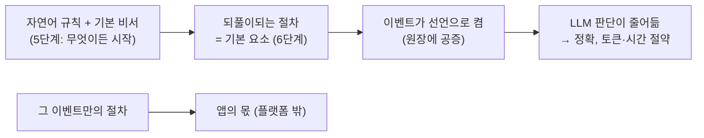

# 6단계 요구사항: 여러 이벤트에 공통인 요소의 기본 탑재

> 상태 표기: ⬜ 미착수 · 🟡 진행 · ✅ 테스트 통과. 번호는 테스트 이름과 맞춘다(P6-A1 → `test_p6a1_...`).

## 0. 목표

5단계는 어떤 이벤트든 앱 없이 자연어 규칙과 기본 비서로 끝까지 갈 수 있음을 보였다. 동시에 절차가 길수록 LLM이 매번 해내지 못한다는 것도 보였다(가위바위보 리그전 15번 중 1번, peer 둘의 한 판 5번 중 5번, `dev/phase5/test-results.md`).

6단계는 **여러 이벤트에 되풀이되는 절차**를 플랫폼의 기본 요소로 넣어, 이벤트가 선언만으로 켜서 쓰게 한다. "명확한 일을 굳히는 세 모양"(`dev/plan.md`) 가운데 **먼저 있는 범용 코드를 여러 이벤트가 쓰는 모양**과 **API를 제공하는 peer** 모양을 플랫폼이 받쳐 주는 단계다.

## 1. 선정 기준 (사용자 2026-11-02 원칙)

- **여러 이벤트에 쓰이는 것만** 넣는다. 요소마다 이 요소를 쓰는 서로 다른 이벤트 종류를 **둘 이상** 적는다.
- 그 이벤트만의 절차와 **뜻의 판단**(승패 계산, 점수로 채택하는 기준 등)은 넣지 않는다. 그것은 앱이나 API를 제공하는 peer의 몫이다.
- 요소는 **선언으로 켠다**. 이벤트 선언과 공지에 요소와 그 설정을 싣고, 원장이 공증한다. 선언하지 않으면 지금처럼 동작한다.
- 요소가 하는 확인은 **코드**로 한다(LLM 토큰을 쓰지 않는다). 기본 비서에게는 요소를 쓰는 범용 도구를 준다.

## 6-0. 공통: 요소를 선언하는 자리

| 번호 | 요구사항 | 상태 |
|---|---|---|
| P6-01 | **요소 블록**: 이벤트 선언과 공지에 `elements` 블록(요소 이름 → 설정)을 둔다. 원장은 알려진 요소 이름과 설정 모양만 받고, 공지의 블록이 원장의 선언과 같아야 이벤트 배정기가 받는다(규칙 해시·실행 방식·앱 목록과 같은 방식) | ✅ |
| P6-02 | **요소 등록**: 요소는 등록해서 더한다(원장 항목 종류처럼). 요소마다 이름, 설정 모양 검사, 그 요소가 더하는 원장 규칙, 그 요소의 op와 기본 비서 도구를 한 묶음으로 둔다. 요소를 더할 때 원장·기록자·배정기를 고치지 않는다 | ✅ |

## 6-A. API를 제공하는 peer 틀 (서비스 중계 peer)

쓰는 이벤트: 결과를 코드로 계산해야 하는 대회(판정 peer), 사내 시스템 자료를 묻는 요청(인사·결재·자산 시스템 중계), 문서 검색, 번역·요약 같은 도구 제공.

| 번호 | 요구사항 | 상태 |
|---|---|---|
| P6-A1 | **설정만으로 띄우는 서비스 peer**: 서비스 설명 파일(이름, 버전, 고정 app_id, op마다 HTTP 방법·경로 또는 파이썬 함수, 허용 그룹, 서명 요구)을 주면 `python -m arena.peers.service --spec <파일>`로 서비스 peer가 뜬다. 지금의 `HttpServiceAdapter`를 이 틀 위에 둔다 | ✅ |
| P6-A2 | **결과에 서명**: 서비스 peer는 답마다 서명한 영수증(op, 요청 해시, 결과 해시, 시각, 서비스 공개키)을 붙인다. 묻는 쪽은 그 영수증으로 "이 서비스가 이 입력에 이 결과를 냈다"를 나중에 증명할 수 있다 | ✅ |
| P6-A3 | **원장에 결과 남기기**: 이벤트가 서비스 peer와 역할 계약을 맺고 정책(`attest_roles`)에서 어떤 결과 종류를 그 역할에 맡기면, 서비스 peer가 계산한 결과를 그 종류의 공동 확인으로 원장에 기록할 수 있다(판정 API peer: 선수들의 LLM이 승패를 판정하지 않아도 됨) | ✅ |
| P6-A4 | **찾기**: 서비스 peer는 프로필에 제공하는 op 목록과 설명을 싣고, 다른 peer는 broker 검색(역할·라벨)과 고급 검색 peer로 찾는다. 앱 배포 peer도 같은 방법으로 찾을 수 있게 한다(5단계 알려진 한계: 설정으로만 정함) | ✅ |
| P6-A5 | **기본 비서의 도구**: `call_service`(서비스 peer의 필명, op, 입력) → 결과와 서명 영수증. 서명 영수증은 코드가 확인하고 보관한다 | ✅ |

### 연결 방식 (사용자 2026-11-02)

> 사용자: "AI 에이전트가 없는 peer에는 다짜고짜 a2a로 접근할 수 없다. REST API로만 열린 peer라면 프로필에 접속 방식 분류(a2a와 api 둘 다 되는 peer도 가능)와 endpoint 같은 정보가 있어야 하고, 접속 방식은 미리 정의되어야 한다." "세 가지 연결 방식: 사람 대 사람(채팅 또는 문자), a2a, api를 통한 요청과 응답."

| 번호 | 요구사항 | 상태 |
|---|---|---|
| P6-A6 | **연결 방식을 미리 정한다**: 플랫폼이 등록해 둔 연결 방식만 쓴다. 처음 셋: `human`(사람끼리 채팅·문자. 플랫폼은 연락처만 알려 주고 대신 보내지 않는다), `a2a`(에이전트끼리, A2A 1.0), `api`(요청과 응답, 플랫폼이 정한 REST 묶음). 연결 방식마다 필요한 칸이 정해져 있고, 새 방식은 등록으로 더한다 | ✅ |
| P6-A7 | **프로필의 연결 정보**: 프로필에 `connections`(연결 방식과 주소 목록)를 싣는다. 한 peer가 여럿을 가질 수 있다(예: `a2a`와 `api`). 에이전트 peer는 `a2a`를 기본으로 갖고, 서비스 peer는 설정에 따라 `a2a`, `api`, 또는 둘 다를 갖고, `human` 연락처는 소유자가 원할 때만 싣는다. broker는 등록되지 않은 방식이나 필요한 칸이 빠진 연결 정보가 든 프로필을 받지 않는다 | ✅ |
| P6-A8 | **`api` 연결 규약과 고르기**: `api`는 `POST {주소}/ops/{op}`에 JSON `{"input": ...}`(이벤트에 관한 요청이면 머리 `X-Arena-Group`·`X-Arena-Event`)을 보내고 A2A와 같은 모양의 답(서명 영수증 포함)을 받는다. 부르는 쪽 코드는 상대 프로필의 연결 정보에서 자기가 쓸 수 있는 방식을 고른다(`a2a` 우선, 없으면 `api`). AI 에이전트 없이 `api`만 여는 peer(API 전용 peer)를 서비스 peer 틀로 띄울 수 있다. `human`은 자동으로 쓰지 않는다: 기본 비서 도구 `contact`는 상대의 사람 연락처를 소유자에게 알려 줄 뿐이다 | ✅ |

## 6-B. 제출 받기

쓰는 이벤트: 아이디어 공모, 자료 요청, 설문, 과제 제출, 입찰 서류 받기.

| 번호 | 요구사항 | 상태 |
|---|---|---|
| P6-B1 | **제출 요소**(`intake`): 설정은 마감 시각, 작성자당 제출 수 상한, 받을 사람(개최자 또는 계약한 역할), 응모 대상(라벨). 정책의 `conflict_roles`(겸할 수 없는 역할)는 그대로 쓴다 | ✅ |
| P6-B2 | **받는 쪽 확인(코드)**: 내용의 해시가 먼저 등록(`publish`)과 같은가, 작성자 서명, 받는 사람이 나인가, 마감 전인가, 작성자당 상한, 겸할 수 없는 역할이 아닌가, 응모 대상인가. 통과하면 받았다는 서명(`share`의 받는 쪽 서명)을 돌려주고 원장에 `share`가 남는다 | ✅ |
| P6-B3 | **보관과 목록**: 받은 제출을 받는 peer의 저장소에 남기고(재시작 뒤 이어 감), 개최자가 이벤트별 목록(작성자 필명, 내용 해시, 받은 시각)을 볼 수 있다 | ✅ |
| P6-B4 | **기본 비서의 도구**: 참가자 `submit`(제출할 글), 개최자 `submissions`(목록). 해시·서명·영수증은 코드가 만든다 | ✅ |

## 6-C. 평가 요청과 판정 기록

쓰는 이벤트: 공모 심사, 문서 검토, 코드 리뷰, 감수, 입찰 평가.

| 번호 | 요구사항 | 상태 |
|---|---|---|
| P6-C1 | **평가 요소**(`evaluation`): 설정은 평가자 역할, 판정 종류(예: `review`), 항목당 평가자 수. 판정 권한은 정책의 `verdict_roles`로 원장이 확인한다(지금 있음) | ✅ |
| P6-C2 | **평가 맡기기**: 개최자가 받은 제출을 계약한 평가자에게 넘기면, 넘긴 기록(`share`, 평가자 서명)이 원장에 남는다. 평가자는 받은 항목마다 서명한 판정(`feedback`: 판정 종류, 점수, 의견 해시)을 돌려준다 | ✅ |
| P6-C3 | **판정 기록과 모음**: 개최자가 판정을 원장에 기록하고, 항목별 판정 목록을 볼 수 있다. **점수로 무엇을 채택할지는 정하지 않는다**(이벤트의 뜻 판단, 앱의 몫) | ✅ |
| P6-C4 | **평가자 쪽**: 평가를 받는 능력(`EvaluationProvider`)을 구현한 앱 또는 기본 비서가 판정한다. 서명과 판정 모양은 코드가 만든다 | ✅ |

## 6-D. 봉인 묶음 (모두 등록한 뒤에 공개)

쓰는 이벤트: 동시에 수를 내는 대회, 봉인 입찰, 비밀 투표, 동시 평가(서로의 점수를 보지 않고 매기기).

| 번호 | 요구사항 | 상태 |
|---|---|---|
| P6-D1 | **봉인 요소**(`sealed`): 설정은 빈 객체(`{}`)이고, 켜면 배정된 모든 주제의 라벨이 봉인된다. 라벨 규약: 배정된 주제 `S`의 봉인 라벨은 `S` 또는 `S-<번호>` | ✅ |
| P6-D2 | **원장 규칙**: 봉인 라벨 `L`(주제 `S`)은 `S`에 배정된 당사자만 등록한다. `L`의 공개(`reveal`)는 배정된 당사자 **전원**이 `L`로 먼저 등록한 뒤에만 받고, `L`에 공개가 하나라도 있으면 새 등록을 받지 않는다 | ✅ |
| P6-D3 | **기본 비서**: 지금 상태에 "라벨 L: 등록 a·b 완료, 공개 가능"처럼 봉인 묶음의 진행을 코드가 적는다 | ✅ |

## 6-E. 그 밖의 후보 (6-A~D 뒤에)

| 번호 | 요구사항 | 쓰는 이벤트 | 상태 |
|---|---|---|---|
| P6-E1 | **게시판 구독**: 내 라벨에 맞는 공지를 받고, 관련도가 낮으면 AI 없이 거른다 | 모집, 요청, 공모 전부 | ⬜ |
| P6-E2 | **추천(짝 찾기)**: 검색 결과를 자기 AI로 걸러 근거와 함께 연결하는 peer 틀 | 심사자 찾기, 협업 상대 찾기 | ⬜ |
| P6-E3 | **판단 근거 틀**: 적합성, 소유자 규칙, 이득과 여력, 위험, 상대 신뢰(계약·결재 확인)의 다섯 근거로 참가·수락을 판단하고 근거를 남긴다 | 참가 결정, 역할 수락, 결재 | ⬜ |

## 6-K. 개인 키 보관과 백업 (후보, 사용자 2026-11-02)

> 사용자: "peer의 개인키는 peer 프로그램이 알아서 OS의 키 보안 영역에서 생성하고 보관해야 한다. 키를 잃지 않도록 백업 서비스도 필요하고, 이것도 특수한 역할을 하는 api peer의 영역이다. 물론 키 분실은 개인 책임." 신원(DID) 발급도 플랫폼 역할이 아니라 필요하면 전담 api peer가 맡는다.

| 번호 | 요구사항 | 상태 |
|---|---|---|
| P6-K1 | **키 보관 인터페이스**(`KeyStore`): peer 프로그램이 개인키를 만들고 보관하는 곳을 바꿔 끼운다. 기본은 OS의 키 보관소(macOS 키체인, Windows 자격 증명 관리자, Linux Secret Service), 지금의 파일(권한 0600)은 대안. 하드웨어 보안 영역은 ed25519를 직접 지원하지 않는 경우가 많아(예: Secure Enclave는 P-256만) 서명할 때 키가 메모리에 올라온다는 한계를 문서에 적는다 | ⬜ |
| P6-K2 | **암호화한 백업 모양**: 개인키를 소유자의 암호문구로 **기기 안에서 암호화**한 백업 모양을 정한다. 백업을 맡는 api peer(플랫폼 밖)는 암호화된 덩어리만 보관하고 돌려준다. 키 분실은 개인 책임이다 | ⬜ |
| P6-K3 | **개인 키 이어받기**: 기록자·god의 `key_rotate`처럼 peer의 키도 옛 키와 새 키의 서명으로 바꿀 수 있게 해, 키를 도난당했을 때 새 키로 옮긴다 | ⬜ |
| P6-K4 | **신원 증명서 모양**(사용자 결정 대기): 회원 등록·인사 연동·기존 DID 연결을 맡는 api peer가 내는 증명서의 공통 모양과, 커뮤니티가 믿는 발급자 목록 확인 | ⬜ |

## 6-V. 검증

| 번호 | 요구사항 | 상태 |
|---|---|---|
| P6-V1 | **LLM 사용량 재기**: LLM 어댑터가 peer별 호출 수와 토큰 수(서비스가 주면)를 센다. 요소가 있을 때와 없을 때를 비교하는 데 쓴다 | ⬜ |
| P6-V2 | **경연 모티브를 기본 요소로**: 테스트 안의 대역 앱(제출 받기, 심사)을 6-B·6-C 요소로 바꿔 같은 흐름이 돈다 | ⬜ |
| P6-V3 | **있을 때와 없을 때 비교**(사용자 결정 D: 앱 있는 이벤트와 없는 이벤트의 차이를 재는 방식): 같은 이벤트를 요소 없이(자연어 규칙만) 그리고 요소를 켜고 실제 LLM으로 여러 번 돌려 성공률, 걸린 시간, LLM 호출·토큰을 잰다. 대상: 아이디어 공모 모티브, 가위바위보(봉인 묶음 + 판정 API peer) | ⬜ |
| P6-V4 | 결과를 `dev/phase6/test-results.md`에 적고, 실행 기록을 `dev/phase6/evidence/`에 보관한다 | ⬜ |

## 넣지 않는 것

| 후보(`dev/plan.md`) | 이유 |
|---|---|
| 먼저 등록 → 전달 → 공유 기록 | 이미 플랫폼에 있다(`publish`, `share`, 영수증) |
| 비서 도구 루프 | 이미 기본 비서다(5단계) |
| 소유자 확인 단계 | 이미 있다(`ask_owner`, 앱 설치 승인). 6-E3의 판단 근거 틀에서 함께 다룬다 |
| 경험 노트와 프로필 갱신 | 이미 있다(4단계 역량 라벨 자율 갱신) |
| 승패·점수로 채택하는 기준, 경기 순서 같은 이벤트만의 절차 | 앱이나 API를 제공하는 peer의 몫(사용자 2026-11-02) |
