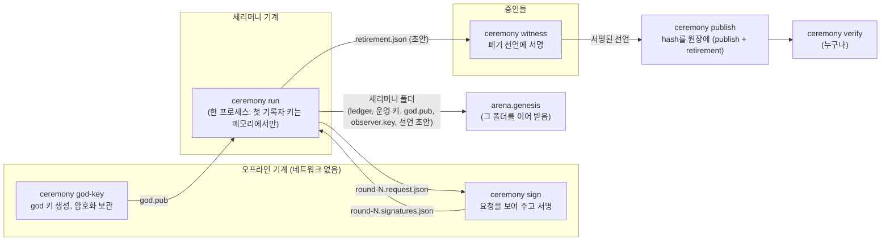
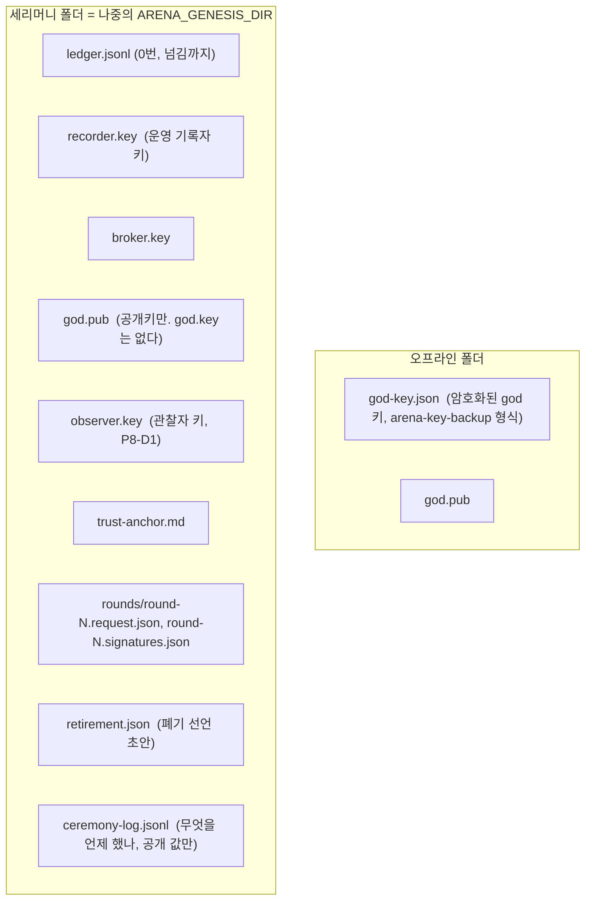
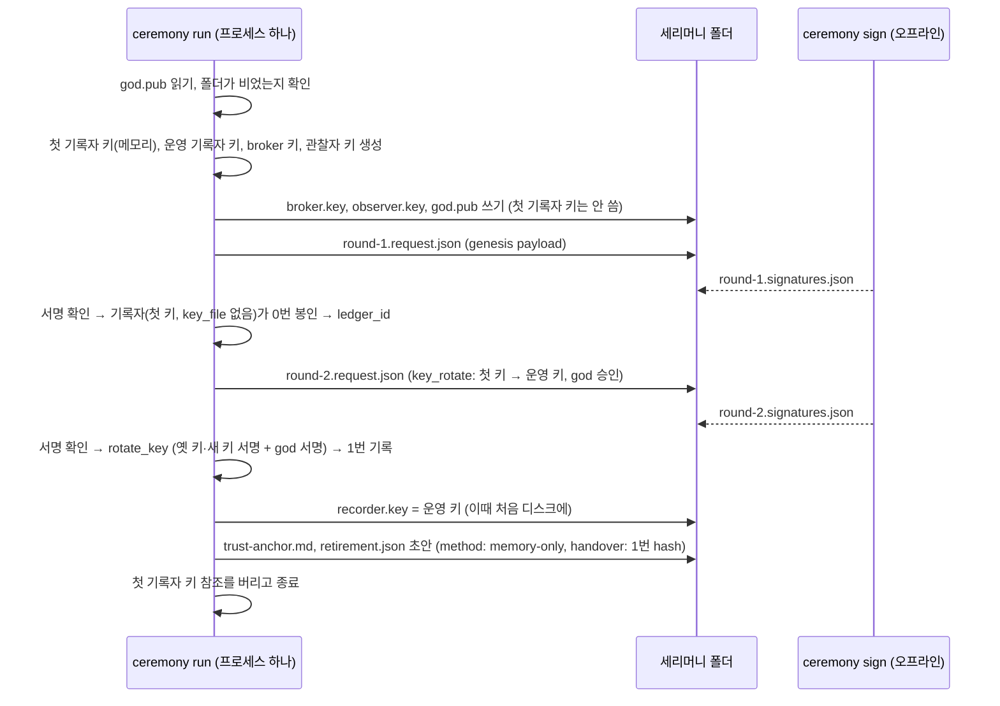

# 8단계 설계: 뿌리 키의 생성과 소멸 (CP-6, CP-7)

> 2026-11-05, 브랜치 `root-key-ceremony-20261105`. 요구사항: [requirements.md](requirements.md)(모두 정함). 번호(P8-xx)는 요구사항과 같다.

## 0. 한눈에



핵심 제약 하나가 모양을 정한다. **god이 서명할 `key_rotate` payload에는 `ledger_id`(0번의 hash)가 들어가고, 그 값은 0번을 봉인해야 나온다**(hash에 기록자가 붙이는 `ts`가 들어간다). 그래서 오프라인 서명은 한 번에 끝나지 않고 **라운드**로 왕복한다. 그동안 `ceremony run` 프로세스가 첫 기록자 키를 메모리에 쥐고 서명 파일을 기다린다(P8-A2).

| 체인 | 라운드 | god이 서명하는 것 |
|---|---|---|
| 뿌리 | 1 | `genesis` payload |
| 뿌리 | 2 | `key_rotate`(첫 기록자 → 운영 기록자) |
| 가지 | 1 | `genesis` payload(`parent` 포함) |
| 가지 | 2 | `chain_link`(뿌리 체인에 남김), `key_rotate` |
| 가지 | 3 | `parent_link`(뿌리가 봉인한 `chain_link` 전체가 들어가므로 2 뒤에야 만들 수 있다) |

## 1. 모듈 배치

새 패키지 `arena/ceremony/`. 원장·기록자·키 백업의 기존 코드를 쓰고, 자기 규칙은 두지 않는다(원장 규칙은 그대로 원장이 확인한다).

| 파일 | 하는 일 | 네트워크 |
|---|---|---|
| `formats.py` | 파일 모양(요청, 서명, 선언, 실행 기록)의 만들기·읽기·모양 확인. 순수 함수 | 없음 |
| `offline.py` | `god-key`, `sign`: god 키 생성·암호화 보관, 요청을 사람에게 보여 주고 서명 | **쓰지 않는다**(코드에 HTTP client를 두지 않는다) |
| `run.py` | `ceremony run`: 키 생성, 라운드 진행, 0번 봉인, (가지) 연결, 넘기기, 폴더 쓰기, 선언 초안 | 가지 체인일 때 뿌리 기록자에만 |
| `retire.py` | `witness`, `publish`, `verify`: 선언 서명, 원장에 hash, 확인 | publish·verify만 |
| `cli.py`, `__main__.py` | `python -m arena.ceremony <명령>` | |

기존 코드 변경은 6절.

## 2. 폴더



- 첫 기록자 키 파일은 **어디에도 없다.** 프로세스 메모리에만 있다가 `run`이 끝나면 사라진다.
- 개인키 파일(`recorder.key`, `broker.key`, `observer.key`)은 0600. `god-key.json`은 passphrase로 암호화(평문 개인키 파일을 만들지 않는다).
- 개인키와 passphrase는 화면, 실행 기록, 요청·서명 파일 어디에도 쓰지 않는다(P8-E3).

## 3. 파일 모양

모두 정규 JSON(`canon`: 키 정렬, 공백 없음, UTF-8)으로 hash·서명한다. 식별자와 구조는 전용 field, 사람의 글은 짧은 free-form field 하나(`note`)만.

### 3.1 서명 요청 (`round-N.request.json`)

```json
{"format": "arena-ceremony-request", "version": 1, "round": 2,
 "chain": "trunk", "ledger_id": "<0번 hash, 1라운드는 null>", "god": "<god 공개키>",
 "items": [{"name": "key_rotate", "type": "key_rotate", "payload": {...}}],
 "made_at": 1793900000.0}
```

- `items[].payload`는 god이 서명할 바로 그 payload. `type`은 원장 항목 종류.
- 요청 hash = `sha256(canon(요청 전체))`.

### 3.2 서명 (`round-N.signatures.json`)

```json
{"format": "arena-ceremony-signatures", "version": 1, "round": 2,
 "request": "<요청 hash>", "god": "<god 공개키>", "sigs": {"key_rotate": "<서명 hex>"}}
```

`run`이 받을 때 확인: 형식, `round`, `request`가 지금 낸 요청의 hash, `god`이 요청의 god, 모든 `items`에 서명이 있고 `verify(god, payload, sig)`가 맞음. 하나라도 틀리면 그 라운드를 다시 기다리고(파일을 무시하고 이유를 화면과 기록에 남김), 원장에는 아무것도 쓰지 않는다.

### 3.3 폐기 선언 (`retirement.json`, P8-C2)

```json
{"format": "arena-key-retirement", "version": 1,
 "body": {"key": "<없앤 공개키>", "role": "recorder", "ledger_id": "<…>",
          "handover": "<그 키를 넘긴 key_rotate 항목 hash>", "head": {"seq": 1, "hash": "<…>"},
          "method": "memory-only", "at": 1793900100.0,
          "witnesses": ["<증인 공개키>", "<증인 공개키>"], "note": "release ceremony, …"},
 "sigs": {"<증인 공개키>": "<body 서명>"}}
```

- 선언 hash = `sha256(canon(body))`. 원장에 남는 것은 이 hash다(3.5).
- `method` 코드: `memory-only`(디스크에 쓴 적 없음) · `file-wiped`(파일을 덮어쓰고 지움). 코드표에 둔다.
- `witnesses`는 초안에서 정해지고, 각 증인은 같은 `body`에 서명한다. 목록에 없는 키의 서명은 받지 않는다.
- `note`는 원장의 free-form 상한과 같은 크기(`ARENA_LEDGER_FREE_MAX_BYTES`, 256 bytes)로 묶는다.

### 3.4 god 키 보관 (`god-key.json`)

기존 키 백업 형식(`arena-key-backup` v1, scrypt + AES-256-GCM, `arena/keys/backup.py`)을 그대로 쓴다. `next`는 넣지 않는다. 새 형식을 만들지 않으므로 같은 테스트 벡터와 같은 확인을 쓴다.

### 3.5 원장에 남는 것 (`publish` + 목적 코드 `retirement`)

```json
{"type": "publish",
 "payload": {"author": "<증인 하나의 공개키>", "content_hash": "<선언 hash>", "purpose": "retirement",
             "group_id": "public", "ledger_id": "<…>", "nonce": "<…>"},
 "sigs": {"<author>": "<서명>"}}
```

- 새 원장 항목 종류를 만들지 않는다(정함). 목적 코드 `retirement`(types: `publish`)를 등록한다. 코드의 확인: `label` 없음(이름표 없이 그대로 등록).
- 원장은 선언 내용을 보지 않는다(원장 밖 문서). 원장이 증명하는 것은 "이 hash가 이 시각에 이미 있었다"다. 내용의 확인은 `verify`가 한다(5절).
- 기본 code table edition을 `agent-arena 1.0` → **`1.1`**로 올린다(코드를 더할 때 `y`를 올린다, `dev/codebook.md`).

### 3.6 실행 기록 (`ceremony-log.jsonl`)

한 줄에 `{"at", "step", "values"}`. `step` 코드: `keys-made`, `request-written`, `signatures-taken`, `signatures-refused`, `sealed`, `chain-linked`, `parent-linked`, `rotated`, `first-key-gone`, `anchor-written`, `declaration-drafted`. `values`에는 공개키, hash, seq만.

## 4. 명령

| 명령 | 어디서 | 입력 → 출력 | 요구사항 |
|---|---|---|---|
| `god-key --out DIR` | 오프라인 | passphrase(두 번) → `god-key.json`, `god.pub` | P8-A1 |
| `sign --key god-key.json --request FILE --out FILE [--yes]` | 오프라인 | 요청을 사람에게 보여 줌(라운드, 체인, 항목 종류, 항목별 주요 field: `genesis`면 god·broker·recorder·group_id, `key_rotate`면 role·old·new, `chain_link`면 child_ledger_id·branch_point …) → "서명할까요" → passphrase → 서명 파일 | P8-A3 |
| `run --god-pub FILE --out DIR [--parent URL] [--name NAME]` | 세리머니 | 라운드마다 요청 파일을 쓰고 서명 파일이 생길 때까지 기다림 → 세리머니 폴더 완성 | P8-A2, A3, A5, A6, B1, C1 |
| `witness --declaration FILE (--home DIR \| --key-file F) [--yes]` | 증인 각자 | 선언을 보여 주고 서명 → 같은 파일에 `sigs` 더함 | P8-C3 |
| `publish --declaration FILE (--home \| --key-file) --recorder URL` | 증인 하나 | 증인 수 확인 → `publish` + `retirement` 기록 | P8-C4 |
| `verify --declaration FILE --recorder URL` | 누구나 | 5절의 확인 → 통과/이유 | P8-C5 |
| `rotate-request`, `rotate` | 운영(나중) | 멈춘 기록자의 원장 파일에 대고 운영 키 → 다음 운영 키(god 서명은 같은 라운드 방식) | P8-B1, B4 |
| `rotate-god-request`, `rotate-god` | 비상용 | god 키 → 새 god 키(옛·새 god 서명) | P8-B3 |

passphrase는 묻거나 `--passphrase-env` 이름의 환경 변수에서 읽는다(테스트·스크립트용, 값은 출력하지 않는다). `arena.keys`와 같은 방식.

### 4.1 `run`의 순서 (뿌리)



- 기록자는 세리머니 안에서 `RecorderService.build(..., key_file=None)`으로 만든다. 그래서 0번 봉인 중에 키 파일이 생기지 않는다. 넘김 뒤 운영 키만 `recorder.key`로 쓴다.
- 이미 `ledger.jsonl`이 있는 폴더에서는 시작하지 않는다(한 폴더에 세리머니 한 번).
- 기다리는 동안 `ARENA_CEREMONY_POLL_SEC`마다 서명 파일을 본다. `ARENA_CEREMONY_TIMEOUT_SEC`가 지나면 멈춘다. 멈추면 **첫 기록자 키가 사라지므로** 그 폴더는 버리고 처음부터 다시 한다(0번을 봉인한 키 없이 넘길 수 없다). 화면과 기록에 그렇게 남긴다.

### 4.2 `run`의 순서 (가지, `--parent URL`)

1라운드 앞에 뿌리 기록자의 `/trust`를 읽어 `parent`(뿌리 `ledger_id`, 기록자 주소·키, 갈라진 지점)를 만든다(지금 `branch_parent`). 2라운드에 `chain_link`와 `key_rotate`를 함께 서명받고, `chain_link`를 뿌리 기록자에 기록한다(god + 첫 기록자 서명). 뿌리가 봉인한 그 항목을 받아 3라운드에 `parent_link`를 서명받아 1번으로 기록하고, 그다음 `key_rotate`를 2번으로 기록한다(1번 앞에는 다른 기록을 받지 않는 지금 규칙). 가지의 god·첫 키를 어떻게 할지는 그 커뮤니티가 정하지만(정함), 도구는 뿌리와 같은 방식으로 돕는다.

### 4.3 첫 키 소멸 확인 (P8-C1)

`run`은 첫 키를 버리기 전에 원장에서 확인한다: `current_keys(chain)["recorder"]`가 운영 키이고, `old`가 첫 키인 `key_rotate`가 있다. 아니면 키를 버리지 않고(프로세스를 끝내지 않고) 멈춰 이유를 알린다. `file-wiped` 방식(운영 키를 나중에 없앨 때)은 `retire --key-file`이 같은 확인 뒤 파일을 덮어쓰고 지운다. SSD에서는 보장되지 않음을 선언의 `note`와 문서에 적는다.

## 5. `verify`의 확인 순서

1. 형식(`arena-key-retirement` v1), body field 모양, `method`가 코드표의 코드.
2. `witnesses`가 `ARENA_CEREMONY_MIN_WITNESSES`(2) 이상이고 서로 다르며, `key`와 다르다.
3. `sigs`: 목록의 모든 증인이 `body`에 서명했고 서명이 맞다. 목록 밖의 서명이 있으면 실패.
4. 기록자 `/health`의 `ledger_id`가 `body.ledger_id`.
5. 기록자 `/trust`의 `rotations`에서 hash가 `handover`인 항목: `role`이 `body.role`, `old`가 `body.key`. 그리고 그 seq 뒤로 `body.key`가 다시 지금 키가 된 적이 없다.
6. 기록자 `/entries/{head.hash}`: 있고, seq가 `head.seq`, 봉인이 맞다.
7. 기록자 `/content/{선언 hash}`: 등록이 있고 목적이 `retirement`, `author`가 `witnesses` 중 하나.
8. 결과: 모든 단계의 통과/실패와 이유. 7이 아직 없으면 "원장에 아직 없음"으로 따로 알린다(문서는 맞지만 시각이 고정되지 않음).

## 6. 기존 코드 변경

| 파일 | 바꿈 | 요구사항 |
|---|---|---|
| `arena/recorder/service.py` `rotate_key` | 옛 키를 `<key_file>.retired-<seq>`로 저장하던 것을 없앤다. 새 키만 `key_file`에 | P8-B2 |
| `arena/genesis.py` | ① `god.key`가 없고 `god.pub`이 있으면 **god 공개키만으로** 시작: 원장이 이미 있어야 한다(없으면 "god 키 없이 0번을 만들 수 없다: ceremony run을 먼저"). 다시 시작할 때 확인은 공개키로. 가지 연결이 안 된 상태면 멈춘다(god 서명이 필요) ② **관찰자 키**: `observer.key`(`ARENA_OBSERVER_KEY_FILE`, 기본 `<genesis dir>/observer.key`)를 읽거나 만든다. 기록자의 전체 열람 허용에 관찰자 키를 넣는다. god peer(GodRole, 관전 창)는 관찰자 키로 돈다 ③ `god.key`가 있는 지금 방식(자동 생성)은 리허설·시험용으로 그대로 둔다. 이때도 god peer는 관찰자 키로 돈다(한 가지 길) | P8-A1, D1, D2, E2 |
| `arena/peer/god_role.py` | 바뀌지 않는다(그 peer의 키로 읽는다). 이름은 그대로 두고 문서에서 "관찰자"라고 부른다 | P8-D1 |
| `arena/bundled/observer` | `/api/state`의 `me`에 `god`(0번의 god 공개키·필명)과 `reads_as`(`observer`)를 더하고, 머리줄에 "관찰자 키로 봄 · god 키 아님" 태그 | P8-D3 |
| `arena/ledger/purposes.py` | 목적 코드 `retirement`(publish, label 없음) | P8-C4 |
| `arena/codebook.py` | 기본 edition `1.1`, 선언 `method` 코드(`memory-only`, `file-wiped`)를 `meanings`에 | P8-C2, C4 |
| `arena/config.py`, `.env.example` | 7절의 설정 | P8-E6 |
| 문서 | `dev/protocol.md`(목적 코드, 선언 형식), `dev/chain-policy.md` 7절(도구 이름), `docs/internal-network-test.md` 4절(세리머니로 0번 만들기를 선택지로), 관전 창 설명 | |

관찰자 키로 쓰기를 거부하는 것(P8-D4)은 새 코드가 아니다. 관찰자 키는 어떤 항목의 서명자도 아니고(기록자 키·god 키 승인은 원장이 `current_keys`로만 받는다), 테스트로 고정한다.

## 7. 설정 (`.env`)

| 키 | 기본 | 뜻 |
|---|---|---|
| `ARENA_CEREMONY_MIN_WITNESSES` | 2 | 폐기 선언의 최소 증인 수 |
| `ARENA_CEREMONY_POLL_SEC` | 1.0 | `run`이 서명 파일을 보는 주기 |
| `ARENA_CEREMONY_TIMEOUT_SEC` | 3600 | `run`이 한 라운드를 기다리는 최대 시간(지나면 멈추고 처음부터) |
| `ARENA_OBSERVER_KEY_FILE` | (비면 `<genesis dir>/observer.key`) | god peer가 원장을 읽는 관찰자 키 |

## 8. 테스트

| 테스트 | 무엇을 | 요구사항 |
|---|---|---|
| 형식 단위 테스트 | 요청·서명·선언의 모양과 hash, 정규 JSON 테스트 벡터(`dev/protocol-vectors.json`에 `ceremony_request`, `key_retirement` 추가) | P8-A3, C2 |
| `test_p8a1_…` | `god-key`가 평문 개인키 파일을 만들지 않고, `god.pub`만 공개, 백업 형식으로 열림 | P8-A1 |
| `test_p8a2_…` | `run` 동안과 뒤에 세리머니 폴더(와 하위)에 첫 기록자 개인키가 어떤 파일에도 없다(모든 파일 내용 검색) | P8-A2 |
| `test_p8a3_…` | 다른 payload의 서명, 다른 god의 서명, 빠진 항목 → 라운드 거부, 원장에 아무것도 안 씀 | P8-A3, E5 |
| `test_p8b2_…` | 넘김 뒤 `.retired-*` 파일이 없다 | P8-B2 |
| `test_p8c1_…` | 넘김 기록 전에는 첫 키를 버리지 않는다(넘김을 일부러 실패시키면 멈춤) | P8-C1 |
| `test_p8c3_c5_…` | 증인 1명 → `publish` 거부, 목록 밖 서명·틀린 서명·없는 handover·다른 원장 → `verify` 실패와 이유 | P8-C3, C5 |
| `test_p8d1_d4_…` | god peer가 관찰자 키로 원장을 읽고, god 공개키로는 안 읽힘(god.key가 없으니), 관찰자 키로 넘김·승인 시도 → 원장 거부 | P8-D1, D4 |
| `test_p8e4_rehearsal_…` (실제 프로세스) | 오프라인 폴더와 세리머니 폴더를 따로 두고 `god-key` → `run`(백그라운드) ↔ `sign` 두 라운드 → `arena.genesis`가 그 폴더를 이어 받음 → peer가 `ARENA_TRUST_*`로 기록자를 검증하고 이벤트 하나 기록 → 증인 둘 `witness` → `publish` → `verify` 통과 → 관전 창이 관찰자 키로 봄 → 다시 시작해도 같은 원장 | P8-E4 |
| `test_p8e4_branch_…` (실제 프로세스) | 위 뿌리 위에 `--parent`로 가지 세리머니 세 라운드 → 뿌리에 `chain_link`, 가지 1번 `parent_link`, 2번 `key_rotate` | P8-E4 |
| 되풀이 | 리허설 테스트를 같은 코드로 두 번 돌려 같은 단계 기록(`ceremony-log.jsonl`의 step 순서)이 나온다 | P8-E3 |
| 기존 테스트 | genesis 프로세스 테스트·관전 창 테스트를 관찰자 키에 맞게 고친다(`snap.stats.genesis.god`은 이제 창의 `me.pub`이 아니다) | |

## 9. 한계 (문서에 적을 것)

- **메모리 소멸의 한계**: Python은 메모리를 0으로 지울 수 없다. 프로세스가 끝나면 OS가 회수하지만, 스왑이나 크래시 덤프에 남을 수 있다. 세리머니 기계는 스왑을 끄고 덤프를 끈 채 쓰기를 권한다.
- **선언은 증명이 아니다**: 증인은 "봤다"를 서명할 뿐이다. 그래서 `memory-only`(파일이 처음부터 없었음)를 권한다.
- **운영 기록자 키를 잃으면 체인이 멈춘다**는 7단계 전까지 그대로다. 세리머니 끝에 운영 키를 키 백업 형식으로 암호화해 오프라인에 두도록 `run`이 안내한다.
- **god 키는 남는다**: 오프라인에 암호화해 보관하고, 쓰는 일은 기록자 키 변경 승인(라운드 방식)뿐이다. 없애는 것은 CP-8 뒤.

## 10. 구현 순서

1. 형식(`formats.py`)과 테스트 벡터 → 2. `rotate_key` 변경, 목적 코드·코드표 1.1 → 3. `offline.py`(`god-key`, `sign`) → 4. `run.py`(뿌리) → 5. genesis 변경(god.pub, 관찰자 키)과 관전 창 태그 → 6. `retire.py`(`witness`, `publish`, `verify`) → 7. 실제 프로세스 리허설(뿌리) → 8. 가지 → 9. `rotate`·`rotate-god` → 10. 문서와 `test-results.md`.
