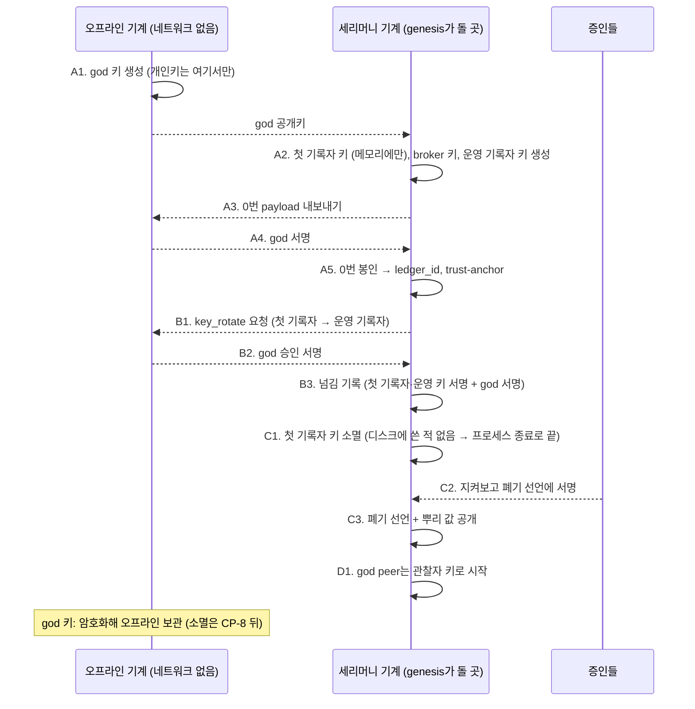

# 8단계 요구사항: 뿌리 키(root key)의 생성과 소멸 (CP-6, CP-7)

> 2026-11-05, 브랜치 `root-key-ceremony-20261105`. 사용자: "root key 생성 및 소멸", "새 branch와 새 phase에서 요구사항 정의부터 시작해". 같은 날 "제안대로 하고 커밋해, design 진행해": 모든 제안과 3절의 다섯 질문을 제안값으로 정함.
>
> 상태 표기: ⬜ 미착수 · 🟡 진행 · ✅ 테스트 통과. 결정 표기: **정함**(사용자가 정함 또는 이미 정한 정책), **제안**(정하지 않았고 제안값), **미정**(사용자 결정 필요). 번호는 테스트 이름과 맞춘다(P8-A1 → `test_p8a1_...`).
>
> 7단계(기록자 분산)는 계획대로 **가장 나중**에 한다. 이 단계는 그 앞에 끼워 넣는 것이라 번호만 8이다.

## 0. 목표

뿌리 키는 0번 원장의 신뢰가 시작되는 키다. **god 키**(0번에 서명, 기록자 키 변경을 승인)와 **첫 기록자 키**(0번을 봉인)가 그것이다. 이 단계는 이 두 키를 **세리머니로 만들고, 쓸 일을 마친 키를 없애는** 절차와 도구를 만든다.

- **리허설과 세리머니가 같은 코드**다(정함, `dev/chain-policy.md` 7.0): 테스트로 처음부터 끝까지 되풀이하고 다 지운다. 진짜는 release 세리머니 때 한 번 한다(진짜 원장은 아직 없다).
- **god 자신의 소멸은 이 단계에 넣지 않는다**(정함, 7.2절): 증인이 기록자 키 변경을 승인할 수 있을 때(CP-8, 7단계)까지 god 키는 오프라인에 보관하고, 쓰는 일은 기록자 키 변경 승인뿐이다. 소멸 시점은 공개 출시 뒤 만든 사람이 판단한다.

### 지금 코드의 모습 (2026-11-05)

| 일 | 지금 | 문제 |
|---|---|---|
| 키 생성 | `arena.genesis`가 처음 켤 때 `god.key`, `recorder.key`, `broker.key`를 한 폴더에 평문 파일(0600)로 만든다 | god 개인키가 서버에 있다. 0번 서명 뒤에도 그대로 남는다 |
| god peer, 관전 창 | god 키로 원장 전체를 읽고 감사한다 | god 키를 오프라인으로 빼면 돌 수 없다 |
| 기록자 키 넘기기 | 원장 규칙과 라이브러리(`RecorderService.rotation_request`, `rotate_key`)는 있다. 테스트에서만 부른다 | 운영자가 쓸 명령이 없다. god 서명을 오프라인에서 받는 길이 없다 |
| 넘긴 뒤 옛 기록자 키 | `recorder.key.retired-<seq>` 파일로 **남긴다** | 소멸과 반대다 |
| 폐기 | 없다 | 폐기 기록의 모양이 정해지지 않았다(CP-6) |

## 1. 전체 흐름 (뿌리 체인 기준)

가지 체인이면 A5와 B1 사이에 뿌리 체인에 남기는 `chain_link`와 1번 `parent_link`가 들어간다. 이 둘에도 god과 첫 기록자의 서명이 필요하므로, **첫 기록자 키 소멸은 반드시 그 뒤**다(7.1절의 순서). 가지 체인의 god과 첫 키를 어떻게 할지는 그 커뮤니티가 정한다(정함).

## 8-A. 생성

| 번호 | 요구사항 | 결정 | 상태 |
|---|---|---|---|
| P8-A1 | **god 키는 오프라인 기계에서 만든다.** 개인키는 그 기계 밖으로 나가지 않는다. 세리머니 기계에는 god **공개키**만 간다. 보관은 암호화 파일(이미 있는 키 백업 형식, `arena.keys`의 passphrase 암호화를 재사용) | 정함 | ✅ |
| P8-A2 | **첫 기록자 키는 메모리에서만 산다.** 디스크에 쓰지 않는다. 0번 봉인, (가지면) `chain_link`·`parent_link` 서명, 운영 키로 넘김까지 한 프로세스 안에서 하고, 프로세스가 끝나면 사라진다. SSD에서 파일 덮어쓰기는 지워짐을 보장하지 못하므로, **쓰지 않는 것**이 가장 확실한 소멸이다 | 정함 | ✅ |
| P8-A3 | **0번 payload를 내보내고 서명을 받아 이어 간다.** 세리머니 기계가 0번 payload(`{group_id, god, broker, recorder}`, 가지면 `parent`)를 파일로 내보내고, 오프라인 기계가 서명만 돌려준다. 받은 서명이 그 payload와 god 공개키에 맞지 않으면 멈춘다 | 정함 | ✅ |
| P8-A4 | **옮기는 매체**: 파일(JSON, USB 등)로 시작한다. QR은 나중 | 정함(파일) | ✅ |
| P8-A5 | **broker 키와 운영 기록자 키**는 세리머니 기계에서 만들어 운영 서버로 옮긴다(운영 중에 쓰는 키). 운영 기록자 키를 잃으면 체인이 멈추는 문제는 이 단계에서 풀지 않는다(7.1절 **미정**, 7단계). 대신 백업을 남기도록 안내한다 | 정함 | ✅ |
| P8-A6 | **뿌리 값**: 세리머니가 끝나면 `trust-anchor.md`(제네시스 hash, god 첫 공개키, 첫 기록자 공개키, 만민 그룹, peer `.env` 두 줄)를 만든다. 지금 genesis가 하는 것과 같다 | 정함(이미 있음) | ✅ |

## 8-B. 넘기기

| 번호 | 요구사항 | 결정 | 상태 |
|---|---|---|---|
| P8-B1 | **기록자 키 넘기기 명령**: 지금 라이브러리(`rotation_request`, `rotate_key`)를 운영자 명령으로 감싼다. god 승인 서명은 P8-A3과 같은 방식(요청 파일 → 오프라인 서명 → 받기)으로 받는다 | 정함 | ✅ |
| P8-B2 | **넘긴 옛 키를 파일로 남기지 않는다.** `recorder.key.retired-<seq>`를 만드는 지금 동작을 없앤다(소멸은 8-C의 일). 운영 키에서 다음 운영 키로 넘길 때도 같다 | 정함 | ✅ |
| P8-B3 | **god 키 넘기기**(`key_rotate` role `god`, 옛 god·새 god 서명): 같은 오프라인 방식으로 할 수 있게 한다. 세리머니 순서에는 넣지 않는다(god 키가 새었을 때 쓰는 길) | 정함 | ✅ |
| P8-B4 | 넘기기는 **멈춘 기록자의 원장 파일**에 대고 한다(기록자 키는 프로세스 안에 있으므로, 도는 중인 기록자에 바깥에서 키를 바꾸는 API는 두지 않는다). 운영 중에는 잠깐 멈추고 넘긴 뒤 새 키로 다시 켠다 | 정함 | ✅ |

## 8-C. 소멸

| 번호 | 요구사항 | 결정 | 상태 |
|---|---|---|---|
| P8-C1 | **첫 기록자 키 소멸은 넘김이 원장에 기록된 다음에만** 일어난다. 도구는 원장에 그 키의 `key_rotate`가 있는지 확인하고, 없으면 거부한다(0번 직후에 없애면 체인이 멈춘다, 7.1절) | 정함 | ✅ |
| P8-C2 | **폐기 선언(retirement declaration)**: 키를 없앴다는 것은 수학으로 증명할 수 없어 선언으로 대신한다. 선언의 전용 field: `format`, `version`, `key`(없앤 공개키), `role`(`recorder`·`god`), `ledger_id`, `handover`(그 키를 넘긴 `key_rotate` 항목 hash), `head`(선언 시점 원장 머리 `{seq, hash}`), `method`(코드: `memory-only` · `file-wiped`), `at`(시각), `witnesses`(증인 공개키 목록). 짧은 설명은 free-form field 하나(`note`)만 | 정함 | ✅ |
| P8-C3 | **증인 서명**: 증인들이 자기 키로 선언에 서명한다. 몇 명 이상이어야 하는지 | 정함(2명 이상) | ✅ |
| P8-C4 | **선언을 어디에 두나**: (가) 원장 밖 문서로만 공개(뿌리 값과 함께, 7.1절 권장) · (나) 원장 밖 문서 + 그 hash를 원장에 남김(시각·순서가 고정됨) | 정함(나. 원장에 남기는 쪽은 새 항목 종류가 아니라 기존 `publish` + 목적 코드 하나로) | ✅ |
| P8-C5 | **확인 도구**: 누구나 선언을 받아 서명, `handover` 항목이 원장에 있고 그 키를 넘긴 것인지, `head`가 원장에 있는지를 확인한다 | 정함 | ✅ |
| P8-C6 | **god 키 소멸은 이 단계에서 하지 않는다.** 도구는 role `god`의 선언도 만들 수 있게 두되(같은 모양), 세리머니 순서에는 넣지 않는다 | 정함(7.2절) | ✅ |

## 8-D. 관찰자 키 (CP-7)

god 키를 오프라인으로 두면 god peer(원장 전체 열람·감사·통계)와 관전 창이 god 키로 돌 수 없다. 그래서 이 단계에 꼭 들어간다.

| 번호 | 요구사항 | 결정 | 상태 |
|---|---|---|---|
| P8-D1 | **god peer는 관찰자 키로 돈다.** 관찰은 통제가 아니다(7.2절). 기록자는 관찰자 키에 원장 전체 열람을 허락한다(지금도 `readers`가 있다) | 정함 | ✅ |
| P8-D2 | **관찰자 키를 누가 정하나**: 세리머니가 만들고 기록자 설정에 넣는다 · 원장에 기록(god 서명)으로 남긴다 | 정함(설정. 원장에 남기면 god 키가 또 필요하다) | ✅ |
| P8-D3 | 관전 창의 "god 필명"은 관찰자 키의 필명이 된다. 0번의 god 공개키와 다르다는 것을 창이 말한다(예: "관찰자 키로 봄, god 키 아님") | 정함 | ✅ |
| P8-D4 | 관찰자 키는 쓰기를 못 한다. 기록자 키·god 키 승인에 쓰이지 않는다(코드가 거부) | 정함 | ✅ |

## 8-E. 도구와 리허설

| 번호 | 요구사항 | 결정 | 상태 |
|---|---|---|---|
| P8-E1 | **명령 하나에 단계별 하위 명령**: `python -m arena.ceremony <단계>` (예: `god-key`, `begin`, `sign`, `seal`, `rotate-request`, `rotate`, `retire`, `declare`, `verify`). 각 단계는 앞 단계의 결과 파일을 받고 다음 단계의 입력 파일을 낸다. 오프라인 기계에서 도는 단계(`god-key`, `sign`)는 네트워크를 쓰지 않는다 | 정함 | ✅ |
| P8-E2 | **genesis와의 관계**: 세리머니가 끝난 폴더를 지금의 `arena.genesis`가 그대로 이어 받는다(0번이 있으면 새로 만들지 않는 지금 동작). 세리머니 없이 처음 켜는 지금 방식(키 자동 생성)은 **리허설·시험용으로 남긴다** | 정함 | ✅ |
| P8-E3 | **같은 결과**: 리허설을 몇 번 해도 같은 순서·같은 모양의 결과가 나온다(키와 hash 값만 다름). 실행 기록(무엇을 언제 했나)을 세리머니 폴더에 남긴다. 개인키·passphrase는 기록에도 화면에도 남기지 않는다 | 정함 | ✅ |
| P8-E4 | **실제 프로세스 리허설 테스트**: 오프라인 기계를 별도 폴더(네트워크 없이)로 흉내 내고, 처음부터 끝까지 → `arena.genesis`로 이어 받아 peer가 뿌리 값으로 기록자를 검증 → 선언 확인까지 한 테스트로 돈다(사용자 원칙: 새 기능은 실제 genesis·실제 프로세스로) | 정함(원칙) | ✅ |
| P8-E5 | **실패 경로 테스트**: 넘기기 전 첫 키 소멸 시도, 다른 payload에 대한 god 서명, 증인 수 부족, 관찰자 키로 쓰기 시도, 넘긴 옛 키 파일이 남지 않음 | 정함 | ✅ |
| P8-E6 | 설정 값(증인 최소 수, 파일 이름, 단계 이름 코드)은 `.env` 설정으로(`ARENA_CEREMONY_*`), 화면 글과 문서의 용어는 영어 기술 용어 그대로(key, ledger, declaration) | 정함(원칙) | ✅ |

## 2. 범위 밖

| 일 | 어디서 |
|---|---|
| god 키 소멸(실제로 없애는 일) | 공개 출시 뒤 만든 사람이 판단(7.2절). 그 전에 CP-8 |
| 기록자 키 변경을 증인이 승인(god 대신) | CP-8, 7단계 |
| god 대리인 위임(`delegate`) | `dev/founding/requirements.md` FG-A |
| 운영 기록자 키를 잃었을 때의 복구 | 7단계(7.1절 **미정**) |
| HSM·하드웨어 키 | 나중(이 단계는 파일과 메모리) |

## 3. 정한 것 (사용자 2026-11-05: "제안대로")

| # | 질문 | 정함 |
|---|---|---|
| 1 | P8-A4: 오프라인 기계와 오가는 매체 | 파일(JSON) |
| 2 | P8-C3: 폐기 선언의 증인 최소 수 | 2명 (`ARENA_CEREMONY_MIN_WITNESSES`) |
| 3 | P8-C4: 폐기 선언의 자리 | 원장 밖 문서 + 그 hash를 원장에(`publish` + 목적 코드) |
| 4 | P8-D2: 관찰자 키를 정하는 곳 | 설정 |
| 5 | P8-A2: 첫 기록자 키 | 메모리에서만 |

설계: [design.md](design.md). 그다음 테스트, `test-results.md`.
