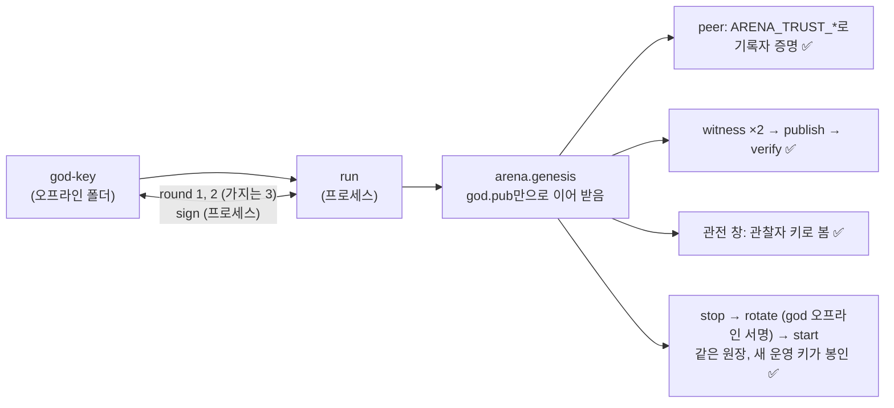

# 8단계 시험 결과: 뿌리 키의 생성과 소멸 (CP-6, CP-7)

> 2026-11-05, 브랜치 `root-key-ceremony-20261105`. 요구사항 [requirements.md](requirements.md), 설계 [design.md](design.md)(11절: 구현하며 정한 것).

## 1. 요약

- 요구사항 26개 모두 ✅. 새 테스트 27개(세리머니 25, 시험 벡터 1, 관전 창 1)와 바꾼 기존 테스트 3개(code table edition 1.1, 관전 창이 관찰자 키로 봄).
- 전체 551개 테스트: 550 통과, 1 건너뜀(opt-in). 실제 LLM은 쓰지 않았다.
- 커버리지(프로세스 포함, `scripts/coverage.sh`): **94.4%**(기준 92%). `arena/ceremony/`: formats 90.6%(단위만) · offline 93.5% · retire 96.8% · rotate 92.7% · run 89.5%.
- **리허설을 실제 프로세스로 처음부터 끝까지** 돌렸다: 뿌리 체인 1회(세리머니 → genesis가 이어 받음 → peer의 뿌리 신뢰 확인 → 기록 → 증인·기록·확인 → 관전 창 → 운영 키 교체 → 재시작), 가지 체인 1회(실행 중인 뿌리에 3라운드로 연결).

## 2. 요구사항별

| 번호 | 확인한 것 | 테스트 |
|---|---|---|
| P8-A1 | god 키는 암호화 파일(`arena-key-backup`)과 `god.pub`만. 평문 개인키 파일 없음, 0600, 다시 만들지 않음. 오프라인 명령은 `httpx`·`uvicorn`·`starlette`·`a2a`·기록자 client를 불러오지 않는다(별도 프로세스로 확인) | `test_ceremony_offline.py` 1·2, `test_ceremony_process.py` 1 |
| P8-A2 | 세리머니 폴더의 **모든 파일**을 바이트로 뒤져 첫 기록자 개인키가 어디에도 없다. 운영 키만 `recorder.key`(0600) | `test_ceremony_run.py::test_p8a2_…` |
| P8-A3 | 다른 요청·다른 payload·다른 키의 서명은 치우고(`.refused`) 기다린다. 원장에는 아무것도 쓰지 않는다. 사람이 "아니오"라고 하면 서명하지 않는다. 요청 내용(라운드, 체인, 항목, 주요 field)을 보여 준다 | `test_ceremony_formats.py`, `test_ceremony_run.py::test_p8a3_…`, `test_ceremony_offline.py` 3 |
| P8-A4·A6 | 파일(JSON) 왕복, `trust-anchor.md`(peer `.env` 두 줄 포함) | `test_ceremony_run.py::test_p8b1_c1_…` |
| P8-A5 | broker·관찰자·운영 키는 세리머니 기계에서 만든다. 끝에 운영 키 백업 안내 | 위 |
| P8-B1·B4 | 멈춘 genesis 폴더에서 운영 키 → 다음 키(god 오프라인 서명), 다시 켜면 새 키가 봉인 | `test_ceremony_run.py::test_p8b1_the_operating_key_…`, `test_ceremony_process.py` 1 |
| P8-B2 | 넘긴 옛 키 파일(`*.retired*`)이 남지 않는다(세리머니, 운영 키 교체 모두) | 위 둘, `test_p8a2_…` |
| P8-B3 | god 키 넘기기는 옛 god·새 god 둘이 서명해야 하고, 끝나면 `god.pub`이 새 키 | `test_ceremony_formats.py::test_p8b3_…`, `test_ceremony_run.py::test_p8b3_…` |
| P8-C1 | 넘김 서명이 오지 않으면 시간이 지나 멈추고, 그 폴더에는 0번만 있고 기록자 키 파일이 없다(아무도 이어 봉인할 수 없음). 같은 폴더에서 다시 시작하지 않는다 | `test_ceremony_run.py::test_p8c1_…` |
| P8-C2 | 선언의 전용 field 모양, hash에 서명이 들어가지 않음, 시험 벡터 | `test_ceremony_formats.py` 5·6, `test_protocol_vectors.py::test_p8_…` |
| P8-C3 | 증인 2명 미만이면 세리머니가 시작하지 않고, 선언도 받지 않는다. 증인 아닌 키의 서명은 거부 | `test_ceremony_run.py::test_the_witnesses_…`, `test_ceremony_retire.py` |
| P8-C4 | `publish` + `retirement`로 hash가 원장에. 이름표가 있거나 `share`에 쓰면 원장이 거부. 같은 선언은 한 번만 | `test_ceremony_retire.py` 1·3 |
| P8-C5 | `verify`: 기록 전에는 "원장에 아직 없음", 기록 뒤 통과. 다른 원장·없는 handover·다른 키·틀린 head·증인 부족·목록 밖 서명은 이유와 함께 실패 | `test_ceremony_retire.py` 1·2, `test_ceremony_process.py` 1 |
| P8-C6 | 선언 형식은 role `god`도 받는다. 세리머니 순서에는 god 소멸이 없다 | `test_ceremony_formats.py` |
| P8-D1·D2 | genesis의 god peer와 관전 창이 `observer.key`로 읽는다. 전체 열람 허용은 관찰자 키(와 설정)만, god 키는 읽지 못한다 | `test_observer_process.py`, `test_ceremony_run.py::test_p8d4_…`, `test_ceremony_process.py` 1 |
| P8-D3 | 관전 창 머리줄에 `관찰자 키로 봄 · god 키 아님`(마우스를 올리면 god 필명) | `tests/ui/test_observer_ui.py::test_p8d3_…` |
| P8-D4 | 관찰자 키로 기록자 키 넘김을 승인하거나 god 키를 넘기려 하면 원장이 거부 | `test_ceremony_run.py::test_p8d4_…` |
| P8-E1 | `python -m arena.ceremony` 하위 명령 10개 | 프로세스 테스트가 CLI로 돈다 |
| P8-E2 | `god.pub`만 있는 폴더를 genesis가 이어 받는다. `god.pub`만 있고 원장이 없으면 "ceremony run first"로 시작하지 않는다. 자동 생성(시험용)은 그대로 | `test_ceremony_process.py` 1·2, 기존 genesis 테스트 |
| P8-E3 | 실행 기록의 단계 순서가 정확히 정해져 있고, 기록에 개인키가 없다 | `test_ceremony_run.py::test_p8b1_c1_…`, `test_p8e3_…` |
| P8-E4 | 실제 프로세스 리허설: 뿌리(위 그림), 가지(뿌리에 `chain_link`, 가지 `genesis, parent_link, key_rotate`, genesis가 뿌리 이름과 함께 이어 받음, 감사 ok) | `test_ceremony_process.py` 1·3 |
| P8-E5 | 실패 경로: 위 A3·C1·C3·C5·D4 | 위 |
| P8-E6 | 설정 `ARENA_CEREMONY_MIN_WITNESSES`, `_POLL_SEC`, `_TIMEOUT_SEC`, `ARENA_OBSERVER_KEY_FILE`(`.env.example` 갱신) | `test_config.py` |

## 3. 바뀐 기존 동작

| 무엇 | 전 | 후 |
|---|---|---|
| 기록자 키 넘기기 | 옛 키를 `recorder.key.retired-<seq>`로 남김 | 남기지 않음 |
| genesis의 god peer, 관전 창 | god 키로 원장을 읽음 | 관찰자 키(`observer.key`)로 읽음. 관전 창의 필명이 관찰자의 것 |
| genesis의 전체 열람 허용 | god 키 + 설정 | 관찰자 키 + 설정 |
| genesis 시작 | 늘 `god.key`를 읽거나 만듦 | `god.pub`만 있으면 공개키로 이어 받음 |
| 기본 code table edition | `agent-arena 1.0` | `agent-arena 1.1`(목적 코드 `retirement`, 폐기 방법 코드) |

## 4. 한계 (그대로 남은 것)

- **메모리 소멸**: Python은 메모리를 0으로 지우지 못한다. 첫 기록자 키는 프로세스가 끝나면 OS가 회수하지만, 스왑이나 크래시 덤프에 남을 수 있다. 세리머니 기계는 스왑과 덤프를 끄고 쓴다.
- **선언은 증명이 아니다**: 증인은 본 것을 서명할 뿐이다. 그래서 파일을 지우는 방식이 아니라 처음부터 쓰지 않는 방식(`memory-only`)을 쓴다.
- **운영 기록자 키를 잃으면** 체인이 멈추는 것은 7단계까지 그대로다(`run`이 백업을 안내한다).
- **god 키는 남는다**: 오프라인 암호화 보관, 쓰는 일은 기록자 키 교체 승인뿐. 없애는 일은 CP-8(증인이 god 대신 승인) 뒤, 공개 출시 뒤 만든 사람이 판단한다.
- 리허설은 테스트 안에서 했다. 내부망의 따로 떨어진 기계(진짜 오프라인 기계)에서 사람이 손으로 해 본 것은 아니다.
