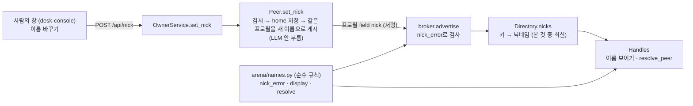

# 9단계 설계: peer가 정하는 필명

> 2026-11-06. 요구사항 [requirements.md](requirements.md). 사용자 결정: 닉네임은 아무 때나 바꾼다. "제안대로"로 Q2(찾을 때 대소문자 구분 안 함)·Q3(이모지 허용)와 나머지 제안값을 정함.

## 1. 구성

## 2. 정한 것

| 일 | 결정 | 이유 |
|---|---|---|
| 규칙의 자리 | `arena/names.py` 한 곳(입출력 없음): `nick_error`, `display`, `resolve` | 한 가지 책임. broker와 peer가 같은 규칙을 쓴다 |
| 닉네임의 자리 | 프로필 전용 field `nick`. 필명 문자열은 어디에도 저장하지 않고 `닉네임-키 앞 6자`로 그때그때 만든다 | 전용 field 원칙(`code-acts-on-dedicated-fields`) |
| 처음 값과 바꾼 값 | 설정 `ARENA_<종류>_PEER_NICK`은 **처음 값**. peer home의 `state.json`에 `nick`이 있으면 그것이 이긴다 | 창에서 바꾼 값이 재시작 뒤에도 남아야 한다 |
| 바꿀 때 | 프로필 버전 +1로 **마지막 프로필을 그대로 두고 `nick`만 바꿔** 게시한다. 요약을 새로 쓰지 않으므로 LLM을 부르지 않는다 | LLM 호출 최소화(이름 바꾸기에 토큰을 쓰지 않는다) |
| 이름 찾는 법 | `resolve(ref, [(키, 닉네임)], n)`: `ref`를 처음 `-`에서 둘로 나눠 닉네임(대소문자 무시)이 같고 키가 뒷부분(소문자 hex)으로 시작하는 것을 모은다. 하나면 그 키, 여럿이면 후보를 전체 필명으로 적어 거절, 없으면 못 찾음 | 닉네임에는 `-`가 없으므로 첫 `-`가 경계다 |
| 후보의 범위 | 이 이벤트에서 아는 peer + broker의 만료 전 프로필 + 나 | 이미 아는 사람과 지금 보이는 사람 |
| 여럿이면 | `AmbiguousName`을 던지고 `Toolbox.run`이 `{"error": 후보 목록}`으로 돌려준다. 하나를 고르지 않는다 | 계약·서명처럼 되돌릴 수 없는 일에 짐작으로 고르지 않는다 |
| 이름 보이기 | `Handles.handle`: 나는 내 닉네임, 남은 `Directory.nicks`(프로필에서 본 것), 못 본 키는 기본 닉네임 | 처음 보는 키는 이름을 붙이기 전에 프로필을 먼저 찾는다(기존 `learn_keys`) |
| 필명처럼 생긴 문자열 검사 | `check_handles`는 `닉네임-<n자>` 모양이고 **닉네임이 아는 닉네임일 때만** 필명으로 보고, 누구도 가리키지 않으면 거절한다 | `co-worker` 같은 일반 글이 필명으로 오인되지 않게 |
| SDK | `Me.nick` 추가 | 앱이 내 닉네임을 알 수 있어야 한다 |
| 창 | `desk`와 `console`의 머리글에 "이름 바꾸기"(입력 + 저장/취소). 입력하는 동안 polling이 머리글을 덮어쓰지 않는다 | 사람이 쓰던 글이 사라지면 안 된다 |
| 설정 | `ARENA_PEN_NAME_PREFIX`는 없앴다. `ARENA_PEN_NAME_DEFAULT_NICK`(`필명`), `ARENA_NICK_MAX_LEN`(16), 종류별 `…_PEER_NICK`을 더했다 | 접두사의 뜻이 닉네임으로 바뀌었다 |

## 3. 이 단계에서 하지 않은 것 (한계)

- **chat 창**에는 이름 바꾸기가 없다(머리글이 다르다). desk와 console에는 있다.
- **god·스핑크스·관전 창의 이름 표시**(`god_role`, `sphinx_role`, observer)는 아직 남의 닉네임을 몰라 기본 닉네임으로 보인다(`필명-xxxxxx`). 이 창들이 쓰는 이름은 이 단계에서 닉네임을 반영하지 않았다.
- **agent card의 이름**(`peer-<필명>`)은 peer를 띄울 때 한 번 만든다. 닉네임을 바꿔도 다시 만들지 않는다.
- 남의 닉네임은 그 사람이 프로필을 다시 읽은 뒤에야 바뀐다(요구사항 P9-A7).
- 키 앞 6자(24비트)를 맞춰 남의 필명을 흉내 내는 일은 막지 않는다(P9-D1).
