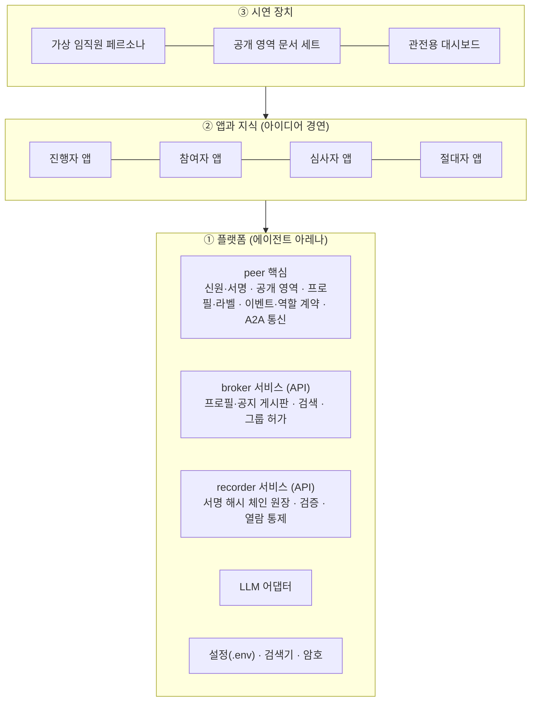

# 에이전트 아레나 개발 계획

> 기획 문서 단계(`docs/`)가 끝나고 2026-10-30부터 플랫폼 개발 단계다. 이 문서는 단계(phase) 나눔과 각 단계의 완료 기준이다.
> 세부 요구사항·설계·테스트 결과는 `dev/phaseN/` 아래에 단계별로 둔다.

## 개발 원칙 (사용자 지정, 2026-10-30)

| 원칙 | 적용 방법 |
|---|---|
| SOLID | 한 모듈은 한 책임. 서비스는 인터페이스(Protocol)로 추상화하고 구현을 주입한다. 새 역할·새 API는 기존 코드를 고치지 않고 등록으로 추가한다 |
| TDD | 요구사항마다 테스트를 먼저 쓰고(빨강) 구현해 통과시킨다(초록). 테스트는 `tests/`에 두고 `pytest`로 돈다 |
| 하드코딩 금지 | 포트·주소·만기·상한·모델명 같은 값은 `.env`에 두고 `arena/config.py`로 읽는다. 저장소에는 `.env.example`만 올린다 |
| 단계 분할 | 한 단계를 끝내고(문서·테스트 포함) 다음 단계로 간다. 단계 안에서도 요구사항 단위로 진행한다 |
| 문서화 순서 | 단계마다 `requirements.md` → `design.md` → (테스트·구현) → `test-results.md` |
| 테스트의 LLM | 삼성SDS Cloud AI 서비스(OpenAI 호환, `.env`의 키)를 쓴다. 오프라인 템플릿으로 대체하지 않는다 |

## 세 계층 (제출본 문항 3의 구분)



## 단계 나눔

| 단계 | 이름 | 범위 | 완료 기준 |
|---|---|---|---|
| **1** | **인프라 서비스** | 설정 모듈(.env), 신원·서명, 검색기, 원장 라이브러리(파일 영속화 포함), **broker API 서비스**, **recorder API 서비스**, 두 서비스의 클라이언트, 단독 실행(데몬) 진입점, 이름 변경(에이전트 아레나) | 두 서비스가 각각 독립 프로세스로 뜨고, 모든 기능이 테스트로 검증되며, 기존 `app/` 데모는 그대로 돈다 |
| 2 | peer 핵심과 앱 분리 | peer 노드(A2A), 공개 영역 연결(로컬 폴더), 프로필 게시·갱신, 이벤트와 역할 계약, LLM 어댑터, 역할 등록 방식. `app/`의 아이디어 경연 로직을 `apps/idea_contest/`로 옮겨 1단계 서비스 위에서 돌게 하고 `app/` 삭제 | 새 구조로 공모 전 과정이 실제 LLM에서 끝까지 돈다 |
| 3 | 플랫폼 새 기능 | ⑴ 공개 영역을 주소(로컬·클라우드·URL)로 연결 ⑵ 공지 없는 **P2P 직접 수집 요청** ⑶ 공개 영역 지식+원장 실적 기반 **역량 라벨 자율 갱신** ⑷ 역할 계약 전 후보의 원장 실적 사전 조회 | 네 기능 각각 테스트와 실행 기록 |
| 4 | 앱 고도화 | 참여자(출처 명시 기획서, 원문 인용 대조), 진행자(채택은 사람 승인), 심사자(기준별 비교표·점수 초안, 사람 확정), 절대자(강점·실적 대시보드) | 제출본 문항 3 "사용자 경험의 변화" 표의 네 역할이 그대로 동작 |
| 5 | 시연 장치 | 페르소나와 공개 영역 문서 세트, 사람 참여 화면(진행자·응모자 1명·심사자 1명), 대시보드 | 5분 시연 장면 ①~⑤ 리허설 가능 |
| 6 | 검증과 리허설 | 반복 실행 안정성, 심사 변별력, 변조·비인가 열람 시연, 실행 기록 보관 | 측정 결과 문서화 |
| 7 | recorder 분산 | 기록자 여럿: 항목 복제, 다른 기록자 항목의 독립 검증(validator 경로), 시각 편차 규칙, 상호 대조. **가장 나중에 한다**(사용자 2026-10-30). 그 전까지 원장 보관소는 하나 | 기록자 2곳 이상에서 같은 체인 유지 |

제출본 문항 3의 2일 계획(1단계 시연 장치 → 2단계 플랫폼 → 3·4단계 앱 → 5단계 검증)과 순서가 다른 이유: 사용자가 "플랫폼 분리 먼저"를 택했다(2026-10-30). 해커톤 당일에는 위 3~6단계가 남도록 1·2단계를 사전에 끝낸다.

## 저장소 배치 (목표)

```
arena/            ① 플랫폼 패키지
  config.py       .env 설정
  crypto.py       신원(ed25519)·해시·서명 검증
  search.py       BM25 검색기 (Searcher 인터페이스)
  ledger.py       원장 규칙·해시 체인·감사·기여 집계
  broker/         게시판·검색 서비스 + HTTP API + 클라이언트
  recorder/      원장 서비스 + HTTP API + 클라이언트 (보관소 하나, 분산은 7단계)
  peer/           (2단계) A2A 노드, 공개 영역, 프로필, 이벤트, 역할 계약
  llm.py          (2단계) LLM 어댑터
apps/             ② 앱 계층 (2단계부터)
  idea_contest/
demo/             ③ 시연 장치 (2단계부터)
tests/            단위·API·통합 테스트
dev/              개발 문서 (이 계획, 단계별 요구사항·설계·테스트 결과)
docs/, review/    기획 문서와 리뷰 (유지)
```

## 브랜치

- 작업 브랜치: `arena-platform-20261030`. 단계가 끝나면 main에 병합한다.
- `checkpoint-20261023-v1`은 동결. 이전 아이디어는 `checkpoint-20261023-v2`.
