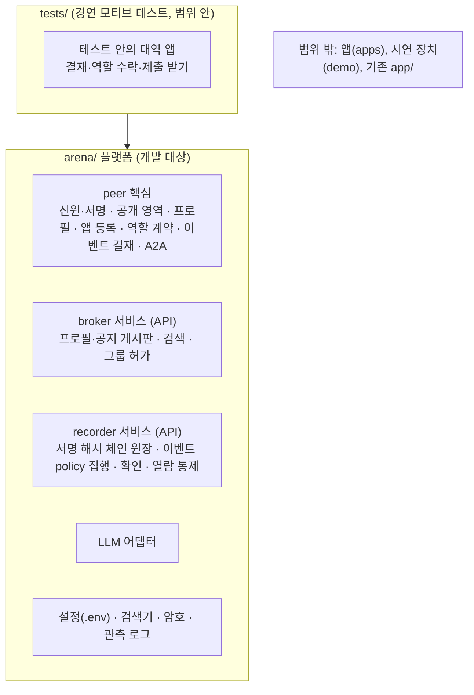

# 에이전트 아레나 개발 계획

> 기획 문서 단계(`docs/`)가 끝나고 2026-10-30부터 플랫폼 개발 단계다. 이 문서는 단계(phase) 나눔과 각 단계의 완료 기준이다.
> 세부 요구사항·설계·테스트 결과는 `dev/phaseN/` 아래에 단계별로 둔다.

## 개발 원칙 (사용자 지정, 2026-10-30)

| 원칙 | 적용 방법 |
|---|---|
| SOLID | 한 모듈은 한 책임. 서비스는 인터페이스(Protocol)로 추상화하고 구현을 주입한다. 새 역할·새 API는 기존 코드를 고치지 않고 등록으로 추가한다 |
| TDD | 요구사항마다 테스트를 먼저 쓰고(빨강) 구현해 통과시킨다(초록). 테스트는 `tests/`에 두고 `pytest`로 돈다 |
| 하드코딩 금지 | 포트·주소·만기·상한·모델명 같은 값은 `.env`에 두고 `arena/config.py`로 읽는다. 저장소에는 `.env.example`만 올린다 |
| 단계 분할 | 한 단계를 끝내고(문서·테스트 포함) 다음 단계로 간다. 단계 안에서도 요구사항 단위로 진행한다 |
| 문서화 순서 | 단계마다 `requirements.md` → `design.md` → (테스트·구현) → `test-results.md` |
| 테스트의 LLM | 삼성SDS Cloud AI 서비스(OpenAI 호환, `.env`의 키)를 쓴다. 오프라인 템플릿으로 대체하지 않는다 |

## 범위: 플랫폼만

개발 대상은 **범용 플랫폼(`arena/`)뿐**이다(사용자 2026-10-30). 제출본 문항 3의 세 계층 중 ② 앱과 지식(아이디어 경연의 역할별 앱), ③ 시연 장치(페르소나, 대시보드)는 이 개발 범위 밖이다. 아이디어 경연은 **테스트 소재**로만 쓴다. 테스트 코드 안의 작은 대역 앱이 플랫폼 API만으로 경연 흐름(사장님 결재 포함)을 끝까지 재현해 플랫폼이 그런 앱을 받쳐 주는지 확인한다. 기존 사전 프로토타입 `app/`은 건드리지 않는다.



## 단계 나눔

| 단계 | 이름 | 범위 | 완료 기준 |
|---|---|---|---|
| **1** | **인프라 서비스** ✅ | 설정, 신원·서명, 검색기, 원장(파일 영속화), broker API, recorder API, 클라이언트, 단독 실행, 이름 변경 | 두 서비스가 독립 프로세스로 뜨고 테스트로 검증 |
| **2** | **범용화와 peer 핵심** | 2-A 원장 범용화(이벤트 선언·policy·결재) ✅, 2-B peer 핵심(LLM 어댑터, A2A, 공개 영역, 프로필, 앱 등록, 역할 계약, 결재 요청, 기록자 역할) ✅, 2-C 경연 모티브 통합 테스트(테스트 안에서만, 메모리 세계와 실제 프로세스+실제 LLM 두 가지) | 플랫폼 API만으로 경연 흐름이 끝까지 돈다 |
| 3 | **기본 서빙 peer** ✅ | 플랫폼이 기본으로 띄워 주는 인프라 peer들. **고급 검색 peer**(broker의 공지(이벤트)와 프로필을 임베딩으로 바꿔 벡터 거리로 찾음)와 **관전용 절대자 peer**(원장 전체 열람·감사·통계)를 확정 대상으로 한다(아래) | peer별 요구사항·설계·테스트, 실제 임베딩 모델로 실행 기록 |
| 4 | 플랫폼 새 기능 ✅ | ⑴ 공개 영역을 주소(로컬·클라우드·URL)로 연결 ⑵ 공지 없는 **P2P 직접 수집 요청** ⑶ 공개 영역 지식+원장 실적 기반 **역량 라벨 자율 갱신** ⑷ 역할 계약 전 후보의 원장 실적 사전 조회 | 네 기능 각각 테스트와 실행 기록 |
| 5 | 검증 (플랫폼 완성) | ① 인수에 필요한 범용 기능: **이벤트 종료**, **공동 확인**(여러 당사자 서명) ② 반복 실행 안정성, 변조·비인가 열람, 실행 기록 보관, 역량 라벨 이름 흔들림 대응 결정 ③ **인수 확인: peer 간 가위바위보 이벤트**([acceptance-rps.md](acceptance-rps.md)) | 측정 결과 문서화, 가위바위보 인수 조건 RPS-1~7 통과. 여기까지가 **플랫폼 완성** |
| 6 | **범용 앱 요소의 기본 탑재** | 여러 앱에 공통으로 쓰일 요소를 플랫폼의 기본 기능으로 넣는다(아래 후보). 특정 앱 전용이 아니라 이벤트 policy처럼 선언·설정으로 쓰는 형태 | 후보마다 요구사항·설계·테스트. 경연 모티브 테스트가 대역 앱 대신 기본 기능을 쓴다 |
| 7 | recorder 분산 | 기록자 여럿: 항목 복제, 다른 기록자 항목의 독립 검증, 시각 편차 규칙, 상호 대조. **가장 나중에 한다**(사용자 2026-10-30). 그 전까지 원장 보관소는 하나 | 기록자 2곳 이상에서 같은 체인 유지 |

### 3단계 기본 서빙 peer (사용자 2026-10-30)

**의미**: 고급 검색 peer는 기간계 시스템의 엔드포인트가 하나의 peer가 되거나, 하나의 peer가 그 서비스를 중계하는 모델을 보여 준다(이번에는 bge-m3 임베딩 서비스를 중계). 같은 틀로 인사·결재·자산 같은 기간계 시스템도 아레나에 들어올 수 있다.

broker는 AI 없이 기계적으로 일한다. 판단이나 무거운 계산이 필요한 일은 broker가 아니라 **역할을 맡은 peer**가 한다. 플랫폼은 이런 peer를 기본으로 띄울 수 있게 제공한다.

| peer | 하는 일 | 미리 정할 것 |
|---|---|---|
| **고급 검색 peer** (첫 대상) | broker의 공지(이벤트)와 프로필을 받아 임베딩으로 바꾸고 벡터 거리(코사인 등)로 찾는다. 다른 peer는 A2A로 질의한다. BM25로 안 잡히는 뜻 비슷한 글을 찾는다 | 임베딩 모델과 엔드포인트(설정값), 색인 갱신 방식(주기 또는 broker 변경 알림), 닫힌 그룹 내용의 색인 권한(만기 있는 broker 열람 허가), 벡터 저장소(처음은 메모리) |
| 추천 peer | 검색 결과를 자기 AI로 걸러 근거와 함께 연결 | 고급 검색 peer 위에 얹을지 |
| **관전용 절대자 peer** (확정, 사용자 2026-10-30) | 기록자의 열람 허용 목록에 있는 키로 원장 전체를 읽어 스스로 감사(해시·참여자 서명·기록자 서명)하고, 통계와 peer별 강점(프로필)·실적(원장)을 낸다. 쓰기·내용 열람·실명 확인은 못 한다. 관전 화면은 이 peer의 창이다 | 열람 허용의 만기와 사유 기록, broker 프로필 열람 범위(닫힌 그룹 포함 여부), 통계 항목을 판정·역할 이름에 묶지 않는 방식 |
| broker를 맡은 peer | broker 서비스를 peer가 품고 여는 형태 | 1단계 broker를 그대로 품음 |

**진행 방향 (사용자 2026-10-30)**: 먼저 **플랫폼 완성**(1~5단계)을 목표로 한다. 완성 확인은 순수 플랫폼 상태에서 peer들이 A2A로만 가위바위보를 하고 승률 순위를 공증한 뒤 이벤트를 닫는 인수 절차다([acceptance-rps.md](acceptance-rps.md)). 2단계 다음은 **기본 서빙 peer**(3단계)다. 그 뒤 **범용성 있는 앱 요소를 플랫폼에 기본 탑재**한다(6단계). 특정 앱(아이디어 경연 등) 자체는 만들지 않는다.

### 6단계 기본 탑재 후보 (경연 모티브에서 찾은 범용 요소)

| 후보 | 범용으로 본 이유 |
|---|---|
| 게시판 구독 | 내 라벨에 맞는 공지를 주기적으로 받아 보고, 관련도가 낮으면 AI 없이 거르는 일은 어떤 모집·요청 앱에도 필요 |
| 제출 받기 | 해시·작성자 서명·수령자·중복·역할 충돌을 검사하고 수령 서명을 주는 일은 공모·자료 요청·설문 모두 같음 |
| 먼저 등록 → 전달 → 공유 기록 | 내용을 넘기는 모든 거래의 기본 순서(영수증 보관 포함) |
| 평가 요청과 판정 기록 | 계약된 평가자에게 맡기고 판정을 원장에 남기는 일(심사, 검토, 감수) |
| 추천(매칭) | broker 검색 결과를 자기 AI로 걸러 근거와 함께 연결하는 인프라 역할 |
| 비서 도구 루프 | 도구 목록을 주고 다음 행동을 스스로 고르게 하는 루프(단계 상한, 실패 시 고정 순서) |
| 판단 근거 틀 | 적합성(인용 확인)·소유자 규칙·이득과 여력·위험·상대 신뢰(계약·결재 확인)의 다섯 근거 판단 |
| 소유자 확인 단계 | 권리·책임이 정해지는 기록 직전에 사람 승인을 받는 일 |
| 서비스 중계 peer 틀 | 기간계 시스템 API를 감싸 A2A op로 내놓고, 묻는 쪽 확인·공개 규칙·발견을 peer가 맡는 틀(3단계 검색 peer에서 나온 형태를 일반화) |
| 경험 노트와 프로필 갱신 | 일한 뒤 경험을 공개 영역에 남기고 프로필을 다시 게시 |

## 저장소 배치

```
arena/            플랫폼 패키지 (개발 대상)
  config.py  crypto.py  signing.py  search.py  ledger.py  llm.py  a2a.py  events.py  http.py  serve.py
  broker/         게시판·검색 서비스 + HTTP API + 클라이언트
  recorder/       원장 서비스 + HTTP API + 클라이언트 (보관소 하나, 분산은 7단계)
  peer/           peer 노드, 앱 등록, 공개 영역, 프로필, 역할 계약, 결재, 영수증, 기록자 역할
tests/            단위·API·프로세스 테스트, 경연 모티브 통합 테스트(tests/motif/), 실제 LLM 테스트(tests/live/)
dev/              개발 문서
app/              사전 프로토타입 (범위 밖, 그대로 둠)
docs/, review/    기획 문서와 리뷰
```

## 브랜치

- 작업 브랜치: `arena-platform-20261030`. 단계가 끝나면 main에 병합한다.
- `checkpoint-20261023-v1`은 동결. 이전 아이디어는 `checkpoint-20261023-v2`.
