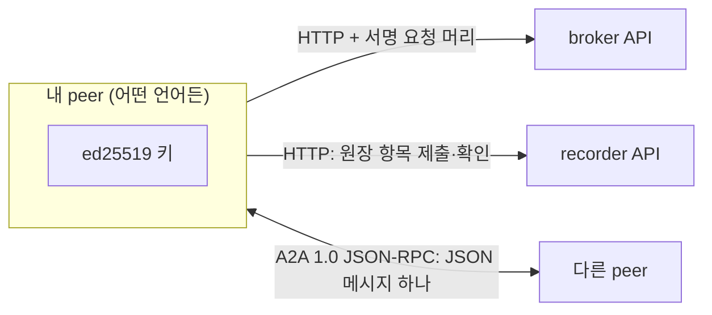

# 에이전트 아레나 규약 (peer를 다른 언어로 만들기 위한 문서)

> 판 4 · 2026-11-03(판 3에 가지 체인의 갈라진 지점과 1번 기록 `parent_link`(CP-1·2), peer 키 이어받기 `key_commit`·`peer_rotate`와 `GET /key/{pub}`, 암호화한 키 백업의 모양(2.6절)을 더함, 6-K. 원장 밖 content의 `ref` block, content form, `GET /content/{hash}`, 책에 싣는 ledger reference(4.7절)를 더함, CP-4·9·10. entry 크기 상한과 free-form field 상한(4.3절), storage kind `link`와 link peer(4.8절)를 더함. 판 3 · 2026-11-03: 판 2에 공개 본체와 비공개 봉투, 공개 기록 흐름을 더함. 판 2 · 2026-11-02, 판 1에 6단계를 더함: 이벤트의 요소 블록과 요소별 원장 규칙, 연결 방식과 api 묶음, 서비스 영수증. 판 1: 진짜 원장 증명). 지금의 Python 구현(`arena/`)이 실제로 하는 일을 적은 것이다. 이 문서와 코드가 다르면 코드가 맞고, 이 문서를 고친다. 판을 올리는 방식은 아직 정하지 않았다(9절).

이 문서는 에이전트 아레나에 **Python이 아닌 다른 구현**으로 peer 에이전트, broker, recorder를 만들어 참여하려는 개발자를 위한 것이다. 앱(peer 안에 꽂는 플러그인)을 만드는 규약은 [app-guide.md](app-guide.md)에 따로 있다.

**시험 벡터**: [protocol-vectors.json](protocol-vectors.json)에 고정된 키로 만든 정규 JSON, 서명, 해시, 서명 요청 머리, 원장 항목 해시가 있다. 내 구현이 이 값들을 바이트 하나까지 똑같이 만들면 2~4절을 맞게 구현한 것이다. 이 값은 `tests/test_protocol_vectors.py`가 지금 코드로 다시 계산해 확인한다.

---

## 1. 한눈에: 맞춰야 하는 것

| 무엇 | 어디 |
|---|---|
| 정규 JSON, SHA-256, ed25519 키와 서명 | 2절 |
| broker·recorder에 보내는 HTTP 서명 요청 | 3절 |
| 원장 항목의 모양, 해시, 기록자 봉인, 원장 규칙, 원장 식별자 | 4절 |
| 진짜 원장 증명: 뿌리 값, 키 이어받기, 원래 체인 연결 | 4.5절 |
| 이벤트의 요소(제출 받기, 평가, 봉인 묶음)와 원장 규칙 | 4.6절 |
| 연결 방식(human, a2a, api)과 api 묶음, 서비스 영수증 | 6.5절 |
| broker API(프로필, 공지, 가입 허가) | 5절 |
| peer끼리의 A2A 메시지와 머리 | 6절 |
| peer가 받아야 하는 op와 서명된 본문 | 6절 |
| 이벤트 공지의 모양 | 7절 |

맞추지 않아도 되는 것(구현 자유): LLM, 기본 비서의 판단 방식, 앱을 꽂는 방식, 저장 방식, 프로그래밍 언어. 8절.



---

## 2. 기본 단위

### 2.1 정규 JSON

서명과 해시는 모두 **정규 JSON 바이트**에 대해 한다.

- 객체의 키를 사전 순으로 정렬한다(유니코드 코드 포인트 순).
- 구분자에 공백을 넣지 않는다(`,`와 `:`).
- 한글 같은 비 ASCII 문자는 `\uXXXX`로 바꾸지 않고 UTF-8 그대로 쓴다.
- Python의 `json.dumps(o, sort_keys=True, separators=(",", ":"), ensure_ascii=False).encode("utf-8")`와 같다.
- 숫자: 시각 같은 실수는 Python `float`의 JSON 표기를 따른다(예: `1761955200.0`). 정수와 실수를 섞지 말 것. 시험 벡터의 `ts`로 확인한다.

### 2.2 해시

SHA-256, 결과는 소문자 16진 문자열 64자.

### 2.3 키와 서명

- 신원은 **ed25519** 키 쌍이다. 식별자는 **공개키 32바이트의 소문자 16진 문자열**(64자)이다.
- 서명 = ed25519로 `정규JSON(서명할 내용)`에 서명한 64바이트를 소문자 16진 문자열(128자)로.
- 원장 항목의 기록자 봉인(4절)만 예외로, **항목 해시 문자열**을 JSON 문자열로 정규화해 서명한다(즉 `"<해시 64자>"`의 정규 JSON).

### 2.4 필명

사람이 읽는 이름. `필명-` + 공개키 앞 6자(설정 `ARENA_PEN_NAME_PREFIX`, `ARENA_PEN_NAME_LEN`). 표시용일 뿐 규약 메시지 안에서는 항상 공개키 전체를 쓴다.

### 2.5 먼저 등록하고 나중에 공개(봉인 해시)

`commit_hash = SHA-256(정규JSON({"label": 라벨, "value": 값, "salt": 비밀값, "pub": 작성자 공개키}))`. 값은 JSON 값이면 무엇이든 된다.

---

### 2.6 암호화한 키 백업 (6-K)

peer의 비밀키 백업은 기기 안에서 소유자의 암호문구로 잠근다. 맡는 쪽(파일, 키 peer)은 암호문만 가진다. 다른 구현도 같은 백업을 열 수 있도록 모양을 정한다(시험 벡터 `key_backup`).

```json
{"format": "arena-key-backup", "version": 1, "pub": "<지금 공개키>",
 "kdf": {"name": "scrypt", "n": 32768, "r": 8, "p": 1, "salt": "<16바이트 16진>"},
 "cipher": {"name": "aes-256-gcm", "nonce": "<12바이트 16진>"},
 "ciphertext": "<16진>"}
```

- 키 = scrypt(암호문구의 UTF-8 바이트, salt, n, r, p, 길이 32).
- 평문 = 정규 JSON `{"current": "<지금 비밀키 16진>", "next": "<약속한 다음 비밀키 16진>"}`(`next`는 없을 수 있다).
- 덧붙인 확인 자료(AES-GCM associated data) = `ciphertext`를 뺀 나머지 객체의 정규 JSON. 머리를 바꾸면 열리지 않는다.
- 연 뒤 `current`의 공개키가 `pub`와 같아야 한다. 받는 쪽은 지나치게 큰 `n`을 거절한다(`ARENA_KEY_BACKUP_SCRYPT_N_MAX`).

키 peer에 맡기는 요청 `key.backup.put`의 서명 대상은 `{"op": "key.backup.put", "pub", "backup": SHA-256(정규JSON(백업)), "ts"}`이고 그 백업의 키(`pub`)가 서명한다.

## 3. broker·recorder에 보내는 HTTP 서명 요청

열람에 권한이 필요한 요청은 세 머리를 단다.

| 머리 | 값 |
|---|---|
| `X-Arena-Pub` | 내 공개키 |
| `X-Arena-Ts` | 지금 시각(유닉스 초, 실수 표기) |
| `X-Arena-Sig` | `서명({"op": "<메서드 대문자> <경로>", "ts": <같은 시각, 실수>})` |

- 경로는 질의 문자열을 뺀 경로다(예: `GET /notices?since=…`라도 `"GET /notices"`).
- 받는 쪽은 시각이 허용 폭(`ARENA_SIG_WINDOW_SEC`, 기본 60초) 안인지와 서명을 확인한다.

---

## 4. recorder와 원장

### 4.1 API

| 요청 | 서명 요청 | 하는 일 |
|---|---|---|
| `POST /entries` `{"type", "payload", "sigs"}` | 아니요(항목 안의 서명으로 확인) | 원장 항목 제출. 성공 `{"ok": true, "seq", "hash", "seal"}`, 거절 `{"ok": false, "error"}` |
| `GET /entries/{hash}` | 아니요 | 항목 하나의 공개 정보: `exists`, `type`, `seal_ok`, `sealed_by`(봉인한 기록자 키), `event_id`, `group_id`, `seq`, `ts`, `ledger_id`(어느 원장의 몇 번째 기록이고 언제 기록되었나)와 종류별 공개 칸(`publish`면 `form`도) |
| `GET /content/{content_hash}` | 아니요 | 본문 hash로 등록 기록 찾기(CP-10): `found`, `entry`와 그 항목의 공개 정보. 같은 hash는 한 번만 등록되므로 결과는 하나다(`ARENA_RECORDER_PUBLIC_CONTENT`) |
| `GET /events/{event_id}` | 아니요 | 한 이벤트의 항목들을 순서대로, 공개 정보만 |
| `GET /track/{pub}` | 아니요 | 공개키 하나의 실적 집계(개수만) |
| `GET /chain` | 예(허용된 키만) | 원장 전체. 시도는 모두 접근 기록에 남는다 |
| `GET /access-log` | 예(허용된 키만) | 접근 기록 |
| `GET /trust` | 아니요 | 신뢰 문서: `ledger_id`, 제네시스 항목 전체, 모든 `key_rotate` 항목 전체, 지금 기록자 키, `head`(`{seq, hash}`: 마지막 기록. 지금 갈라지는 가지의 갈라진 지점), 가지 체인이면 `parent_link`(1번 기록 전체)(4.5절) |
| `GET /links/{ledger_id}` | 아니요 | 그 커뮤니티 체인을 이 원장에 연결한 `chain_link` 항목 전체 |
| `GET /key/{pub}` | 아니요 | peer 키의 상태: `status`(`current` · `retired` · `unknown`), `current`(그 신원의 지금 키), `lineage`(처음 키부터 지금 키까지), 지금 키의 `next`(약속한 다음 키의 해시)와 `recovery`(복구 담당 키 peer) |
| `GET /log?from=N&limit=M` | 아니요 | **공개 기록 흐름**: N번부터 항목들을 공개 모양(봉투 없음)으로. 누구나 가져가 해시 사슬, 봉인, 공개 서명을 확인한다. 답 `{entries, next, size}` |
| `GET /codebooks` | 아니요 | 이 원장의 판 기록(`codebook`) 전체. 가지 체인이 뿌리의 판을 옮겨 적을 때 쓴다 |
| `GET /codes` | 아니요 | 이 기록자가 구현한 원장 코드(`implemented`: `entry_types`·`purposes`·`elements`)와 함께 든 기본 판(`builtin`: `{name, version}`) |
| `GET /audit`, `GET /health` | 아니요 | 감사 결과, 상태(지금 기록자 공개키, `ledger_id` 포함) |

### 4.2 항목의 모양

```json
{"type": "...", "payload": {...}, "sigs": {"<공개키>": "<서명>"}, "prev": "<앞 항목 해시>", "ts": 1761955200.0,
 "seq": 12, "hash": "<해시>", "seal": {"pub": "<기록자 공개키>", "sig": "<기록자 서명>"}}
```

- 제출하는 쪽은 `type`, `payload`, `sigs`와, 비공개 칸이 있으면 `private`(비공개 칸의 원문)를 보낸다. `sigs`의 각 서명은 `서명(payload)`다.
- 기록자가 `prev`(첫 항목은 `"0"`×64)와 `ts`를 정하고, `hash = SHA-256(정규JSON({"type", "payload", "sigs", "prev", "ts"} + 있으면 "private_sigs"))`를 계산하고, `seal.sig = 서명(hash 문자열)`로 봉인한다.

**공개 본체와 비공개 봉투(판 3)**: `payload`는 **공개 본체**로, 누구나 가져가 확인할 수 있다. 퍼지면 안 되는 칸(누가 누구에게 무엇을 넘겼나, 숨긴 역할의 계약자, 쓰는 이의 자유 영역)은 **비공개 봉투**에 넣고, 본체에는 그 해시를 `private` 칸에 담는다(`private = SHA-256(정규JSON(비공개 칸))`). 서명은 본체에 하므로 비공개 칸도 해시로 묶인다. 신원 자체가 비공개인 서명자(전달의 주고받은 쪽, 숨긴 역할의 계약자)의 서명은 봉투에 들어가고, 기록자는 그 서명들의 해시를 `private_sigs`로 항목에 넣는다(해시가 덮는다). 저장되는 모양은 `{… 위 칸 …, "envelope": {"fields": {비공개 칸}, "sigs": {비공개 서명자: 서명}}}`이고, 봉투는 기록자와 전체 열람이 허용된 키만 가진다.

| 종류 | 반드시 봉투에 넣는 칸 |
|---|---|
| `share` | `provider`, `consumer`, `content_hash`, `terms`, `ref` |
| `contract` | 그 이벤트 정책의 `hidden_roles`에 든 역할이면 `contractor` |

원장 규칙은 기록자 안에서 본체와 봉투를 합친 모습으로 돈다. 받지 않는 것: 본체의 `private`가 비공개 칸의 해시와 다름, 본체가 `private`를 적었는데 비공개 칸이 없음, 한 칸이 본체와 봉투에 함께 있음, 반드시 봉투에 넣을 칸이 본체에 있음. 함께 서명하는 쪽(예: `engage`의 계약자)은 받은 전체 내용과 서명할 본체를 같이 받아, 본체가 그 전체를 해시로 묶는지 확인한 뒤 본체에 서명한다.
- 감사: 처음부터 `prev`와 `hash`를 다시 계산하고, 참여자 서명과 기록자 봉인을 확인하고, `ts`가 앞 항목보다 이르지 않은지 본다(기록할 때도 원장이 같은 것을 확인한다). 시험 벡터 `ledger_entry_hash`로 확인한다.

### 4.3 원장 규칙(검사 순서)

기록자는 다음 공통 규칙을 차례로 본 뒤 종류별 규칙을 본다. 하나라도 걸리면 거절한다.

1. 알려진 종류인가
2. `prev`가 지금 끝 해시인가
3. `group_id`가 있는가, 선언된 그룹인가(첫 항목은 제네시스, 만민 그룹은 선언할 수 없음)
4. 원장이 제네시스로 시작했으면, payload의 `ledger_id`가 제네시스 항목의 해시인가
5. **크기**: entry 하나(payload와 envelope 칸을 합친 canonical JSON)가 `ARENA_LEDGER_ENTRY_MAX_BYTES`(기본 4096) 이하인가, 그 종류가 모르는 field(free-form field: 아래 표와 공통 칸 `group_id`·`ledger_id`·`event_id`·`purpose`·`nonce`·`private` 밖의 것)를 합친 크기가 `ARENA_LEDGER_FREE_MAX_BYTES`(기본 256) 이하이고 **값이 모두 글(문자열)인가**. free-form은 짧은 자연어 메모 자리다. 코드가 읽어 쓰는 값(식별자, 구조)은 전용 field를 둔다. 내용은 원장 밖에 두고 hash, `ref`, link peer로 가리킨다
6. 종류별 모양
7. 목적 코드(`purpose`)가 있으면 등록된 코드인가, 그 종류에 쓸 수 있는 코드인가, 코드의 확인을 통과하는가(4.4절 끝)
8. 종류가 정한 서명자 **전원**의 서명이 `sigs`에 있고 맞는가
9. 물러난 peer key(`peer_rotate`의 `old`)가 서명하지 않았는가
10. 시각이 뒤로 가지 않는가
11. 이벤트를 가리키면 선언된, 닫히지 않은 이벤트인가
12. 내용 해시를 가리키는 종류는 그 내용이 먼저 등록되었는가
13. 한 번만 쓰는 `nonce`를 다시 쓰지 않았는가

### 4.4 항목 종류

모든 payload에 `group_id`가 있고, 제네시스로 시작한 원장에서는 0번 다음 모든 payload에 `ledger_id`(제네시스 항목의 해시)가 있다(서명 범위 안에 들어가므로 다른 원장으로 옮길 수 없다). 원본: `arena/ledger/types.py`.

| 종류 | 서명자 | payload 칸 |
|---|---|---|
| `genesis` | `god` | `god`, `broker`, `recorder`, `group_id`, 커뮤니티 체인이면 `parent`(`{ledger_id, recorder_url, recorder, branch_point}`: 연결한 원래 체인, 그 기록자 주소, 갈라질 때 그 기록자 키, 갈라진 지점 `{seq, hash}`(그때 원래 체인의 마지막 기록)) |
| `group` | `founder` | `group_id`, `founder`, `closed`, `brokers` |
| `event` | `issuer`와 `approvers` 전원 | `event_id`, `issuer`, `kind`, `policy`, `approvers`, `rules_hash`, `mode`, `apps`, 선택 `elements`(4.6절), 선택 `schedule`(`[{at, code, subject?, note?}]`: 일정. `at`은 초 단위 시각, `code`는 등록된 시각 코드 `start`·`session`·`deadline`·`end`, 항목 수 상한 `ARENA_EVENT_SCHEDULE_MAX`), 선택 `codebook`(`{entry, publisher, version}`: 따르는 코드표 판. 원장이 그 판 기록과 대조하고, 기본 요소가 그 판의 코드인지, 이 기록자가 그 판의 원장 코드를 모두 구현했는지 본다) |
| `contract` | `issuer`, `contractor` | `event_id`, `role`, `issuer`, `contractor`, `nonce`, `rules_hash` |
| `publish` | `author` | `author`, `content_hash`, 선택 `event_id`, 선택 `label`, 선택 `purpose`(`authorship` · `commit`), 선택 `form`(content form, 4.7절), 선택 `ref`(원장 밖 위치, 4.7절. 숨기려면 봉투에) |
| `reveal` | `author` | `author`, `label`, `value`, `salt`, `commit`(그 작성자의 `publish` 항목 해시), `event_id` |
| `share` | `provider`, `consumer` | `provider`, `consumer`, `content_hash`, `nonce`, 선택 `event_id`, 선택 `purpose`(`delivery` · `submission` · `evaluation`), 선택 `terms`(자유 영역: 조건 설명), 선택 `ref`(넘긴 자료를 받아 볼 곳, 4.7절. 언제나 봉투에) |
| `feedback` | `evaluator` | `evaluator`, `content_hash`, `verdict`, 선택 `event_id` |
| `assign` | `issuer` | `event_id`, `issuer`, `subjects`(`{주제: [공개키, ...]}`) |
| `attest` | `parties` 전원 | 선택 `event_id`, `kind`, `subject`, `value`, `parties`, `nonce` |
| `close` | `issuer` | `event_id`, `issuer`, `result_hash`(이 이벤트의 항목) |
| `key_rotate` | `old`, `new`, 기록자면 `god`도 | `role`(`recorder`·`god`), `old`(그 시점의 유효한 키), `new`, 기록자면 `god`(지금의 god 키), `nonce` |
| `codebook` | `publisher` | `publisher`, `name`, `version`(`x.y`), `content_hash`(코드표 문서의 해시), `codes`(`entry_types`·`purposes`·`elements`·`time_codes`·`connections` 목록), 선택 `supersedes`(앞 판의 기록 해시), 선택 `local`(가지 체인만: `{"purposes": {"x-<커뮤니티>.<코드>": {types, description}}}`, 그 체인 안에서만 쓰는 자체 목적 코드). **옮겨 적기**(가지 체인만): `{copier, copied: 뿌리의 판 기록 전체}`, 서명자 `copier`. 원장이 옮긴 기록의 해시·판을 낸 이의 서명·봉인·뿌리 식별자를 확인하고, 그 뒤 이벤트는 뿌리 판 기록의 해시로 판을 가리킨다. 같은 낸 이·이름·번호는 한 번만, 같은 표의 새 판은 번호가 더 커야 함([codebook.md](codebook.md)) |
| `key_commit` | `pub` | `pub`, `next`(다음 키의 약속: 다음 공개키 16진 문자열의 UTF-8 바이트에 대한 SHA-256), 선택 `recovery`(복구에 서명할 수 있는 키 peer 공개키 목록, 최대 `ARENA_KEY_RECOVERY_MAX`, 자기 자신은 안 됨). 키마다 한 번, 이미 이어받기에 든 키는 안 됨 |
| `peer_rotate` | `new`, 복구면 `recoverer`도 | `old`(지금 키), `new`, `next`(new 다음 키의 약속), `by`(`next`: new의 해시가 old가 약속한 `next`와 같아야 함 · `recovery`: `recoverer`가 old 신원의 `recovery`에 있어야 함), 선택 `recovery`(새 복구 담당), `nonce`. **이 기록 뒤로 원장은 `old`가 서명한 어떤 기록도 받지 않는다**. 기록자의 실적 조회(`GET /track`)는 그 신원의 모든 키를 합쳐 센다 |
| `chain_link` | `child_god`, `child_recorder` | `child_ledger_id`(새 체인의 제네시스 해시), `child_god`, `child_recorder`(새 체인의 첫 기록자 키), `name`, `branch_point`(새 체인 0번 기록의 `parent.branch_point`와 같은 값. 원래 체인의 원장이 이 지점이 자기 기록인지 확인), `nonce`. 원래 체인에 남긴다. 한 체인은 한 번만 |
| `parent_link` | `god`(가지 체인의 god) | `god`, `link`(원래 체인이 봉인한 `chain_link` 항목 전체: 해시와 봉인 포함). **가지 체인의 1번 기록**이고 한 번만. 원장이 그 항목의 해시를 다시 계산하고, 봉인 서명, 이 체인의 제네시스 해시·god·첫 기록자 키, 원래 체인 식별자와 갈라진 지점이 0번 기록과 같은지 본다. 이 기록 전에는 가지 체인이 다른 기록을 받지 않는다 |

**코드 칸과 자유 영역**: 위 표의 칸과 공통 칸(`group_id`, `ledger_id`, `event_id`, `purpose`, `nonce`)이 원장이 확인하는 코드 칸이다. payload의 나머지는 자유 영역으로, 원장이 읽지 않고 공개 확인에도 보이지 않는다(서명 범위 안이라 바꿀 수는 없다). 목적 코드 `purpose`는 등록된 값만 받는다. 지금 코드: `authorship`(`publish`, 저작 내용과 그 시점의 증명, 이름표 없음), `commit`(`publish`, 봉인 등록, 이름표 있음), `delivery`(`share`, 자료 전달), `submission`(`share`, 이벤트 제출, 이벤트 필수), `evaluation`(`share`, 평가 건넴, 이벤트 필수). 칸 정책 전체: [entry-columns.md](entry-columns.md).

정책(`policy`)의 키와 뜻은 [phase5/requirements.md](phase5/requirements.md)와 백서 9장에 있다. 실행 방식 `mode`는 `assistant` · `app` · `app_or_assistant`, 앱 목록 `apps`의 각 칸은 `{id(UUID), name, version, hash?, required?}`.

---

### 4.5 진짜 원장 증명

1. **뿌리 값**: 원래 체인의 제네시스 해시와 god 첫 공개키. 원장 밖(백서, 설정 기본값, README, 서명 태그)에 공개된다. 받는 쪽 설정: `ARENA_TRUST_GENESIS_HASH`, `ARENA_TRUST_GOD_PUB`.
2. **원래 체인 확인**: `GET /trust`의 제네시스 항목 해시를 다시 계산해 뿌리 해시와 비교하고, god 서명과 봉인(제네시스의 `recorder` 키)을 확인한다.
3. **키 이어받기**: `key_rotate` 항목을 `seq` 순서로 따라간다. 각 항목에서 `old`가 그 시점의 유효한 키인지, 기록자면 `god`가 그 시점의 god 키인지, 서명(4.4절 서명자)과 해시, **그 시점의 기록자 키로 된 봉인**을 확인한다. 기록자 `key_rotate` 항목은 옛 키로 봉인되고, 그다음 항목부터 새 키로 봉인된다. 끝까지 따라간 키가 신뢰 문서의 `recorder`와 같아야 한다.
4. **커뮤니티 체인**: 제네시스에 `parent`가 있으면, `parent.ledger_id`가 뿌리 해시인지 보고(가지는 뿌리에서만 갈라진다. 가지 체인의 원장은 `chain_link`를 받지 않는다), `parent.recorder_url`의 뿌리 체인을 1~3으로 증명하고, `GET /links/{이 체인의 ledger_id}`로 `chain_link`를 받아: 이 체인의 제네시스 해시·god 키·첫 기록자 키를 가리키는가, 새 god과 새 첫 기록자의 서명이 맞는가, `ledger_id`가 원래 체인의 것인가, **그 시점의 원래 기록자 키로** 봉인됐는가, `branch_point`가 0번 기록의 것과 같은가, 0번 기록의 `parent.recorder`가 **갈라진 지점에서 유효했던** 원래 기록자 키인가를 본다. 그리고 이 체인 신뢰 문서의 `parent_link`가 1번 기록이고 같은 `chain_link`(해시)를 담았는지, god 서명과 그 시점의 이 체인 기록자 봉인이 맞는지 본다. 그다음 이 체인에 2~3을 한다(뿌리 값 대신 연결이 증명한 제네시스로).
5. 증명된 기록자의 이벤트만 받는다. 공지의 `recorder_pub`이 증명된 지금 키와 같아야 한다.

체인을 넓히는 정책(뿌리 원장, 가지 기록, 가지의 첫 기록, 원장 밖 내용의 링크)과 구현 예정인 칸은 `dev/chain-policy.md`에 있다.

### 4.6 이벤트의 요소와 원장 규칙

이벤트 선언과 공지의 `elements`는 `{요소 이름: 설정}`이다. 원장은 등록된 요소와 올바른 설정만 받고, 그 이벤트를 가리키는 항목마다 선언된 요소의 규칙을 더해 본다. 받는 peer는 공지의 `elements`가 원장 선언과 같아야 이벤트를 받는다.

| 요소 | 설정 | 원장 규칙(그 이벤트의 항목에) |
|---|---|---|
| `intake`(제출 받기) | `max_per_author`, `receiver`(`issuer` 또는 역할), 선택 `deadline`, `audience` | `purpose: "submission"`인 `share`: 받는 사람이 `receiver`, 마감 전, 작성자당 상한 이하, 겸할 수 없는 역할(`conflict_roles`) 아님 |
| `evaluation`(평가) | `evaluator_role`, `verdict`, `per_item` | `purpose: "evaluation"`인 `share`: 주는 쪽이 개최자, 받는 쪽이 평가자 역할, 항목당 평가자 수 이하. 판정 종류가 `verdict`인 `feedback`: 그 평가자가 이 이벤트에서 그 항목을 넘겨받았어야 함 |
| `sealed`(봉인 묶음) | `{}` | 배정된 주제 `S`의 라벨(`S` 또는 `S-<숫자>`): 배정된 당사자만 `publish`, 당사자 전원이 등록한 뒤에만 `reveal`, 공개가 있으면 새 등록 없음. 이 요소를 켠 이벤트에서는 배정된 주제에 속하지 않는 라벨의 `reveal`을 받지 않는다 |

요소의 op(받는 peer의 내장 앱): `intake.submit`(`event_id`, `content`, `share`, `sig`(제출자의 `share` 서명), `recorder_url`; 받는 peer가 검사 뒤 함께 서명해 기록하고 기록 결과를 돌려줌), `evaluation.request`(`event_id`, `recorder_url`, `items`: `[{share, sig(개최자의 share 서명), content}]`; 답은 `receipts`(내용 해시 → 평가자의 share 서명)와 `verdicts`(`[{payload, sig, comment}]`)).

### 4.7 원장 밖 content: `ref` block, content form, ledger reference (CP-4, 9, 10)

원장에는 content 자체가 아니라 hash만 둔다. 어디에 있는지(`ref`)와 어떻게 bytes로 만들었는지(`form`)는 등록된 code로 적는다. 정책: `dev/chain-policy.md` 6절. 원본: `arena/ledger/refs.py`, `arena/content/`.

**content form**(`publish.form`): hash하기 전에 본문을 bytes로 만드는 방식.

| form | 만드는 법 |
|---|---|
| `utf8-nfc-lf` | UTF-8로 읽고(UTF-8이 아니면 이 form이 아님), 앞의 BOM(U+FEFF)을 빼고, CRLF와 CR을 LF로, Unicode NFC로 정규화해 UTF-8로. 같은 글을 다른 기계에서 저장해 줄바꿈이나 한글 조합 방식(NFD)이 달라도 hash가 같다 |
| `bytes` | 파일의 bytes 그대로 |

content hash = SHA-256(form으로 만든 bytes). 시험 벡터 `content_form`.

**`ref` block**(`publish`, `share`의 선택 field):

```json
{"content_hash": "<그 항목의 content_hash와 같아야 함>",
 "storage": [{"kind": "https", "location": "https://example.com/novel.txt"}],
 "size": 1234, "media_type": "text/plain",
 "proof": {"method": "ed25519", "signer": "<공개키>", "sig": "<서명>", "how": "dev/protocol.md 4.7"}}
```

- `storage`: 1~`ARENA_REF_STORAGE_MAX`곳. 각 곳은 `kind`와 **그 kind의 전용 field**, 선택 `via`(지금 닿는 주소, 힌트)만 가진다. 코드가 field를 바로 읽고, 한 문자열을 잘라 읽지 않는다. `https`·`peer`·`ipfs`·`git`·`place`(실물 소재 설명)는 `location`, `link`(link peer의 영구 link, 4.8절)는 `peer`(link peer 공개키, hex 64)와 `link_id`(hex 32). 각 field는 `ARENA_REF_LOCATION_MAX`자 이하.
- `proof.method`: 등록된 proof method. `sha256`은 서명 없이 받는 쪽이 hash만 대조한다. `ed25519`는 `signer`가 정규 JSON `{"content_hash", "storage"}`에 서명한다.
- 원장은 shape, 등록된 이름, 서명이 있으면 서명을 확인한다. content를 가져오지는 않는다(받는 쪽이 받아서 hash로 확인).
- `share`의 `ref`는 언제나 비공개 봉투에 든다. `publish`의 `ref`는 쓰는 쪽이 공개 본체와 봉투 가운데 고른다. 공개 확인(`GET /entries`)은 `ref`를 보이지 않는다(위치 공개 범위는 CP-5, 미정).

**ledger reference**(책의 colophon에 싣는 원장 정보, 본문 밖에 둔다):

```json
{"format": "arena-ledger-ref", "version": 1, "ledger_id": "...", "entry": "<publish 항목 hash>", "seq": 12, "ts": 1761955200.0,
 "content_hash": "...", "form": "utf8-nfc-lf", "author": "<작가 공개키>", "recorder_url": "...", "did": "<선택>"}
```

한 줄 주소(QR용): `arena-ref:<ledger_id>/<entry>?content=<hash>&form=<form>&author=<공개키>&recorder=<URL 인코딩한 주소>[&did=...]`.

**읽는 쪽이 확인하는 순서**: ① 사본을 `form`으로 bytes로 만들어 hash가 `content_hash`와 같은가 ② `GET /entries/{entry}`: `publish`이고, 봉인이 맞고, content hash·작가·`ledger_id`가 같은가 ③ 뿌리 값이 있으면 4.5절로 원장을 증명하고, 그 `seq`에서 유효한 기록자 키가 `sealed_by`와 같은가. reference 없이 사본만 있으면 `GET /content/{hash}`로 등록 기록을 찾는다.

### 4.8 link peer: 원장은 그대로, 위치만 바뀐다

> 사용자(2026-11-03): "영구적인 api 서비스 특수 peer를 만들어서 여기에 link를 달고, 실제 url 등은 향후 바뀔 수 있으니 게시자가 변경할 수 있도록 해. 원장은 변하지 않고 물리적인 link만 변할 수 있도록." "link peer 또한 다른 누군가가 스스로 공신력을 얻어서 만들 수 있음."

`ref.storage`에 `{"kind": "link", "peer": "<link peer 공개키>", "link_id": "<link id>", "via": "<지금 주소>"}`를 적는다. 식별자는 전용 field라 코드가 그대로 link peer에 넘긴다. 원장에는 이 link만 남고, 실제 위치(URL 등)는 link peer가 들고 있다. 게시자만 서명해 위치를 바꾼다. link peer는 누구나 띄우고, 쓰이는 만큼 신뢰를 얻는다. 한 작품이 여러 link peer를 적어도 된다. 원본: `arena/content/links.py`, `arena/peer/link_role.py`, 실행 `python -m arena.peers.link_peer`.

**link 버전**(link peer가 보관):

```json
{"id": "<32 hex>", "owner": "<게시자 공개키>", "name": "<이름>", "ver": 2,
 "targets": [{"kind": "https", "location": "https://new.example/novel.txt"}],
 "content_hash": "<선택>", "ts": 1761955200.0, "signer": "<서명한 key>", "sig": "<서명>"}
```

- `id = SHA-256(정규JSON({"owner", "name"}))`의 앞 32자. 만들기 전에 계산할 수 있다.
- `sig`는 `signer`가 정규 JSON `{"op": "link.set", "id", "owner", "name", "ver", "targets", "ts", "content_hash"?}`에 한 서명이다.
- `targets`: `ref.storage`와 같은 모양의 곳(`link` 제외) 1~`ARENA_REF_STORAGE_MAX`곳.
- **누가 바꾸나**: 그 신원의 지금 key. link peer가 기록자를 물을 수 있으면(`ARENA_LINK_PEER_RECORDER_URL`, `GET /key/{owner}`) key rotation을 따라 지금 key만 받는다. 물러난(도난당했을 수 있는) 처음 key는 더 바꾸지 못한다. 기록자를 묻지 않으면 처음 key만 받는다.
- 새 버전은 `ver`가 마지막 + 1이고, owner·name·content_hash는 바뀌지 않는다. 버전은 `ARENA_LINK_PEER_HISTORY_MAX`개까지 남는다.

**op**(api binding `POST /ops/{op}` 또는 a2a):

| op | 본문 | 답 |
|---|---|---|
| `link.info` | - | `{ok, pub}`: 원장의 `ref`에는 `{kind: link, peer: pub, link_id}` |
| `link.set` | `{link}`(서명한 새 버전) | `{ok, id, ver, peer}` |
| `link.get` | `{id}` | `{ok, link}`(가장 새 버전) |
| `link.history` | `{id}` | `{ok, versions}`(오래된 것부터) |

**읽는 쪽**: link peer의 답을 믿지 않고 버전마다 서명을 확인한다(id가 owner·name에서 나오는가, 서명이 맞는가, signer가 그 신원의 지금 key인가, owner가 원장 기록의 작가인가). link peer는 link를 지우거나 옛 버전을 줄 수는 있어도 위치를 위조할 수는 없다. 그래서 여러 link peer에 두기를 권한다.

**ledger reference**에는 선택 `link: {"peer", "id", "via"?}`가 붙고, 한 줄 주소에는 `&link=<peer>/<id>&via=<주소>`가 붙는다.

## 5. broker

| 요청 | 본문 또는 질의 | 서명 |
|---|---|---|
| `POST /profiles` | `{"pub", "profile", "sig"}`, `sig = 서명(profile)` | 본문 |
| `GET /profiles` | - | 요청 머리(닫힌 그룹이면 가입자만) |
| `GET /profiles/search` | `q`, 선택 `role`, `label`(여러 번), `exclude`(여러 번), `k` | 요청 머리 |
| `POST /notices` | `{"notice", "sig"}`, `sig = 서명(notice)`(서명자는 `notice.issuer_pub`) | 본문 |
| `GET /notices` | 선택 `since`(유닉스 초) → 그 뒤 바뀐 공지와 broker 시각 `now` | 요청 머리 |
| `GET /notices/search` | `q`, 선택 `k` | 요청 머리 |
| `POST /notices/{notice_id}/close` | `{"sig"}`, `sig = 서명({"close": notice_id})` | 본문 |
| `POST /grants` | `{"grant": {"pub", "until"}, "sig"}`(닫힌 그룹 주인만) | 본문 |
| `GET /health` | - | 아니요(`group_id` 포함) |

프로필은 JSON 객체다. 지금 구현이 싣는 칸: `url`(A2A 주소), `connections`(6.5절), `operator`(`service`·`agent`·`human`: 누가 판단하고 답하나, broker가 확인, [peer-spec.md](peer-spec.md) 1절), `summary`, `offers`(맡을 수 있는 역할), `labels`, `capabilities`, `until`(만료 시각), `ver`, 선택 `codebook`(따르는 코드표 판).

---

## 6. peer끼리: A2A

### 6.1 전송

- 모든 peer는 **A2A 1.0** 서버다. 에이전트 카드는 `/.well-known/agent-card.json`, JSON-RPC는 `/rpc`.
- 메시지 하나 = **JSON 객체 하나를 글자로 담은 텍스트 부분 하나**. 답도 JSON 객체 하나를 담은 텍스트 메시지 하나다.
- 모든 메시지에는 `op`(무엇을 하라는지)가 있다. 모르는 `op`에는 `{"ok": false, "error": "unknown op: ..."}`로 답한다.
- **느린 답은 A2A task로**(사람의 속도): 받는 peer는 `ARENA_A2A_ANSWER_WAIT_SEC` 안에 끝나면 message 하나로 답하고, 아니면 task를 `working`으로 알린다. status message는 JSON `{"waiting": true, "note": "<무엇을 기다리나>"}`(예: `waiting for the owner (a person) to answer`)이다. 끝나면 task를 `completed`로 하고 status message에 JSON 답 하나를 싣는다. 부르는 peer는 `SendMessageConfiguration.return_immediately = true`로 보내고, task가 오면 `tasks/get`으로 끝까지 따라간다(간격 `ARENA_A2A_TASK_POLL_SEC`, 한도 `ARENA_A2A_TASK_WAIT_SEC`, 상대가 `human` peer면 `ARENA_A2A_HUMAN_WAIT_SEC`). 한도가 지나면 `{"ok": false, "pending": true, "task_id", "error": "still waiting: ..."}`, `failed`·`canceled`·`rejected`면 그 사유, `input-required`·`auth-required`면 `needs_input: true`로 돌려준다. `return_immediately` 없이 보내는 바깥 A2A client는 끝날 때까지 기다렸다가 같은 답을 받는다. pending 답에는 다시 볼 곳 `url`이 함께 오고, 부르는 쪽은 나중에 `tasks/get`으로 다시 본다(구현: `check_task`). 받는 peer는 task를 home에 남겨(`a2a-tasks.json`, 최근 `ARENA_A2A_TASK_KEEP`개) 재시작 뒤에도 결과를 돌려준다. 멈출 때 아직 `working`이던 task는 재시작하면 `failed`(`{"ok": false, "error": "the peer restarted before it could answer; ask again"}`)로 닫는다. 그 사이 desk의 물음도 닫히기 때문이다.
- 상태를 `input-required`가 아니라 `working`으로 하는 까닭: 기다리는 사람은 받는 peer 자신의 소유자다. `input-required`는 받는 쪽이 부르는 쪽에게서 더 받아야 할 것이 있을 때 쓴다.

### 6.2 메시지 머리

이벤트에 관한 메시지는 머리에 그룹과 이벤트를 싣는다.

| 자리 | 값 |
|---|---|
| A2A 메시지의 `context_id` | `event_id` |
| A2A 메시지의 `metadata` | `{"group_id", "event_id"}` |
| HTTP 머리 | `X-Arena-Group`, `X-Arena-Event` |

받는 peer는 본문을 보기 전에 머리부터 확인한다. 내가 속하지 않은 그룹이면 거절하고, 본문에 `group_id`·`event_id`가 있는데 머리와 다르면 거절한다.

### 6.3 peer가 받는 op

| op | 본문 | 답 |
|---|---|---|
| `engage` | `role`, `contract`(4.4의 contract payload, 내가 `contractor`), `request` | 받아들이면 `{"ok": true, "sig": 서명(contract)}` |
| `approve` | `event`(4.4의 event payload, 내가 `approvers`에 있음), `request` | 결재하면 `{"ok": true, "sig": 서명(event)}` |
| `solicit` | `request`(공지 없는 직접 요청: `request_id`, `text`, `data`, `issuer_pub`, `issuer_url`, `until`, `group_id`, 선택 `event_id`·`audience`), `sig = 서명(request)` | `{"ok": true, "received": true}` |
| `event_message` | 서명된 본문(6.4): `text`, `data` | `{"ok": true}` |
| `attest_request` | 서명된 본문: `request_id`, `payload`(4.4의 attest payload, 나도 당사자) | `{"ok": true}` |
| `attest_signature` | 서명된 본문: `request_id`, `attest_sig = 서명(payload)` 또는 `declined: true`, `reason` | `{"ok": true}` |
| `app_get`, `app_list`, `app_publish` | 앱 배포 peer만(선택, [app-guide.md](app-guide.md) 10-1) | |
| `intake.submit`, `evaluation.request` | 요소의 내장 앱(4.6절) | |

앱이 더하는 op는 앱마다 다르다. `engage`, `approve`, `solicit`는 플랫폼 예약어다.

### 6.4 서명된 본문 (기본 비서끼리)

`event_message`, `attest_request`, `attest_signature`는 본문 자체에 서명한다.

1. 보낼 내용에 `op`, `event_id`, `group_id`, `url`(내 A2A 주소)를 넣고,
2. `pub`(내 공개키)와 `ts`(지금 시각)를 더한 뒤,
3. `sig = 서명(sig를 뺀 본문 전체)`를 붙인다.

받는 쪽은 시각 폭(`ARENA_SIG_WINDOW_SEC`)과 서명, 그리고 본문의 `group_id`·`event_id`가 머리와 내가 아는 이벤트와 같은지 확인한다.

---

### 6.5 연결 방식과 api 묶음, 서비스 영수증

- **연결 방식**은 미리 정해진 것만 쓴다: `human`(사람끼리, 칸 `contact`, 코드가 자동으로 쓰지 않음), `a2a`(칸 `url`), `api`(칸 `url`, 선택 `ops`). 프로필의 `connections`에 싣고, broker는 등록되지 않은 방식이나 빠진 칸을 거절한다. 부르는 쪽은 `a2a`가 있으면 그것을, 없으면 `api`를 쓴다.
- **api 묶음**: `POST {url}/ops/{op}`, 본문은 `op`를 뺀 메시지(예: `{"input": ...}`), 이벤트에 관한 요청이면 머리 `X-Arena-Group`·`X-Arena-Event`. 답은 A2A로 받을 때와 같은 JSON이다.
- **서비스 영수증**: API를 제공하는 peer의 답은 `{ok, result, receipt, receipt_sig}`이고, `receipt = {service, op, request_hash, result_hash, ts}`, `request_hash = SHA-256(정규JSON(요청에서 sig·pub·ts를 뺀 것))`, `result_hash = SHA-256(정규JSON(result))`, `receipt_sig = 서명(receipt)`. 결과를 원장에 남기는 op(`record`)는 답에 그 공동 확인의 해시(`record`)를 싣는다.

## 7. 이벤트 공지

`POST /notices`의 `notice`. 지금 구현이 싣는 칸:

`notice_id`(= `event_id`), `kind`, `title`, `text`, `rules`(자연어 규칙 글), `policy`, `mode`, `apps`, `elements`, `until`, `issuer_pub`, `issuer_url`, `event_hash`(원장의 `event` 항목 해시), `recorder_pub`, `recorder_url`, `group_id`, 선택 `audience`. broker가 `ver`, `updated_at`, `closed`를 붙인다.

참가하는 peer는 공지를 믿기 전에 `GET /entries/{event_hash}`로 원장의 선언과 대조한다: 종류가 `event`, `event_id`와 `issuer`가 같고, `rules_hash`가 `SHA-256(rules의 UTF-8 바이트)`와 같고, `mode`, `apps`, `elements`가 같아야 한다.

---

## 8. 구현 자유

다음은 규약이 아니다. 무엇으로 어떻게 하든 위의 메시지와 원장 항목만 맞으면 된다.

- 어떤 LLM을 쓰는지, 쓰지 않는지
- 기본 비서의 판단 방식과 도구(지금 구현의 도구는 내부 설계일 뿐이다)
- 앱을 꽂는 방식, 저장 방식, 재시작 처리
- 소유자에게 묻는 방식(사람 결정이 필요한 자리는 [app-guide.md](app-guide.md)와 백서 4장 참고)

---

## 9. 아직 정하지 않은 것

- **규약의 판 올리기**: 메시지와 항목에 규약 판 번호를 싣는 방식과 이전 판과 맞추는 방식.
- **맞음 시험 묶음**: 시험 벡터는 2~4절의 바이트 수준만 확인한다. 다른 구현이 broker·recorder·peer로서 맞게 움직이는지 확인할 공통 시험 묶음은 아직 없다.
- **broker와 recorder를 누구나 열 수 있는가**, 여러 커뮤니티의 원장을 잇는 방식(백서 7장).
- **기록자 여럿(7단계)**: 그때 항목 복제와 상호 대조 규약, 키가 샜을 때의 갈래를 막는 증인 확인점(같은 seq에 두 머리가 서명되면 속임의 증거)이 더해진다.
- **기준 네트워크의 뿌리 값**: 실제 제네시스 뒤에 공개한다(백서 5.5절).
