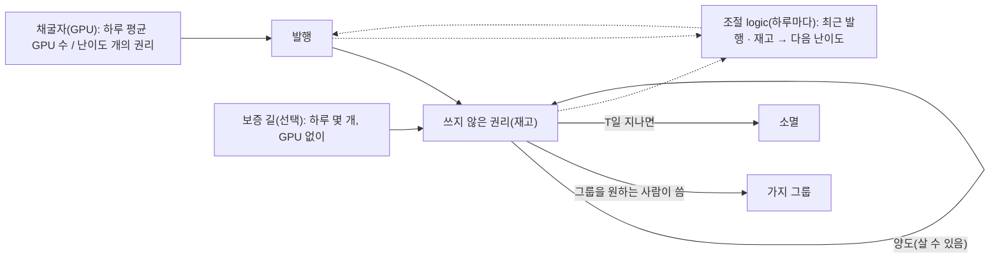
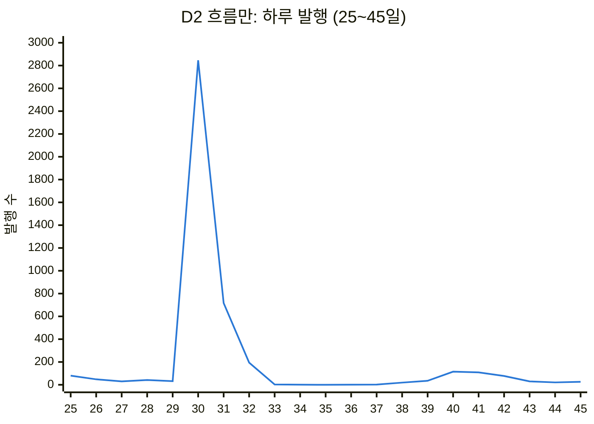
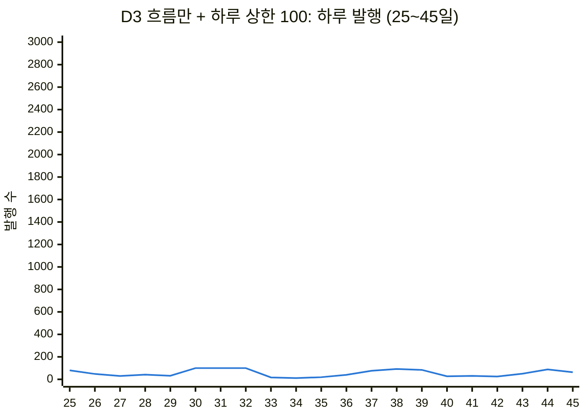
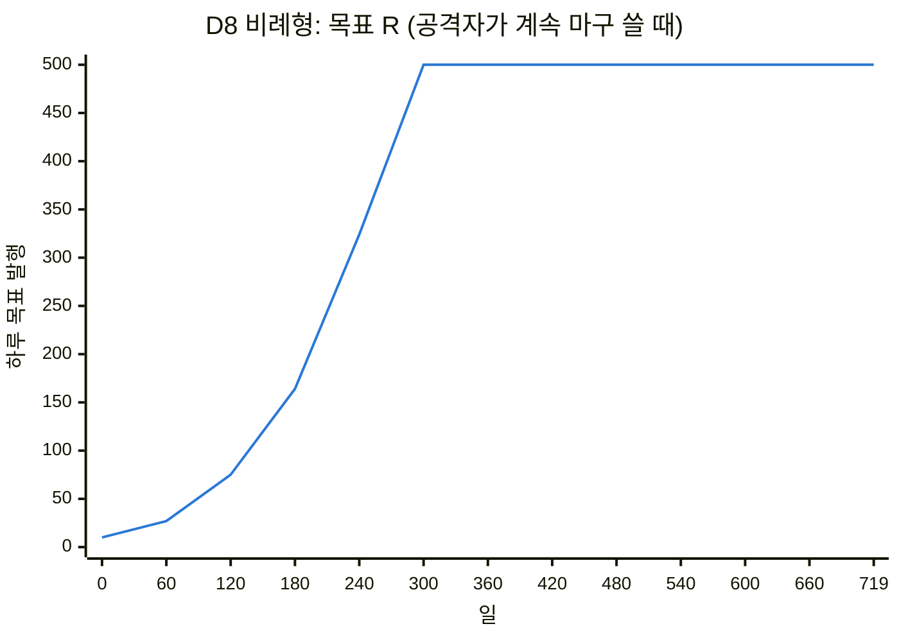
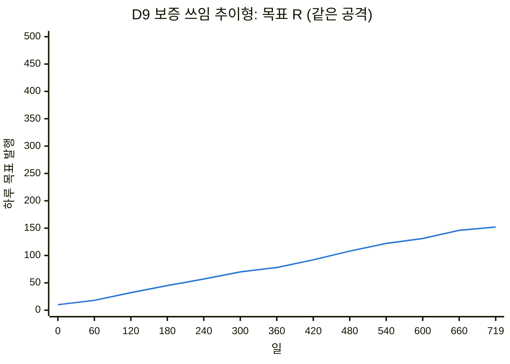

# 그룹 생성권 모의 실험

> 2026-11-04, 브랜치 `sim-group-rights-20261104`. 사용자: "GPU를 소모하게 해서 그룹생성 권리를 득하고 그 권리는 양도도 가능. 그리고 그 권리가 너무 많아지거나 부족하지 않도록 logic으로 조절하는 방안 찾아보는 것 어때?", "모의 실험부터 만들어서 돌려 봐".
>
> 플랫폼 코드(`arena/`)가 아니다. 설계를 정하기 전에 조절 logic이 공격에 어떻게 움직이는지 보는 모의 실험이다. 코드: `sim/rights.py`, 테스트: `tests/test_sim_rights.py`(14개), 전체 표: [sim-rights-results.md](sim-rights-results.md). 다시 돌리기: `python -m sim.rights [--days N] [--seed S] [--out FILE]`.

## 1. 무엇을 모의하나



- 하루 단위로 돈다. 실제 해시는 계산하지 않는다. GPU h대는 난이도 D에서 하루 평균 h/D개의 권리를 얻는다(포아송 분포).
- 조절 logic은 원장이 보여 줄 수 있는 것만 본다: 발행, 소모, 소멸, 재고.
  ```
  다음 D = D × clamp( (최근 window일 평균 발행 / R) × 재고 보정(U), 1/4, 4 )
  ```
- 기본값: 목표 발행 R = 하루 50개, 기한 T = 90일, 재고 범위 U_min = 350, U_max = 1,500, 하루 변화 ×4~÷4, window = 3일. 180일을 돈다.
- 정직한 쪽: GPU 100대, 하루 40명이 그룹을 원한다. 먼저 기다린 사람이 가장 오래된 권리를 쓴다.

**시나리오**

| 이름 | 내용 |
|---|---|
| `steady` | 공격자 없음 |
| `spam-10x` | 30일째 공격자가 GPU 1,000대(정직한 쪽의 10배)를 붙이고, 얻는 대로 가지를 만듦 |
| `hoard-10x` | 같은 공격자가 권리를 쓰지 않고 쌓아 둠 |
| `buy-surplus` | GPU 없는 공격자가 정직한 채굴자의 남는 권리를 매일 절반씩 사서 가지를 만듦 |
| `flash-50x` | 30~32일 사흘만 GPU 5,000대(50배) |
| `miners-leave` | 60일째 정직한 GPU가 90% 빠짐 |
| `demand-surge` | 60~90일 그룹을 원하는 사람이 하루 120명 |
| `growth-2y` | 2년(720일) 동안 생태계가 자람: 정직한 GPU 50→400대, 그룹을 원하는 사람 하루 10→160명 |
| `growth-2y-spam` | 같은 2년, 30일째부터 공격자 GPU 1,000대가 계속 마구 씀 |

**설계**

| 설계 | 조절 |
|---|---|
| D1 처음 설계 | 흐름 + 재고 양쪽(많으면 어렵게, 적으면 쉽게) |
| D2 흐름만 | 재고 보정 없음 |
| D3 흐름만 + 하루 상한 | 원장이 하루에 받는 발행을 100개까지 |
| D4 D3 + 보증 길 | 보증으로 하루 30개를 정직한 founder에게(양도 가능) |
| D5 D4, 보증 권리는 양도 불가 | 보증 권리는 받은 founder만 씀 |
| D6 D5 + 남으면 어렵게 | 재고가 500을 넘으면 어렵게(적다고 쉽게 하지는 않음) |
| D7 일정형 | 목표 R이 360일마다 반으로(발행 곡선을 미리 공개). 하루 상한은 그날 R의 2배 |
| D8 비례형 | 목표 R = 지금까지 발행된 전체의 1%(하루 10~500). 하루 상한은 그날 R의 2배 |
| D9 보증 쓰임 추이형 | 목표 R = 최근 30일 동안 보증 길로 세운 가지의 하루 평균(하루 10~500). 보증 길은 요청이 있을 때만 주고, 보증으로 세운 가지의 founder도 30일에 1번 보증한다. 하루 상한은 그날 R의 2배 |

## 2. 결과 (씨앗 1)

| 지표 | D1 | D2 | D3 | D5 |
|---|---|---|---|---|
| `spam-10x`: 정착 뒤 하루 발행 | **346** | 54 | 52 | 81(작업 증명 51 + 보증 30) |
| `spam-10x`: 공격자 몫 | 0.88 | 0.77 | 0.76 | 0.49 |
| `spam-10x`: 그룹을 연 정직한 사람 비율 | 1.00 | **0.32** | **0.32** | **1.00** |
| `flash-50x`: 가장 많이 발행된 날 | 2,488 | **2,846** | **100** | 139 |
| `flash-50x`: 공격자가 만든 가지 | 3,225 | 3,686 | 290 | 295 |
| `buy-surplus`: 공격자가 만든 가지 | 20,711 | 2,076 | 2,076 | 7,206 |
| `hoard-10x`: 그룹을 연 정직한 사람 비율 | 0.33 | 0.32 | 0.32 | 1.00 |
| `miners-leave`: 정착 뒤 하루 발행 | 48 | 50 | 51 | 80 |

씨앗 1~10을 돌려도 D5의 정직한 사람 비율은 모든 시나리오(180일짜리 7개)에서 0.993 이상이다. D5에서 가장 많이 발행된 날은 142개(상한 100 + 보증 길)다. D2의 반짝 공격 첫날은 씨앗에 따라 3,375개까지 갔다.

반짝 공격(`flash-50x`) 25~45일의 하루 발행. 두 그림은 같은 눈금이다.





## 2-1. 전체 발행 추이에 따라 목표를 움직이면 (D7~D9)

사용자: "하루 상한만 두지 말고 전체 발행 개수 추이에 따라 개수 조절 필요하지 않을까?" 목표 R을 고정하지 않고 시간에 따라 움직이는 세 가지를 2년 시나리오로 비교했다(씨앗 1).

| 지표 | D5 고정 R | D7 일정형 | D8 비례형 | D9 보증 쓰임 추이형 |
|---|---|---|---|---|
| `growth-2y`: 그룹을 연 정직한 사람 비율 | 0.83 | 0.58 | 1.00 | 1.00 |
| `growth-2y`: 평균 기다림(일) | 8.9 | 35.1 | 0.0 | 0.0 |
| `growth-2y`: 끝의 목표 R | 50 | 12.5 | 500(상한) | 158 |
| `growth-2y-spam`: 그룹을 연 정직한 사람 비율 | 0.45 | 0.40 | 1.00 | 1.00 |
| `growth-2y-spam`: 공격자가 만든 가지 | 28,757 | 15,695 | **206,566** | 46,228 |
| `growth-2y-spam`: 끝의 목표 R | 50 | 12.5 | 500(상한) | 152 |
| `steady`: 끝의 목표 R(수요는 그대로) | 50 | 35.4 | **155** | 38.8 |

`growth-2y-spam`에서 목표 R이 움직인 모습(60일마다). 두 그림은 같은 눈금이다.





씨앗 1~5에서 D9의 끝 목표 R은 공격이 없을 때 154~158, 공격이 있을 때 152~161이었다. 정직한 사람 비율은 모두 1.0이었다.

## 3. 알게 된 것

1. **"재고가 적으면 쉽게"는 공격 통로다(D1).** 마구 쓰는 공격자는 얻는 대로 써 버려서 재고가 늘 바닥이고, 조절 logic은 그것을 수요로 읽고 난이도를 낮춘다. 발행이 목표의 7배(하루 346개)가 된다. 소모가 많다고 쉽게 하면 안 된다.
2. **흐름만 보면 전체 발행은 지켜지지만, 몫은 GPU 순이다(D2).** 10배 공격자가 발행의 77%를 가져가고, 정직한 사람은 32%만 그룹을 연다. 작업 증명은 **증가 속도의 상한**은 지키지만 **공정한 나눔**은 지키지 못한다.
3. **조절은 하루 늦다. 하루 상한이 그 틈을 닫는다(D3).** 반짝 공격의 첫날 D2는 2,846개를 발행했다. 그 뒤에는 난이도가 지나치게 올라 닷새 동안 발행이 거의 0이었다(정직한 사람도 못 얻음). 원장이 하루 받는 수를 묶으면 첫날도 100개이고, 공격자가 만든 가지는 3,686개에서 290개로 줄었다.
4. **정직한 사람의 몫은 GPU가 아닌 길로만 지킬 수 있다(D5).** 보증으로 하루 30개를 founder에게 주면, 어떤 GPU 공격에도 정직한 사람이 거의 모두 그룹을 열었다(씨앗 10개에서 0.993 이상). 단 그 권리는 **양도할 수 없어야** 한다. 사고팔 수 있으면 보증 권리도 시장으로 흘러간다.
5. **양도가 되면 공격자는 사면 된다(`buy-surplus`).** 남는 권리를 사들이는 공격은 어느 설계로도 0이 되지 않는다. 돈을 내고 채굴을 대신 시키는 것과 같기 때문이다. 다만 상한이 있으면 가지가 늘어나는 속도는 상한 안에 머문다(D5에서 7,206개, 180일 동안 하루 40개꼴). 남는 권리가 많을수록 살 것이 많으므로 R을 실제 수요에 가깝게 두어야 한다.
6. **쌓아 두기는 기한이 묶는다.** `hoard-10x`에서 공격자 권리는 90일 뒤 사라졌다(2,754~3,347개 소멸). 그러나 그동안 정직한 사람은 굶는다(D1~D3에서 0.32). 이것도 보증 길(D5)이 메운다. D6(남으면 어렵게)은 쌓아 두기에 난이도를 크게 올려(44배) 정직한 채굴자까지 어렵게 하고, 이득은 작았다.

7. **고정 R은 자라는 생태계를 따라가지 못하고(D5), 줄어드는 일정은 더 나쁘다(D7).** 공급을 미리 정한 곡선으로 줄이면(희소성), 수요가 느는 생태계에서 기다림이 평균 35일이 된다.
8. **"전체 발행"을 신호로 쓰면 스스로 부풀고, 공격자가 그 신호를 키운다(D8).** 누적에 비례하는 목표는 수요가 그대로여도 복리로 자라고(50 → 155), 공격자의 발행도 누적에 들어가 공격할수록 공급이 늘어난다. 2년 공격에서 공격자 가지 206,566개.
9. **추이 신호는 GPU로 부풀릴 수 없는 것이어야 한다(D9).** 보증 길로 실제로 세운 가지의 추이를 쓰면, 목표 R은 정직한 쓰임을 따라 자라고(50 → 158) 공격이 있어도 거의 같다(152). 공격자 몫의 상한도 정직한 쓰임에 비례한다(목표 R의 두 배 상한 안).

## 4. 이 모의 실험이 다루지 않은 것

- 시장 가격과 판매 행동: 정직한 채굴자가 남는 것의 일정 비율을 판다고만 놓았다.
- 기록자의 시각 조작, 검열, 여러 기록자(7단계).
- 보증 길 자체의 공격(가짜 보증인): 보증 길은 "하루 30개를 정직한 founder에게"로만 놓았다. 실제로는 보증인 자격과 한도 규칙(앞서 이야기한 "살아 있는 가지의 founder만 보증, 기간마다 1번")이 이것을 지켜야 하고, 따로 모의해야 한다.
- 실제 해시 방식(메모리를 쓰는 방식과 SHA-256의 GPU·칩 이점 차이).
- **D9는 보증 길을 신뢰의 기준으로 삼는다.** 보증 길이 뚫리면(가짜 보증인, 보증인끼리 서로 세워 주기) 목표 R도 부풀려진다. 보증 길의 공격은 이 모의 실험에 없고, 가장 먼저 따로 모의해야 한다.

## 5. 이 결과로 본 설계 방향(제안, 결정 전)

- 조절: **흐름만**(재고로 쉽게 하지 않음) + **그날 목표의 두 배인 하루 상한** + 기한 T.
- 목표 R은 고정하지 않고 **보증 길로 세운 가지의 추이**를 따라 움직인다(D9). 전체 발행 추이(D8)나 미리 정한 감소 곡선(D7)은 쓰지 않는다.
- 나눔: 작업 증명 권리(양도 가능, 증가 속도만 묶음)와 **보증 권리(양도 불가, 정직한 founder의 몫)** 두 길.
- α(목표 R / 보증 쓰임), 아래·위 한도, 추이 기간, 상한 배수는 모든 기록자가 같아야 하므로 규약이나 코드표 판에 둔다.
- 다음 모의 실험 후보: **보증 길의 공격**(보증인 자격·한도, 서로 세워 주기, D9의 신호를 부풀리기), α를 1보다 작게 했을 때 공격자 몫, 시장 가격이 있을 때 공격자의 비용, 반짝 공격 뒤 난이도가 지나치게 오르는 것을 줄이는 조절.
