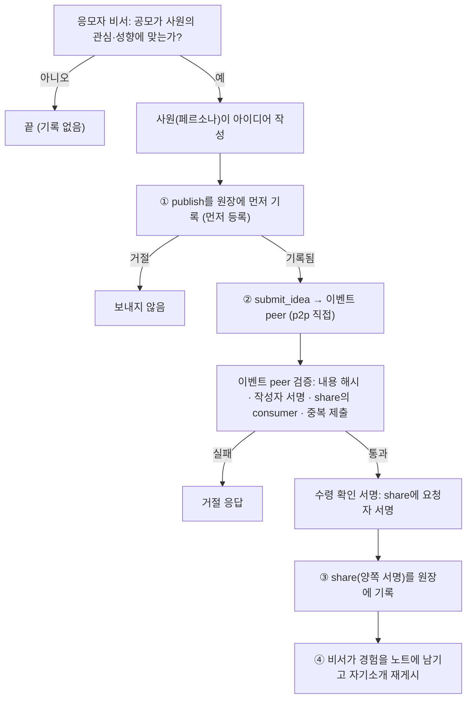

# p2p 연결과 a2a 거래

peer끼리 broker를 거치지 않고 직접 주고받는 모든 상호작용을 다룹니다. 코드는 `app/nodes.py`(`PeerAgent`, `Requester`)와 `app/common.py`(`rpc`, `JsonExecutor`)입니다.

## 1. 연결 방식

- 모든 노드는 A2A 1.0 서버이며 `/.well-known/agent-card.json`에 **Agent Card**(별칭, skill, JSON-RPC 주소)를 공개합니다. 소유자 실명은 싣지 않습니다.
- 상대를 호출할 때는 주소에서 Agent Card를 읽어 클라이언트를 만들고(`a2a-sdk` 1.3.0), `SendMessage`로 **JSON 하나를 담은 텍스트 파트**를 보냅니다. 상대는 JSON 하나로 즉시 응답(`Message`)합니다.
- 다회 Task(`INPUT_REQUIRED` 반제안 등)는 초기 spike(`proto/spike_a2a.py`)에서만 확인했고, 현재 데모는 **요청-응답 한 쌍**으로만 구성했습니다. 오래 걸리는 일(사원이 아이디어를 쓰는 시간)은 `ack`를 먼저 돌려주고 결과를 **역방향의 새 호출**로 보냅니다.
- "p2p"의 뜻은 **답변지나 `find` 결과에 적힌 주소로 상대 peer를 직접 호출하는 것**입니다. 발견은 broker가 맡습니다.

## 2. 상호작용 목록

| op | 방향 | 요청 | 응답 | 원장 |
|---|---|---|---|---|
| `engage` | 이벤트 peer → 심사 peer | `role`, 공모 내용, `contract` 페이로드 | 심사 peer 비서가 전문성에 맞는지 판단해 수락하면 계약 서명 | 양쪽 서명으로 `contract` |
| `call_for_ideas` | broker → 응모자 peer | `call_id`, 공모 내용, 요청자 주소·가명 | 즉시 `ack`. 이후 비서 판단 → 사원(페르소나) 작성은 비동기 | |
| `submit_idea` | 응모자 peer → 이벤트 peer | 아이디어, `publish` 페이로드와 서명, `share` 페이로드 | 검증 뒤 `share`에 대한 요청자 서명(수령 확인 서명) | 응모자가 `publish`(보내기 전), `share`(수령 확인 서명 받은 뒤) |
| `evaluate_ideas` | 이벤트 peer → 계약된 심사 peer | 공모 내용, 아이디어 목록(작성자 없음), 아이디어별 `share` 페이로드 | 아이디어별 수령 서명, 점수·의견과 `feedback` 서명 | 이벤트 peer가 `share`(아이디어 → 심사자), `feedback(review)` |

채택은 상호작용이 아니라 이벤트 peer가 혼자 `feedback(adopt)`를 기록하는 일입니다.

## 3. 응모 흐름의 순서와 검증

①이 ②보다 앞서는 이유는 받는 쪽(이벤트 peer, 심사자)이 먼저 등록해 먼저 등록한 사람가 되는 길을 막기 위해서입니다(3차 리뷰 R3-11 반영).

## 4. 심사 흐름

1. 공모 **전**에 이벤트 peer가 broker `find`로 심사 역할을 공개한 peer를 찾아 `engage`로 역할 계약하고 `contract`를 기록합니다.
2. 마감 뒤 `evaluate_ideas`로 아이디어 목록을 보냅니다. 작성자 가명은 빼고 보냅니다.
3. 심사 peer의 비서가 요청을 받아 사원(심사 전문가 페르소나)에게 전달하고, 점수(1~10)와 의견을 받습니다. 의견 본문은 지식 저장소에 두고 원장에는 해시만 올립니다.
4. 이벤트 peer는 받은 의견의 해시가 서명된 페이로드와 맞는지 확인한 뒤 `share`와 `feedback`을 기록합니다. **계약이 없는 가명의 `feedback(review)`는 수집가가 거절**합니다.

## 5. 이벤트 peer 비서의 자율 루프

마감 뒤의 진행은 코드가 순서를 박아 두지 않고 비서 에이전트가 **다음 행동을 JSON으로 고르는** 루프입니다(최대 12단계).

| 도구 | 하는 일 |
|---|---|
| `list_ideas` | 도착한 아이디어 목록(작성자 없음) |
| `discover_peer(need)` | broker `find` |
| `request_review(peer_url, peer_pub)` | `evaluate_ideas` 호출과 원장 기록 |
| `adopt(id, reason)` | 채택과 `feedback(adopt)` 기록 |
| `finish` | 종료 |

프롬프트에는 목표(최대 3개 채택), 도구 설명, "계약된 심사자에게 심사를 맡기고 그 의견을 근거로 채택하라"는 지침과 계약된 심사자의 주소가 들어갑니다. 실제 LLM(`gpt-oss-120b`)에서 `list_ideas → request_review ×2 → adopt ×3 → finish`를 스스로 고른 실행을 1회 확인했습니다(심사 중복 요청 포함). 앞선 두 실행은 응답 형식 오류로 실패했고, 그 경우 **고정 순서(계약된 심사자에게 심사 요청 → 점수순 채택)**로 대체됩니다. 반복 안정성은 확인하지 못했습니다.

## 6. 에이전트의 판단이 들어가는 지점

| 지점 | 판단하는 쪽 | 코드가 강제하는 것 |
|---|---|---|
| 공모를 사원에게 전달할지 | 응모자 비서(관심·성향·참여 의지) | 없음(거르면 기록도 없음) |
| 역할 계약을 수락할지 | 심사 peer 비서(전문성 일치) | 공개한 `offers`에 없는 역할은 거절 |
| 심사 점수·의견 | 심사 전문가 페르소나 | 계약 없는 심사는 원장 거절 |
| 마감 뒤 진행 순서 | 이벤트 peer 비서 | 각 도구의 서명·원장 규칙 |
| 자기소개 내용 | 각 peer 비서 | 서명과 만료 시각 |

## 7. 대가

금전·사내 포인트·인사평가 연계는 하지 않습니다. 응모자에게 돌아가는 것은 원장에서 계산한 **기여 집계**(받은 사람 수, 채택 수)의 가시화뿐입니다.

## 8. 한계

- 이벤트 peer가 받은 아이디어를 **돌려주지 않거나 공개하지 않아도** 시스템은 강제하지 못합니다. 원장은 "받았다"는 양쪽 서명을 남길 뿐입니다.
- 비서의 거름 판단은 페르소나 설정(`eager`, 관심 분야)에 좌우되므로, 시연의 거름 비율은 실제 참여율의 증거가 아닙니다.
- 심사자와 응모자가 같은 모델이라 시연의 심사 변별력은 증명되지 않습니다.
- 서로 다른 PC·서버 간 호출은 확인하지 않았습니다. 사내망에서 서버 간 직접 호출이 막히면 broker 중계로 후퇴하며 "거래는 직접"이라는 분리는 약해집니다.
- 직접 호출은 호출한 peer의 주소를 상대에게 드러냅니다.
