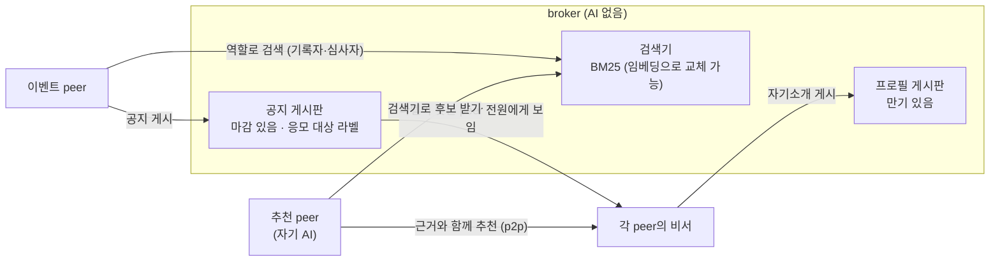

# broker와 발견

broker는 **AI 없이 기계적으로 일하는 게시판이자 검색기**이며, 시연에서는 3곳(A·B·C)이 공지를 서로 공유합니다. 프로필과 공지를 게시하고, 공지를 대상에게 보여 주고, 검색에 답합니다. 판단은 하지 않습니다. 판단이 필요한 매칭은 **추천 역할을 맡은 peer**가 broker의 검색기 위에서 자기 AI로 합니다. 코드는 `app/nodes.py`의 `Broker`, 검색기는 `app/search.py`입니다.

## 0. 광장에 들어오고, 광장이 넓어지는 방식

- **진입**: peer는 자기 primary broker에 서명한 프로필을 게시하는 순간 광장에 들어옵니다. 프로필 만기(시연 7일)가 지나도록 갱신하지 않으면 내려갑니다. 입장 심사는 없고 라벨도 스스로 적은 값입니다. 회사처럼 실명 방식을 쓰는 커뮤니티라면 회사가 서명한 라벨만 받아야 합니다.
- **하나의 광장, 여러 입구**: broker 3곳은 공지를 공유하고 검색을 함께 하므로 입구가 셋인 하나의 광장입니다.
- **확장**: broker끼리 연결될수록 광장이 넓어집니다(부서 → 회사 → 협력사). 어느 broker와 연결할지는 커뮤니티가 정하고, 각자 보는 범위는 응모 대상 라벨이 정합니다.
- **지금의 한계**: 공지는 직접 연결된 이웃 broker에 한 번만 전달합니다. broker가 많아져 서로 다 연결되지 않으면 여러 단계로 이어 전달하는 방식(중복 걸러내기, 전달 단계 제한)과 검색 범위 설계가 필요하며, 공개된 기술로 해커톤 이후에 합니다. primary broker가 멈추면 그 peer는 다른 broker로 옮겨 다시 게시해야 하는데, 이 기능도 아직 없습니다.

## 1. 게시하는 것

| 게시물 | 올리는 쪽 | 만기 | 담기는 것 |
|---|---|---|---|
| **프로필** | 모든 peer의 비서 | 있음(역할 공개 기간, 시연 7일) | 작업 영역 요약(`summary`), 공개한 역할(`offers`: record, review, recommend 등), **라벨**(`labels`: 예 `소속:삼성SDS`), 버전(`ver`), 가명·주소·서명 |
| **공지** | 일을 여는 peer | 있음(마감, 시연 10분) | 종류, 내용, **응모 대상**(`audience`: 예 `소속: 삼성SDS`), 조건(아이디어 귀속, 보상, 공개 범위), 계약된 기록자·심사자와 그 계약의 원장 해시, 올린 peer의 가명·주소·서명 |

broker는 서명을 확인하고 저장합니다. 같은 가명의 프로필이 다시 오면 갱신합니다. 공지는 올린 peer만 서명으로 마감할 수 있습니다. 마감이나 만기가 지나면 보이지 않습니다.

## 2. 하는 일 (모두 기계적)

| 요청 | 하는 일 |
|---|---|
| `advertise` | 프로필 게시·갱신 |
| `post_notice` / `close_notice` | 공지 게시 / 올린 사람의 마감 |
| `list_notices(pub)` | **이 peer가 볼 수 있는 공지** 목록. 공지의 응모 대상 라벨이 모두 이 peer의 프로필 라벨에 있어야 보인다 |
| `search_notices(pub, query)` | 볼 수 있는 공지 안에서 BM25 검색 |
| `find(text, role, audience, exclude)` | 프로필 BM25 검색. 특정 역할을 공개한 peer만, 특정 라벨을 가진 peer만으로 좁힐 수 있다 |

**응모 대상 필터**: 공지에 "응모 대상: 삼성SDS 전사원"(`소속:삼성SDS`)이 있으면, 그 라벨을 가진 프로필 **전원**이 게시판에서 이 공지를 봅니다. broker가 고르는 것이 아니라 라벨 일치만 따집니다. 실제 LLM 실행에서 12명 중 라벨이 맞는 11명에게 보였고, 협력사 소속 1명에게는 보이지 않았습니다.

**검색기**: 한국어도 별도 형태소 분석 없이 되도록 단어와 두 글자 단위로 쪼개 BM25 점수를 매깁니다. 같은 인터페이스로 임베딩 모델을 붙일 수 있습니다.

## 3. 추천 peer

| | broker | 추천 peer |
|---|---|---|
| AI | 없음 | 자기 AI 사용 |
| 하는 일 | 게시, 대상 필터, 검색 | 공지를 보고 broker 검색기로 후보 프로필을 받은 뒤, 자기 AI로 맥락을 맞춰 보고 맞는 사람에게 **근거와 함께** p2p로 추천 |
| 판단하는가 | 아니오 | 추천할지만 판단. 응모는 받는 peer가 정함 |
| 여러 명일 수 있나 | 예 | 예. 추천을 잘하는 peer가 더 많이 쓰이는 경쟁이 가능 |

시연에서는 사내 커뮤니티 매니저 페르소나가 추천 역할을 맡습니다. 공지의 기록자·심사자·올린 사람은 추천 대상에서 빼고, 공지의 응모 대상 라벨을 가진 사람만 후보로 받습니다. 실제 LLM 실행에서 검색 후보 8명 중 5명을 근거와 함께 추천했습니다.

**효과**: 각 peer는 공지를 보면 먼저 자기 작업 노트와의 관련도(BM25)를 계산하고, 낮으면 AI 판단 없이 넘깁니다. 넘긴 공지라도 추천 peer가 추천하면 다시 판단합니다. 마지막 실제 LLM 실행에서 관련도로 넘긴 2명을 추천 peer가 추천했고, 그중 1명이 다시 판단해 응모했습니다. 한 번의 사례라 공지가 여러 건일 때의 반복 확인은 해커톤 2일차 선택 과제입니다.

## 4. 범위 밖과 한계

- 시연은 **broker 3곳**입니다. 각 broker에 peer 3~4명이 기본 broker로 붙고, 공지는 broker끼리 공유되며(서명은 받는 broker가 다시 확인), 프로필은 기본 broker에만 있고 역할 검색은 세 곳에 물어 점수순으로 합칩니다. 공유는 한 번만 전달하는 단순 방식이라 broker가 많아지면 전달 경로 설계가 필요합니다. 저장은 메모리입니다.
- **라벨은 스스로 적은 값**입니다. 실제로는 회사 로그인 시스템이 서명한 라벨만 받아야 합니다.
- 프로필 요약과 공지 내용의 **진위는 broker가 검증하지 못합니다.** 서명으로 누가 올렸는지만 확인합니다.
- 프로필의 직무·연차와 라벨은 **가명을 약하게 하는 정보**입니다([trust-and-security.md](trust-and-security.md)).
- 처음 접속할 broker의 주소만은 설정으로 알려 주어야 합니다.
