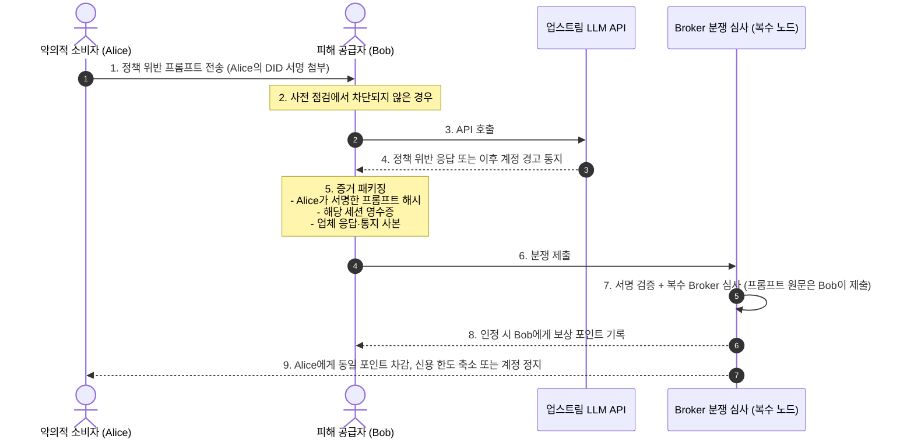

# SUT 정책 위반 분쟁 해결 및 공급자 보호 메커니즘 (Dispute & Provider Protection)

> **악의적 소비자의 정책 위반 질의로부터 공급자를 보호하기 위한 사전 차단, 부인 방지 증거, 포인트·신용 한도 기반 제재 및 공급자 보상 구조**

---

## 1. 문제 배경: "위반은 소비자가 하고, 피해(계정 경고·정지)는 공급자가 받는 위험"

P2P LLM 공유 네트워크에서 가장 치명적인 악용 시나리오는 다음과 같습니다.
- 악의적인 소비자가 해킹 도구 생성, 탈옥(Jailbreak), 불법 콘텐츠 등 **OpenAI/Anthropic 이용 정책을 위반하는 프롬프트**를 전송합니다.
- 이 요청이 공급자의 API Key를 통해 업스트림 엔드포인트로 들어갑니다.
- **결과**: 업체의 모더레이션 시스템에 적발되어 **선량한 공급자의 계정이 경고를 받거나 정지**될 수 있습니다.

이를 막기 위해 SUT는 **사전 차단**을 최우선으로 하고, 위반이 확인되면 **포인트와 신용 한도로 제재하고 공급자를 보상**합니다.

---

## 2. 분쟁 처리 시퀀스

---

## 3. 핵심 3단계 메커니즘

### 3.1 [사전 차단] 2중 프리플라이트 가드레일 (Pre-flight Guardrail)
위험한 질문이 업스트림으로 나가지 못하도록 2단계로 걸러냅니다. **가장 중요한 방어선은 이 단계입니다.**
1. **소비자 로컬 1차 검문 (Llama Guard 계열 분류 모델 / 정규식)**:
   - 소비자 Agent가 프롬프트를 전송하기 전, 경량 안전성 분류 모델로 명백한 위법·탈옥 프롬프트를 로컬에서 차단합니다.
2. **공급자 측 Moderation 사전 점검**:
   - 공급자 Agent는 본 호출 전에 업체가 제공하는 Moderation 엔드포인트(예: OpenAI `v1/moderations`)나 자체 분류 모델로 유해성을 조회합니다. 위험 플래그가 감지되면 세션을 파기하고 분쟁 증거로 보관합니다.

### 3.2 [증거 확보] 부인 방지 서명 (Non-repudiation)
- 소비자는 프롬프트를 보낼 때 **자신의 Ed25519 개인키(DID)로 프롬프트 해시에 서명**합니다.
- 공급자는 *"이 프롬프트는 공급자가 아니라 소비자 DID `did:key:Alice`가 서명해서 보낸 것"*임을 서명으로 입증할 수 있습니다. 공급자가 보는 것은 소비자의 파생 DID이며, Broker가 이를 원장 DID와 대조해 제재 대상을 특정합니다.
- **한계**: 업체의 정책 위반 응답이나 계정 경고 통지에는 업체 서명이 없어, 그 자체로는 진위를 기계적으로 증명할 수 없습니다. 그래서 판정은 자동 집행이 아니라 **복수 Broker의 심사**로 합니다. 심사는 프롬프트 원문이 실제로 정책 위반인지를 기준으로 합니다(공급자가 원문을 제출하고, 서명된 해시와 일치하는지 확인).

### 3.3 [사후 제재·보상] 포인트와 신용 한도
1. **공급자 보상**: 분쟁이 인정되면 피해 정도에 따라 공급자에게 보상 포인트를 기록합니다. 같은 포인트가 위반 소비자에게서 차감되므로 전체 합계 0은 유지됩니다.
2. **소비자 제재**: 위반 소비자는 신용 한도가 축소됩니다. 반복되거나 중대한 위반이면 계정이 정지되고, 해당 DID는 Broker 네트워크 전역에 차단 목록으로 공유됩니다.
3. **허위 분쟁 제재**: 공급자가 근거 없는 분쟁을 반복 제출하면 같은 방식으로 공급자의 신용 한도를 축소합니다.

---

## 4. 공급자 보호 효과

| 구분 | 보호 장치가 없는 경우 | **SUT 보호 메커니즘** |
| :--- | :--- | :--- |
| **사전 차단** | 위반 프롬프트가 그대로 업스트림으로 전달 | 소비자 로컬 + 공급자 측 2중 점검으로 대부분 사전 차단 |
| **책임 소재** | 누가 보낸 프롬프트인지 입증 불가 | 소비자 DID 서명으로 발신자 입증 |
| **피해 발생 시** | 공급자 혼자 피해 감수 | 심사 후 위반 소비자의 포인트로 공급자 보상 |
| **어뷰징 억제** | 익명 뒤에 숨어 반복 시도 | 신용 한도 축소, 계정 정지, 차단 목록 공유 |

---

## 5. 결론

SUT의 분쟁 처리는 **사전 차단을 최우선**으로 하고, 사후에는 **포인트와 신용 한도**로 위반자를 제재하고 피해 공급자를 보상합니다. 업체 계정 정지 같은 실제 피해를 포인트로 완전히 메울 수는 없으므로, 공급자 보호의 핵심은 여전히 2중 사전 점검과 공급자가 직접 설정하는 공유 범위(허용 모델, 일일 한도, 허용 시간대)입니다.
