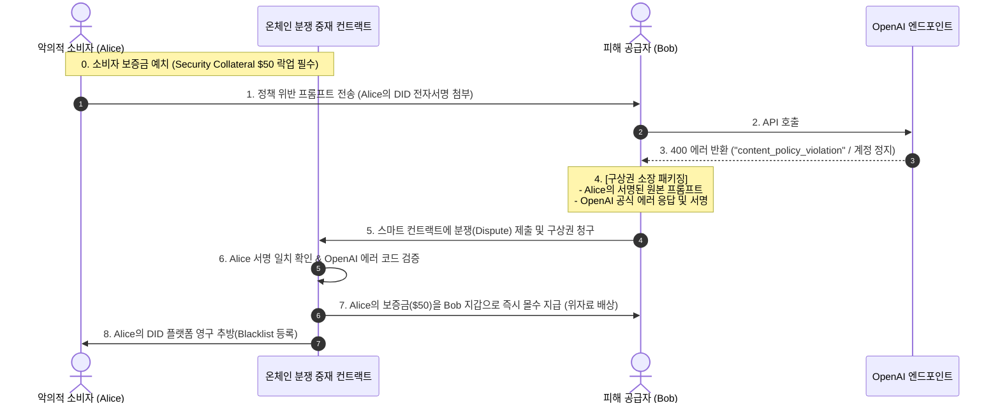

# SUT 정책 위반 분쟁 해결 및 구상권 전가 메커니즘 (Dispute & Indemnity Architecture)

> **악의적 소비자의 정책 위반 질의로 인한 공급자 피해(계정 정지) 발생 시, 스마트 컨트랙트를 통해 보증금을 몰수하고 피해를 100% 자동 배상하는 구상권(Slashing & Indemnity) 아키텍처**

---

## 1. 문제 배경: "죄는 소비자가 짓고, 벌(계정 정지)은 공급자가 받는 위험"

P2P LLM 중계 플랫폼의 가장 치명적인 악용 시나리오는 다음과 같습니다:
- 악의적인 소비자가 테러, 해킹 도구 생성, 탈옥(Jailbreak), 불법 콘텐츠 등 **OpenAI/Anthropic 이용 정책을 심각하게 위반하는 프롬프트**를 전송.
- 이 요청이 공급자의 API Key와 IP를 통해 빅테크 엔드포인트로 인입됨.
- **결과**: 빅테크 AI의 모더레이션 시스템에 적발되어 **선량한 공급자의 정품 계정이 경고(Strike)를 받거나 영구 정지(Account Ban)**되는 억울한 피해 발생.

이를 방지하기 위해 SUT는 **"사전 가드레일 검문"**과 피해 발생 시 **"스마트 컨트랙트를 통한 소비자 보증금 즉시 몰수 및 공급자 배상(구상권 행사)"** 구조를 갖춥니다.

---

## 2. 구상권 자동 집행 시퀀스 (Slashing & Indemnity Flow)

---

## 3. 핵심 3단계 기술 메커니즘

### 3.1 [사전 방어] 2중 프리플라이트 가드레일 (Pre-flight Guardrail)
애초에 위험한 질문이 공급자 PC로 나가지 못하도록 사전에 2단계로 걸러냅니다.
1. **소비자 로컬 1차 검문 (Llama Guard / 정규식)**:
   - 소비자 Agent에서 프롬프트를 전송하기 전, 초경량 안전성 분류 모델(`Llama Guard` 등)을 통해 명백한 위법/탈옥 프롬프트를 로컬에서 즉시 차단(Reject).
2. **OpenAI 무료 Moderation API 사전 점검**:
   - 공급자 PC는 본 호출(유료)을 날리기 전, OpenAI가 무료로 제공하는 `v1/moderations` 엔드포인트로 유해성을 사전 조회. 위험 플래그 감지 시 즉시 세션을 파기하고 신고.

---

### 3.2 [증거 확보] 위조 불가능한 서명 영수증 (Non-repudiation Proof)
소비자는 자신이 작성한 프롬프트에 대해 절대 발뺌할 수 없습니다.
- 소비자가 프롬프트를 보낼 때 **자신의 Ed25519 개인키(DID)로 프롬프트 해시에 서명**을 동봉합니다.
- 공급자는 피해 발생 시 *"이 위반 프롬프트는 공급자 본인이 친 게 아니라, 소비자 DID `did:key:Alice`가 서명해서 보낸 것"*임을 **수학적으로 100% 입증**할 수 있습니다.

---

### 3.3 [사후 배상] 온체인 스마트 컨트랙트 기반 구상권 자동 집행 (Slashing)
인간 중재자의 주관적 판단 없이, **블록체인 코드가 객관적 암호 증거를 검증하여 즉시 강제 집행**합니다.

1. **소비자 사전 담보금 (Security Collateral)**:
   - 소비자는 SUT 플랫폼 이용 전, 일정 금액(예: \$30~\$50 상당의 스테이블코인 또는 \$SUT)을 스마트 컨트랙트에 에스크로 예치해야 합니다. (정상 이용 시 언제든 100% 환불 가능)
2. **분쟁 접수 및 코드 판결**:
   - 공급자가 `[소비자 서명 원본] + [OpenAI 400 Policy Violation 응답]`을 컨트랙트에 제출.
   - 컨트랙트는 서명 유효성과 에러 코드를 검증 후, **소비자의 담보금(\$50)을 즉시 몰수(Slashing)하여 피해 공급자 지갑으로 강제 이체**.
3. **영구 블랙리스트**:
   - 가해자 소비자의 DID는 분산 브로커 네트워크 전역에 불량 노드로 브로드캐스트되어 영구 차단.

---

## 4. 공급자 보호 및 어뷰징 억제 효과

| 구분 | 기존 중앙화 중계 서비스 | **SUT 구상권 메커니즘** |
| :--- | :--- | :--- |
| **공급자 리스크** | 계정이 잘려도 하소연할 곳 없이 본인이 독박 | **계정 손실 시 스마트 컨트랙트가 상대방 보증금을 털어 전액 배상** |
| **소비자 어뷰징 유인** | 익명성에 숨어 탈옥/악성 질문 남발 | **위반 1번에 보증금 \$50 몰수 및 영구 퇴출되므로 어뷰징 원천 봉쇄** |
| **분쟁 해결 비용** | 고객센터 인건비, 법적 소송 비용 발생 | **스마트 컨트랙트가 1초 만에 수학적·자동으로 판결 및 집행** |

---

## 5. 결론

SUT의 구상권(Slashing) 아키텍처는 **"선량한 공급자에게 어떠한 불합리한 피해도 전가되지 않도록 하는 안전장치"**이자, 악의적 소비자의 위법 행위를 강력한 금전적 페널티로 사전 억제하는 **자율 정화 생태계의 핵심 기둥**입니다.
