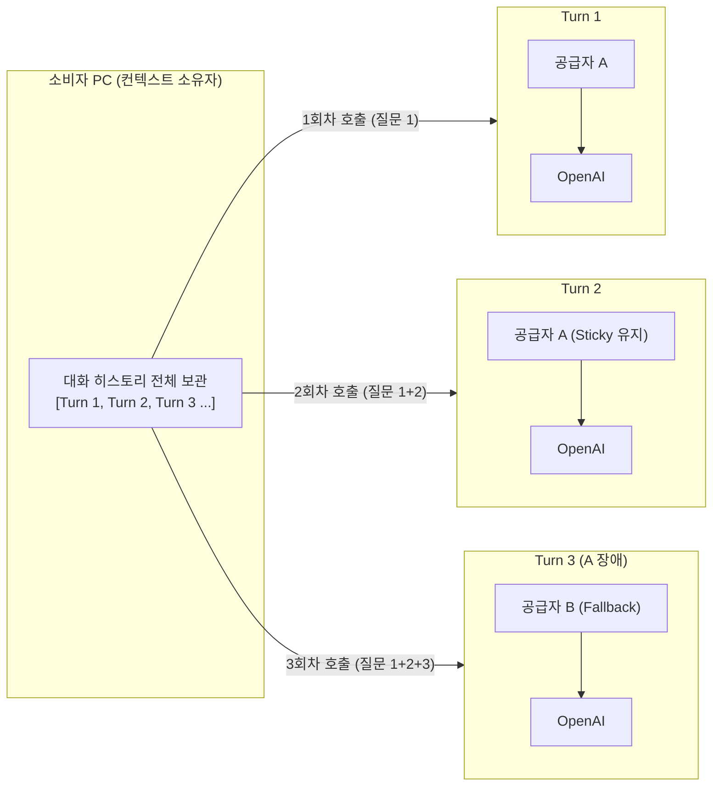
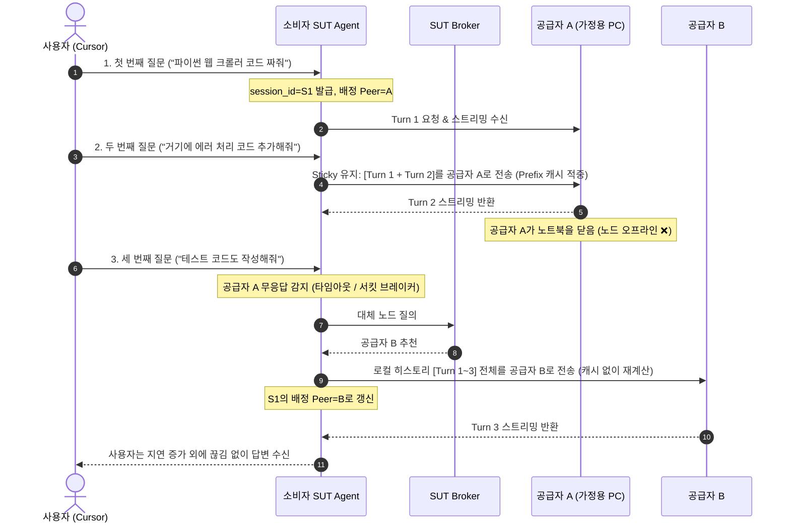

# SUT 턴 단위 동적 피어 스위칭 (Dynamic Turn-by-Turn Peer Switching)

> **동일한 대화 스레드 내에서 평상시에는 같은 공급자 Peer를 유지해 캐시 효율을 얻고, 장애 시에만 Completion(턴) 단위로 다른 Peer로 교체하는 "세션 친화(Sticky) + 무상태 Fallback" 라우팅 기술**

---

## 1. 기술적 성립 원리: LLM API의 "완전 무상태성(Statelessness)"

많은 사용자가 대화 세션이 서버나 공급자 PC에 묶여 있다고 생각하지만, **현대 LLM의 Chat Completion API는 세션을 저장하지 않는 완전한 무상태(Stateless) 구조**입니다.

- **대화 기억(Context)의 소유 주체**: 공급자 Peer나 OpenAI가 아니라, **오직 소비자의 로컬 SUT Agent**입니다.
- **매 턴마다 누적 전송**: 대화가 이어질 때마다 소비자 Agent는 이전의 모든 대화 기록을 `messages` 배열에 담아 새롭게 전송합니다.
- **결론**: 이전 질문을 어떤 공급자가 처리했든 상관없이, **새로운 질문(턴)은 다른 공급자 Peer에게 던져도 LLM은 앞선 맥락을 이해**합니다. 따라서 Peer 교체는 언제든 *가능*하지만, 아래 2절의 이유로 *필요할 때만* 수행합니다.

---

## 2. 라우팅 정책: 세션 친화(Sticky) + 무상태 Fallback

### 2.1 왜 매 턴 교체하지 않는가: 캐시 효율

매 턴 누적 히스토리를 다시 보내므로, 같은 접두사(Prefix)를 반복 처리하는 비용이 턴마다 커집니다. 이 비용은 **같은 Peer에 계속 보낼 때만** 캐시로 절감됩니다.

| 공급 유형 | 캐시 메커니즘 | 캐시 범위 |
|---|---|---|
| 상용 API (OpenAI, Anthropic) | 업체 서버의 Prompt Caching | 공급자 **계정(조직) 단위** → Peer가 바뀌면 캐시 미적중 |
| 오픈 모델 (vLLM, SGLang 등) | Automatic Prefix Caching / RadixAttention | 공급자 **추론 서버 단위** → Peer가 바뀌면 캐시 미적중 |

즉 Peer를 바꾸는 순간 누적 컨텍스트 전체가 캐시 없이 다시 과금·재계산됩니다. 따라서 **기본 동작은 같은 세션을 같은 Peer로 고정(Sticky)** 하는 것입니다.

### 2.2 동작 규칙

1. **세션 식별**: 소비자 Agent는 대화 스레드마다 `session_id`를 발급하고, 해당 세션에 배정된 Peer를 로컬 라우팅 테이블에 기록합니다.
2. **Sticky 유지**: 배정된 Peer가 정상 응답하는 동안에는 같은 `session_id`의 모든 턴을 그 Peer로 보냅니다.
3. **무상태 Fallback**: 배정된 Peer가 무응답이거나 오류를 반환하면, 소비자 Agent가 **로컬에 보관 중인 전체 히스토리**를 새 Peer로 보내 재계산(Re-prefill)합니다. 새 Peer가 해당 세션의 배정 Peer가 됩니다.
4. **캐시 전용 상태 원칙**: Peer 측에 남는 상태(Prompt Cache, Prefix Cache)는 **성능 최적화용 캐시일 뿐**이며, 정확성의 근거는 항상 소비자 로컬 히스토리입니다. Peer 측 상태가 사라져도 결과는 동일하고 속도와 비용만 달라집니다.

---

## 3. 동적 피어 스위칭 동작 시퀀스

---

## 4. 턴 단위 피어 스위칭의 효과와 한계

### ① 무중단 장애 복구 (Failover)
- **기존 P2P의 한계**: 개인 PC는 언제든 절전 모드로 들어가거나 인터넷이 끊길 수 있어 세션 지속성이 취약함.
- **SUT의 해결책**: 대화가 특정 공급자에게 종속(Lock-in)되지 않으므로, **공급자가 이탈해도 다음 턴에서 다른 Peer가 로컬 히스토리를 받아 대화를 이어감**.
- **한계**: 스트리밍 *도중* 이탈한 경우 해당 턴은 재요청해야 하며, 이미 소비된 토큰의 정산 처리(부분 과금 여부)가 필요함. LLM 호출은 비용 측면에서 멱등하지 않으므로 재전송 시 이중 과금 방지 규칙을 정산 프로토콜에 정의해야 함.

### ② 가격 기반 재배정 (Spot Re-assignment)
- 시장 가격이 변동하면 더 저렴한 Peer로 옮길 수 있습니다.
- 단, 옮기는 순간 누적 컨텍스트의 캐시 이점을 잃으므로, **"절감되는 단가 차이 > 캐시 미적중으로 늘어나는 비용"** 일 때만 재배정합니다. 대화 초반(컨텍스트가 짧을 때)이나 새 세션 시작 시점에 적용하는 것이 유리합니다.

### ③ 프라이버시 관점의 주의사항
- Peer를 바꿀 때마다 **새 Peer는 대화 전체 히스토리를 받습니다.** 따라서 잦은 교체는 개인 추적을 분산시키는 효과보다 **대화 전체를 보는 상대가 늘어나는 효과**가 더 큽니다.
- Sticky 정책은 이 노출 범위를 줄이는 효과도 있습니다. 민감한 대화는 교체를 최소화하는 것이 원칙입니다.

---

## 5. 검토했으나 채택하지 않은 안: Peer 측 KV 캐시(`past_key_values`) 관리·전달

"Peer Agent가 `request_id`와 `past_key_values`(KV 캐시)를 직접 관리하거나, Peer 교체 시 KV 캐시를 넘겨주면 재계산 비용을 없앨 수 있지 않은가"라는 안을 검토했으나, 다음 이유로 채택하지 않습니다.

| 검토 항목 | 결과 |
|---|---|
| 상용 API 적용 | **불가.** OpenAI/Anthropic은 KV 캐시를 외부로 노출하거나 주입받는 기능을 제공하지 않음 |
| 오픈 모델 간 KV 전송 크기 | Llama-3 8B 기준 토큰당 약 128 KB(FP16), 8K 토큰 대화 시 약 1 GB. 70B는 약 2.6 GB |
| 전송 vs 재계산 | 가정용 업로드(50~100 Mbps)로 1 GB 전송에 1~3분 소요. GPU 재계산(Prefill)은 수 초. **재계산이 더 빠름** |
| 호환성 | 모델 가중치, 양자화, 추론 엔진 버전이 완전히 같아야만 재사용 가능. 이기종 개인 PC 간에는 사실상 불가 |
| Peer 측 세션 상태 보관 | Peer 이탈 시 상태가 소실되며, 무상태 Failover 구조(4절 ①)와 충돌 |
| 프라이버시 | KV 캐시로부터 원문 프롬프트를 역추론하는 연구가 있어 원문 전송과 노출 수준이 동일 |
| 무결성 | 조작된 KV 캐시 주입으로 응답을 오염시킬 수 있는 공격 경로가 추가됨 |

이 안에서 유효한 아이디어인 "같은 세션은 같은 Peer에서 캐시를 재사용한다"는 **2절의 Sticky 라우팅 + 캐시 전용 상태 원칙**으로 반영했습니다.

---

## 6. 토큰 카운팅 및 정산 구조와의 정합성

- 각 턴(Completion)은 **독립된 마이크로 세션(Micro-session)**으로 취급됩니다.
- 공급자 A와의 통신이 끝나면 해당 턴에서 발생한 토큰량만큼 서명 영수증(Ticket)을 교환합니다. Sticky 유지 중에는 같은 Peer와 턴마다 티켓을 누적합니다.
- 다음 턴에서 공급자 B를 만나면 공급자 B와 새로운 마이크로 티켓을 교환하므로, 노드가 바뀌어도 턴 단위로 정산 경계가 명확합니다.
- 캐시 적중 여부에 따라 실제 원가가 달라지므로(캐시 적중 토큰은 업체 단가가 낮음), 티켓에는 **입력 토큰 중 캐시 적중분과 미적중분을 구분해 기록**합니다.

---

## 7. 결론

> **"대화의 기억(Memory)은 내 로컬 PC에 머물고, 원격 공급자는 평소에는 같은 Peer로 캐시를 살려 쓰다가, 장애가 나면 로컬 기억을 들고 다른 Peer로 옮겨 가는 교체 가능한 연산 엔진이다."**

Sticky 라우팅과 무상태 Fallback의 조합은 **P2P의 노드 이탈 문제에 대한 내결함성**과 **누적 컨텍스트의 캐시 효율**을 함께 확보하며, Peer 측 상태를 캐시로만 취급해 정확성이 특정 Peer에 의존하지 않도록 합니다.
