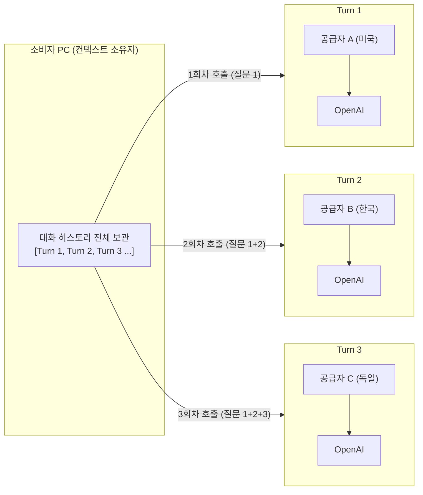
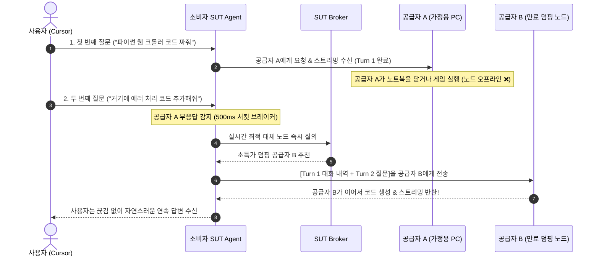

# SUT 턴 단위 동적 피어 스위칭 (Dynamic Turn-by-Turn Peer Switching)

> **동일한 대화 스레드 내에서 Completion(턴) 단위로 공급자 Peer를 동적으로 교체하는 무상태 라우팅 기술과 3대 핵심 효과**

---

## 1. 기술적 성립 원리: LLM API의 "완전 무상태성(Statelessness)"

많은 사용자가 대화 세션이 서버나 공급자 PC에 묶여 있다고 생각하지만, **현대 LLM의 Chat Completion API는 세션을 저장하지 않는 완전한 무상태(Stateless) 구조**입니다.

- **대화 기억(Context)의 소유 주체**: 공급자 Peer나 OpenAI가 아니라, **오직 소비자의 로컬 SUT Agent**입니다.
- **매 턴마다 누적 전송**: 대화가 이어질 때마다 소비자 Agent는 이전의 모든 대화 기록을 `messages` 배열에 담아 새롭게 전송합니다.
- **결론**: 이전 질문을 어떤 공급자가 처리했든 상관없이, **새로운 질문(턴)은 완전히 다른 공급자 Peer에게 던져도 LLM은 앞선 맥락을 100% 완벽히 이해**합니다.

---

## 2. 동적 피어 스위칭 동작 시퀀스

---

## 3. 턴 단위 피어 스위칭이 가져오는 3대 혁신적 효과

### ① P2P의 최대 아킬레스건 극복: 무중단 장애 복구 (Zero-Downtime Failover)
- **기존 P2P의 한계**: 개인 PC는 언제든 절전 모드로 들어가거나 인터넷이 끊길 수 있어 세션 지속성이 취약함.
- **SUT의 해결책**: 대화가 특정 공급자에게 종속(Lock-in)되지 않으므로, **공급자가 중간에 갑자기 이탈해도 다음 턴에서 대기 중인 다른 Peer가 즉시 바통을 이어받아 대화 연속성 100% 보장**.

### ② 초단위 최저가 사냥 (Dynamic Spot Arbitrage)
- 대화 중간에도 시장 가격은 실시간으로 변동합니다.
- 1번째 질문은 일반 가격으로 처리했더라도, 2번째 질문 시점에 **"구독 만료 10분 전이라 80% 폭탄 세일 중인 덤핑 노드"**가 나타나면 시스템이 자동으로 해당 노드를 낚아채어 **대화 도중에도 비용을 극단적으로 절감**.

### ③ 빅테크 추적 및 프로파일링 완벽 분쇄 (Context Sharding)
- 사용자가 장문의 비즈니스 기획이나 독창적인 코딩 작업을 하더라도:
  - 1턴: 미국 공급자 노드 계정으로 호출
  - 2턴: 한국 공급자 노드 계정으로 호출
  - 3턴: 독일 공급자 노드 계정으로 호출
- **결과**: OpenAI의 감시 시스템에는 단일 사용자의 일관된 프로필이 쌓이지 않고, **전 세계 수십 개 계정으로 흩어진 파편화된 데이터(Data Shards)**만 기록되어 **빅데이터 추적 및 개인 프로파일링이 원천 차단**됨.

---

## 4. 토큰 카운팅 및 정산 구조와의 정합성

- 각 턴(Completion)은 **독립된 마이크로 세션(Micro-session)**으로 취급됩니다.
- 공급자 A와의 통신이 끝나면 해당 턴에서 발생한 토큰량만큼만 서명 영수증(Ticket)을 교환하고 채널을 정리합니다.
- 다음 턴에서 공급자 B를 만다면 공급자 B와 새로운 마이크로 티켓을 교환하므로, **노드가 바뀌어도 정산 장부의 위변조나 계산 혼선이 전혀 발생하지 않습니다.**

---

## 5. 결론

> **"대화의 기억(Memory)은 내 로컬 PC에 안전하게 머물고, 원격의 공급자들은 턴마다 가장 빠르고 저렴한 노드로 물 흐르듯 교체되는 일회용 연산 엔진이다."**

턴 단위 동적 피어 스위칭은 **P2P의 안정성 한계를 극복하는 최고의 내결함성(Fault-tolerance) 기술**이자, **빅테크의 개인 감시를 무력화하는 가장 강력한 프라이버시 방패**입니다.
