# 에이전트 아레나 교육 자료: 지금의 모습

> 2026-11-04 기준. 지금까지 만든 것을 한 번에 이해하기 위한 자료다. 순서는 **spec(표준과 선언) → 순수 플랫폼 → 플랫폼 부가기능 → 앱 기능**이고, 층마다 무엇이 있는지(구성), 어떻게 움직이는지(동작), 어떻게 쓰는지(사용)를 적었다. 바이트 단위의 정확한 규칙은 이 자료가 아니라 각 절에 적은 원본 문서가 기준이다. 기술 용어는 영어 그대로 쓴다(끝에 용어표).

## 0. 한 장으로 보기

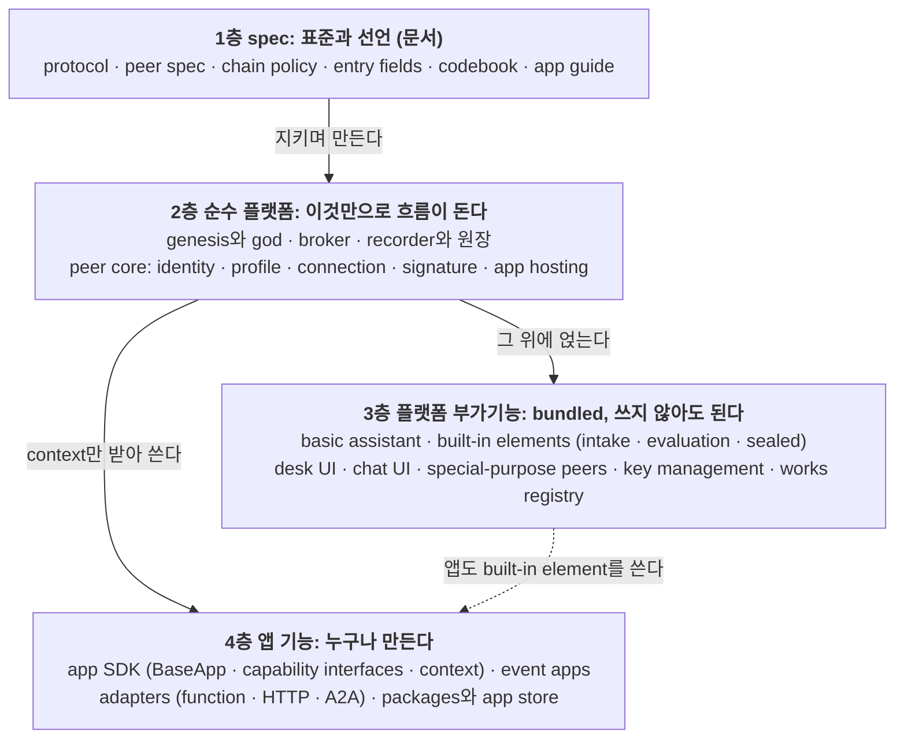

**한 문장으로**: 사람마다 자기 에이전트(peer)를 갖고, peer들은 broker에서 서로를 찾아 직접 대화하거나(a2a) 기능을 부르며(api), 권리와 책임이 생기는 일은 서명해서 원장(recorder)에 남긴다. 플랫폼은 그 통로와 보장만 제공하고, 일의 내용(event, app)은 참여자가 만든다.

## 0.1 고정된 것은 규약과 코드뿐, 구현체는 누구나

> 사용자(2026-11-03): "결국 코드와 규약 말고는 구현체(sw)는 누구나 만들 수 있어."

모두가 똑같이 지켜야 하는 것은 **둘뿐**이다. 하나는 **규약**(protocol: 바이트, 메시지, 원장 규칙)이고, 다른 하나는 **코드**(codebook: entry type, purpose code, element, time code, connection kind, storage kind, proof method, content form)다. 그 밖의 소프트웨어는 peer든 broker든 recorder든 app이든 UI든 누구나 어떤 언어로든 만든다. 이 저장소의 `arena/`(Python)는 규약을 따르는 **reference implementation 하나**이고, 이 자료의 2~4부는 그 구현의 모습이다.

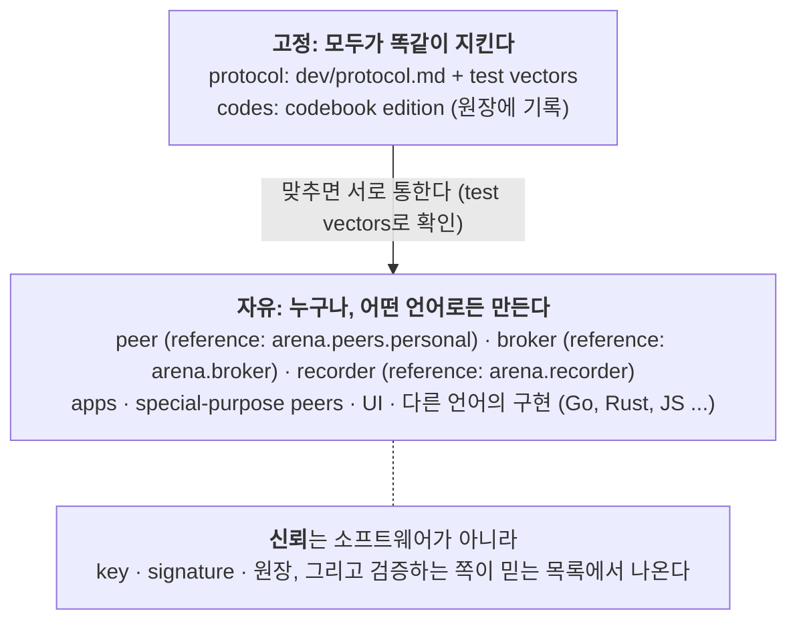

| 무엇 | 고정인가 | 설명 |
|---|---|---|
| protocol (canonical JSON, signature, hash, entry와 rule, API, message) | **고정** | 바이트 하나까지 같아야 통한다. test vectors로 확인한다 |
| codes (codebook edition) | **고정** (edition 단위) | 같은 code는 같은 뜻이다. edition은 누구나 내고, 따르는 쪽이 많을수록 신뢰를 얻는다 |
| peer · broker · recorder · app · UI 소프트웨어 | 자유 | protocol과 code만 맞으면 누구나 |
| 어느 broker · recorder를 믿을지 | 검증하는 쪽이 정함 | root values와 key rotation으로 증명한다. trunk chain이 믿는 recorder 목록을 내는 절차는 **미정**(CP-18) |
| event 내용, rules 글, free-form fields | 자유 | 원장은 hash만 공증한다 |

그래서 순수 플랫폼(2부)도 "우리 서버"가 아니라 **protocol이 정한 역할**이다. 누가 broker를 새로 짜서 띄워도 protocol대로 움직이면 같은 역할을 한다. 믿을지는 그 broker나 recorder의 key와 기록을 보고 검증하는 쪽이 정한다.

**층을 나눈 기준**

| 층 | 기준 | 빼면 |
|---|---|---|
| spec | 다른 언어로 만들어도 맞물리도록 정한 약속 | 서로 다른 구현끼리 통하지 않는다 |
| 순수 플랫폼 | 이것만으로 event 하나가 돌고, 플랫폼 보장(signature, 공증, identity 증명)이 깨지지 않는다 | 생태계가 성립하지 않는다 |
| 플랫폼 부가기능 | 여러 앱과 사람에게 공통으로 쓸모 있어 기본으로 넣었지만 쓰지 않아도 된다 | 덜 편하고 덜 튼튼해질 뿐 돌기는 돈다 |
| 앱 기능 | 특정 일을 위한 것. 플랫폼 코드(`arena/`)에 넣지 않는다 | 그 일만 못 한다 |

---

# 1부. spec: 표준과 선언

## 1.1 문서 지도

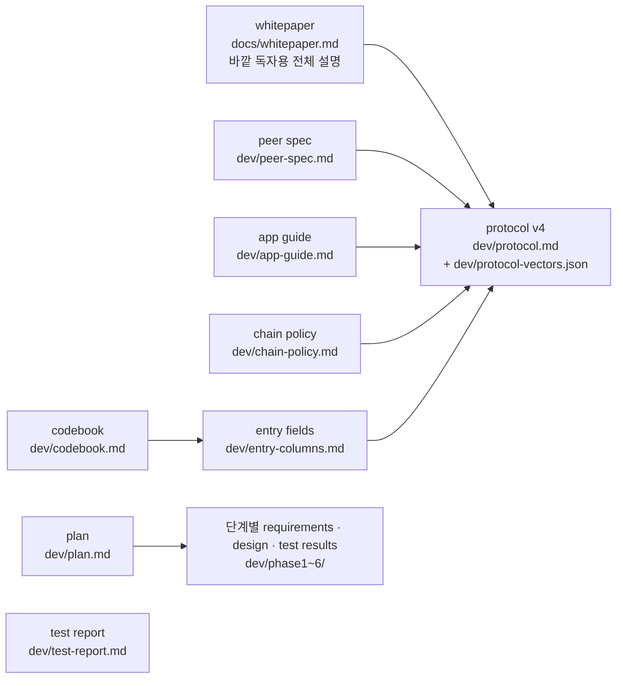

| 문서 | 무엇을 정하나 | 누가 읽나 |
|---|---|---|
| `dev/protocol.md` | canonical JSON, signature, hash, signed HTTP request, entry와 rule, broker · recorder API, A2A message, key backup format, off-ledger `ref` | 다른 언어로 peer · broker · recorder를 만드는 사람 |
| `dev/peer-spec.md` | peer가 **반드시**(MUST) 지킬 것, **권하는**(SHOULD) 것, 자유인 것 | peer를 만드는 사람 |
| `dev/app-guide.md` | app이 받는 context, capability interfaces, event blocks, 배포 | app을 만드는 사람 |
| `dev/chain-policy.md` | trunk chain과 branch chain, 원장 보관, 첫 key 폐기, god 소멸, off-ledger content | 원장 운영자와 커뮤니티 |
| `dev/entry-columns.md` | code fields와 free-form fields, purpose codes | entry를 설계하는 사람 |
| `dev/codebook.md` | codebook edition을 내고 따르는 방식 | foundation peer, 커뮤니티 |

## 1.2 바탕이 되는 결정 (사용자가 정한 것)

| 결정 | 뜻 |
|---|---|
| 플랫폼만 만든다 | `arena/`에는 범용 기능만 둔다. 공모 · 심사 같은 특정 일의 말은 플랫폼 코드에 없다(테스트가 막는다) |
| interface는 둘 | `a2a`(양방향 대화)와 `api`(일방향 serving). 사람이 끼는 것도 `a2a`에 끼는 것이다 |
| operator는 셋 | `service`(코드가 답함), `agent`(LLM이 판단하고 중요한 일은 사람에게 물음), `human`(사람이 직접) |
| 원장에는 내용이 아니라 hash | 긴 글과 자산은 원장 밖에 둔다. "원장에 책 정보를 찍는 게 아니라 책에 원장 정보를 찍는다" |
| public body + private envelope | 누구나 가져가는 기록은 public body, 퍼지면 안 되는 field는 private envelope(hash로 묶임) |
| branch는 trunk에서만 | 커뮤니티 chain은 trunk chain에서만 갈라진다. branch chain의 규칙은 그 커뮤니티가 정한다 |
| 원장에는 늘 timestamp | recorder가 모든 entry에 시각을 찍고, 거꾸로 가는 시각은 받지 않는다 |
| 명확한 일은 코드로 | LLM은 판단이 필요한 곳에만 쓴다. token을 줄이는 것은 진행을 코드가 맡는 app이다 |
| key는 peer가 스스로 만든다 | 누구도 남의 private key를 만들거나 보지 않는다 |
| god은 통제자가 아니라 자유를 주는 자 | god이 사라지는 시점은 공개 출시 뒤 만든 사람이 정한다 |

## 1.3 바이트 단위의 약속 (`protocol.md` 2~3절)

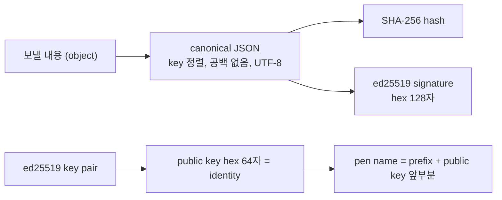

- **identity**: ed25519 key pair 하나. public key가 식별자다. 가입 절차는 없다.
- **signature**: 언제나 canonical JSON에 한다. recorder seal만 entry hash 문자열에 서명한다.
- **broker · recorder로 가는 HTTP 요청**: signed request headers(누가, 언제, 무엇을)를 붙인다.
- **peer끼리 A2A message**: JSON object 하나이고 `op`가 있다. event에 관한 message는 head에 group과 event를 싣는다(A2A `context_id`=`event_id`, `metadata`, HTTP header `X-Arena-Group` · `X-Arena-Event`).
- **test vectors**: `dev/protocol-vectors.json`의 값을 바이트 하나까지 똑같이 만들면 맞게 구현한 것이다(canonical JSON, signature, hash, signed request, entry, envelope, key backup, next-key commitment, content form).

## 1.4 entry와 rule (`protocol.md` 4절)

**entry 하나의 모양**

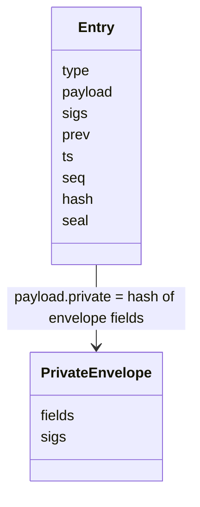

| field | 뜻 |
|---|---|
| `type` | 무슨 행위인가(entry type) |
| `payload` | public body. 참여자가 서명한다 |
| `sigs` | 서명자별 signature |
| `prev`, `seq` | 앞 entry의 hash, 번호 |
| `ts` | recorder가 찍은 시각 |
| `hash` | SHA-256(canonical JSON of type, payload, sigs, prev, ts) |
| `seal` | recorder의 signature |
| envelope `fields`, `sigs` | 퍼지면 안 되는 field의 원문, 신원이 비공개인 서명자의 signature. recorder와 허용된 key만 가진다 |

**recorder가 entry를 받기 전에 보는 순서**(`arena/ledger/rules.py`)

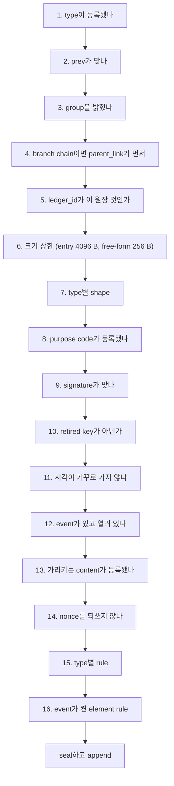

어느 단계든 걸리면 그 자리에서 거절하고 이유를 돌려준다(`{ok: false, error}`).

**entry types**(register해서 더한다. 원장 코드는 고치지 않는다)

| 무리 | type | 한 줄 |
|---|---|---|
| 세상과 신뢰 | `genesis`, `key_rotate`, `chain_link`, `parent_link` | 0번 entry, recorder · god key rotation, branch chain 연결(trunk 쪽, branch 쪽) |
| 모임 | `group` | broker group 선언(closed group 포함) |
| event | `event`, `contract`, `assign`, `attest`, `close`, `endorse` | 선언, 역할 계약, 당사자 배정, 공동 확인, 종료, 선언 뒤 공동 서명(선택) |
| 내용 | `publish`, `reveal`, `share`, `feedback` | content hash 등록, 등록한 값 공개, 전달, 판정 |
| 코드 | `codebook` | codebook의 edition 하나 |
| peer key | `key_commit`, `peer_rotate` | next-key commitment, peer key rotation |

**field가 놓이는 세 곳**(`entry-columns.md`)
- payload 밖: recorder가 정한다(`type`, `prev`, `ts`, seal).
- payload 안 **code fields**: 원장이 확인한다(`group_id`, `ledger_id`, `event_id`, `purpose`, `nonce`, type별 field, `form`, `ref`).
- payload 안 **free-form fields**: 원장이 읽지 않는다. 서명 범위 안이라 바꿀 수는 없다. **짧은 자연어(글)만** 들어간다. 코드가 읽어 움직이는 값(식별자, 구조)은 전용 field를 둔다(LLM이 글에서 꺼내지 않게).
- **크기 상한**(원장이 커지지 않게, 작게 고정): free-form fields 합계 256 bytes, entry 하나 4,096 bytes. 넘으면 거절하고 "content는 원장 밖에(hash, `ref`, link peer)"라고 알린다.

**purpose codes**: `authorship`(작품과 그 시점의 증명), `commit`(나중에 공개할 값의 hash 등록), `delivery`(자료 전달), `submission`(event 제출), `evaluation`(평가 건넴).

## 1.5 chain policy (`chain-policy.md`)

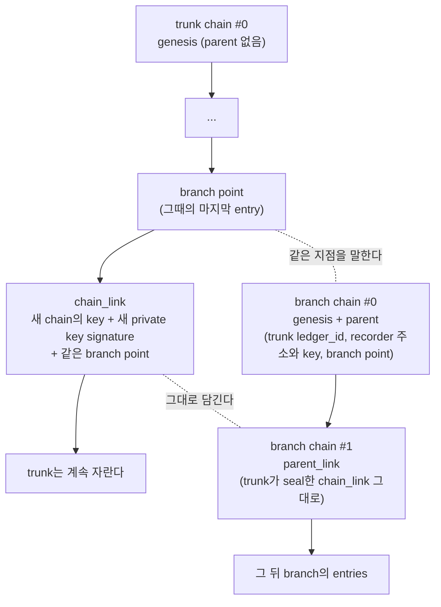

- trunk는 하나다. branch는 trunk에서만 갈라지고, branch에서 다시 branch가 나지 않는다(증명은 언제나 한 단계).
- branch chain은 `parent_link`(#1)를 남기기 전에는 다른 entry를 받지 않는다.
- trunk에서 보면 branch 하나는 `chain_link` entry 하나다.
- **원장 보관**: 쓰기는 recorder를 통해서만 한다. 보관과 조회는 누구나 할 수 있다(`GET /log`). trunk chain은 transparency log 방식을 따르기로 했다(Merkle tree, checkpoint, witness, external anchoring. 모두 **계획**). closed community의 branch chain은 central DB를 써도 된다.
- **첫 key**: #0을 seal한 첫 recorder key는 operating key로 넘긴 뒤 없애기를 권한다.
- **off-ledger content**: 원장에는 hash만 둔다. 어디에 있는지는 `ref`(storage, proof)로 적을 수 있고, 거꾸로 **책이 원장을 가리킨다**(3.8절).

## 1.6 peer spec (`peer-spec.md`)

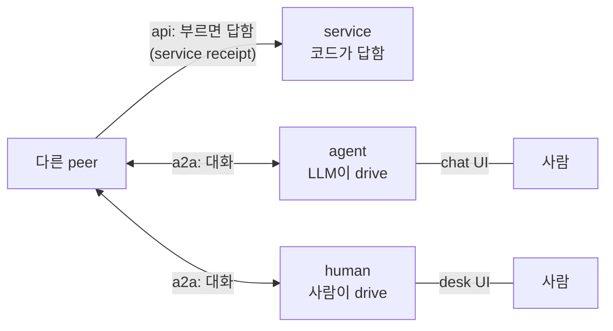

| 층 | MUST | SHOULD |
|---|---|---|
| identity와 signature | ed25519 identity, canonical JSON signature, signed request headers, key는 peer가 스스로 만들고 밖으로 내보내지 않음 | OS key store, next-key commitment, recovery를 맡길 key peer |
| profile | `operator`, `connections`(a2a / api / human), 서명해서 broker에 게시 | 따르는 codebook edition |
| connection | profile에 적은 kind마다 열기 | |
| 받는 op | `engage`(계약), `endorse`(공동 서명), `solicit`(직접 요청) 등 operator별 | |
| event 참여 | notice를 원장의 선언과 대조, 증명된 recorder만 믿기 | |
| 사람의 결정 | 권리와 책임이 생기는 일은 사람에게 | |
| 시각 | | schedule 시각에 timer로 깨어나기 |
| 사람용 UI | 자유(reference peer의 desk · chat은 한 예) | |

`human` connection kind는 기술 통로가 아니라 "플랫폼 밖에서 사람끼리 연락하라"는 연락처다. 코드는 이 kind로 자동 전송하지 않는다.

## 1.7 app guide (`app-guide.md`)

app은 peer 객체를 받지 않는다. 플랫폼이 주입하는 **context**만 쓰고, 필요한 **capability interface**만 구현한다.

```mermaid
flowchart LR
    subgraph APP["app (필요한 것만 구현)"]
        O1["OpProvider: ops()"]
        O2["OfferProvider: offers()"]
        O3["RoleAcceptor: accept_role()"]
        O4["EventEndorser: endorse_event()"]
        O5["RequestReceiver: on_request()"]
        O6["ProfileContributor: profile_extra()"]
        O7["Lifecycle: start()"]
        O8["EventHandler: on_event()"]
        O9["TimerHandler: on_timer()"]
    end
    subgraph CTX["Context (작은 interface 8개)"]
        C1["Me: 나"]
        C2["Platform: settings · clock · LLM · owner"]
        C3["Storage: app 전용 state"]
        C4["LedgerAccess: recorder · 원장"]
        C5["Messaging: 다른 peer · broker"]
        C6["Showing: profile 알리기"]
        C7["Scheduling: timer"]
        C8["ElementAccess: element가 모은 것"]
    end
    CTX -->|"플랫폼이 주입"| APP
```

**event blocks**: `rules`(자연어 규칙, hash가 공증됨), `policy`(역할 · 판정 · 공동 확인 규칙, 원장이 집행), `mode`(`assistant`: basic assistant가 / `app`: app이 / `app_or_assistant`: app이 있으면 app이), `apps`(app 목록), `elements`(built-in elements), `schedule`(`start` · `session` · `deadline` · `end`), `codebook`(따르는 edition).

## 1.8 codebook과 edition (`codebook.md`)

entry type, purpose code, element, time code, connection kind, storage kind, proof method, content form의 목록이 **codebook**이다. 누구나 edition(`x.y`)을 원장에 낼 수 있고, 따르는 event와 profile이 많은 edition이 저절로 신뢰를 얻는다(누가 임명하지 않는다). branch chain은 자체 code(`x-<community>.<code>`)를 더할 수 있고, trunk의 edition을 copy해서 따를 수도 있다.

---

# 2부. 순수 플랫폼

> protocol이 정한 역할(god · broker · recorder · peer core)과 그 reference implementation `arena/`. 다른 구현으로 바꿔 끼워도 protocol만 맞으면 같은 흐름이 돈다.

## 2.1 구성

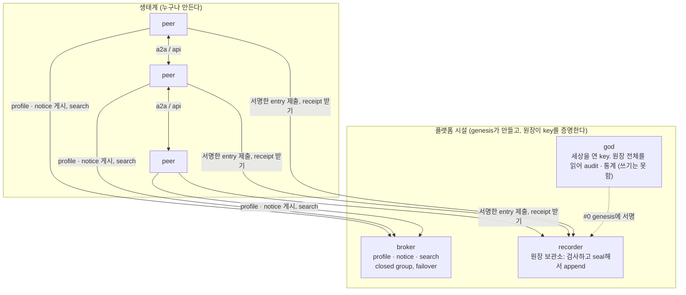

| 시설 | 코드 | 단독 실행 |
|---|---|---|
| genesis와 god | `arena/genesis.py`, `arena/peer/god_role.py` | `python -m arena.genesis` |
| broker | `arena/broker/` (service, api, client, failover, neighbors, store) | `python -m arena.broker` |
| recorder와 원장 | `arena/recorder/`, `arena/ledger/` | `python -m arena.recorder` |
| peer core | `arena/peer/node.py` 외 | (3부의 runner들) |
| 바탕 | `crypto.py`, `signing.py`, `a2a.py`, `rest.py`, `connections.py`, `config.py`, `http.py`, `serve.py` | |

**layering**(`tests/test_layering.py`가 지킨다): ledger · recorder · broker는 peer 층을 import하지 않는다. 플랫폼 코드에는 app의 말이 없다.

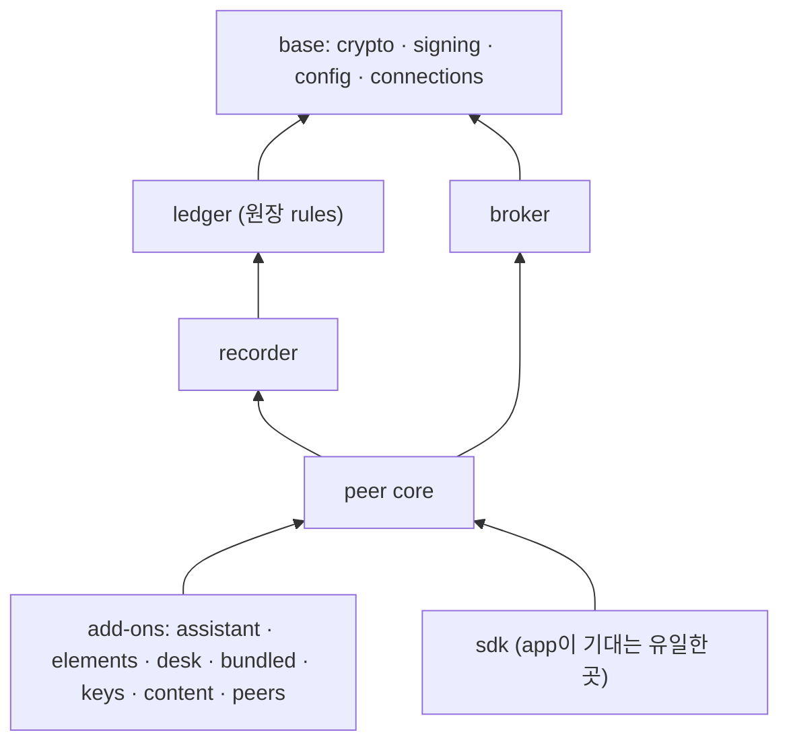

## 2.2 genesis: 세상의 시작

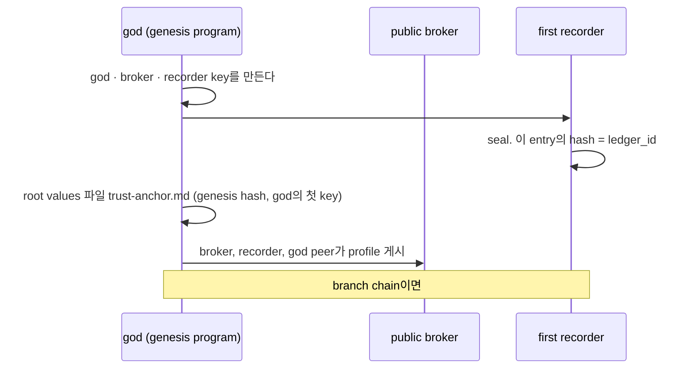

**사용**: `python -m arena.genesis`(settings `ARENA_GENESIS_*`). `ARENA_GENESIS_PARENT_RECORDER_URL`을 주면 branch chain의 genesis가 된다. **진짜 원장(기준 네트워크의 genesis)은 아직 만들지 않았다.** 테스트와 시험 실행은 매번 첫 원장을 새로 만든다.

## 2.3 broker

| 요청 | 하는 일 |
|---|---|
| `POST /profiles`, `GET /profiles`, `GET /profiles/search` | 서명한 profile 게시, 목록, 찾기(BM25, role · label 필터) |
| `POST /notices`, `GET /notices?since=`, `GET /notices/search`, `POST /notices/{id}/close` | event notice 게시, 바뀐 notice 받기, 찾기, 닫기 |
| `POST /grants` | closed group 주인이 가입 허가 |
| `GET /health` | 상태, group id |

- AI 없이 기계적으로 일한다. profile의 signature, connection kind, `operator` 값을 확인한다.
- group 하나에 broker를 여럿 둘 수 있다. primary broker가 죽으면 peer가 secondary로 넘어간다(`failover.py`). 이웃 broker에게 search를 넘기기도 한다(`neighbors.py`).

## 2.4 recorder와 원장

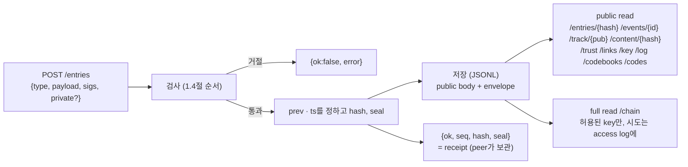

| public read | 무엇 |
|---|---|
| `GET /entries/{hash}` | entry 하나의 공개 정보(어느 원장의 몇 번째, 언제, 누가 seal했나, type별 공개 field) |
| `GET /events/{event_id}` | event 하나의 entries(공개 정보만) |
| `GET /track/{pub}` | identity 하나의 실적(개수만, 상대와 내용은 없음). key가 바뀌어도 identity를 따라간다 |
| `GET /content/{hash}` | content hash로 등록 entry를 찾는다(CP-10) |
| `GET /trust` | trust document: genesis, 모든 `key_rotate`, 지금 recorder key, 마지막 entry, branch면 `parent_link` |
| `GET /links/{ledger_id}`, `GET /key/{pub}` | branch chain 연결 entry, peer key 상태 |
| `GET /log?from=&limit=` | public log(envelope 없음). 누구나 가져가 hash chain · seal · 공개 signature를 확인한다 |
| `GET /codebooks`, `GET /codes` | edition entries, 이 recorder가 구현한 codes |

**ledger 코드**(`arena/ledger/`): `core.py`(순서 · 검사 · seal), `rules.py`(공통 rules), `types.py`(entry type registry), `envelope.py`(public body와 envelope 조립), `trust.py`(진짜 원장 증명), `peer_keys.py`, `refs.py`(storage kind · proof method · content form), `codebook.py`, `purposes.py`, `schedule.py`, `elements.py` · `builtin_elements.py`, `run.py`(mode 블록), `store.py`.

## 2.5 peer core

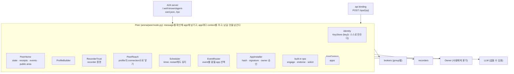

**message 하나가 들어오면**

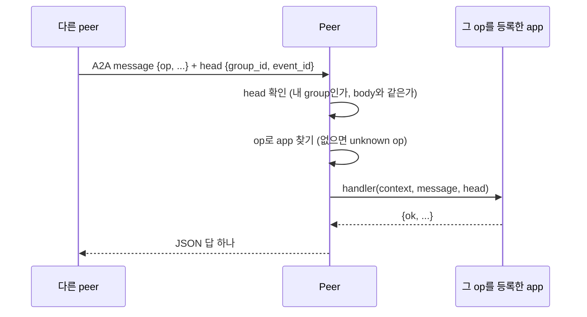

| 플랫폼 보장 | peer core에서 하는 곳 |
|---|---|
| 내가 속한 group의 message만 받는다 | message head 확인 |
| 서명된 body만 믿는다 | `signing.py`, signature 시각 범위 |
| 증명된 recorder의 event만 받는다 | `RecorderTrust` (root values → key rotation → branch link) |
| entry마다 recorder receipt를 남긴다 | `receipts.py` |
| app은 context 밖에 손대지 못한다 | `AppContext` (peer 객체를 주지 않음) |
| 남의 app 코드는 확인 없이 돌지 않는다 | `AppInstaller` (event가 정한 hash, publisher signature, owner 승인) |

## 2.6 순수 플랫폼만으로 event 하나

basic assistant도 app도 없이, protocol만 지키는 peer들이 event 하나를 진행하는 모양이다. 3부의 basic assistant와 4부의 app은 이 흐름에서 **누가 무엇을 판단하나**를 채운다.

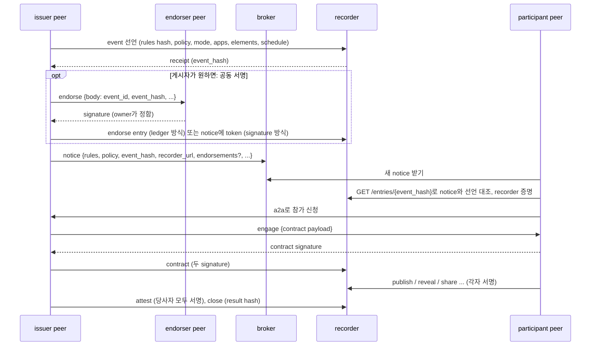

## 2.7 공동 서명(endorsement): 게시자가 고르는 무게

event는 issuer 혼자 선언한다. 결재처럼 "누가 서명해야 열린다"는 관문은 없다. issuer가 event에 효력이나 명성을 더하고 싶을 때, 선언한 **뒤에** 다른 peer(예: 조직의 책임자, 이름난 심사위원)에게 공동 서명을 청한다. 청할지, 누구에게, 어느 방식으로 할지는 issuer가 정하고, 서명할지는 청받은 peer의 owner가 정한다.

두 방식 모두 같은 body에 issuer와 endorser가 서명한다: `{event_id, event_hash, issuer, endorser, group_id, ledger_id?}`. 이미 있는 entry는 바뀌지 않으므로 hash chain은 그대로다.

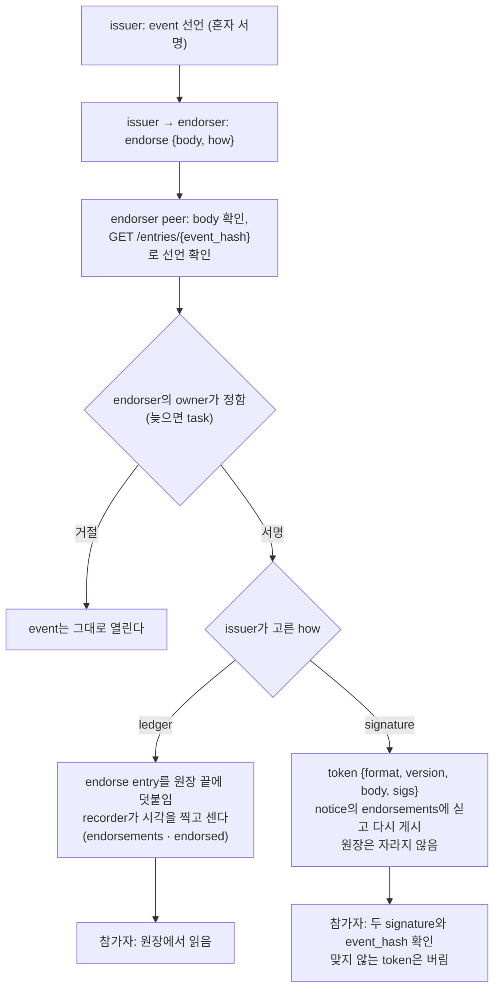

| | `ledger` | `signature` |
|---|---|---|
| 어디에 남나 | 원장의 `endorse` entry | notice의 `endorsements` (원장 밖) |
| 장점 | recorder가 시각을 찍고, 누가 몇 번 서명했는지 원장으로 센다. audit가 signature를 다시 본다 | 원장이 커지지 않는다 |
| 원장이 보는 것 | body가 갖춰졌고 endorser는 issuer가 아님 → `event_hash`가 선언된 그 event의 hash → issuer가 그 event의 issuer → 같은 endorser는 한 번만 | (원장이 보지 않는다) |

event가 닫힌 뒤에도 `ledger` 방식으로 덧붙일 수 있다(명성은 나중에도 쌓인다). 규약은 `dev/protocol.md` 4.9절, 코드는 `arena/ledger/endorse.py`(entry type), `arena/peer/endorsements.py`(청하는 쪽), `arena/peer/builtin.py`의 `EventEndorsements`(청받는 쪽 built-in op `endorse`)다.

---

# 3부. 플랫폼 부가기능

기본으로 들어 있지만 쓰지 않아도 되는 것들이다. 모두 2부의 peer core 위에 **app처럼** 얹혀 있다. reference implementation에 함께 넣었을 뿐, 같은 일을 하는 다른 구현을 누구나 만들어도 된다(special-purpose peer도 마찬가지).

## 3.1 지도

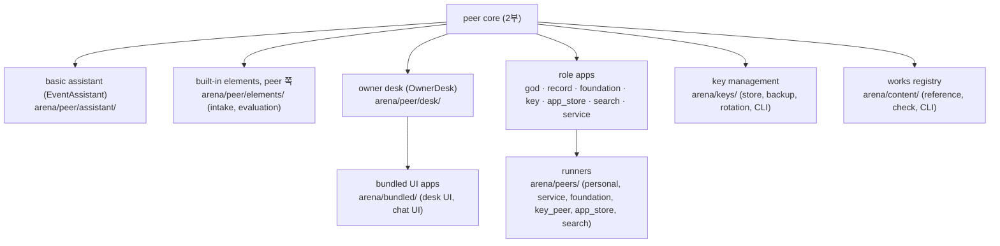

## 3.2 basic assistant: 자연어 rules로 event를 처리

event의 `mode`가 `assistant`이거나, `app_or_assistant`인데 필요한 app이 없으면 basic assistant가 맡는다. LLM이 rules 글을 읽고 tool을 골라 움직인다.

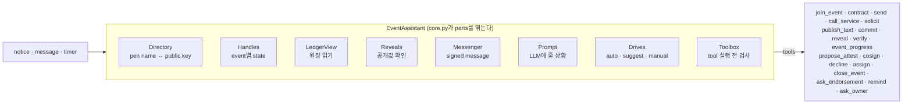

**drive**(`drives.py`): event마다 누가 움직일지 고른다.

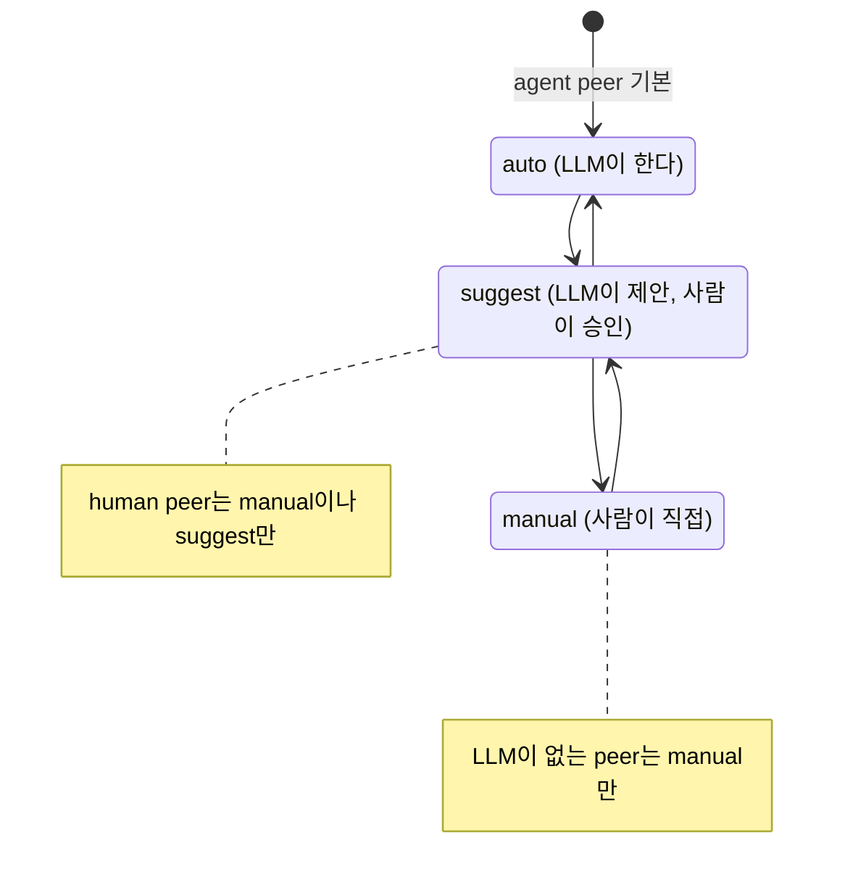

## 3.3 built-in elements: 틀리면 안 되는 부분을 원장이 지킨다

event가 `elements`로 켜면 원장이 그 event의 entry마다 규칙을 더 본다. peer 쪽에는 그 일을 받는 built-in op가 있다.

| element | 원장이 지키는 것 | peer 쪽 op |
|---|---|---|
| `intake` | 받는 사람, deadline, 작성자당 개수, 겸할 수 없는 역할 | `intake.submit` |
| `evaluation` | issuer만 넘기고 evaluator 역할만 받음, 넘겨받은 것만 판정 | `evaluation.request` |
| `sealed` | 배정된 당사자만 commit, 모두 commit한 뒤에만 reveal | (원장 rule만) |

비교 실행의 결론: element는 **보장**을 준다. token을 줄이는 것은 element가 아니라 진행을 코드가 맡는 **app**이다(`dev/phase6/test-results.md` 4절).

## 3.4 schedule과 timer

```mermaid
sequenceDiagram
    participant I as issuer
    participant R as 원장
    participant P as 참가 peer의 Scheduler
    participant A as event를 맡은 app 또는 assistant
    I->>R: event 선언 schedule [{at, code: session}, {at, code: deadline}]
    P->>R: 선언 확인 (공증된 시각)
    P->>P: 그 시각에 timer (home에 남아 restart해도 유지)
    Note over P: 시각이 됨 (꺼져 있었으면 켜질 때 한 번)
    P->>A: on_timer {kind: schedule, data: 그 일정}
    A->>R: deadline이 지났는지 원장으로 확인한 뒤 행동
```

"아직인가?"를 확인하려고 주기적으로 깨어나지 않고 timer를 건다(token과 시간을 아낀다).

## 3.5 사람용 UI: desk와 chat

사람의 화면은 peer의 기본 기능이 아니라 **bundled app**이다(`arena/bundled/`). peer가 자기 local web을 띄운다. 기본은 **console**(통합 창)이다. 사람이 운전하든 agent가 운전하든 같은 창에서 event의 대화를 **지켜보고**(받은 말은 왼쪽, 내 peer가 한 말은 오른쪽, 그 밖의 일은 가운데), **끼어든다**(내 peer로서 상대에게 한 마디, 내 agent에게 지시, 물음에 답, drive 바꾸기, tool 직접 실행). desk UI와 chat UI도 고를 수 있다.

```mermaid
flowchart LR
    subgraph HP["human peer"]
        D1["OwnerDesk<br/>question · notice · suggestion items"]
        W1["desk UI (DeskWebApp)<br/>/api/state /api/items /api/events ..."]
        D1 --- W1
    end
    subgraph AP["agent peer"]
        D2["OwnerDesk"]
        W2["chat UI (ChatApp)<br/>/api/feed /api/say /api/items/{id}/answer"]
        CON["Concierge (LLM)"]
        D2 --- W2 --- CON
    end
    U1["사람"] -->|"browser + token"| W1
    U2["사람"] -->|"browser + token"| W2
    HP <-->|"a2a"| AP
```

- 사람과 사람의 소통도 각자의 peer가 `a2a`로 주고받는다. 그래서 사람의 message에도 signature, head, 원장 연결이 똑같이 붙는다.
- **a2a는 무전기 방식이다.** peer와 peer 사이에는 session(websocket 등)을 열어 두지 않는다. message 하나가 말 한 번이고, 사람이 운전하는 peer도 바깥에서는 agent와 똑같이 보인다(사람이 agent를 흉내 낸다). 늦은 답은 task로 하고, 바뀌면 받는 peer가 부르는 peer의 **webhook**(`/a2a/notify`)으로 알린다. 부르는 peer는 알림을 신호로만 쓰고 직접 다시 묻는다. 바깥 client를 위해 **SSE**도 열어 둔다.
- 사람의 답은 늦을 수 있다. 받는 peer는 짧은 시간 안에 끝나지 않는 답을 **A2A task**(`working`, "waiting for the owner")로 알리고, 부르는 peer는 `tasks/get`으로 끝까지 따라간다(아래 그림). 상대가 human peer면 더 오래 기다리고, 한도가 지나면 거절이 아니라 pending으로 받는다. basic assistant는 pending으로 돌아온 contract를 기억했다가 timer로 다시 보고, 답이 오면 원장 기록까지 마저 한다(`check_pending` tool로 지금 볼 수도 있다). 받는 peer는 task를 home에 남겨 재시작 뒤에도 결과나 사유("restarted, ask again")를 돌려준다.

```mermaid
sequenceDiagram
    participant C as caller peer
    participant H as human peer
    participant P as 사람 (desk UI)
    C->>H: engage (return_immediately, 내 webhook과 1회용 token)
    H->>P: desk에 question
    Note over H: ARENA_A2A_ANSWER_WAIT_SEC 안에 답이 없다
    H-->>C: task working {"note": "waiting for the owner"}
    P->>H: 예 (몇 분, 몇 시간 뒤)
    H->>C: webhook /a2a/notify (token): task가 바뀌었다
    C->>H: tasks/get (알림 본문은 믿지 않고 직접 묻는다)
    H-->>C: completed {ok, sig}
    Note over C,H: 알림이 오지 않으면 ARENA_A2A_PUSH_FALLBACK_SEC마다 다시 묻는다
```
- 화면은 token이 있어야 열린다(주소의 `#token=`, 열자마자 주소창에서 지워짐).
- UI 테스트는 Playwright headless Chromium으로 돌린다(`tests/ui/`, 8개).

## 3.6 special-purpose peers

모두 선택이고 누구나 띄울 수 있다. 권한은 없고, 쓰는 쪽이 고른다.

| peer | 하는 일 | 실행 |
|---|---|---|
| foundation peer | 기본 codebook edition을 원장에 기록하고 문서를 내준다(`codebook.get`) | `python -m arena.peers.foundation` |
| key peer | 암호화된 key backup 보관, 미리 정해 둔 recovery에 서명. private key는 보지 않는다(`key.info`, `key.backup.put/get`, `key.recover`) | `python -m arena.peers.key_peer` |
| app store peer | publisher signature가 맞는 app package를 보관하고 app id로 내준다(`app_get`, `app_list`, `app_publish`) | `python -m arena.peers.app_store` |
| link peer | 원장이 가리키는 영구 link를 맡는다. 실제 위치는 게시자가 자기 key로 서명해 바꾸고, 원장은 그대로다(`link.info`, `link.set`, `link.get`, `link.history`) | `python -m arena.peers.link_peer` |
| search peer | embedding(bge-m3) 벡터로 peer 찾기 | `python -m arena.peers.search` |
| service peer template | spec 파일 하나로 API peer를 만든다(Python 함수나 기존 HTTP API, signed receipt, 결과를 원장에 남기는 op) | `python -m arena.peers.service --spec spec.json` |

플랫폼 시설의 role app(`god_role`, `record_role`)은 genesis가 띄운다.

**container로 띄우기**(`dev/docker.md`): API 서버 peer는 서로 다른 곳에서 따로 운영되므로 peer마다 실행 디렉토리(`deploy/<peer>/`)에 `docker-compose.yml`과 `.env.example`이 있다. 이미지는 하나이고 `deploy/build.sh`가 build한다(compose에는 build가 없다). 시험용 broker는 `deploy/test-broker/`(genesis). peer는 broker에 연결될 때까지 간격을 늘려 가며 계속 시도한다(`Presence`). 듣는 주소(`ARENA_HOST`)와 남에게 알리는 주소(`ARENA_PUBLIC_HOST`)는 따로다.

**service peer를 api로 부르기**

```mermaid
sequenceDiagram
    participant C as caller peer
    participant S as service peer
    C->>C: profile의 connections에서 api 고르기
    C->>S: POST {url}/ops/add {input} (+ group · event headers)
    S-->>C: {ok, result, receipt {service, op, request_hash, result_hash, ts}, receipt_sig}
    C->>C: receipt signature 확인 (무엇을 물었고 무엇을 받았는지 증명)
```

## 3.7 key management: 스스로 만들고, 미리 약속하고, 맡긴다

```mermaid
flowchart LR
    subgraph DEV["내 기기"]
        P["peer program"] --> KS["KeyStore<br/>OS key store 또는 0600 file<br/>(ARENA_KEY_STORE auto / os / file)"]
        P --> BK["encrypted backup<br/>current key + next key<br/>(scrypt + AES-256-GCM)"]
    end
    P -->|"key_commit: next key의 hash, recovery peers"| L["원장"]
    BK -->|"ciphertext만"| K["key peer"]
    K -.->|"recovery signature (미리 정한 경우만)"| L
```

```mermaid
sequenceDiagram
    participant O as owner peer
    participant K as key peer
    participant R as 원장
    O->>R: key_commit {pub, next: next key hash, recovery: [key peer]}
    O->>K: backup (ciphertext) + recovery secret (그 key로 서명한 요청)
    Note over O: 도난: current key만 새어 나감
    O->>K: backup 받기 (recovery secret)
    O->>O: passphrase로 열어 next key를 꺼내고, 그다음 key를 새로 만든다
    O->>R: peer_rotate {old, new, next, by: next}
    Note over R: old key의 signature는 더 받지 않는다. 도둑은 약속한 key가 없어 rotate하지 못한다
    Note over O: 분실: 기기와 passphrase를 모두 잃음
    O->>K: key.recover {payload, recovery secret}
    K-->>O: key peer signature (본인 확인 뒤)
    O->>R: peer_rotate {by: recovery, recoverer} (new key + key peer signature)
```

**사용**(`python -m arena.keys`, peer를 멈춘 상태에서):

```bash
python -m arena.keys register --recorder <recorder API> --key-peer <key peer> --key-peer-recovers --backup-file backup.json
python -m arena.keys rotate   --recorder <recorder API> --key-peer <key peer>        # 도난: 약속한 key로 rotate
python -m arena.keys recover  --recorder <recorder API> --key-peer <key peer> --old <잃은 public key>   # 분실
python -m arena.keys restore  --backup-file backup.json                              # 새 기기, 같은 key
python -m arena.keys where                                                           # key가 있는 곳
python -m arena.keys status   --recorder <recorder API> --pub <public key>
```

passphrase와 recovery secret은 묻거나 `--passphrase-env` · `--secret-env`로 환경 변수에서 읽는다. 화면에 찍지 않는다.

## 3.8 works registry: 책에 원장 정보를 찍는다 (CP-4, 9, 10)

> 사용자(2026-11-02): "원장에 책 정보를 찍는 것이 아니라 책에 원장 정보를 찍는 거야."

원장에는 본문의 hash와 작가의 signature만 남는다. 제목, 출판사, 판매처 같은 책 정보는 원장에 적지 않는다. 대신 책의 colophon(판권면)에 **ledger reference**를 싣고, 독자가 책에서 출발해 원장으로 간다.

```mermaid
sequenceDiagram
    participant A as author peer
    participant R as recorder
    participant B as 책 (colophon)
    participant D as reader
    A->>A: 본문을 content form으로 bytes로 만들고 hash (utf8-nfc-lf)
    A->>R: publish {purpose: authorship, content_hash, form, ref?} (author signature)
    R-->>A: receipt (ledger_id, entry hash, seq, ts)
    A->>B: ledger reference 싣기 (JSON, arena-ref: 주소, colophon 문구)
    D->>D: 사본을 같은 form으로 hash
    D->>R: GET /entries/{entry}: publish인가, seal, content hash, author, ledger
    D->>R: GET /trust: root values부터 원장 증명, 그 seq의 recorder key가 seal했나
    Note over D: reference가 없는 사본이면 GET /content/{hash}로 등록 entry를 찾는다
```

| 구성 | 뜻 |
|---|---|
| **content form** (CP-9) | 본문을 hash하기 전에 bytes로 만드는 방식. `utf8-nfc-lf`(UTF-8, BOM 제거, 줄바꿈 LF, Unicode NFC: 한글 조합형과 완성형을 하나로), `bytes`(파일 그대로). `publish.form`에 적는다 |
| **ledger reference** (CP-9) | `{ledger_id, entry, seq, ts, content_hash, form, author, recorder_url, did?}`. 바뀌지 않는 것은 ledger_id · entry · content_hash · form · author, 바뀔 수 있는 것은 recorder_url. QR용 한 줄 주소 `arena-ref:<ledger_id>/<entry>?content=…&form=…&author=…&recorder=…` |
| **`ref` block** (CP-4) | 원장 밖 content가 어디 있는지: `storage`(`https` · `peer` · `ipfs` · `git` · `place`), `size`, `media_type`, `proof`(`sha256`: hash 대조만, `ed25519`: 그 key가 {content_hash, storage}에 서명). 원장은 shape와 signature만 보고 content를 가져오지 않는다. 위치를 숨기려면 private envelope에 넣는다(공개 기본값은 CP-5, 미정). `share`의 `ref`는 언제나 envelope |
| **link peer** (CP-20) | 위치가 바뀔 수 있으면 `ref`에 URL 대신 영구 link만 적는다: `{kind: link, peer: <link peer 공개키>, link_id}`(전용 field라 코드가 그대로 link peer에 넘긴다). 여러 link peer에 둘 수 있고, 읽는 쪽은 서명이 맞는 가장 새 버전을 쓴다. 실제 위치는 link peer가 들고, 작가가 서명해 바꾼다(`relink`). 원장은 그대로다. link peer는 위치를 위조하지 못하고(작가 signature), 누구나 띄울 수 있다 |
| **content lookup** (CP-10) | `GET /content/{hash}`: reference 없이 사본만 가진 사람도 등록 entry를 찾는다. content hash는 한 번만 등록되므로(먼저 등록한 사람이 이긴다) 결과는 하나다 |

**사용**(`python -m arena.content`):

```bash
python -m arena.content hash     --file novel.txt                               # content hash (utf8-nfc-lf)
python -m arena.content register --home <author home> --recorder <recorder API> --file novel.txt \
       --storage https=https://example.com/novel.txt --out ref.json            # 등록, colophon 문구와 주소 출력
python -m arena.content check    --file copy.txt --ref ref.json                 # 독자: 본문 · entry · 원장 확인 (root values는 .env)
python -m arena.content check    --file copy.txt --uri "arena-ref:..."          # QR 주소로
python -m arena.content find     --file copy.txt --recorder <recorder API>      # reference 없이 찾기
python -m arena.content register ... --link-peer <link peer API>                # 원장에는 영구 link만
python -m arena.content relink   --home <author home> --ref ref.json --storage https=https://new.example/novel.txt   # 위치 옮기기
python -m arena.content resolve  --ref ref.json                                 # 지금 위치 (작가 signature 확인)
```

## 3.9 reference personal peer와 직접 써 보기

`python -m arena.peers.personal`은 peer spec을 따르는 reference peer다. 한 프로그램이 settings로 두 mode가 된다.

| `ARENA_PERSONAL_MODE` | operator | 기본 UI app | drive |
|---|---|---|---|
| `agent` | agent | chat UI | auto / suggest / manual |
| `human` | human | desk UI | manual (LLM plugin이 있으면 suggest까지) |

**직접 써 보기**(`dev/try-personal-peer.md`)

```bash
.venv/bin/python -m scripts.try_personal --fresh            # genesis + human peer 둘(human-a, human-b), LLM 없음
.venv/bin/python -m scripts.try_personal --fresh --agent    # + agent peer 하나(chat UI, .env의 LLM 사용)
```

```mermaid
sequenceDiagram
    participant A as human-a desk
    participant B as human-b desk
    participant R as 원장
    A->>R: event 열기 (title, rules, schedule)
    A-->>B: notice card (broker 거쳐)
    B->>A: join_event 실행 (a2a 참가 신청)
    A->>B: contract 실행 (role member, peer = B의 pen name)
    A->>R: contract가 원장에 남는다
    Note over A,B: commit · reveal · send · propose_attest · close_event도 직접 해 본다
```

## 3.10 settings와 tests

- 모든 상수는 `.env`(`arena/config.py`가 읽음)에 둔다. 예시 파일 `.env.example`은 `scripts/gen_env_example.py`로 만든다. key와 secret은 `.env`에만 둔다(git 제외).
- tests: 실제 LLM 없이 도는 tests 전부와 coverage gate 92%(`scripts/coverage.sh`), 실제 LLM tests는 따로(`tests/live`, 최소로). 결과는 `dev/test-report.md`.

```bash
.venv/bin/python -m pytest --ignore=tests/live   # 전부 (UI tests 포함)
scripts/coverage.sh                              # + coverage, gate 아래면 실패
```

---

# 4부. 앱 기능

app은 특정 일을 하는 코드다. 플랫폼(`arena/`) 밖에서 누구나 만들고, `arena.sdk`에만 기댄다.

## 4.1 app이 놓이는 곳

```mermaid
flowchart TB
    subgraph P["peer"]
        CORE["peer core"]
        subgraph APPS["apps"]
            A1["내가 만든 app<br/>(ops, on_event, on_timer ...)"]
            A2["basic assistant (add-on)"]
            A3["설치한 app<br/>(app store peer에서)"]
        end
        CORE -->|"Context"| APPS
    end
    EV["event 선언<br/>mode, apps"] -->|"EventRouter가 맡을 app을 고른다"| APPS
```

**누가 event를 맡나**

```mermaid
flowchart LR
    N["notice 도착"] --> M{"mode"}
    M -->|"assistant"| BA["basic assistant"]
    M -->|"app"| H{"required apps가<br/>모두 있나"}
    M -->|"app_or_assistant"| H2{"required apps가<br/>모두 있나"}
    H -->|"예"| AP["그 apps"]
    H -->|"아니요"| X["참여하지 않음<br/>(app store peer에서 받아 설치할 수 있음)"]
    H2 -->|"예"| AP
    H2 -->|"아니요"| BA
```

## 4.2 가장 작은 app

```python
from arena.sdk import BaseApp, Messaging, MessageHead

class HelloApp(BaseApp):
    name, version, sdk = "hello", "0.1.0", "1"
    app_id = "<fixed UUID>"

    def ops(self):
        return {"hello": self.hello}

    async def hello(self, ctx: Messaging, msg: dict, head: MessageHead) -> dict:
        return {"ok": True, "text": "안녕"}
```

- context type에는 쓰는 interface만 적는다(`Messaging`, `Scheduling` …). 테스트할 때도 그 부분만 흉내 내면 된다.
- package의 entry point(`arena.apps`)로 내놓으면 peer가 찾아 꽂는다(`discover_apps`).
- 하면 안 되는 것: context 밖의 peer 내부에 손대기, owner 전용 문서를 남에게 보내기, owner 확인 없이 자산 · 권한 쓰기, module 전역 state.

## 4.3 event app: rules를 코드로

```python
from arena.sdk import announce_event, app_ref

await announce_event(ctx, group="public", title="가위바위보", kind="game",
                     rules=rules_text, policy={"roles": ["player"]},
                     mode="app_or_assistant", apps=[app_ref(GameApp())],
                     elements={"sealed": {}})
```

```mermaid
sequenceDiagram
    participant H as issuer의 app
    participant R as 원장
    participant J as participant의 app
    H->>R: event 선언 (apps에 GameApp과 app hash)
    J->>J: on_event(notice, new): 같은 app이 있으니 app이 맡는다
    J->>H: 참가 (ctx.call_peer)
    H->>R: contract
    J->>R: publish (값의 commit hash)
    J->>R: reveal (원장이 commit과 대조)
    H->>R: close (result hash)
```

진행을 코드가 맡으므로 LLM이 매 단계 판단하지 않는다. token이 줄어드는 곳이 여기다.

## 4.4 adapters: app을 모르는 것을 app으로

| adapter | 무엇을 | 예 |
|---|---|---|
| `function_app` | 평범한 함수들 → 그 capability만 가진 app | 작은 계산, 규칙 판정 |
| `HttpServiceAdapter` | 기존 HTTP service · 기간계 → op로 relay | 사내 시스템을 service peer로 |
| `A2AAgentAdapter` | 아레나 peer가 아닌 A2A agent → 글로 묻는 op | 외부 agent |

## 4.5 package와 배포

```mermaid
sequenceDiagram
    participant D as app developer
    participant S as app store peer
    participant P as participant peer
    D->>D: package_app (source hash, publisher signature)
    D->>S: app_publish
    Note over P: event가 이 app(app_id, hash)을 요구하는데 없다
    P->>S: app_get {app_id}
    S-->>P: package
    P->>P: hash가 event의 것과 같은가, publisher signature가 맞는가
    P->>P: owner 승인 (남의 코드를 내 peer에서 돌리는 일)
    P->>P: 설치하고 start
```

## 4.6 확인용 motif (플랫폼이 아니라 tests에만)

| motif | 무엇을 확인하나 | 어디 |
|---|---|---|
| 가위바위보 | peer 사이 한 게임(acceptance RPS-1~7), element를 켠 게임, league | `dev/acceptance-rps*.md`, `tests/live/` |
| 아이디어 공모 | 공모 · 심사 흐름을 built-in elements로 끝까지 | `tests/motif/` (tests 전용, 플랫폼 코드 아님) |

---

# 5부. 아직 아닌 것

```mermaid
flowchart LR
    subgraph NOW["되어 있음"]
        N1["1~5단계: 플랫폼 완성"]
        N2["6단계: elements, service peer, connection kinds, codebook, schedule, peer spec, desk · chat UI, private envelope, branch link, peer keys, works registry, slow answers as A2A tasks, size caps, link peer"]
    end
    subgraph NEXT["다음 후보"]
        X2["6-N broker group without a ledger"]
        X3["6-E notice subscription, matching, decision basis"]
    end
    subgraph LATER["7단계와 그 뒤"]
        L1["multiple recorders, witnesses, Merkle tree · checkpoints"]
        L2["god 대신 witnesses가 key 변경 승인 → god 소멸 판단"]
        L3["public release: 기준 네트워크의 진짜 genesis"]
    end
    NOW --> NEXT --> LATER
```

**사용자 결정이 필요한 것**: 기준 네트워크 god private key 보관과 운영 위치, trunk chain이 믿는 recorder 목록을 내는 절차(CP-18), root values가 없는 peer의 기본 동작(CP-3), `ref` 위치를 공개 정보에 보일지(CP-5), ledger_id만으로 recorder 찾기(CP-11), identity certificate 모양(6-K4).

---

## 부록: 용어

| 용어 | 뜻 |
|---|---|
| peer | 한 참여자의 agent 프로그램. identity key로 서명한다 |
| broker | profile과 notice를 받아 두고 찾아 주는 게시판 |
| recorder | 원장 보관소. 검사하고 seal해서 append한다 |
| 원장 (ledger) | 서명된 entries가 hash로 이어진 기록 |
| entry | 원장의 기록 하나 |
| payload / public body | entry에서 참여자가 서명하는 부분. 누구나 볼 수 있다 |
| private envelope | public body에 hash만 남기고 원문은 recorder와 허용된 key만 가지는 field들 |
| code field / free-form field | 원장이 확인하는 field / 원장이 읽지 않는 field |
| seal | recorder가 entry hash에 한 signature |
| receipt | recorder가 돌려준 `{seq, hash, seal}`. peer가 보관해 나중에 증명한다 |
| genesis | 세상의 시작. 원장의 #0 entry |
| root values | 원장 밖에 공개한 genesis hash와 god의 첫 key. 이것으로 원장이 진짜인지 증명한다 |
| trust document | recorder가 내는 genesis, key rotations, 지금 key 묶음(`GET /trust`) |
| trunk chain / branch chain | 뿌리 원장 / 커뮤니티가 따로 시작한 원장. branch는 trunk에서만 갈라진다 |
| branch point | branch가 갈라질 때 trunk의 마지막 entry |
| key rotation | key를 바꾸는 entry(`key_rotate`는 recorder · god, `peer_rotate`는 peer) |
| next-key commitment | 다음에 쓸 key의 hash를 미리 원장에 적어 두는 것(`key_commit`) |
| codebook / edition | code 목록 / 그 목록의 한 버전(`x.y`) |
| purpose code | 같은 type의 entry가 어떤 목적인지 밝히는 code(`authorship` 등) |
| element | event가 켜면 원장이 지키는 공통 규칙(`intake`, `evaluation`, `sealed`) |
| notice | broker에 게시하는 event 공지 |
| endorsement (공동 서명) | 게시자가 선언 뒤 다른 peer에게 받는 서명. event의 효력이나 명성을 더한다. 관문이 아니다. `ledger`(원장에 `endorse` entry를 덧붙임) 또는 `signature`(notice에 싣는 원장 밖 token) |
| pen name | public key에서 계산한 표시용 이름 |
| drive | event를 누가 움직이나: auto, suggest, manual |
| owner desk | 사람에게 묻고 알리는 항목을 모아 두는 곳. desk UI · chat UI가 이것을 보여 준다 |
| special-purpose peer | 생태계를 튼튼하게 하려고 미리 정의해 둔 선택 peer(foundation, key, link, app store, search) |
| link peer | 원장이 가리키는 영구 link를 맡고, 실제 위치는 게시자 서명으로만 바꾸는 API peer |
| content form | 본문을 hash하기 전에 bytes로 만드는 방식 |
| ledger reference | 책에 싣는 원장 정보(ledger_id, entry, content hash, form, author) |
| reference implementation | protocol을 따르는 견본 구현. 이 저장소의 `arena/` |
