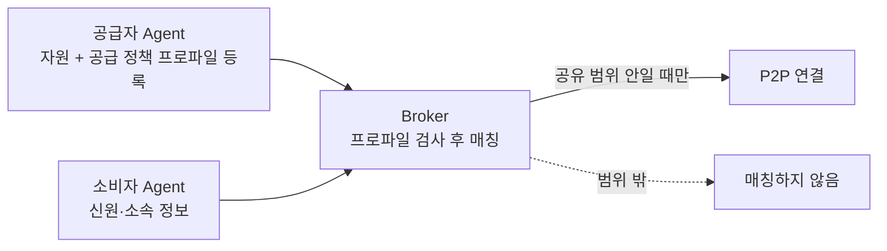
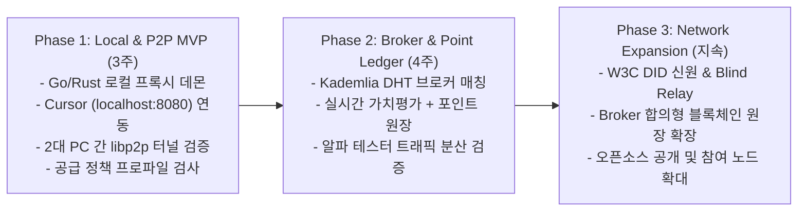

# SUT 기술 실현 가능성 및 공급원 이용 조건 준수 구조

> **검증된 기술의 조합으로 본 실현 가능성과, 모든 공급이 공급원의 이용 조건(업체 약관, 모델 라이선스, 조직 정책)을 따르도록 하는 구조**

---

## 1. 기술적 실현 가능성 분석 (Feasibility Analysis)

SUT 시스템은 완전히 새로운 미지의 기술을 개발하는 것이 아니라, **이미 글로벌 서비스에서 대규모로 검증된 핵심 기술들의 융합(Orchestration)**입니다.

| 핵심 기능 모듈 | 이미 검증된 실서비스 / 오픈소스 레퍼런스 | 기술 실현 가능성 |
| :--- | :--- | :---: |
| **Cursor / IDE 로컬 연동** | **LiteLLM, Ollama, LocalAI, Jan.ai** - `localhost:8080/v1` 로컬 엔드포인트를 통해 이미 수십만 개발자가 Cursor, Continue, Cline과 완벽 연동 사용 중 | **100%** (수십 줄의 프록시 코드로 구현 가능) |
| **유휴 컴퓨팅/대역폭 DePIN** | **Grass (getgrass.io), Bittensor (TAO)** - 개인 PC/노트북의 유휴 자원을 공유하고 토큰으로 정산하는 분산 네트워크 (유저 수백만 명) | **100%** (입증된 비즈니스 & 분산 아키텍처) |
| **P2P 은닉 및 NAT 트래버설** | **libp2p, Tor, NKN, Mysterium Network** - 일반 가정용 공유기(NAT/방화벽) 뒤에서도 99% P2P 홀펀칭 및 Blind 중계 통신 검증 | **100%** |
| **스트리밍 사용량 정산** | **Bitcoin Lightning Network(상태 채널), Hyperledger Fabric(허가형 블록체인)** - 스트리밍 도중 누적 사용량에 마이크로 서명을 교환하고, 최종 영수증을 참여 노드 합의형 원장에 기록 | **100%** |

---

## 2. 공급 전제: 공급원의 이용 조건 준수

> **SUT의 모든 공급은 그 공급원의 이용 조건을 반드시 따른다는 것을 전제로 합니다.** 이용 조건이 허용하는 서비스만 공유하며, 허용하지 않는 서비스는 공급할 수 없습니다. (상세: [시스템 개요 1.3절](system-overview.md))

### 2.1 공급원별 이용 조건

| 공급원 | 따라야 할 이용 조건 | 공유 범위 |
| :--- | :--- | :--- |
| **개인 GPU + 오픈 모델** | 모델 라이선스 (상업적 이용, 사용자 수, 용도 제한 등) | 라이선스가 허용하는 범위에서 공개 공유 |
| **조직 계약 상용 API** | 업체 약관 + 조직 정책 | 같은 조직 구성원에게만 공유 |
| **개인 상용 API 키** | 업체 약관 | 약관이 제3자 제공을 허용하지 않으면 공유 불가 |

- 주요 상용 API 약관은 대체로 **자기 제품을 만들어 자기 사용자에게 제공하는 것은 허용**하지만, **계정 자격증명을 제3자에게 제공하거나 접근권을 재판매·임대하는 것은 제한**합니다. 또 계정에서 일어난 모든 활동의 책임을 키 보유자에게 둡니다. 따라서 상용 API는 조직 안에서 공유하는 것을 기본으로 합니다.
- 각 공급원의 이용 조건은 바뀔 수 있으므로, 공급자는 등록 시점의 최신 조건을 확인해야 합니다.

### 2.2 준수를 위한 구조

1. **공급 정책 프로파일**: 공급자는 자원을 등록할 때 그 자원의 이용 조건에 맞는 공유 범위(공개, 같은 조직만 등)와 허용 용도를 함께 등록합니다.
2. **매칭 전 검사**: Broker는 소비자가 해당 공급원의 공유 범위에 들어가는지 확인한 뒤에만 연결합니다. 예를 들어 조직 계약 API는 소비자의 조직 신원(SSO 등)이 같을 때만 매칭됩니다.
3. **공급자 자원 관리**: 공급자는 일일 공유 한도, 공유 시간대, 허용 모델을 직접 설정해 자신의 사용량과 비용을 관리합니다.
4. **정책 준수 사전 점검**: 공급자 측에서 각 공급원의 이용 정책(콘텐츠 정책 등)에 어긋나는 요청을 사전에 걸러냅니다. (상세: [분쟁 해결 및 공급자 보호](dispute-and-indemnity.md))

---

## 3. 현실적인 3단계 MVP 구현 로드맵

거대한 시스템을 한 번에 구축하기보다 점진적으로 가치를 검증하는 전략입니다.

1. **Phase 1 (P2P 프록시 및 Cursor 연동 검증)**:
   - 복잡한 블록체인은 제외하고, Cursor에서 발생한 요청이 P2P를 통해 공급자 PC의 SUT Agent(로컬 오픈 모델 또는 같은 조직의 API 키)로 릴레이되는 코어 엔진 개발.
2. **Phase 2 (브로커 매칭 및 포인트 원장)**:
   - 분산 브로커를 통한 노드 탐색, 실시간 가치평가 기반 포인트 계산, 양측 서명 영수증의 원장 기록 연동.
3. **Phase 3 (네트워크 확장 및 오픈소스 공개)**:
   - IP 비노출을 위한 Blind Relay, 공급자별 파생 DID, Broker 합의형 블록체인 원장의 참여 노드 확대, 오픈소스 공개.
