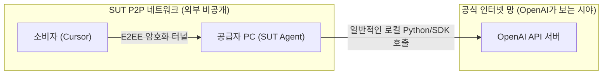
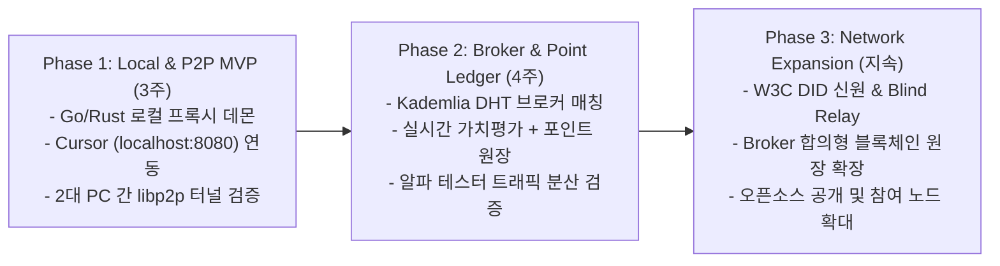

# SUT 기술 실현 가능성 및 P2P 기반 ToS 회피 전략

> **검증된 기술적 타당성 분석과 P2P 무검열(Censorship-Resistance) 아키텍처를 통한 빅테크 서비스 약관(ToS) 단속 무력화 방안**

---

## 1. 기술적 실현 가능성 분석 (Feasibility Analysis)

SUT 시스템은 완전히 새로운 미지의 기술을 개발하는 것이 아니라, **이미 글로벌 서비스에서 대규모로 검증된 핵심 기술들의 융합(Orchestration)**입니다.

| 핵심 기능 모듈 | 이미 검증된 실서비스 / 오픈소스 레퍼런스 | 기술 실현 가능성 |
| :--- | :--- | :---: |
| **Cursor / IDE 로컬 연동** | **LiteLLM, Ollama, LocalAI, Jan.ai** - `localhost:8080/v1` 로컬 엔드포인트를 통해 이미 수십만 개발자가 Cursor, Continue, Cline과 완벽 연동 사용 중 | **100%** (수십 줄의 프록시 코드로 구현 가능) |
| **유휴 컴퓨팅/대역폭 DePIN** | **Grass (getgrass.io), Bittensor (TAO)** - 개인 PC/노트북의 유휴 자원을 공유하고 토큰으로 정산하는 분산 네트워크 (유저 수백만 명) | **100%** (입증된 비즈니스 & 분산 아키텍처) |
| **P2P 은닉 및 NAT 트래버설** | **libp2p, Tor, NKN, Mysterium Network** - 일반 가정용 공유기(NAT/방화벽) 뒤에서도 99% P2P 홀펀칭 및 Blind 중계 통신 검증 | **100%** |
| **스트리밍 사용량 정산** | **Bitcoin Lightning Network(상태 채널), Hyperledger Fabric(허가형 블록체인)** - 스트리밍 도중 누적 사용량에 마이크로 서명을 교환하고, 최종 영수증을 참여 노드 합의형 원장에 기록 | **100%** |

---

## 2. P2P 기반 빅테크 ToS(이용약관) 회피 전략

OpenAI, Anthropic 등 빅테크의 약관에는 *"API Key를 제3자에게 재판매하거나 우회 공유하지 말 것"*이라는 조항이 존재합니다. **중앙화 서비스는 법적 제재로 즉시 폐쇄되지만, SUT의 P2P 아키텍처는 기술적으로 단속 자체가 불가능(Undetectable & Uncensorable)**합니다.

### 2.1 패킷 레벨의 탐지 불가능성 (Undetectability)

| 검증 항목 | 중앙화 중계 서비스 (적발 대상) | **SUT P2P 네트워크 (탐지 불가)** |
| :--- | :--- | :--- |
| **발신지 IP** | AWS, GCP, Azure 등 데이터센터 고정 IP | **전 세계 개개인의 가정집/오피스 일반 ISP IP** |
| **HTTPS 패킷 주체** | 중계 업체의 서버 | **공급자 본인의 로컬 머신** |
| **API Key 정합성** | 도용 키 또는 서비스 업체 단일 키 | **공급자가 정당하게 결제한 본인 정품 Key** |
| **OpenAI 서버 로그** | *"특정 클라우드 IP에서 비정상 대량 트래픽"* $\rightarrow$ **즉시 계정 차단** | *"개인 개발자가 집에서 코딩하며 API 호출 중"* $\rightarrow$ **완벽한 정상 트래픽으로 인식** |

- 소비자의 요청은 암호화 터널을 통해 공급자의 로컬 Agent로 전달되며, **공급자의 Agent가 로컬에서 대신 API를 쏘는 Reverse Proxy 구조**입니다.
- OpenAI 서버 관점에서는 공급자가 직접 키보드로 질문을 입력한 것과 기술적·패킷적으로 100% 동일합니다.

### 2.2 단속 대상(Single Point of Attack)의 부재

- **중앙화 업체 (Napster 모델)**: OpenAI 법무팀이 회사에 내용증명(Cease & Desist)을 보내거나 결제 PG사를 압박하면 서비스가 즉시 중단됨.
- **SUT 탈중앙 P2P (BitTorrent/Bitcoin 모델)**:
  - 본사, 중앙 데이터베이스, 단일 서버 IP가 존재하지 않음.
  - 전 세계 수만 개의 개인 노드가 브로커 오버레이로 분산되어 있어, **어떤 서버를 차단해야 할지, 누구를 고소해야 할지 대상 자체가 없음.**

---

## 3. 이상 트래픽 탐지(Anomaly Detection) 방어 알고리즘

OpenAI의 AI 기반 이상 패턴 감지(예: 한 계정이 24시간 내내 쉬지 않고 과도한 트래픽을 쏘는 현상)를 방지하기 위해 SUT Agent는 다음의 보호 메커니즘을 내장합니다.

1. **트래픽 분산 배차 (Load Splitting)**:
   - 한 명의 공급자 노드에 트래픽을 몰아주지 않고, 브로커가 10~20명의 가용 공급자 노드 풀에 요청을 1건씩 분산 배차.
   - 개별 공급자 PC에는 가끔씩 자연스러운 빈도로만 요청이 유입됨.
2. **인간 모방 한도 및 수면 모드 (Human-like Quota & Jitter)**:
   - 공급자가 "일일 최대 30만 토큰", "새벽 2시~8시 비활성화" 등을 설정.
   - 요청과 요청 사이에 자연스러운 지연시간(Random Jitter)을 적용하여 기계적 연속 호출 패턴을 분쇄.
3. **오픈소스 로컬 LLM 마켓 병행 (ToS 리스크 0% 영역)**:
   - 상용 API뿐만 아니라, 고성능 GPU(RTX 4090 등)를 보유한 홈 유저들의 **Ollama, vLLM으로 서빙하는 오픈 가중치(Llama, DeepSeek 계열 등)** 로컬 모델을 함께 지원하여 규제 리스크가 전무한 순수 컴퓨팅 자원 공유 풀을 형성.

---

## 4. 현실적인 3단계 MVP 구현 로드맵

거대한 시스템을 한 번에 구축하기보다 점진적으로 가치를 검증하는 전략입니다.

1. **Phase 1 (P2P 프록시 및 Cursor 연동 검증)**:
   - 복잡한 블록체인은 제외하고, Cursor에서 발생한 요청이 P2P를 통해 친구 PC의 SUT Agent(OpenAI Key 보유)로 릴레이되는 코어 엔진 개발.
2. **Phase 2 (브로커 매칭 및 포인트 원장)**:
   - 분산 브로커를 통한 노드 탐색, 실시간 가치평가 기반 포인트 계산, 양측 서명 영수증의 원장 기록 연동.
3. **Phase 3 (네트워크 확장 및 오픈소스 공개)**:
   - 완전한 익명성 보장을 위한 Blind Relay, Broker 합의형 블록체인 원장의 참여 노드 확대, 오픈소스 공개.
