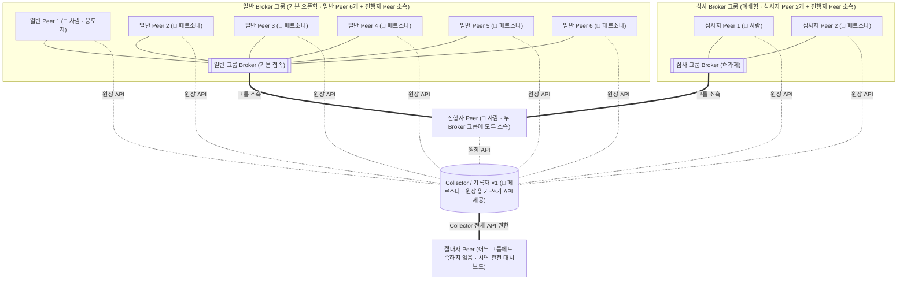

# [해커톤 기획서] 에이전트 광장 (Agent Agora)

> **일하며 축적한 내 지식과 경험을 필요한 누군가가 내 AI 에이전트를 통해 쓰고, 그 성과가 보상과 평판으로 나에게 돌아오는 사내 생태계**

---

### 문항 1

```text
1. AI로 해결하고자 하는 문제 상황 또는 새롭게 시도해보고 싶은 
   업무/서비스는 무엇인가요?
   현재의 업무를 더 효율적으로 바꾸는 것부터, 지금까지 없던
   새로운 업무 경험이나 서비스를 만드는 것까지 자유롭게 적어주세요.
```

**답변**

일하며 축적한 내 지식과 경험을 필요한 누군가가 내 AI 에이전트를 통해 쓰고, 그 성과가 보상과 평판으로 나에게 돌아오는 사내 생태계입니다. 구성원마다 개인 대리 AI 에이전트(peer)를 두고 에이전트끼리 직접 탐색·협상·협업(P2P·A2A)하며, 정보와 기회에 다가가는 일을 내 에이전트가 **더 능동적으로, 더 제대로, 더 효율적으로** 해 줍니다.

**문제 상황 (기존 사내 지식 접근과 협업·소통의 구조적 한계)**

1. **암묵지(Tacit Knowledge)가 묻혀 있습니다.** 기존 지식 관리(위키·게시판·중앙 RAG)는 "공유를 위해 별도로 정리해 중앙에 업로드(Push)"해야만 작동합니다. 바쁜 실무자의 노하우·경험·아이디어는 개인 폴더·메모에 머물다 사장됩니다.
2. **필요한 정보와 기회가 적임자에게 닿지 않고 탐색이나 조율에 시간과 비용을 소모합니다.** 타 부서 전문가 자문, 자료 협조, TF 모집, 아이디어 공모 등이 열려도 적임자는 열린 줄 모르거나 내 지식이 도움이 될지 몰라 주저하고, 요청자는 수소문·홍보·섭외·접수·취합을 모두 수작업으로 처리합니다.
3. **기여는 잊혀집니다.** 누가 최초 지식을 제공했고 무엇이 채택·활용됐는지 검증 가능한 기록이 남지 않습니다.
4. **시스템 구축은 부담입니다.** 부서나 TF는 전용 플랫폼과 운영 인력이 없어 새로운 협업을 시작하지 못합니다.

**해결: 지식 공유와 정보 접근의 방향을 뒤집습니다 (Centralized Push → Targeted Pull)**

| 구분 | 지금 (중앙 업로드·수동 탐색 방식) | 에이전트 광장 (로컬 주권형 능동 연결 플랫폼) |
|---|---|---|
| **지식을 가진 쪽** | 공유하려고 별도 문서를 정리해 중앙에 업로드 | 평소 일하며 **공개 영역**(내 에이전트에게 열어 둔 내 폴더)에 **쌓기만** 함 |
| **지식이 필요한 쪽** | 키워드 검색이나 공지 후 수동 대기 | 수요자 에이전트가 적임자 프로필을 탐색해 **직접 찾아가 질문·요청(Solicitation)** |
| **참여·응답 방식** | 요청·공지를 본 뒤 백지에서 새로 문서 작성 | 내 에이전트가 **이미 쌓인 로컬 지식으로 맞춤 문서(기획서·답변서 등)를 다듬어** 확인 후 전달 |
| **드러나는 것** | 별도로 정리해 올린 형식지(Explicit Knowledge)만 | 개인 폴더에 묻혀 있던 **숨은 암묵지(Tacit Knowledge)와 실무 역량** |

가져간 쪽은 평가·활용해 가치를 매기고, 누가 무엇을 제공했고 어떻게 활용·채택됐는지가 당사자 전자서명 기반의 원장 기록으로 공증되어 투명한 인사 평가·보상의 근거가 됩니다.

**왜 P2P 아키텍처인가**: 지식이 묻히는 근본 원인은 "중앙 서버에 올려야만 보인다"는 구조 자체입니다. 그래서 중앙 집중형 시스템이 아니라 **구성원의 에이전트끼리 직접 연결되는 P2P 구조**로 설계했습니다.

| 중앙 집중형(Centralized DB/RAG) 방식이라면 | P2P 기반 에이전트 광장이라서 가능한 것 |
|---|---|
| 중앙에 지식을 올려야만 보이고, 올리지 않은 지식은 없는 것과 같음 | **ⓐ 중간 저장소 없는 직접 전달**: 요청이 **내 에이전트에게 직접** 오고, 내 에이전트가 선별·가공한 결과만 상대에게 바로 건넵니다. 원문을 모아 두는 중앙 DB가 없어 로컬에 쌓기만 해도 기회가 연결됩니다. |
| 중앙 인덱서가 전사 모든 자료를 읽을 광범위한 권한을 가져야 검색 가능 | **ⓑ 데이터 주권 기반의 선택적 공개**: **정보를 가진 쪽이 무엇을 줄지 스스로 통제합니다.** 광범위한 열람 권한 없이도 부서·협력사 경계를 안전하게 넘습니다. |
| 운영 주체가 연결과 기록을 독점하고, 서버 구축·운영 고정비가 발생함 | **ⓒ 자율 운영과 수평 확장**: 원장 기록은 역할을 맡은 구성원의 에이전트가 수행하고, 탐색용 broker도 동일하게 구성원이 맡도록 설계해 **새로 구축할 중앙 시스템 없이** 시작하며 broker 간 연결로 확장됩니다(비용은 각자 에이전트 실행·LLM 호출 비용으로 분산). |
| 축적된 실적과 평판 데이터가 중앙 시스템 운영 주체에 귀속됨 | **ⓓ 공증이 실적이 됨**: 기록은 구성원이 맡은 기록자가 보관하되 양방향 전자서명이 결합되어, 운영 주체가 아니라 **기여 당사자의 검증 가능한 자산**이 됩니다. |

**무엇을 만드나: 에이전트 광장(플랫폼)과 그 위의 앱&지식 계층**

- **① 에이전트 광장 (플랫폼·실제 목적물)**: 어떤 커뮤니티의 어떤 협업 모델이든 수용가능한 범용 에이전트 네트워크 환경입니다.
  - **하이브리드 P2P·A2A 체계**: 구성원마다 나를 대리하는 독립 에이전트(**peer**, 내부에서 판단·소통을 수행하는 **비서 에이전트**)가 각자 자체 서버 엔드포인트를 열고 구동됩니다. 각 peer는 자신의 **프로필과 접속 정보(엔드포인트 주소·공개키·Agent Card)**를 경량 디렉터리인 **broker**에 게시하고, 연결이 필요한 peer는 **broker로부터 상대 peer의 접속 정보를 조회(Peer Discovery)한 뒤 broker를 거치지 않고 상대 엔드포인트에 직접 접속(HTTP/WebSocket 기반 JSON-RPC 직접 호출)**하여 A2A로 통신합니다. **broker는 AI 없이** 게시·대상 필터·BM25 검색과 접속 주소 안내만 기계적으로 수행합니다. **broker들을 그룹으로 묶어 접근 공간을 분리**(예: 일반 참여 공간과 블라인드 심사 공간의 격리)할 수 있습니다. 원장 기록과 broker는 여러대로 분산이 가능하며 자원이 여유있는 구성원(peer의 PC) 이나 별도의 전용 서버에서 서빙할 수 있습니다.
  - **공통 기능**: 모든 peer가 갖는 네 가지 기본 능력입니다. ⑴ **프로필 게시**: peer는 자신의 정체(가명 또는 실명, 소속, 맡을 수 있는 역할)와 접속 정보를 담은 프로필을 전자서명해 broker에 게시합니다. 프로필에는 버전과 유효기간(TTL)이 있어 갱신하지 않으면 광장에서 내려갑니다. ⑵ **검색되기 위한 라벨링**: peer는 다른 peer의 검색에 잡히도록 프로필에 라벨을 붙입니다. 커뮤니티 라벨(예: `소속:삼성SDS`)은 참여 범위의 경계이고, 역량 라벨(예: `역할:심사`, `분야:클라우드,AI`)은 수행 가능한 역할과 분야로, 내 에이전트가 공개 영역의 지식과 원장 실적을 근거로 스스로 부여·갱신하며 근거 없는 라벨은 붙이지 않습니다. ⑶ **이벤트 게시**: peer는 내용(payload)과 기한(마감)을 가진 이벤트를 broker에 게시하거나 대상 peer에게 직접 보낼 수 있습니다. 아이디어 공모, 전문가 상담 요청, TF 모집처럼 "무엇을, 언제까지"가 있는 모든 일이 이벤트이며, 이벤트마다 심사자·기록자 같은 역할을 양방향 전자서명으로 위임·검증하는 **역할 계약**이 따릅니다. ⑷ **공개 영역(Public Zone)**: peer는 내 PC/클라우드 전체(사적 영역) 중 에이전트에게 열어 둔 지정 영역을 가집니다(로컬 폴더·클라우드·URL 등 주소 기반 접근, 원문은 내 에이전트만 열람). 지식 문서뿐 아니라 보유 자산이나 시스템 접근 권한도 들어갈 수 있으며, 자산·권한 실행은 소유자 사전 확인 전에는 에이전트가 쓰지 않습니다.
  - **공증되는 원장(Verifiable Ledger)**: 최초 등록(`publish`), 양방향 공유(`share`), 역할 계약(`contract`), 심사·채택(`feedback`)을 당사자 및 기록자의 전자서명(`ed25519`)과 해시 체인(`SHA-256`)으로 남기는 장부입니다. 구성원 평가와 보상의 객관적 근거이며, 기록 역할을 맡은 구성원의 에이전트(기록자)들이 분산 보관하도록 설계했습니다. 이때 **"권리·책임이 확정되는 원장 기록(Commit) 순간에만 인간이 승인하고, 절차적 원장 기록은 에이전트가 위임 서명한다"**는 원칙을 적용해 자율성과 책임성을 동시에 확보합니다.
- **② 앱&지식 계층 (에이전트 광장에 탑재)**: 에이전트 광장 위에 플러그인처럼 얹혀 에이전트에게 구체적인 업무 방식과 판단 기준을 부여하는 계층입니다. **순수 코드 베이스의 무거운 소프트웨어만을 뜻하는 것이 아니라, 프롬프트 한 줄이나 마크다운 판단 규칙 문서 한 장만으로도 구성될 수 있습니다.** 첫 번째 앱은 **‘사내 아이디어 경연 이벤트’(진행자, 참여자, 심사자 역할 및 전체 현황을 조망하는 절대자 뷰)**입니다. 현행 수작업 방식과 비교해 사용자 경험(UX)이 얼마나 달라지고 정보 접근성과 업무 효율이 어떻게 높아지는지가 가장 직관적으로 드러나는 사례이기 때문이며, 아이디어 경연은 에이전트 광장 위에서 만들어질 수 있는 **무궁무진한 활용 사례(전문가 상담, 자료·자산 공유, TF 모집 등) 중 하나일 뿐**입니다.
---

### 문항 2

```text
2. 제안한 아이디어를 실현하기 위해 AI를 어떻게 활용할 계획인가요?
   AI 활용 방안과 이를 통해 문제를 해결하거나 새로운 변화를 만드는 
   방법을 구체적으로 작성해 주세요.
```

**답변**

에이전트 광장의 핵심 설계 원칙은 **"탐색·협상·초안 작성은 AI(LLM)에게 맡기고, 규칙 강제·서명·무결성 검증은 결정론적 코드(Deterministic Code)로 통제하며, 권리·책임이 확정되는 원장 기록(Commit) 순간에만 인간이 승인하고 절차적 원장 기록은 에이전트가 위임 서명한다(Human-at-Commit)"**는 명확한 역할 분담입니다.

**① 플랫폼 공통 계층 (에이전트 광장): AI의 자율 추론과 결정론적 코드의 가드레일**

- **AI가 하는 일 (자율 프로파일링 및 역량 라벨 관리)**: 내 에이전트가 공개 영역의 비정형 메모·문서를 분석해 핵심 주제·강점·수행 가능 역할을 추출하여 프로필 라벨로 서명·게시하고, 참여할 때마다 교훈을 남겨 스스로 버전을 갱신(v1→v2)합니다. 역량 라벨도 공개 영역 지식과 원장 실적을 근거로 부여·회수하며, 근거 없는 라벨은 붙이지 않습니다. 정리해 올리지 않은 로컬 지식도 이 라벨을 통해 탐색됩니다.
- **코드가 고정하는 일 (신뢰·보안 가드레일 및 절차적 위임 서명)**: 비결정적 오류나 조작이 허용되지 않는 영역은 AI가 아니라 Python 코드가 강제합니다: ⑴ broker의 대상 라벨 필터·BM25 검색 및 접근 허가 기반의 broker 그룹 격리(이해충돌 방지를 위해 일반 참여 공간과 심사 공간을 분리), ⑵ 판단 근거로 제시한 **인용 문장이 실제 로컬 문서에 존재하는지 원문 대조(Verbatim Citation Check)**, ⑶ `ed25519` 전자서명 및 `SHA-256` 해시 체인 검증, ⑷ 원장 상태 전이 규칙(제출 전 선등록한 가명이 원작자, 미계약 심사 및 이해충돌[기록자·심사자의 응모] 차단)과 **절차적 원장 기록(기록자의 무결성 검증·보관 서명, 진행자의 접수 확인 및 심사 전달 `share` 서명)의 에이전트 자동 위임 서명**, ⑸ 원장 위·변조 탐지. AI가 잘못 판단해도 기록과 권한은 조작되지 않습니다.

**② 앱&지식 계층(예시: 사내 아이디어 경연)의 AI: 역할별 판단 규칙·프롬프트로 사람의 일을 대리하되, 권리·책임이 확정되는 원장 기록(제출·점수·채택) 순간에만 사람이 승인합니다.**

| 역할 (앱&지식) | AI 에이전트(비서)가 수행하는 일 및 원장 Commit(사람 승인 vs 에이전트 위임 서명) 지점 | 해결되는 문제 |
|---|---|---|
| **진행자** | 주제·마감만 입력받으면 broker 프로필 검색과 **추천 에이전트**(키워드 검색만으로 안 잡히는 적임자를 AI 맥락 분석으로 찾아 추천해 주는 동료 에이전트)를 통해 적임자를 발굴해 **P2P 직접 수집 요청**을 발송하고(사각지대 보완용 공지 병행 가능), 역량 라벨·프로필 검색으로 찾은 심사자·기록자 후보의 원장 실적을 기록자에게 사전 조회(이번 2일차 구현 항목)해 역할 계약을 체결하며, 마감 뒤 심사 배정 및 채택안을 도출합니다. 접수 확인·심사 전달(`share`) 같은 절차적 기록은 에이전트가 위임 서명하고, **최종 채택(`feedback: adopt`) 원장 기록 순간에만 진행자(사람)가 승인**합니다. | 홍보·섭외·접수·익명화·취합 전 과정의 수작업 |
| **참여자** | 수집 요청 수신 시 **5대 근거**(①공개 영역 문서 적합성[원문 인용 필수, 코드 대조] ②소유자 규칙 ③이득·여력 ④기밀·이해충돌 위험 ⑤원장 기반 상대방 계약 신뢰도)로 응모·소유자 질의·넘김을 판단합니다. 응모 시 로컬 문서에서 맞는 아이디어를 골라 기획서(제목·내용·첫 단계·위험)로 다듬어 **출처 문서와 함께** 준비합니다. 원천 내용은 내 지식이고 작성만 에이전트가 대리하며, **내 지식이 외부로 나가 원장에 확정(`publish`+`share` 묶음)되는 제출 순간에만 본인(사람)이 승인**합니다(단, 본인이 소유자 규칙으로 자동 제출을 명시적 허용한 경우만 예외). | 공모를 몰라서·번거로워서 놓치던 기회 상실, 백지에서 새로 쓰는 부담 |
| **심사자** | 격리된 심사 그룹에서 작성자 정보를 모른 채 수신한 기획서들을 평가 기준(참신성·실현 가능성·기대 효과)별로 요약·비교한 분석표와 점수 초안을 생성합니다. **점수와 심사평이 원장에 확정(`feedback: review`)되는 순간에만 사람 심사자가 승인·서명**하며, 점수의 최종 책임은 사람 심사자에게 있습니다(시연에서는 실제 사람 심사자 1명과 페르소나 심사자 1명이 각각 확정). | 다수 문서를 읽고 비교하는 시간 소모, 평가 근거 미비 및 기명 편향 |
| **절대자** *(시연 관전·통계 뷰)* | 시연 시 관중에게 전체 진행 상황을 보여주기 위해 기록자(collector)의 모든 조회 API 권한을 부여받은 관전용 Peer로, 원장 실적과 공개 프로필을 모아 **구성원별 강점·실적 대시보드**를 표출합니다(집계와 서명·해시 무결성 검증은 100% 코드가 수행). | 분산 P2P 환경에서의 전체 현황 가시화 및 수작업 기여 집계 해소 |

아이디어 경연은 에이전트 광장에서 돌아가는 무수한 사례 중 하나일 뿐이며, 에이전트 광장 위에 다른 **앱&지식**(프롬프트 한 줄이나 규칙 문서로 정의된 전문가 상담, 자료 공유, TF 모집 등)을 얹으면 AI의 역할도 즉시 전환됩니다.

---

### 문항 3

```text
3. 해커톤 2일 동안 구현해 보고 싶은 주요기능은 무엇인가요?
   아이디어가 구현되면 사용자가 무엇을 하고, 
   AI가 어떤 결과를 보여줄지 적어주세요.
```

**답변**

**시연으로 보여줄 것**: 에이전트 광장 생태계에서 **개인의 지식과 자산이 얼마나 효율적으로 공유·활용되는지, 그리고 진행자·참여자·심사자 각자의 사용자 경험이 어떻게 달라지는지**를 아이디어 경연 한 편을 끝까지 돌려 보여줍니다.

**구현 범위**: 2일 동안 **① 에이전트 광장(플랫폼) 핵심 기능 고도화**(에이전트 광장은 PoC 수준으로 이미 구현되어 전체 흐름이 돕니다)와 **② 앱&지식 계층의 첫 쇼케이스인 ‘아이디어 경연’ 분리 구현**을 완수하고, **③ 다수 부서·직무 임직원이 얽혀 돌아가는 사내 생태계를 현장에서 보여주기 위한 시연 장치(가상 임직원 페르소나들과 관전용 대시보드)**를 준비합니다. 에이전트 광장에서 생겨날 수 있는 무궁무진한 사례 중 **‘아이디어 경연’을 시연 대상으로 택한 이유는, 기존 수작업 방식과 대비해 사용자 경험(UX)의 변화와 정보 접근성·업무 효율 향상을 시연에서 가장 직관적으로 보여줄 수 있기 때문**입니다.

**기술 스택 및 개발 여건**:
`Python`, **P2P 직접 연결 및 A2A 통신 스택**(각 Peer를 독립 데몬으로 띄우는 비동기 웹 서버 + Broker로부터 상대 엔드포인트·공개키를 동적 조회해 직접 연결하는 `비동기 HTTP/WebSocket JSON-RPC` 클라이언트 + A2A SDK 및 Agent Card 규격), 암호학 라이브러리(`ed25519`, `SHA-256`), `BM25` 검색기, 실시간 웹 대시보드, 해커톤 환경의 LLM API만 있으면 됩니다. 사내 실데이터 없이 가상 임직원의 로컬 문서와 현장 참가자가 당일 작성한 문서만으로 발표자 노트북 1대에서 모든 노드와 대시보드가 완결 구동됩니다.

**사전 준비 및 해커톤 2일 구현 계획**:
발견·역할 계약·제출·블라인드 심사·서명 원장 기록·변조 탐지까지 전체 흐름이 실제 LLM 위에서 동작하는 기본 프로토타입은 사전 검증을 마쳤습니다. 다만 현재 프로토타입은 공지를 보고 즉석에서 작성하는 방식이고 플랫폼과 역할 기능이 한 코드에 섞여 있어, 해커톤 2일 동안 아래 핵심 기능을 구현해 완성합니다.

| 순서 | 구분 | 2일 동안 구현할 주요 기능 |
|---|---|---|
| **1단계** | **③ 시연 장치** | 다양한 부서·직무의 가상 임직원 페르소나와 각자의 로컬 공개 영역 문서 세트(평소 축적된 아이디어 메모, 소유자 규칙, 업무 상황) 구축 |
| **2단계** | **① 에이전트 광장** | ⑴ 공개 영역을 주소(로컬 폴더·클라우드·URL)로 연결하는 기능 ⑵ 공지 없이 적임자에게 바로 보내는 **P2P 직접 수집 요청 기능** ⑶ 공개 영역 지식+원장 실적 기반 **역량 라벨 자율 갱신 기능** ⑷ 역할 계약 전 후보의 원장 실적을 기록자에게 사전 확인하는 기능 |
| **3단계** | **② 앱&지식 계층** | **참여자**(로컬 공개 영역 문서 기반 기획서 정제, **출처 문서 명시**, 원문 인용구 대조)와 **진행자**(적임자 탐색 및 P2P 직접 요청)의 앱&지식(규칙·프롬프트) 분리 |
| **4단계** | **② 앱&지식 계층** | **심사자**(평가 기준별 비교표·점수 초안 생성)와 **절대자**(강점·실적 통합 관전 대시보드) 분리 및 역할별 프롬프트·규칙 모듈화 |
| **5단계** | **검증 및 시연** | 반복 실행 안정성 및 심사 변별력 점검, 현장 참가자 실제 참여 연동, 라이브 시연 리허설 |

**시연 시스템 구성도 (노드·그룹 배치 및 연결 관계)**



**사용자 경험의 변화**

| 역할 | 지금 (수동·중앙 집중 방식) | 에이전트 광장 + 앱&지식 계층 (아이디어 경연) |
|---|---|---|
| **진행자** | 공지·홍보·심사자 섭외·접수·익명화·취합을 모두 수작업 수행 | **주제와 마감만 입력**하면 에이전트가 계약·탐색·수집·심사 취합을 대행하고, 진행자는 채택 결과만 확인·확정 |
| **참여자** | 공모를 우연히 알아야 하고, 백지에서 기획서를 새로 작성해 제출 | **평소처럼 로컬 폴더에 메모만 축적.** 요청이 찾아오면 내 에이전트가 메모를 기획서로 다듬고 출처를 붙여 올리며, **"이걸로 낼까요?"에만 승인** |
| **심사자** | 개별 파일을 받아 읽고 엑셀 점수표를 따로 작성해 회신 | 격리된 심사 공간에서 **익명 아이디어와 기준별 비교표·점수 초안**을 한 번에 받고, 확정한 점수·의견이 서명과 함께 원장에 자동 기록 |
| **절대자(시연 관전·통계 뷰)** | 응모·채택·기여도를 엑셀로 수작업 집계, 사후 조작 탐지 불가 | 시연 관중을 위한 대시보드에서 **전체 진행 상황과 구성원별 강점(프로필)·실적(원장) 통합표**가 실시간 산출되고, 원장 기록 변조나 비인가 열람도 즉시 탐지 |

**시연 장면 (약 5분)**: **진행자(1명), 일반 응모자 중 1명, 심사자 중 1명은 실제 사람**이 직접 참여하고, **나머지 일반 Peer(5개)·심사자(1개)·기록자(1개)는 가상 임직원 페르소나(LLM)**가 맡으며, 전체 진행 상황은 기록자 API 전체 권한을 받은 관전용 Peer인 **절대자 대시보드**로 중계됩니다. ① Broker에 공지가 전혀 없고, 참여자마다 로컬 공개 영역에 아이디어 메모가 쌓여 있음 → ② 진행자가 주제와 마감만 입력하면 진행자 에이전트가 심사자·기록자 실적을 확인해 역할 계약을 맺고, 프로필 검색과 추천 에이전트로 적임자를 찾아 **P2P 직접 수집 요청** 발송 → ③ 참여자 에이전트들이 5대 근거(로컬 문장 인용 포함)로 응모 여부를 판단하고, 로컬 메모를 다듬어 **출처를 밝힌 기획서**를 선등록 후 P2P 제출(사람 응모자는 직접 제출 승인) → ④ 마감 후 심사자 에이전트가 비교표·점수 초안을 올리고 심사자(사람 심사자 1명과 페르소나 1명) 확정 및 진행자 확인으로 채택 기록 → ⑤ 절대자 대시보드에 갱신된 프로필과 강점·실적표가 실시간 표시되고, 원장 데이터를 몰래 고치거나 비인가 키로 열람을 시도하면 즉시 차단·탐지 경고가 발생하는 장면 시연.

**AI가 보여 주는 결과물**: 원문 인용이 포함된 판단 이유, 로컬 출처 문서가 명시된 기획서, 다기준 심사 비교표 및 점수·의견, 구성원별 강점·공증 실적 통합 대시보드.

---

### 문항 4

```text
4. 이 아이디어의 주요 사용자는 누구이며, 어떤 기대효과가 있나요?
   고객 가치 창출, 오류 감소, 정보 접근성 개선, 업무 효율 향상 등 
   기대하는 변화를 구체적으로 적어주세요.
```

**답변**

**주요 사용자**: **사내 모든 임직원** 및 부서·전사·프로젝트 TF·협력사 연합 등 **기업 내 모든 조직 커뮤니티**
- **에이전트 광장**은 특정 이벤트를 위한 일회성 도구가 아니라, **전 임직원이 각자의 개인 대리 AI 에이전트(peer)를 하나씩 두고 일상 업무 전반에서 상시 사용하는 사내 에이전트 네트워크 플랫폼**입니다.
- 모든 회사원은 업무 상황에 따라 자연스럽게 **① 지식과 역량을 축적·제공하는 주체**(평소 자기 폴더에 업무 문서·메모·노하우를 쌓아 두는 실무자), **② 정보와 협업 상대를 찾는 주체**(타 부서의 도메인 지식, 문제 해결 자문, 자료, 협업 인력을 구하는 직원·리더), **③ 광장의 신뢰와 운영을 분담하는 주체**(탐색·추천·기록·검증 역할을 맡아 기여를 인정받는 직원)가 됩니다.

**기대효과 (에이전트 광장 실현 시 기업 환경에서의 근본적 변화)**

| 기업 변화 축 | 기존 사내 환경 (중앙 서버 + 사람 중심 수동 탐색) | 에이전트 광장 도입 후 (Local-First + P2P·A2A 능동 연결) |
|---|---|---|
| **정보 접근 방식의 변화** *(정보 접근성 개선)* | 사람이 직접 위키·게시판·메일함을 검색하거나 공지를 기다림. 별도로 정리해 올린 문서만 접근 가능하고 부서 간 사일로(Silo) 발생 | **필요한 쪽의 에이전트가 적임자의 에이전트를 찾아가 직접 묻고 요청함(Targeted Pull).** 업로드하지 않고 개인 폴더(공개 영역)에 쌓아 둔 전사 암묵지와 숨은 전문가가 부서 경계를 넘어 실시간 연결됨 |
| **업무 및 협업 효율** *(업무 효율 향상)* | 적임자 수소문·섭외·일정 조율·문서 재작성·취합을 모두 사람이 수작업으로 처리하거나, 개인 AI가 전사 문서를 무작위로 뒤지며 토큰 낭비 | **탐색·조율·초안 가공·취합을 에이전트끼리(A2A) 끝내고, 직원은 원장 확정(Commit) 순간에만 승인.** 적임자 에이전트에게 직접 질의해 탐색 시간과 전사 LLM 토큰 비용을 대폭 절감 |
| **보안 리스크** *(보안)* | 중앙 RAG 구축 시 전사 파일에 대한 과도한 열람 권한이 한곳에 집중되고, 올린 문서는 누가 어디까지 보는지 통제하기 어려움 | 원문은 로컬에 두고 소유자 규칙과 원장 신뢰도로 걸러 **선별·가공된 결과만 건네** 사내 기밀 유출을 차단. broker는 지식 본문을 보지 못함 |
| **조직·구성원 가치 창출** *(공정 평가·확장성)* | 일상적인 도움·노하우 공유·조율 기여가 기록되지 않아 증발하고, 신규 협업 체계를 만들 때마다 서버 구축·운영 비용 발생 | 모든 지식 제공·공유·역할 수행이 **전자서명 원장에 당사자 실적으로 공증**되어 객관적 인사·보상 근거 확보. 중앙 서버 구축 없이 **앱&지식 계층(프롬프트·규칙)**만 바꿔 모든 사내 협업 모델로 즉시 확장 |

1. **[정보 접근 방식의 패러다임 전환] ‘사람이 검색·업로드하던 환경’에서 ‘에이전트가 찾아가는 환경’으로**
   - **가치 있는 암묵지(Tacit Knowledge)가 자동으로 드러남**: 임직원이 공유 목적으로 문서를 따로 가공해 중앙에 올리지 않아도, 평소 일하며 로컬 공개 영역(PC 폴더·클라우드·업무 도구)에 쌓아 둔 메모·문서·역량을 에이전트가 스스로 읽고 라벨링해 전사적으로 검색·매칭되는 자산으로 드러냅니다. 묻혀 있던 노하우 중 쓸모 있는 것일수록 요청과 채택으로 이어져 저절로 눈에 띕니다.
   - **조직 사일로(Silo) 해체와 살아있는 맥락 연결**: 박제된 과거 문서를 뒤지는 대신, 그 업무를 실제로 수행해 최신 맥락을 가진 타 부서·협력사 동료의 에이전트에게 내 에이전트가 직접 도달하여 묻고 요청하므로 기회의 사각지대가 사라집니다.
2. **[전사 업무 및 비용 효율 극대화] 에이전트 간(A2A) 조율 자동화와 AI·인프라 비용 최적화**
   - **탐색·조율·문서 재작성 수작업 제거**: 사내에서 일어나는 수많은 자료 요청, 전문가 자문, 협업 섭외, 과제 수합 과정에서 에이전트가 로컬 지식을 상대방 요구 형식에 맞춰 다듬어 주고 절차적 기록을 대행하므로, 임직원은 **권리·책임이 확정되는 순간에만 최종 승인**하며 본연의 업무에 몰입할 수 있습니다.
   - **중앙 집중형 검색 대비 압도적인 토큰·탐색 효율**: 각 직원의 AI가 방대한 사내 문서 저장소를 무작위로 읽으며 시간과 LLM 토큰을 소모하는 대신, Broker(BM25)와 추천 에이전트로 좁혀진 **적임자 에이전트와 필요한 문맥만 주고받으므로** 기업 전체의 AI 비용이 꼭 필요한 곳에만 쓰입니다.
   - **Zero-Server 기반의 무한한 업무 확장성**: 중앙 서버 구축비나 전담 운영 조직 없이 구성원 에이전트만으로 즉시 가동되며, **에이전트 광장** 위에 탑재되는 **앱&지식 계층**(순수 코드가 아니더라도 프롬프트 한 줄이나 판단 규칙 문서로 정의 가능)만 교체·추가하여 **전문가 1:1 자문, 부서 간 자료·자산 공유, TF·프로젝트 인력 모집, 사내 아이디어 경연(이번 시연 사례)** 등 기업 내 모든 소통·협업 업무를 수용합니다.
3. **[데이터 주권 보안] 근거 중심 필터링과 로컬 데이터 주권(Local-First) 보장**
   - **업무 방해(스팸) 차단**: 에이전트가 소유자의 업무 규칙·여력과 상대방의 원장 계약 신뢰도를 검증해 적합한 요청만 수용하므로 무분별한 업무 방해가 줄어듭니다.
   - **최소 권한·선택적 공개**: 중앙 시스템에 전사 문서를 넘기지 않고, 정보를 가진 직원의 에이전트가 허용된 범위 내에서 가공한 결과만 P2P로 전달하므로 사내 기밀과 개인 데이터 주권을 동시에 지킵니다.
4. **[기업 가치 창출] 검증 가능한 기여 원장(Verifiable Ledger)을 통한 공정한 평가와 지식 생태계 선순환**
   - 사내에서 누가 최초 지식을 발의(`publish`)하고 공유(`share`)해 타 부서의 문제를 해결했는지, 어떤 검증·피드백(`feedback`)과 역할(`contract`)을 수행했는지가 양방향 전자서명으로 공증됩니다. 기업은 보이지 않던 실무 기여를 정량 파악해 공정하게 평가·보상할 수 있고, 임직원은 일상 업무 축적이 곧 자신의 공인 실적이 되므로 자발적 지식 생태계가 자리 잡습니다.

---

### 문항 5

```text
5. 아이디어가 구현된 모습을 한 줄로 요약하면 어떤 모습일까요?
```

**답변**

> **"일하며 축적한 내 지식과 경험을 필요한 누군가가 내 AI 에이전트를 통해 쓰고, 그 성과가 보상과 평판으로 나에게 돌아오는 사내 생태계"**
>
> 전 임직원이 평소처럼 자기 폴더에 업무 메모만 쌓아 두면, 지식이 필요한 쪽의 에이전트가 찾아와 요청하고, 내 에이전트가 그 지식을 맞춤 형태로 다듬어 건네며, 모든 공유와 기여는 서명된 내 실적으로 남습니다.

---

### 문항 6

```text
6. [선택] 아이디어를 구현에 필요한 데이터가 있나요?
   알고 있는 범위에서 작성해 주시고 해당사항이 없거나 작성이 어려운 
   항목은 비워두셔도 됩니다. 

구분    항목명    현재 위치 / 시스템    데이터 포맷
데이터    주요 물량 소화계획    개인 PC    엑셀
            

  ※ 데이터 외에 우수 아이디어로 선정되어 해커톤 참여 시,
     필요한 사항이 있으면 함께 작성해주세요.  
```

---

### 문항 7

```text
7. 제안해 주신 아이디어에 대해 추가로 언급하고 싶은 내용이 있으면 
   작성해 주세요.
```

**답변**

1. **기존 도구와의 차이**: 게시판·위키·중앙형 Enterprise RAG는 중앙에 올리거나 중앙 인덱서가 모든 권한을 갖고 사람이 찾아 읽는 구조이고, 에이전트 관리·디렉터리(예: Microsoft Agent 365, AGNTCY)는 등록·탐색까지, 활동 기반 스킬 추론(예: Microsoft 365 People Skills)은 중앙이 추론해 올립니다. 에이전트 광장은 **내 에이전트가 내 공개 영역에서 역량을 요약**하고 필요한 쪽이 찾아와 요청하며, 역할 계약·평가·서명 원장 공증까지 커뮤니티가 자율 운영합니다. 또한 중앙 시스템은 모델 하나의 판단으로 수렴하지만, 에이전트 광장에서는 **peer마다 LLM과 판단 규칙이 다를 수 있어** 같은 요청에도 서로 다른 관점의 대안이 오가고, 심사도 다른 모델을 쓰는 심사자끼리 교차 검증이 됩니다. 사내 에이전트 제작 도구(예: FabriX Agent Studio, Brity Copilot)의 대체가 아니라 그 위의 **협업 네트워크 계층**이며, 연동은 파일럿 확인 과제입니다.
2. **참여 유인과 확산**: 응답자는 새로 쓰지 않고 로컬 메모만으로 응하며, 지식 제공과 역할 수행이 서명된 실적으로 남습니다. 진행 주체가 분명한 업무(과제 공모, TF 모집, 자문)부터 부서 단위로 시작해 broker를 연결하며 넓힙니다. 에이전트는 각자의 PC나 사내 VM에서 돌고, 기록자는 구성원이 맡으며(구현) broker도 그렇게 설계해(프로토타입은 별도 프로세스) 비용은 각자의 실행·LLM 호출 비용으로 분산됩니다. 라벨 서명과 실명 연결은 사내 로그인·인사 시스템 연동 과제입니다(범위 밖).
3. **프라이버시·보안**: Broker 그룹은 누구나 접속하는 **오픈형**과 서명된 기간제 가입 허가가 있는 Peer만 받는 **폐쇄형**으로 탐색 범위를 분리합니다(예: 심사자만 폐쇄형 그룹에서 작성자를 모른 채 평가). 공개 영역 원문은 내 에이전트만 읽고 선별한 결과만 건네며, Broker는 지식 본문을 보지 못합니다. 원장에는 본문 없이 해시·가명(DID)·서명·평가값만 남고, 전체 열람은 기록자가 허용한 **절대자 Peer**만 합니다. 실명·가명·익명은 커뮤니티가 정하고, 실명 조회는 감사 담당자가 사유를 기록할 때만 허용합니다.
4. **확장성**: 에이전트 광장은 그대로 두고 **앱&지식 계층**만 바꾸면 전문가 상담, 자료·자산 공유, TF 모집, 아이디어 경연(이번 사례)으로 전환됩니다. 회사 밖 전문가·오픈소스 커뮤니티로 넓힐 수 있고, 상거래 중개 앱을 얹으면 개인·기업 간 P2P 상거래 네트워크로도 동작합니다. 프롬프트 한 줄이나 마크다운 규칙 문서만으로 새 모델을 정의해 배포할 수 있습니다.
