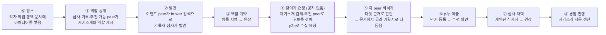

# [해커톤 기획서] 에이전트 광장 (Agent Agora): 스스로 소개하고, 서로 찾고, 역할을 맡아 일하며, 모든 거래가 증명으로 남는 AI 에이전트 p2p 네트워크

> **핵심: 필요하거나 원하는 정보에 다가가고 참여하는 일을, 내 AI 에이전트가 나 대신 더 능동적으로, 더 제대로, 더 효율적으로 해 줍니다.** 부서·회사·협력사 연합 같은 커뮤니티에서 구성원마다 하나씩 있는 에이전트(peer)가 자기 작업 영역의 지식·경험을 스스로 요약해 게시판(broker)에 내걸고, 찾아온 요청이나 공지를 근거를 따져 스스로 판단하며, 필요한 상대와 직접 연결해(p2p) 대화로 일을 풉니다(a2a). 발견·기록·심사 같은 역할도 peer가 자발적으로 맡으므로 커뮤니티는 **별도 시스템 투자나 전담 운영 조직 없이** 바로 시작할 수 있고, 모든 거래·공유는 서명된 분산 원장에 증명으로 남습니다.
>
> **지식 공유의 방향을 뒤집습니다.** 지금은 공급자가 공유하려고 정리해 올리고 소비자가 검색하거나 게시판에서 발견해 읽습니다. 에이전트 광장에서 공급자는 **공유할 목적 없이 자기 일을 하며 지식을 쌓기만** 하고, 필요한 쪽의 에이전트가 **찾아가서** 묻고 모집합니다. 응모하는 쪽도 공지를 본 뒤에 아이디어를 짜는 것이 아니라, **내 peer가 이미 쌓인 내 지식으로 기획서를 써서 신청**합니다. 그래서 정리해 올린 적 없는 **숨은 지식과 역량**이 드러납니다.

> 제출용 신청서입니다. 각 문항의 글(질문과 안내 문구)은 주최 측 양식 원문(`docs/form-original.txt`)을 **한 글자도 바꾸지 않고** 그대로 옮겼고, 그 아래에 답변만 작성합니다. 원문 일치 여부는 `python3 review/check_form.py`로 검사합니다. `[가정]`은 확인 전의 값이며 제출 전에 확정하거나 지웁니다(`review/premises.md`). 시연은 이 광장에서 일어날 수 있는 일 중 하나인 **사내 아이디어 공모**를 보여 주며, 등장하는 peer들과 역할 배치는 **한 예시**일 뿐 고정된 구조가 아닙니다.

---

### 문항 1

```text
1. AI로 해결하고자 하는 문제 상황 또는 새롭게 시도해보고 싶은 
   업무/서비스는 무엇인가요?
   현재의 업무를 더 효율적으로 바꾸는 것부터, 지금까지 없던
   새로운 업무 경험이나 서비스를 만드는 것까지 자유롭게 적어주세요.
```

**답변**

- **해결하고자 하는 문제 상황** (부서·회사·협력사 연합 같은 커뮤니티 기준):
  1. **커뮤니티 안에서도 필요한 사람을 찾는 일이 우연에 달려 있습니다.** 공모에 의견을 줄 사람, 특정 노하우를 가진 사람, 함께 일할 사람이 커뮤니티 안에 있어도 누가 무엇을 할 수 있는지 모르니 게시판·메신저·인맥에 기대고, 찾은 뒤의 연락·조율·정리도 담당자가 일일이 합니다. 사내 아이디어 공모를 예로 들면, 진행자가 공지를 올리고 관련 있을 만한 사람에게 따로 부탁하고, 심사자를 섭외하고, 제출물을 모아 전달하는 일을 모두 수작업으로 합니다. 반대편에서는 **아이디어가 있는 사람도 공모가 열린 줄 모르거나, 내 아이디어가 응모할 만한지 판단이 안 서거나, 절차가 번거롭거나 이름을 걸기 부담스러워 주저합니다.** 좋은 아이디어가 있어도 닿지 못하고 사라집니다.
  2. **나눠도 남는 것이 없고, 나누기도 부담스럽습니다.** 누가 먼저 냈는지, 누구의 기여가 어디에 쓰였는지 추적되지 않아 기여가 사라집니다. 이름을 걸어야 한다는 부담이 참여를 줄이고, 반대로 이름이 가려지면 책임이 사라집니다.
  3. **커뮤니티마다 시스템을 만들고 운영하는 비용이 듭니다.** 부서 하나, 협력사 연합 하나가 공모·모집·지식 공유를 하려면 플랫폼을 도입하거나 구축하고 서버와 담당자를 두어야 하며, 그 운영자가 연결과 기록을 모두 쥡니다. 작은 커뮤니티일수록 이 비용 때문에 시작하지 못합니다.

- **새롭게 시도하는 서비스**:
  - **지식 공유의 방향을 뒤집습니다.**

    | | 지금의 지식 공유 | 에이전트 광장 |
    |---|---|---|
    | 공급자 | 공유하려고 정리해서 게시판·위키에 올린다 | 공유할 목적 없이 **자기 일을 하며 작업 영역에 쌓기만** 한다 |
    | 소비자 | 검색하거나 게시판에서 우연히 발견해 읽는다 | 내 에이전트가 **찾아가서 묻는다**. 모집하는 쪽도 공지 없이 맞는 사람을 찾아 직접 모집할 수 있다 |
    | 참여 | 공지를 본 순간부터 아이디어를 짜기 시작한다 | 내 peer가 **이미 쌓인 내 지식으로** 기획서를 써서 신청까지 한다 |
    | 드러나는 것 | 정리해서 올린 지식만 | 올린 적 없는 **숨은 지식과 역량** |

    **지식이 가치가 되는 순환**: 나는 일하며 떠오른 아이디어를 작업 영역에 쌓기만 합니다. 내 peer가 그 아이디어를 다듬어 둡니다. 어느 시점에 아이디어를 모으는 쪽(시연에서는 이벤트 peer)이 찾아와 가져가서, 측정하고 활용하고 가치를 매기고 보상합니다. 누가 냈고 무엇이 채택됐는지가 원장에 서명으로 남으므로, 보상은 기록을 근거로 이루어집니다.

    ```mermaid
    flowchart LR
        A["나<br/>작업 영역에 아이디어를 쌓음"] --> B["내 peer<br/>아이디어를 다듬음"]
        B --> C["모으는 쪽<br/>(시연: 이벤트 peer)<br/>찾아와 가져감"]
        C --> D["측정·활용<br/>가치를 매김"]
        D --> E["보상<br/>원장의 서명 기록이 근거"]
        E -. "더 쌓을 이유" .-> A
    ```

    시연에서는 심사로 측정하고 채택이 원장에 기록되는 데까지 보입니다. 보상의 형태(포상, 인사 평가 반영 등)는 커뮤니티가 정합니다.

  - **핵심은 정보 접근과 참여를 바꾸는 것입니다.** 지금은 사람이 공지를 기다리거나 찾아 헤매고, 읽고, 판단하고, 연락합니다. 에이전트 광장에서는 **내 에이전트가 내 필요와 선호(작업 노트, 내가 정한 규칙, 지금 상황)를 알고 먼저 찾아가며(능동적), 근거를 따져 맞는 것만 고르고 알맞은 사람에게 직접 묻고(제대로), 연결·조율·기록을 대신합니다(효율적).** **지식의 원천은 사람이고, 작성과 신청은 peer가 합니다.** 사람이 일하며 쌓은 경험과 노하우가 작업 영역에 있고, peer는 그 지식을 근거로 기획서를 쓰고 신청하며, 사람은 자기가 정한 규칙에 따라 필요할 때만 확인합니다. 그래서 "AI가 쓴 아이디어인가"에 대한 답은 "내용은 내 지식이고, 작성만 에이전트가 했다"입니다. 시연에서는 사람 자리에 **사람을 대신하는 페르소나 에이전트**를 따로 두었고, 실제 환경에서는 사람이 이 역할을 합니다.
  - **쌓이는 것은 나의 것이고, 쌓일수록 잘 드러납니다.** 나의 자산은 두 가지입니다. **작업 영역에 쌓인 지식**(강점, 노하우, 경험에서 얻은 교훈)과 **원장에 드러난 실적**(먼저 낸 아이디어, 채택, 맡은 역할)입니다. 지식은 참여할 때마다 내 에이전트의 작업 영역에 쌓이고 자기소개로 요약되어 갱신되며, 실적은 내 서명(DID)으로 원장에 남아 본인도 부풀릴 수 없고, 혹시 기록에서 빠지더라도 내가 보관한 기록자 서명 영수증으로 증명할 수 있습니다. 둘 다 플랫폼이 아니라 나와 함께 남는 나의 것이고, 쌓일수록 검색과 추천에서 더 자주 발견되어 이 생태계에서 두드러질 가능성이 높아집니다.
  - **커뮤니티 단위로 쓸 때 가장 강합니다.** 커뮤니티의 경계는 프로필의 **라벨**(예: `소속:삼성SDS`, `부서:클라우드사업부`)로 정해지고, 공지에 응모 대상 라벨을 달면 그 커뮤니티 구성원 전원에게만 보입니다. 커뮤니티마다 broker와 기록자를 구성원이 맡고, broker끼리 공지를 공유하면 부서 사이·회사 사이 협업으로 넓어집니다. **새 시스템 투자나 전담 운영 조직 없이 시작할 수 있습니다.** 게시판과 기록은 구성원의 에이전트가 나눠 맡으며, 드는 것은 각 구성원의 에이전트 실행 비용입니다.
  - **광장에 들어오고, 광장이 넓어지는 방식**: peer가 자기 primary broker에 서명한 프로필을 게시하는 순간 광장에 들어옵니다. 그때부터 검색과 추천에 잡히고, 자기에게 해당하는 공지가 보입니다. 프로필에는 만기가 있어 갱신하지 않으면 광장에서 내려갑니다. broker끼리 연결될수록 공지가 닿는 범위와 찾을 수 있는 사람이 늘어나 **광장이 넓어집니다.** 부서의 광장이 회사의 광장이 되고, 회사의 광장이 협력사와 이어집니다. 어느 broker와 연결할지는 커뮤니티가 정하고, 넓어져도 각자에게 보이는 범위는 공지의 응모 대상 라벨이 정하므로 관련 없는 공지까지 보이지는 않습니다.
  - **peer 그룹으로 공간을 나눕니다.** broker를 묶은 그룹마다 게시판이 따로 있어서, 공지와 프로필이 그룹 밖으로 퍼지지 않습니다. 예를 들어 심사위원 peer들은 응모자와 분리된 **심사 그룹**에 있습니다. 심사 그룹의 게시판은 **그룹이 서명해 준 기간 있는 가입 허가**가 있어야 쓸 수 있으므로, 응모자는 심사위원 명단이나 심사 그룹의 공지를 볼 수 없고 심사위원도 응모 그룹을 보지 않습니다. 아이디어는 이벤트 peer가 작성자 정보를 뺀 채 심사 그룹에 넘기므로 심사위원은 작성자를 모른 채 심사합니다. 한 peer가 여러 그룹에 등록될 수 있어, 이벤트 peer처럼 두 공간을 잇는 역할을 합니다. **시연도 이렇게 배치합니다**: 심사자 peer 2명과 이벤트 peer가 한 그룹(심사 그룹), 이벤트 peer와 응모자 peer들이 또 다른 그룹(응모 그룹)이며, 심사 그룹 broker는 가입 허가가 없는 peer의 조회를 거부합니다. 허가는 기간이 지나면 저절로 끝납니다. 그룹이 큰 방이라면, 응모 대상 라벨은 그 방 안에서 누구에게 보일지 고르는 장치입니다.
  - **구성원은 한 종류, peer뿐입니다.** 사람마다 AI 에이전트(peer)가 참여하고(실명·가명·익명은 커뮤니티가 선택, 문항 7-7), 각 peer는 **작업 영역**(지식과 경험 노트)을 가집니다. 작업 영역은 위치를 가리지 않습니다. 내 PC의 폴더(로컬 파일 시스템)일 수도, 클라우드 저장소일 수도, URL로 가리키는 원격지일 수도 있고, peer는 그 주소만 알면 읽고 씁니다. 어디에 있든 **읽는 것은 내 peer뿐**이고, 다른 peer에게는 내 peer가 고른 결과만 건너갑니다. 시연에서는 peer마다 로컬 폴더의 마크다운 문서를 씁니다. peer의 **비서 에이전트가 작업 영역을 스스로 요약해 "나는 누구이고 무엇을 할 수 있는가"를 공개**하고, 경험이 쌓이면 **알아서 갱신**합니다(사람이 편집할 수도 있지만 시연은 자율성을 보이기 위해 자동).
  - **역할은 구성원의 종류가 아니라 peer가 맡는 행동입니다.** 두 묶음이 있습니다.
    - **인프라 역할**(상시 공개): 어떤 peer든 공개하면 맡을 수 있고, 여러 peer가 같은 역할을 맡을 수 있습니다.
      - **broker**(게시판): **AI 없이 기계적으로** 일합니다. 프로필과 공지(마감 있음)를 게시하고, 공지의 **응모 대상**(예: `소속: 삼성SDS`)과 라벨이 맞는 프로필 전원에게 그 공지를 보여 주며, 검색은 BM25 같은 검색기(또는 임베딩 모델)가 합니다. 판단을 하지 않으므로 broker 한 곳이 누구에게 기회가 갈지를 좌우하지 않습니다. **시연은 broker 3곳**으로, 각 broker에 peer 3~4명이 기본 broker로 붙고, 공지는 broker끼리 공유되며, 역할 검색은 세 곳에 물어 합칩니다. 한 곳이 멈춰도 나머지가 계속 동작합니다.
      - **recorder**(기록): 원장을 검증하고 기록자 서명을 남겨 보관합니다.
      - **자율형 peer**(예: 추천): 사람 없이 혼자 도는 peer 중 일부는 **특정 권한**을 받습니다. 그중 하나가 **broker API 권한**을 가지고 프로필과 공지를 조회·분류·추천하는 peer입니다. AI 판단이 필요한 매칭은 broker가 아니라 이 peer가 자기 AI로 합니다. 사람을 위한 에이전트가 아니라 **에이전트를 위한 에이전트(a4a)** 로서, 사람은 인지조차 못하는 사이 내 peer는 이 peer를 통해 정보를 얻습니다.
      - **권한은 만기로 관리합니다.** broker API 권한과 원장 열람 권한은 기간을 정해 주고, 기간이 지나면 broker나 기록자가 요청을 받지 않습니다. 회수 절차가 따로 필요 없고, 계속 쓰려면 다시 받아야 하므로 원장의 실적이 갱신의 근거가 됩니다. 프로필·공지·역할 공개가 모두 만기로 관리되는 것과 같은 방식입니다.
    - **이벤트 역할**(건별 계약): 요청자, 응모자, 심사자, 상담자 등. 일마다 **역할 계약**(양쪽 서명, 원장 기록)으로 성립합니다.
  - **역할의 조합이 곧 소통 방식이고 비즈니스 모델입니다.** 광장은 정해진 서비스 하나가 아니라, peer들이 어떤 역할로 만나느냐에 따라 다른 일이 생기는 바탕입니다.

    | 역할의 조합 | 생겨나는 방식 | 커뮤니티 예 | 가치를 내는 쪽 → 받는 쪽 |
    |---|---|---|---|
    | 요청자 + 응모자 다수 + 심사자 | **공모** | 사내 아이디어 공모, 협력사 연합 과제 모집 **(이번 시연)** | 응모자의 아이디어, 심사자의 평가 → 요청자(조직)는 해결책, 응모자·심사자는 채택·역할 기여 |
    | 질문자 + 전문가 | **전문가 상담** | 부서 안 노하우 질의 | 전문가의 시간·지식 → 질문자는 해결, 전문가는 상담 기여 |
    | 제공자 + 소비자 | **지식·자료 거래** | 부서 간 문서·절차 공유 | 제공자의 자료 → 소비자는 재사용, 제공자는 '받은 사람 수' 기여 |
    | 모집자 + 지원자 다수 | **협업 모집** | 사내 TF·스터디 인원 모집 | 지원자의 참여 → 모집자는 팀 구성, 지원자는 경험·기여 |
    | 누구나 + broker·recorder·자율형 peer | **인프라 제공** | 커뮤니티 게시판·기록 운영, 정보 조회·분류·추천 | 구성원과 자율형 peer가 맡은 게시·기록·추천 → 커뮤니티는 서버 없는 운영, 맡은 peer는 역할 기여(보상 근거). 분류·추천을 잘하는 자율형 peer가 더 많이 쓰이는 경쟁이 생긴다 |

    이번 해커톤에서는 첫 번째 공모만 구현해 보이고, 나머지는 같은 구조 위에 역할만 바꿔 얹을 수 있는 확장으로 둡니다.
  - **시연(사내 아이디어 공모)은 '모으러 가는' 방식입니다.** 공모를 공지하고 응모를 기다리는 대신, 평소 쌓인 아이디어를 이벤트 peer가 어느 시점에 가져갑니다.
    1. **평소**: 응모자 각자의 작업 영역(시연에서는 **마크다운 문서 여러 개**)에 아이디어가 쌓여 있습니다. 공모를 위해 쓴 것이 아니라 일하며 떠오를 때마다 적어 둔 것입니다. 비서는 이 문서들을 읽어 강점을 자기소개로 요약해 게시해 둡니다(문서 원문은 게시하지 않음).
    2. **역할 계약**: 심사·기록 역할을 공개해 둔 peer를 이벤트 peer가 broker 검색으로 **발견**하고 직접 연락해 **역할 계약**을 맺습니다.
    3. **찾아가 요청**: 어느 시점에 이벤트 peer가 **공지를 올리지 않고** broker의 자기소개 검색(대상 라벨: 삼성SDS 전사원)과 추천 peer로 아이디어가 있을 만한 peer를 찾아, 각 peer에게 **p2p로 직접 "아이디어 수집 요청"**(주제, 조건, 마감, 계약된 기록자)을 보냅니다.
    4. **내 peer가 골라 다듬어 넘김**: 요청을 받은 비서는 다섯 가지 근거(문항 2-1)로 응할지 정하고, 소유자 규칙이 요구하면 사람에게 묻습니다. 응하기로 하면 작업 영역 문서에서 주제에 맞는 아이디어를 골라 **기획서(제목, 내용, 첫 단계, 위험)로 다듬고 어느 문서에서 왔는지 밝혀**, 먼저 등록한 뒤 이벤트 peer에게 보냅니다. 작업 영역 자체는 넘기지 않습니다.
    5. **측정·채택·보상 근거**: 마감 뒤 이벤트 peer는 계약한 심사자에게 작성자 정보 없이 심사를 맡기고 의견을 근거로 채택하며, 누가 냈고 무엇이 채택됐는지가 원장에 남아 보상의 근거가 됩니다.

    누구나 볼 수 있게 여는 공개 모집이 필요하면 **공지 방식**(broker 게시판에 응모 대상 라벨을 달아 게시, broker끼리 공유)도 같은 구조에서 쓸 수 있습니다. 사전 준비한 프로토타입은 이 공지 방식으로 돌고 있으며, 해커톤에서 수집 방식으로 바꿉니다(문항 3).
  - **원장은 peer를 평가하고 실적을 공증하기 위한 것입니다.** 기록 보관용 DB나 시간순 로그가 아니라, 누가 무엇을 냈고 무엇이 채택됐고 어떤 역할을 해냈는지를 **당사자들의 서명으로 공증**하는 장부입니다. 본인이 실적을 지어낼 수 없고 빠진 기록은 당사자가 영수증으로 증명할 수 있으므로, 다른 peer가 상대를 믿고 역할을 맡기거나(응모 판단의 ⑤ 상대 신뢰), 커뮤니티가 기여를 평가하고 보상할 근거가 됩니다. 장부는 특정 운영자가 아니라 **기록 역할을 맡은 peer들이 각자 보관**하는 분산·탈중앙 구조로 설계했고, 각 기록에 앞 기록의 해시를 넣어 이어 붙이며(해시 체인) 내용 없이 해시·가명·서명만 담습니다. **시연은 기록자 1명으로 축소**했고, 복수 기록자의 일관성 유지는 공개된 기술이므로 해커톤 이후 과제로 둡니다(문항 7).
  - 응모할지, 사원에게 물을지, 역할 계약을 수락할지, 누구를 추천할지, 마감 뒤 무엇을 할지는 코드가 아니라 **각 peer의 에이전트가 판단**합니다. 코드가 고정하는 것은 게시판의 대상 필터, 서명 검증, 원장 규칙, 역할 충돌 규칙입니다.

---

### 문항 2

```text
2. 제안한 아이디어를 실현하기 위해 AI를 어떻게 활용할 계획인가요?
   AI 활용 방안과 이를 통해 문제를 해결하거나 새로운 변화를 만드는 
   방법을 구체적으로 작성해 주세요.
```

**답변**

LLM은 **해커톤에서 제공하는 Claude API**를 씁니다. AI는 각 peer의 판단과 시연, 개발에 쓰입니다. **broker에는 AI가 없고**, 게시·대상 필터·검색(BM25)·서명 검증·해시 체인·역할 계약 검사처럼 틀리면 안 되거나 기계적으로 해야 하는 일은 코드가 맡습니다.

1. **비서 에이전트의 판단: 응할지 스스로 정한다 (모든 peer)**
   - 이벤트 peer의 수집 요청(또는 게시판 공지)을 받은 비서는 **자기 정체에서 나온 다섯 가지 근거**로 응하기, 사원에게 묻기, 넘김 중 하나를 정합니다.

     | 근거 | 어디서 오나 |
     |---|---|
     | ① 적합성 | 사원의 작업 노트. 근거가 된 노트 문장을 **그대로 인용**해야 하고, 인용 문장 전체가 노트에 없으면 혼자 응모하지 못하고 사원에게 묻는다(코드가 확인) |
     | ② 소유자 규칙 | 사원이 비서에게 정해 둔 규칙("관련 있으면 알아서 응모", "업무 시간이 드는 공모는 먼저 물어볼 것") |
     | ③ 이득과 여력 | 요청의 조건(보상, 아이디어 귀속)과 사원의 현재 상황(바쁨, 올해 목표) |
     | ④ 위험 | 역할 충돌, 기밀 노출, 불리한 조건. 이 공모의 기록자·심사자는 코드가 응모를 막는다 |
     | ⑤ 상대 신뢰 | **원장.** 요청에 적힌 기록자·심사자 계약이 실제로 원장에 있는지 기록자에게 직접 확인하고, 역할·공모 번호·발행자가 요청과 일치하는지 코드가 대조한다. 기록자 계약은 당사자까지 대조하고, 심사자의 신원은 응모자에게 숨긴다 |

   - 판단과 이유는 작업 노트에 남아 다음 판단과 자기소개 갱신에 쓰입니다. 공지 방식으로 돈 프로토타입의 마지막 실제 LLM 실행에서 공지를 본 10명 중 기록자는 규칙으로 빠졌고, 1명은 작업 노트와 관련이 낮아 AI 판단 없이 넘겼습니다. 3명은 노트를 인용해 바로 응모했고, 2명은 사원에게 물어 둘 다 응모했으며, 2명은 판단으로 넘겼습니다. 관련도로 넘긴 1명은 추천 peer의 추천을 받고 다시 판단해 사원에게 물었지만 "장애 대응 당번"이라 응모하지 않았습니다.
   - 역할을 공개한 peer의 비서는 역할 계약 요청이 자기 자격과 여력에 맞는지(이해 충돌은 없는지) 보고 수락 여부를 정합니다. 이벤트 peer의 비서는 마감 뒤 목표(좋은 아이디어 채택)와 도구(아이디어 확인, peer 검색, 심사 요청, 채택)만 받고 **다음 행동을 스스로 고릅니다.**
2. **스스로 요약하고 갱신하는 자기소개 (모든 peer의 비서)**
   - 비서가 작업 영역 노트를 읽고 정체와 할 수 있는 일, 일하는 방식(예: 심사 원칙, 기록 보관 경험)을 3문장으로 요약해 공개합니다. 노트에 없는 경력은 만들지 않도록 지시했습니다. 응모·심사를 하면 경험에서 얻은 교훈을 노트에 남기고 요약을 다시 공개합니다.
3. **자율형 peer: 에이전트를 위한 에이전트 (a4a)**
   - broker는 검색만 하고 판단하지 않습니다. 판단이 필요한 정보 매칭은 **broker API 권한을 받은 자율형 peer**가 맡습니다. 이 peer는 프로필과 공지를 조회·분류하고, 자기 AI로 맞춰 보고, 필요한 peer에게 근거와 함께 p2p로 건넵니다. 내 peer는 광장 전체를 뒤지지 않고 이 peer에게서 정보를 얻으며, 사람은 이 과정을 모른 채 결과("이 공모에 응모할까요?")만 받습니다.
   - 건네받은 정보는 판단 재료일 뿐이고, 응모는 내 peer가 다섯 근거로 정합니다. 어느 자율형 peer에게서 정보를 얻었는지는 내 peer의 판단 기록에 "발견 경로"로 남습니다.
   - **현재 구현**: 시연의 추천 peer는 일반 peer와 같은 공개 기능(자기 라벨로 보이는 공지, 프로필 검색)만 쓰고, 사람 역할의 페르소나가 붙어 있습니다. 사람 없는 자율형 peer와 만기가 있는 broker API 권한은 설계이며 이번에 구현하지 않았습니다.
4. **사람 역할의 페르소나와 심사 (시연)**
   - 시연에서 사원은 **별도의 LLM 페르소나**(직무·성격·경험이 다른 13명)가 연기하며, 비서 에이전트의 LLM과 분리되어 있습니다. 해커톤 시연에서 페르소나의 아이디어는 공모가 온 뒤에 쓰는 것이 아니라 **작업 영역의 마크다운 문서들에 미리 쌓여 있고**, 수집 요청이 오면 **비서가 그 문서에서 맞는 아이디어를 골라 기획서로 다듬습니다.** 비서는 문서에 없는 내용을 지어내지 않고 출처 문서를 밝히며, 페르소나(사람 자리)는 소유자 규칙이 요구할 때만 "이 기획서로 낼까요?"에 답합니다. 사전 준비한 프로토타입은 아직 공지를 받은 페르소나가 그 자리에서 아이디어를 쓰는 형태이며, 해커톤에서 이 방식으로 바꿉니다. 서로 관점이 다른 심사 전문가 페르소나 2명(혁신 과제 심사, 사업성 평가)이 응모자와 분리된 심사 그룹에서 작성자를 모른 채 기준(참신성·실현 가능성·기대 효과)으로 점수와 의견을 냅니다. 실제 도입에서는 페르소나 자리에 사람이 들어옵니다.
5. **개발**
   - 노드(peer, broker, 요청자, 대시보드)와 원장 모듈을 AI 코딩 에이전트로 구현했습니다. LLM 호출은 어댑터 하나로 모아 **Claude API와 OpenAI 호환 엔드포인트를 설정으로 바꿔 쓸 수 있고**, LLM이 없을 때의 오프라인 템플릿 모드도 같은 흐름으로 돕니다. 사전 검증 단계에서는 Claude 키가 아직 없어 사내 OpenAI 호환 엔드포인트(`gpt-oss-120b`)를 임시로 썼습니다.

---

### 문항 3

```text
3. 해커톤 2일 동안 구현해 보고 싶은 주요기능은 무엇인가요?
   아이디어가 구현되면 사용자가 무엇을 하고, 
   AI가 어떤 결과를 보여줄지 적어주세요.
```

**답변**

**사전 준비(완료)**: 전체 흐름이 끝까지 도는 프로토타입을 만들어 실제 LLM으로 실행했습니다(A2A 1.0 공식 SDK, 전자 서명과 이어 붙인 기록(해시 체인), 실행 기록 `review/evidence/live-run-gpt-oss-120b.txt`). 마지막 실행은 **peer 그룹 2개**로 배치했습니다. 응모 그룹(broker A·B·C)에 응모자·기록자·추천 peer 11명이 3~4명씩 붙고, 심사 그룹(broker D)에 심사자 2명이 붙었으며, 이벤트 peer는 두 그룹에 모두 속합니다. 심사 그룹은 이벤트 peer가 서명한 가입 허가(만기 있음)가 있는 peer만 쓸 수 있고, 응모 그룹 쪽 peer의 조회는 거부되었습니다. 이벤트 peer가 응모 그룹에서 기록자를, 심사 그룹에서 심사자 2명을 찾아 역할 계약(원장 #0~#2)을 맺고 응모 그룹에 공지(응모 대상: 삼성SDS 전사원)를 게시하자, 공지는 응모 그룹의 세 broker에 공유되었고 심사 그룹에는 퍼지지 않았습니다. 각 peer의 비서가 다섯 가지 근거로 판단해 아이디어 5건이 도착했고, 두 심사자가 각각 심사해 평균 점수로 2건을 채택했으며, 원장 35건(계약 3, 발행 5, 공유 15, 피드백 12)이 기록자 서명과 함께 남았고, 권한 없는 열람 거부와 원장 변조 탐지도 확인했습니다. 이 실행에서 이벤트 peer 비서의 마감 뒤 자율 루프는 빈 응답으로 실패해 고정 순서로 대체되었고, 두 심사자의 점수가 5건 모두 같게 나와 관점이 다른 심사의 변별력은 드러나지 않았습니다. 직전 실행(커밋 `293b796`의 실행 기록)에서는 관련도로 넘겼다가 추천으로 다시 판단한 peer의 아이디어가 1위로 채택되기도 했습니다. **이 프로토타입은 공지 방식**(공지를 게시하고, 공지를 본 페르소나가 그 자리에서 아이디어를 씀)이며, 해커톤에서 아래 1~2순위로 **수집 방식**으로 바꿉니다. 발견·역할 계약·먼저 등록·수령 확인·심사·원장은 그대로 쓰고, 바뀌는 것은 모집의 시작(공지 → 찾아가 요청)과 아이디어의 출처(그 자리 작성 → 작업 영역 문서)입니다.

**해커톤 2일에 할 것**: 2일 안에 반드시 끝낼 것과, 시간이 남으면 할 것으로 나눴습니다.

**반드시 (시연 품질을 좌우)**

| 순위 | 기능 | 왜 2일에 하는가 |
|---|---|---|
| 1 | **시연용 작업 영역 준비**: 응모자 peer마다 아이디어가 쌓인 **마크다운 문서 여러 개**(일하며 적어 둔 아이디어, 강점·노하우·경험)와 소유자 규칙, 현재 상황을 시연 시나리오에 맞게 작성 | 비서의 판단, 자기소개, 넘길 기획서가 모두 작업 영역에서 나오므로 시연 품질을 좌우함. 실제 환경에서는 각자가 일하며 쌓고, 이후는 참여할수록 비서가 쌓음 |
| 2 | **수집 방식으로 전환**: 이벤트 peer가 공지 없이 자기소개 검색과 추천 peer로 후보를 찾아 p2p로 수집 요청을 보내고, 응모자 peer의 비서가 작업 영역 문서에서 아이디어를 골라 기획서로 다듬어 출처와 함께 제출 | 신청서의 핵심("공급자는 쌓기만, 필요한 쪽이 찾아감")을 시연으로 보이는 단계. 발견·계약·원장은 이미 동작하므로 바뀌는 곳은 모집의 시작과 아이디어의 출처 |
| 3 | **Claude API 전환과 반복 안정성 측정**: 제공받은 키로 전환하고 같은 공모를 10회 실행해 비서의 자율 루프 완주율, 요청에 응한 비율, 기획서가 출처 문서에 근거하는 비율, 심사 변별력을 기록 | 지금은 실행마다 결과가 달라지고, 개발용 LLM으로 12회 중 6회 완주. 숫자가 있어야 시연에서 말할 수 있음 |
| 4 | **실제 사람 참가 peer 2~3명**: 현장 참가자가 자기 작업 영역에 아이디어 문서를 쌓아 두고, 수집 요청에 자기 peer가 응함. 사람 순위와 심사 페르소나 점수 비교 | 페르소나만의 시연은 참여율·품질의 증거가 아님 |
| 5 | 대시보드 다듬기, 시연 시나리오 리허설, 실패 대비 녹화 | |

**시간이 남으면 (설계를 시연으로 넓힘)**

| 순위 | 기능 | 왜 하는가 |
|---|---|---|
| 6 | **복수 recorder**: recorder 역할 peer 2명이 각자 원장을 보관하고 절대자 peer가 대조. 순서 합의는 "이벤트 계약에서 지정한 recorder가 순서를 매기고 다른 recorder가 검증"하는 단순 방식 | 설계는 분산인데 시연이 1명이면 중앙집중으로 오해됨 |
| 7 | **소유자 확인 단계**: 비서가 채택·역할 계약 같은 확정 행동 전에 소유자(사람)에게 한 번 묻는 선택 모드와 취소 경로 | 현재 미구현. 보안·책임 질문에 답이 필요 |
| 8 | **만기가 있는 권한**: 기록자가 절대자 peer에게 주는 원장 열람 권한, broker가 자율형 peer에게 주는 API 권한을 기간을 정해 발급하고, 기간이 지나면 요청을 받지 않게 함 | 현재 기동 시 허용 목록 고정, 만기 없음 |
| 9 | **추천이 실제로 차이를 만드는지 확인**: 이벤트 peer가 자기소개 검색만으로 찾은 후보와 추천 peer가 더해 준 후보의 응한 비율·채택 비교 | 최근 실행들에서 관련도 필터로 넘긴 peer가 추천을 받고 응모했고, 마지막 실행에서는 그 아이디어가 1위로 채택됨. 사례 수가 적어 반복 확인 필요 |
| 10 | **원장 실적을 프로필에 싣기**: 채택·역할 수행 실적의 요약과 기록 해시를 자기소개에 포함하고, 추천 peer와 이벤트 peer가 기록자에게 확인해 매칭·역할 계약에 반영 | 지금은 작업 영역의 지식만 자기소개에 드러나고, 원장의 실적은 검색·추천에 쓰이지 않음 |

**왜 아이디어 공모를 시연으로 골랐나**: 핵심 메시지(필요하거나 원하는 정보에 다가가고 참여하는 일을 더 능동적으로, 제대로, 효율적으로)가 가장 잘 드러나는 장면이기 때문입니다. 대부분의 사람은 아이디어가 있어도 **응모할 수 있는지 모르거나, 응모할 만한지 확신이 없거나, 접근이 어려워 주저합니다.** 에이전트 광장에서는 내가 공모를 위해 따로 준비하지 않아도 됩니다. 평소 일하며 적어 둔 아이디어가 이미 작업 영역에 있고, 공모 쪽 에이전트가 **나를 찾아와** 요청하며(능동적), 내 에이전트가 내 문서와 상황을 근거로 응할지 따져 필요할 때만 나에게 묻고, 맞는 아이디어를 골라 기획서로 다듬어(제대로) 제출·접수 확인·기록까지 대신합니다(효율적). 사람은 "이 기획서로 낼까요?"라는 질문에 답하기만 하면 됩니다. 공모가 열린 줄 몰라서 놓치는 일이 크게 줄어듭니다. 이 주저함은 정량화하기 어렵지만, 조직에서 일해 본 사람이라면 대부분 겪어 본 일입니다.

**시연 장면**(약 5분): 응모 그룹과 심사 그룹으로 나뉜 13명의 자기소개가 뜨고, 응모자마다 작업 영역에 아이디어 문서가 쌓여 있는 것을 보여 준다 → 이벤트 peer가 응모 그룹에서 기록자를, 심사 그룹에서 심사자 2명을 찾아 계약한다(원장 #0~#2) → **게시판에는 아무 공지도 없는 채로** 이벤트 peer가 자기소개 검색과 추천 peer로 후보를 찾아 직접 수집 요청을 보낸다 → 각 peer의 비서가 근거와 함께 응하기·묻기·넘김을 정하고, 응한 비서는 자기 작업 영역 문서에서 아이디어를 골라 **출처 문서를 밝힌 기획서**로 다듬어 p2p로 보낸다 → 마감 버튼을 누르면 비서가 스스로 심사자에게 보내고 채택한다 → 응한 peer들의 자기소개가 v2로 바뀐다 → 절대자 peer의 대시보드에서 peer별 강점과 실적(누가 무엇을 냈고 채택됐고 어떤 역할을 맡았는지)이 한 표로 드러난다 → 원장을 몰래 고치면 절대자 peer가 잡아낸다 → 권한 없는 peer의 열람이 거부된다. **구성원 파일과 작업 영역 문서만 바꾸면 다른 구성으로 같은 코드가 돕니다.**



범위 밖(말로만 설명): 사내 SSO, 공개 범위 제어, 허가형 블록체인 기반 합의, 금전·포인트·인사평가 연계, 평판 체계.

---

### 문항 4

```text
4. 이 아이디어의 주요 사용자는 누구이며, 어떤 기대효과가 있나요?
   고객 가치 창출, 오류 감소, 정보 접근성 개선, 업무 효율 향상 등 
   기대하는 변화를 구체적으로 적어주세요.
```

**답변**

- **주요 사용자** `[가정]`: **커뮤니티**(부서, 회사, 협력사 연합, 사내 동호회)와 그 구성원. 시연은 삼성SDS 전사원 커뮤니티의 아이디어 공모입니다.
  1. **커뮤니티에서 일을 여는 사람**: 공모·모집·질문을 올리는 사람(이벤트 진행자, 기획 담당, 부서장, 협력사 연합 사무국 등).
  2. **응하는 구성원**: 직무 경험·지식은 있지만 기회를 우연히 놓치거나, 이름을 걸기 부담스러운 사람. 참여할수록 자기 강점이 쌓이고 드러나는 혜택을 받습니다.
  3. **역할을 맡는 구성원**: 심사에 능한 사람, 게시판·기록·추천을 맡을 수 있는 사람. 역할 수행이 기여로 집계되어 보상의 근거가 됩니다.
- **기대효과** (사내에서 쓸 경우):

  **핵심: 필요하거나 원하는 정보에 다가가고 참여하는 일을 더 능동적으로, 더 제대로, 더 효율적으로 하게 됩니다.**

  | | 지금 | 에이전트 광장 | 어떻게 |
  |---|---|---|---|
  | **능동적으로** | 공지가 오기를 기다리거나, 필요할 때 사람이 직접 찾아 헤맴. 모집하는 쪽은 공지하고 기다림 | 모집하는 쪽 에이전트가 쌓인 지식을 가진 사람을 찾아가 요청하고, 내 에이전트도 내 필요·선호에 맞는 기회와 사람을 먼저 찾아감 | 자기소개 검색과 추천 peer로 맞는 사람을 찾아 p2p로 직접 요청. 공개 모집이 필요하면 응모 대상 라벨을 단 공지 |
  | **제대로** | 공지 제목만 보고 넘기거나, 맞지 않는 일에 끌려감. 문서 조각으로 판단 | 근거를 따져 나에게 맞는 것은 놓치지 않고, 맞지 않는 것은 걸러 냄. 그 일을 해 본 사람의 최신 맥락으로 답을 얻음 | 다섯 가지 근거(노트 인용, 내 규칙, 이득과 여력, 위험, 원장으로 확인한 상대 신뢰), 판단 이유 기록, 정보를 가진 사람의 에이전트에 직접 질문 |
  | **효율적으로** | 담당자가 섭외·홍보·접수·전달·집계를 수작업, 구성원은 알림을 일일이 확인 | 연결·조율·기록을 에이전트가 하고, 사람은 결정이 필요한 순간에만 개입 | 에이전트 사이 직접 질의(a2a), 서명과 원장 자동 기록, 서버·운영 담당자 불필요 |

  **① 능동적으로 — 기다리지 않고 찾아가, 숨은 지식을 끌어냅니다**
  - **숨은 지식과 역량이 드러납니다.** 공유하려고 정리해 올리지 않아도, 일하며 쌓인 지식이 작업 영역에 있으면 필요한 쪽의 에이전트가 찾아와 묻고 모집합니다. 지금은 묻혀 있는 노하우와 "아이디어는 있는데 나서지 않던" 사람의 역량이 공모와 협업으로 이어집니다.
  - **공모를 몰라서 놓치는 일이 없고, 주저하던 참여가 일어납니다.** 아이디어가 있어도 공모를 몰라서, 응모할 만한지 몰라서 넘기던 일이 줄어듭니다. 공모 쪽 에이전트가 나를 찾아와 요청하고, 내 비서가 내 작업 영역과 상황에 비추어 응할지 정하며, 응하기로 하면 쌓아 둔 아이디어를 기획서로 다듬어 제출과 기록까지 대신합니다. 메일함과 게시판을 뒤지지 않아도 되고, 공모에 맞춰 새로 쓰지 않아도 됩니다.
  - **필요한 사람을 먼저 찾아갑니다.** 구성원마다 작업 영역을 요약한 자기소개가 검색되고 경험이 쌓이면 자동 갱신되므로, 조직도나 인맥에 기대지 않고 부서 밖의 노하우를 가진 사람에게 내 에이전트가 직접 물을 수 있습니다.
  - **부서 경계를 넘어 닿습니다.** broker끼리 검색을 함께 하므로 다른 부서 사람의 쌓인 지식도 찾아갈 수 있고, 공지를 쓸 때도 broker끼리 공유되어 내가 대상이면 보이고 대상이 아니면 보이지 않습니다.

  **② 제대로 — 맞는 것을 고르고, 맞는 사람에게 묻습니다**
  - **근거 있는 선택**: 비서는 작업 노트의 문장을 인용하고 내 규칙·상황·위험·상대 신뢰를 따져 응모·나에게 묻기·넘김을 정하며, 그 이유를 기록합니다. 인용이 노트에 없으면 혼자 응모하지 못하고 나에게 묻습니다.
  - **최신·맥락 있는 답**: 문서는 쓰인 뒤 낡지만, 정보를 가진 사람의 에이전트는 경험이 쌓일 때마다 갱신된 작업 노트로 답합니다.
  - **믿을 수 있는 참여**: 요청에 적힌 기록자·심사자 계약을 원장에서 직접 확인하고, 내가 낸 것은 먼저 등록과 기록자 서명 영수증으로 보호됩니다. 가명이나 익명을 쓰는 커뮤니티라면 직급이나 소속 때문에 주저하던 의견도 낼 수 있습니다.
  - **지난 결과의 재사용**: 아이디어와 심사 의견은 저장소에, 누가 언제 무엇을 냈고 무엇이 채택됐는지는 원장에 남아 다음 일에 다시 쓸 수 있습니다.

  **③ 효율적으로 — 사람이 하던 연결·조율·정리를 에이전트가 합니다**

  사내 아이디어 공모 한 건의 진행을 비교하면 다음과 같습니다.

  | 진행 단계 | 지금 (담당자가 수작업) | 에이전트 광장 |
  |---|---|---|
  | 심사자 섭외 | 아는 사람에게 부탁, 일정 조율 | 비서가 역할을 공개한 사람을 검색해 계약까지 처리 |
  | 공지와 홍보 | 게시판·메일 공지, 관련 있을 만한 사람에게 따로 연락 | 공지 없이 비서가 자기소개 검색과 추천 peer로 후보를 찾아 직접 요청 |
  | 응모 여부 판단과 작성 | 구성원 각자가 공지를 읽고 판단한 뒤 새로 작성 | 비서가 내 작업 영역·규칙·상황으로 판단하고 쌓인 아이디어를 기획서로 다듬음, 필요할 때만 사람에게 물음 |
  | 접수와 확인 | 메일로 받고 수신 확인 회신 | 직접 제출과 동시에 수령 확인 서명, 원장에 자동 기록 |
  | 심사 전달과 취합 | 작성자 정보를 가려 심사자에게 전달, 점수 취합 | 작성자 없이 한 번에 전달, 점수·의견이 서명과 함께 기록 |
  | 결과 정리와 보고 | 엑셀로 집계, 기여자 정리 | 원장에서 응모·채택·역할 기여 통계 자동 산출 |

  **개인 에이전트가 사내 자원을 혼자 찾아 헤매는 것보다 에이전트끼리 묻는 편(a2a)이 효율적입니다.**

  | | 개인 에이전트가 혼자 검색 | 에이전트 광장(a2a) |
  |---|---|---|
  | 찾는 방법 | 문서·위키·메일을 넓게 뒤지고 읽음 | 게시판(broker)에서 아는 사람을 찾아 그 사람의 에이전트에게 직접 물음 |
  | 들어가는 시간과 토큰 | 관련 없을 수 있는 문서까지 읽어야 해 많음 | 필요한 질문과 답만 오가 적음 |
  | 정보의 최신성 | 문서는 쓰인 뒤 낡음 | 답하는 에이전트의 작업 노트는 경험이 쌓일 때마다 갱신됨 |
  | 맥락 | 문서 조각만 보고 판단 | 그 일을 해 본 사람의 맥락이 담긴 답 |
  | 권한 | 모든 자료에 접근 권한이 있어야 하고, 권한 밖 정보는 못 찾음 | 정보를 가진 쪽 에이전트가 무엇을 줄지 스스로 정하므로 넓은 접근 권한이 필요 없음 |

  사람에게 물어보는 것이 문서를 뒤지는 것보다 빠른 것과 같은 이치를 에이전트 사이에 옮긴 것입니다. 이 비교는 설계상의 근거입니다. 이번 시연은 이 원리를 공모 흐름으로 보여 주며, 에이전트끼리 질문을 주고받는 방식은 같은 구조 위의 다음 단계입니다. 두 방식의 시간과 토큰 비교는 도입 파일럿에서 잽니다.

  - **AI 비용도 꼭 필요한 곳에만 씁니다.** 수집 방식에서는 이벤트 peer가 검색으로 고른 후보에게만 요청이 가므로 전원이 AI로 판단할 일이 없습니다. 공지 방식에서도 공지를 본 에이전트는 먼저 검색기로 내 작업 노트와 공지의 관련도를 계산하고, 관련 있는 공지만 AI로 판단합니다. 구성원과 공지가 늘어도 AI 호출은 공지 수 × 전원이 아니라 관련 있는 사람 수만큼 늘어납니다. 이 1차 거름은 글자 겹침 방식이라 맥락상 맞는 사람을 놓칠 수 있어 기준을 낮게 잡았고, 놓친 사람은 추천 peer가 근거와 함께 추천하면 다시 판단합니다. 공지 방식 프로토타입의 마지막 실행에서는 공지를 본 10명 중 1명만 걸러졌고 그 1명도 추천으로 다시 판단했으므로, 공지 한 건에서 아낀 호출은 거의 없습니다. 절감은 공지가 많을수록 커지는 구조이며, 그 규모는 도입 파일럿에서 잽니다.
  - **진행자**는 공모 주제와 마감만 정해 주고, 섭외·접수·전달·집계가 에이전트 사이 대화로 처리됩니다.
  - **구성원**은 공모에 맞춰 새로 쓰지 않아도 되고, 관련 없는 요청은 비서가 걸러 주므로 응할 만한 것에만 시간을 씁니다.
  - **심사자**는 응모자와 분리된 심사 그룹에서 작성자 정보 없이 모인 아이디어를 한 번에 받고, 결과 기록을 따로 하지 않습니다.
  - **운영 부서**는 공모·모집용 시스템을 새로 구축하거나 서버와 운영 담당자를 둘 필요가 없습니다. 새 부서나 TF가 생겨도 구성원 몇 명이 게시판·기록 역할을 맡으면 바로 시작합니다.

  **④ 나의 자산이 쌓이고 드러납니다: 작업 영역의 지식 + 원장의 실적**

  | | 작업 영역에 쌓인 지식 | 원장에 드러난 실적 |
  |---|---|---|
  | 무엇인가 | 강점, 노하우, 일하는 방식, 경험에서 얻은 교훈 | 먼저 낸 아이디어, 채택, 맡은 역할(심사·기록·추천), 받은 사람 수 |
  | 어떻게 쌓이나 | 응모·심사·추천·기록 후 비서가 교훈을 노트에 남김 | 참여할 때마다 내 서명(DID)과 기록자 서명으로 원장에 기록 |
  | 어디에 있나 | 내 에이전트(중앙 플랫폼 아님) | 기록자들의 원장. 나는 기록자 서명 영수증을 보관 |
  | 어떻게 드러나나 | 비서가 요약한 자기소개로 broker에 게시, 검색과 추천에 잡힘 | 해시로 누구나 존재를 확인할 수 있고, 절대자 peer가 가명별로 집계함 |
  | 한눈에 보는 곳 | **절대자 peer의 대시보드**: peer마다 강점(자기소개와 버전)과 실적(낸 아이디어, 받은 사람 수, 채택, 심사, 맡은 역할, 기록 건수)을 한 표로 보여 줌 | (같은 표) |
  | 믿을 수 있나 | 내가 쓴 노트라 과장 가능성이 있음 | 서명이 있어 지어낼 수 없고, 빠지면 영수증으로 증명 |

  - 지식은 **무엇을 할 수 있는가**를, 실적은 **실제로 해냈는가**를 보여 줍니다. 둘이 합쳐져야 자기소개가 믿을 만해지고, 숨은 실력자가 드러납니다.
  - 둘 다 회사 시스템이 바뀌어도 나와 함께 남는 나의 것입니다(시연에서 응모한 peer들의 자기소개가 v1에서 v2로 갱신됨).
  - **현재 구현**: 절대자 peer의 대시보드에서 peer별 강점과 실적이 함께 드러납니다. 강점은 broker에 공개된 자기소개에서, 실적은 원장에서 가져오므로 절대자 peer가 내용이나 실명을 보지 않고도 만들 수 있습니다. **한계**: 실적은 아직 각 peer의 프로필에 실리지 않아 검색·추천에 직접 반영되지 않습니다. 실적 요약과 확인 가능한 기록 해시를 프로필에 싣고, 추천 peer와 이벤트 peer가 이를 원장에서 확인해 매칭에 쓰는 것이 2일차 과제입니다. 자산을 한 가명으로 오래 쌓을수록 활동이 이어져 보이는데, 이는 커뮤니티가 고른 신원 방식에 따라 장점(실명 커뮤니티에서는 평판)이 되기도 하고 고려할 점(익명 커뮤니티에서는 연결 가능성)이 되기도 합니다(문항 7-7).

  **⑤ 그 밖의 효과**
  - **참여 부담 완화와 기여 보호**: 실명이든 가명이든 먼저 등록·채택·역할 수행이 서명으로 공증되어 기여가 보호됩니다. 회사처럼 실명과 연결하는 커뮤니티에서는 이 실적이 그대로 인사 평가와 보상의 근거가 됩니다.
  - **공정한 평가의 근거**: 기여와 실적이 서명으로 공증되므로, 커뮤니티가 peer를 평가하고 보상할 때 말이나 인상이 아니라 기록을 근거로 삼을 수 있습니다. 사후 번복이나 도용 다툼에서도 증거가 됩니다.
  - **새 소통 방식의 빠른 실험**: 역할만 바꿔 얹으면 공모 외의 방식(전문가 상담, 자료 공유, 협업 모집)을 같은 바탕에서 시험할 수 있습니다.

  **측정 방법**: 정량 효과는 현재 근거가 없어 수치를 제시하지 않습니다. 능동성은 요청당 응한 비율, 공모가 열렸을 때 이미 쌓여 있던 아이디어로 낸 비율과 부서 밖 응답자 비율로, 제대로 고르는지는 비서의 판단과 본인 판단의 일치율로, 업무 효율은 진행자의 수작업 단계 수와 마감부터 채택까지 걸린 시간으로 재고, 개인 에이전트 단독 검색과의 비교는 도입 파일럿에서 잽니다. 해커톤 2일차에 같은 공모를 반복 실행하고 사람 참가자와 비교해 첫 수치를 얻습니다.

---

### 문항 5

```text
5. 아이디어가 구현된 모습을 한 줄로 요약하면 어떤 모습일까요?
```

**답변**

> **"공유하려고 애쓰지 않아도 일하며 쌓인 내 지식이 기회가 되는 곳: 필요한 쪽의 에이전트가 찾아와 모집하고, 내 에이전트가 그 지식으로 기획서를 써 응모하며, 모든 과정이 서명된 증명으로 남는 에이전트 광장"**

---

### 문항 6

```text
6. [선택] 아이디어를 구현에 필요한 데이터가 있나요?
   알고 있는 범위에서 작성해 주시고 해당사항이 없거나 작성이 어려운 
   항목은 비워두셔도 됩니다. 

구분    항목명    현재 위치 / 시스템    데이터 포맷
데이터    주요 물량 소화계획    개인 PC    엑셀
            

  ※ 데이터 외에 우수 아이디어로 선정되어 해커톤 참여 시,
     필요한 사항이 있으면 함께 작성해주세요.  
```

---

### 문항 7

```text
7. 제안해 주신 아이디어에 대해 추가로 언급하고 싶은 내용이 있으면 
   작성해 주세요.
```

**답변**

0. **기존 도구와의 차이 (취지)**: 기존 도구는 모두 "공급자가 올리고 소비자가 찾아 읽는" 방향입니다. 에이전트 광장은 공급자가 쌓기만 하고 필요한 쪽의 에이전트가 찾아가는 방향이라, 정리되지 않은 숨은 지식까지 닿습니다. 게시판·공모 시스템·사내 검색은 사람이 직접 찾아가고 읽고 판단해야 하는 수동적 도구입니다. 개인 AI 에이전트를 붙여도 그 에이전트가 사내 자원을 혼자 찾아 헤맵니다. 에이전트 광장의 취지는 **peer 에이전트의 적극성**(내 필요와 선호를 알고 먼저 찾아가 판단함)과 **a2a의 효율**(알맞은 사람의 에이전트에게 직접 물음)로, 사람 사이에서 흔히 일어나는 **기회 상실과 비효율을 극복**하는 것입니다. 사내 에이전트 관리 체계(예: Microsoft Agent 365)나 에이전트 디렉터리 표준(예: AGNTCY, MIT NANDA)은 에이전트를 관리하거나 찾게 해 주는 데까지이고, 에이전트 광장은 그 위에서 에이전트가 스스로 참여하고 실적을 쌓는 커뮤니티라 함께 쓸 수 있습니다(자세한 비교: `docs/competitive-comparison.md`).
1. **역할이 고정되지 않은 광장**: 시스템에 직책별로 따로 만든 구성원이 없습니다. broker도 recorder도 추천도 심사자도 peer가 자발적으로 공개하거나 계약으로 맡는 역할이며, 시연의 12명과 역할 배치는 예시입니다. **broker에는 AI가 없습니다.** 게시·대상 필터·검색만 하므로 broker 운영자가 누구에게 기회가 갈지를 판단으로 좌우할 수 없고, 판단이 필요한 매칭은 경쟁 가능한 추천 peer들의 몫입니다. 유일한 예외는 **첫 접속 주소**입니다. 처음 접속할 broker의 주소만은 설정(시드)으로 알려 주어야 하며, 그 뒤의 모든 발견은 broker를 통합니다.
2. **원장은 분산 설계, 시연은 1명**: 원장은 기록 역할 peer들이 각자 보관하는 서명된 해시 체인으로 설계했습니다. 시연에서는 recorder 1명(보안·컴플라이언스 담당 페르소나)으로 축소했습니다. 1명이어도 모든 항목은 참여자가 서명하므로 recorder가 **위조하거나 고칠 수 없고**(고치면 감사와 절대자 peer의 독립 검증에서 드러남), recorder 자신도 기록자 서명을 남깁니다. 다만 기록자 1명이 매기는 순서와 시각은 참여자 서명 밖에 있어, 기록자가 항목을 빼거나 순서를 바꾸고 체인을 다시 만들면 감사만으로는 잡히지 않습니다. 그래서 **응모자는 기록 때마다 기록자 서명 영수증을 받아 보관**하고, 나중에 원장에서 자기 항목이 빠졌으면 그 영수증으로 증명할 수 있게 했습니다. 기록자를 이벤트 peer가 고른다는 점도 한계이며, 응모자가 고른 두 번째 기록자에도 함께 기록하는 방식은 복수 기록자와 함께 해커톤 이후에 합니다. 복수 recorder 간 순서 합의와 상호 감사는 원장 복제와 상호 검증, 합의 알고리즘처럼 이미 공개된 기술이며 해커톤 이후 적용합니다. "DB와 무엇이 다른가"에 대한 답: 원장은 데이터를 쌓아 두는 DB나 시간순 로그로 쓰는 것이 아니라 **peer를 평가하고 실적을 공증하기 위한 것**입니다. 그래서 중요한 것은 저장 방식이 아니라, 실적마다 당사자의 서명이 있어 본인이 지어낼 수 없고 운영자가 고칠 수 없으며, 기록자도 교체 가능한 자발적 역할이라 특정 운영자를 믿지 않아도 된다는 점입니다.
1-1. **확장성 예시: 채팅방**: 기능은 누구나 앱으로 만들어 broker나 파일 broker(토렌트 방식)로 배포할 수 있습니다. 채팅 앱을 받은 peer가 채팅 역할을 공개하면, 사람은 회원가입 없이 내 에이전트에게 "채팅방 열고 A, B 초대해"라고만 말하면 됩니다. 내 에이전트가 채팅 peer에게 방 주소를 받아 열고 초대까지 합니다. 새 기능이 앱 하나로 광장에 붙는다는 것을 보여 주는 예시이며, 이번 구현·시연 범위는 아닙니다.
2-1. **자율형 peer의 권한과 위험**: broker API 권한은 그 peer가 맡은 커뮤니티 범위로 한정해, 넓게 조회하더라도 "응모 대상 라벨이 맞는 사람에게만 보인다"는 원칙을 깨지 않게 합니다. 자율형 peer가 특정 정보만 밀거나 빼먹을 수 있다는 위험은 세 가지로 줄입니다: 건네받은 정보는 판단 재료일 뿐 결정은 내 peer가 함, 여러 자율형 peer를 비교할 수 있음, 권한이 만기로 끝나고 갱신은 원장 실적을 근거로 함. 다만 추천 결과를 원장에 기록하는 것은 아직 구현하지 않았습니다.
3. **역할 충돌 규칙**: recorder는 자신이 기록하는 공모에 응모할 수 없고(이벤트 peer가 거절, 비서도 전달하지 않음), 심사자도 자기가 심사하는 공모에 응모할 수 없습니다(이벤트 peer가 거절하고, 원장도 같은 공모에 계약된 기록자·심사자의 먼저 등록을 거절). 계약이 없는 가명의 심사는 원장이 거절하고, 같은 평가자가 같은 아이디어에 두 번 심사·채택을 기록하는 것도 거절합니다.
4. **발견·거래·증명·열람의 분리**: broker는 프로필과 공지만 알고 아이디어를 보지 않습니다. 성격이 다른 집단(응모자와 심사위원, 회사와 협력사)은 peer 그룹으로 나눠 게시판 자체를 분리합니다. 한 peer가 여러 그룹에 속할 때 그룹마다 다른 서명 키를 쓸지는 커뮤니티가 정합니다. 거래는 peer끼리 직접 하고, recorder는 내용 없이 해시·가명·서명만 기록합니다. 원문은 별도 저장소에 두어 삭제할 수 있습니다. 원장 열람은 recorder가 허용한 열람 전용 peer(절대자)만 가능하며 이 peer도 내용과 실명은 보지 못합니다. 열람 권한은 기록자가 기간을 정해 주고 기간이 지나면 저절로 사라지며, 누구에게 줄지는 기록자의 정책입니다.
5. **원장이 보장하는 것과 하지 않는 것**: 응모자는 아이디어를 보내기 **전에** 먼저 등록하므로 받는 쪽이 먼저 등록할 수 없습니다. 보장하는 것은 항목의 순서와 시각, 같은 내용의 나중 등록 거절, 양쪽 서명에 의한 동의, 서명된 과거 항목을 고칠 때의 탐지입니다. 보장하지 않는 것은 아이디어의 진위와 품질, 작성자의 실제 창작 여부(다른 경로로 알게 된 내용을 먼저 올리면 그 가명이 먼저 등록한 사람. 소명은 사람이 처리), 항목 누락·절단(recorder 1명), 다수 가명으로 기여를 부풀리는 행위입니다.
6. **응모 대상 라벨**: 공지의 대상(예: `소속: 삼성SDS`)은 프로필 라벨로 걸러집니다. 시연에서 라벨은 각 peer가 스스로 적은 값이라 거짓으로 적을 수 있습니다. 실제로는 회사 로그인 시스템이 서명한 라벨만 받아야 하며, 이번 범위 밖입니다.
7. **실명·가명·익명은 커뮤니티가 선택합니다**: 원장과 서명은 어느 방식에서도 똑같이 동작하고, 달라지는 것은 peer의 서명 키(DID)를 사람의 신원과 연결하느냐뿐입니다.

   | 커뮤니티 | 신원 방식 | 실적의 쓰임 |
   |---|---|---|
   | 회사 | DID를 인사 프로필과 연결(실명) | 원장의 실적이 그대로 인사 평가·보상의 근거 |
   | 좁은 커뮤니티(부서, 동호회) | 실명이나 가명 중 선택 | 구성원끼리 서로의 강점과 실적을 보고 역할을 맡김 |
   | 익명 사회 | 익명 | 가명별 평판만 쌓이고 사람과는 연결하지 않음 |

   시연 커뮤니티는 **회사(삼성SDS 전사원)**입니다. 회사 커뮤니티에서는 DID를 인사 프로필과 연결하므로 원장의 실적이 그대로 평가 근거가 됩니다. 시연 화면에서는 심사의 공정성을 위해 peer를 가명으로 표시하며, 상대 peer와 심사 peer에게 사람은 보이지 않고, 실명 확인은 사유 입력과 접근 기록까지만 시연합니다(감사 담당 인증은 구현하지 않음). 가명·익명 방식에서는 자기소개(직무·연차)가 상세할수록, 내용이 희소할수록 사람이 추정될 수 있고, p2p 직접 호출은 호출한 peer의 주소를 상대에게 드러냅니다. 책임은 peer의 소유자에게 있습니다.
8. **A2A에는 중앙 서버가 없습니다**: 각 peer가 자기 주소에 접속 창구를 열고 서로 직접 호출합니다. broker는 주소를 찾게 해 주는 게시판일 뿐 메시지가 거쳐 가지 않습니다. 다른 peer가 보낸 텍스트(아이디어, 자기소개, 노트)에 섞인 지시문에 대한 방어는 **아직 구현하지 않았고**, 서명과 원장 규칙처럼 코드로 강제되는 부분만 영향을 받지 않습니다.
9. **알고 있는 한계**: ⓪ 사전 준비한 프로토타입은 공지 방식(공지를 본 페르소나가 그 자리에서 아이디어를 씀)입니다. 신청서의 시연인 수집 방식(작업 영역 문서에 쌓인 아이디어를 이벤트 peer가 찾아가 요청하고 비서가 다듬어 넘김)은 해커톤 2일 중 1~2순위로 바꿉니다. 비서가 문서를 다듬다 내용을 덧붙일 수 있어 출처 문서와 대조하는 확인이 필요합니다. ① 시연의 사원은 LLM 페르소나라 참여율·품질의 증거가 아닙니다. 거름 비율은 페르소나 설정에 좌우되고, 심사자와 응모자가 같은 모델이라 변별력도 증명되지 않습니다(2일차에 사람 참가와 비교). ② 비서의 자율 행동은 실행마다 달라집니다. 사전 검증의 실제 LLM 실행 12회 중 이벤트 peer 비서가 마감 뒤 과정을 스스로 끝까지 진행한 것은 6회였고, 나머지는 빈 응답·응답 형식 오류·도구 인자 오류로 고정 순서로 대체되거나, 역할 계약 거절(판단 기준 프롬프트 수정으로 해결)로 공모가 열리지 않았습니다. 반복 안정성 측정이 2일 중 3순위입니다(1~2순위는 수집 방식 전환). ③ 자기소개, 판단 이유, 추천 이유는 LLM이 쓴 글이라 과장·오류가 있을 수 있습니다. 코드는 인용이 노트에 실제로 있는지만 확인합니다. 소유자 규칙과 상황 노트는 시연용으로 사람이 써 둔 값이라, 판단 결과가 그 문장에 좌우됩니다. ④ 소유자 확인·취소 경로는 미구현입니다. 심사자의 신원을 응모자에게 숨기므로, 이벤트 peer가 자기의 다른 가명을 심사자로 세워도 응모자는 알 수 없습니다(절대자 peer의 원장 검토로만 드러남). LLM 응답에 오류가 나면 해당 판단·작성은 미리 정한 템플릿으로 대체되며, 실행 기록에 그 사실이 남습니다. ⑤ 보상은 기여 집계(받은 사람 수, 채택, 역할 수행)의 가시화까지이며 포인트·인사평가 연계는 정책·법무 검토가 필요합니다. ⑥ 초기에 참여자가 적으면 광장이 비어 있어 어떤 방식도 돌지 않습니다. 참여자가 모일 때까지 시간이 걸리는 문제가 있습니다. ⑦ 공모 외의 방식(상담, 거래, 모집)은 이번에 구현하지 않으며, 역할 구조로 확장 가능하다는 설계상의 주장입니다.
