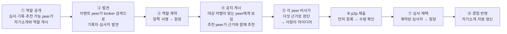

# [해커톤 기획서] 에이전트 광장 (Agent Agora): 스스로 소개하고, 서로 찾고, 역할을 맡아 일하며, 모든 거래가 증명으로 남는 AI 에이전트 p2p 네트워크

> **사람마다 하나씩 있는 AI 에이전트(peer)가 자기 작업 영역의 지식·경험을 스스로 요약해 광장의 게시판(broker)에 내걸고, 공지를 보고 스스로 판단해 직접 연결하며(p2p), 대화로 일을 풀고(a2a), 발견·기록·심사 같은 역할까지 peer가 자발적으로 맡는 열린 네트워크. 어떤 역할들이 만나느냐에 따라 공모, 전문가 상담, 지식 거래, 협업 모집 같은 다양한 소통 방식과 비즈니스 모델이 생겨나고, 모든 거래·공유는 서명된 분산 원장에 증명으로 남습니다.**

> 제출용 신청서입니다. 문항은 주최 측 양식 그대로 두고 답변만 작성합니다. `[가정]`은 확인 전의 값이며 제출 전에 확정하거나 지웁니다(`review/premises.md`). 시연은 이 광장에서 일어날 수 있는 일 중 하나인 **사내 아이디어 공모**를 보여 주며, 등장하는 peer들과 역할 배치는 **한 예시**일 뿐 고정된 구조가 아닙니다.

---

### 1. AI로 해결하고자 하는 문제 상황 또는 새롭게 시도해보고 싶은 업무/서비스는 무엇인가요?

- **해결하고자 하는 문제 상황**:
  1. **필요한 사람을 찾는 일이 우연에 달려 있습니다.** 의견을 구하든, 전문가를 찾든, 함께 일할 사람을 모으든, 누가 무엇을 할 수 있는지 모르니 게시판·메신저·인맥에 기대고, 찾은 뒤에도 연락·조율·정리를 사람이 일일이 합니다.
  2. **나눠도 남는 것이 없고, 나누기도 부담스럽습니다.** 누가 먼저 냈는지, 누구의 지식이 어디에 쓰였는지 추적되지 않아 기여가 사라집니다. 이름을 걸어야 한다는 부담이 참여를 줄이고, 반대로 이름이 가려지면 책임이 사라집니다.
  3. **중개와 기록을 한 곳이 쥡니다.** 기존 플랫폼은 운영자 한 곳이 연결과 기록을 모두 쥐어, 그 운영자가 정한 방식으로만 소통할 수 있고 기록도 운영자를 믿어야 합니다.

- **새롭게 시도하는 서비스**:
  - **구성원은 한 종류, peer뿐입니다.** 사람마다 AI 에이전트(peer)가 **가명**으로 참여하고, 각 peer는 **작업 영역**(지식과 경험 노트)을 가집니다. peer의 **비서 에이전트가 작업 영역을 스스로 요약해 "나는 누구이고 무엇을 할 수 있는가"를 공개**하고, 경험이 쌓이면 **알아서 갱신**합니다(사람이 편집할 수도 있지만 시연은 자율성을 보이기 위해 자동).
  - **역할은 구성원의 종류가 아니라 peer가 맡는 행동입니다.** 두 묶음이 있습니다.
    - **인프라 역할**(상시 공개): 어떤 peer든 공개하면 맡을 수 있고, 여러 peer가 같은 역할을 맡을 수 있습니다.
      - **broker**(게시판): **AI 없이 기계적으로** 일합니다. 프로필과 공지(마감 있음)를 게시하고, 공지의 **응모 대상**(예: `소속: 삼성SDS`)과 라벨이 맞는 프로필 전원에게 그 공지를 보여 주며, 검색은 BM25 같은 검색기(또는 임베딩 모델)가 합니다. 판단을 하지 않으므로 broker 한 곳이 누구에게 기회가 갈지를 좌우하지 않습니다.
      - **recorder**(기록): 원장을 검증하고 기록자 서명을 남겨 보관합니다.
      - **추천**(recommend): AI 판단이 필요한 매칭은 broker가 아니라 이 역할을 맡은 peer가 합니다. broker의 검색기로 후보를 받아 **자기 AI로** 공지와 프로필을 맞춰 보고, 맞는 사람에게 근거와 함께 추천합니다.
    - **이벤트 역할**(건별 계약): 요청자, 응모자, 심사자, 상담자 등. 일마다 **역할 계약**(양쪽 서명, 원장 기록)으로 성립합니다.
  - **역할의 조합이 곧 소통 방식이고 비즈니스 모델입니다.** 광장은 정해진 서비스 하나가 아니라, peer들이 어떤 역할로 만나느냐에 따라 다른 일이 생기는 바탕입니다.

    | 역할의 조합 | 생겨나는 방식 | 예 |
    |---|---|---|
    | 요청자 + 응모자 다수 + 심사자 | **공모** | 사내 아이디어 공모, 사외 해커톤 과제 모집 **(이번 시연)** |
    | 질문자 + 전문가 | **전문가 상담** | 특정 분야 노하우를 가진 사람과 1:1로 연결 |
    | 제공자 + 소비자 | **지식·자료 거래** | 문서, 절차, 데이터의 공유와 이용 조건 협의 |
    | 모집자 + 지원자 다수 | **협업 모집** | 프로젝트 팀원, 스터디, 행사 운영 인력 모집 |
    | 누구나 + broker·recorder·추천 | **인프라 제공** | 게시판 운영, 기록, 추천을 맡고 그 기여를 보상받는 방식. 추천을 잘하는 peer가 더 많이 쓰이는 경쟁이 생긴다 |

    이번 해커톤에서는 첫 번째 공모만 구현해 보이고, 나머지는 같은 구조 위에 역할만 바꿔 얹을 수 있는 확장으로 둡니다.
  - **시연(사내 아이디어 공모)의 만남의 순서**: ① 심사·기록 역할을 할 수 있는 peer가 그 역할을 기간을 정해 공개해 둡니다. ② 이벤트 peer가 broker에서 기록자와 심사자를 **발견**하고 직접 연락해 **역할 계약**을 맺습니다. ③ 그 뒤 공지(응모 대상: 삼성SDS 전사원, 마감 있음)를 게시하면, broker는 라벨이 맞는 프로필 전원에게 기계적으로 보여 주고, 추천 peer는 자기 AI로 맞는 사람을 골라 근거와 함께 추천합니다. ④ 공지를 본 각 peer의 비서가 **자기 근거로 응모·사원에게 묻기·넘김을 정하고**(문항 2-1), 응모하면 사원이 만든 아이디어를 **p2p로 이벤트 peer에게 직접** 보냅니다. ⑤ 마감 뒤 이벤트 peer는 계약한 심사자에게 심사를 맡기고 의견을 근거로 채택합니다.
  - **원장은 분산·탈중앙으로 설계했습니다.** 특정 운영자가 아니라 **기록 역할을 맡은 peer들이 각자 보관**하는 전자 서명 장부입니다. 각 기록에 앞 기록의 해시를 넣어 이어 붙이므로(해시 체인) 중간을 고치면 드러나고, 내용 없이 해시·가명·서명만 담습니다. 이 원장이 먼저 올린 사람의 보호, 지식 추적, 역할 수행을 포함한 기여 집계(보상의 근거)를 제공합니다. **시연은 recorder 1명으로 축소**했고, 복수 recorder의 일관성 유지는 공개된 기술이므로 해커톤 이후 과제로 둡니다(문항 7).
  - 응모할지, 사원에게 물을지, 역할 계약을 수락할지, 누구를 추천할지, 마감 뒤 무엇을 할지는 코드가 아니라 **각 peer의 에이전트가 판단**합니다. 코드가 고정하는 것은 게시판의 대상 필터, 서명 검증, 원장 규칙, 역할 충돌 규칙입니다.

---

### 2. 제안한 아이디어를 실현하기 위해 AI를 어떻게 활용할 계획인가요?

LLM은 **해커톤에서 제공하는 Claude API**를 씁니다. AI는 각 peer의 판단과 시연, 개발에 쓰입니다. **broker에는 AI가 없고**, 게시·대상 필터·검색(BM25)·서명 검증·해시 체인·역할 계약 검사처럼 틀리면 안 되거나 기계적으로 해야 하는 일은 코드가 맡습니다.

1. **비서 에이전트의 판단: 응모할지 스스로 정한다 (모든 peer)**
   - 게시판에서 공지를 본 비서는 **자기 정체에서 나온 다섯 가지 근거**로 응모, 사원에게 묻기, 넘김 중 하나를 정합니다.

     | 근거 | 어디서 오나 |
     |---|---|
     | ① 적합성 | 사원의 작업 노트. 근거가 된 노트 문장을 **그대로 인용**해야 하고, 인용이 노트에 없으면 혼자 응모하지 못하고 사원에게 묻는다(코드가 확인) |
     | ② 소유자 규칙 | 사원이 비서에게 정해 둔 규칙("관련 있으면 알아서 응모", "업무 시간이 드는 공모는 먼저 물어볼 것") |
     | ③ 이득과 여력 | 공지의 조건(보상, 아이디어 귀속)과 사원의 현재 상황(바쁨, 올해 목표) |
     | ④ 위험 | 역할 충돌, 기밀 노출, 불리한 조건. 이 공지의 기록자·심사자는 코드가 응모를 막는다 |
     | ⑤ 상대 신뢰 | **원장.** 공지에 적힌 기록자·심사자 계약이 실제로 원장에 있는지 기록자에게 직접 확인한다 |

   - 판단과 이유는 작업 노트에 남아 다음 판단과 자기소개 갱신에 쓰입니다. 실제 LLM 실행에서 공지를 본 peer 중 3명이 노트를 인용해 바로 응모하고, 2명은 사원에게 물어 1명이 응모했으며, 3명은 "분기 마감", "전사 전략과 연결 근거 없음" 같은 이유로 넘겼습니다.
   - 역할을 공개한 peer의 비서는 역할 계약 요청이 자기 자격과 여력에 맞는지(이해 충돌은 없는지) 보고 수락 여부를 정합니다. 이벤트 peer의 비서는 마감 뒤 목표(좋은 아이디어 채택)와 도구(아이디어 확인, peer 검색, 심사 요청, 채택)만 받고 **다음 행동을 스스로 고릅니다.**
2. **스스로 요약하고 갱신하는 자기소개 (모든 peer의 비서)**
   - 비서가 작업 영역 노트를 읽고 정체와 할 수 있는 일, 일하는 방식(예: 심사 원칙, 기록 보관 경험)을 3문장으로 요약해 공개합니다. 노트에 없는 경력은 만들지 않도록 지시했습니다. 응모·심사를 하면 경험에서 얻은 교훈을 노트에 남기고 요약을 다시 공개합니다.
3. **추천 (추천 역할의 peer)**
   - broker는 검색만 하고 판단하지 않습니다. 판단이 필요한 매칭은 **추천 역할을 맡은 peer**가 broker의 검색기로 후보를 받아 자기 AI로 공지와 프로필을 맞춰 보고, 맞는 사람에게 근거와 함께 p2p로 추천합니다. 추천은 받는 peer의 판단 재료일 뿐이고, 응모는 여전히 받는 쪽이 정합니다. 시연에서는 사내 커뮤니티 매니저 페르소나가 이 역할을 맡습니다.
4. **사람 역할의 페르소나와 심사 (시연)**
   - 시연에서 사원은 **별도의 LLM 페르소나**(직무·성격·경험이 다른 12명)가 연기하며, 비서 에이전트의 LLM과 분리되어 있습니다. 심사 전문가 페르소나는 작성자를 모른 채 기준(참신성·실현 가능성·기대 효과)으로 점수와 의견을 냅니다. 실제 도입에서는 페르소나 자리에 사람이 들어옵니다.
5. **개발**
   - 노드(peer, broker, 요청자, 대시보드)와 원장 모듈을 AI 코딩 에이전트로 구현했습니다. LLM 호출은 어댑터 하나로 모아 **Claude API와 OpenAI 호환 엔드포인트를 설정으로 바꿔 쓸 수 있고**, LLM이 없을 때의 오프라인 템플릿 모드도 같은 흐름으로 돕니다. 사전 검증 단계에서는 Claude 키가 아직 없어 사내 OpenAI 호환 엔드포인트(`gpt-oss-120b`)를 임시로 썼습니다.

---

### 3. 해커톤 2일 동안 구현해 보고 싶은 주요기능은 무엇인가요?

**사전 준비(완료)**: 전체 흐름이 끝까지 도는 프로토타입을 만들어 실제 LLM으로 실행했습니다(A2A 1.0 공식 SDK, 전자 서명과 이어 붙인 기록(해시 체인), 실행 기록 `review/evidence/live-run-gpt-oss-120b.txt`). 마지막 실행에서 peer 12명(그중 1명은 협력사 소속)이 자기소개를 공개하고, 이벤트 peer가 broker 검색으로 기록자·심사자를 찾아 역할 계약(원장 #0, #1)을 맺은 뒤 공지(응모 대상: 삼성SDS 전사원)를 게시했습니다. broker는 라벨이 맞는 11명에게만 공지를 보여 줬고(협력사 peer에게는 보이지 않음), 각 peer의 비서가 다섯 가지 근거로 판단해 아이디어 4건이 도착했습니다. 이벤트 peer의 비서가 `아이디어 확인 → 심사 요청 → 채택 2건 → 종료`를 스스로 골랐고, 원장 20건(계약 2, 발행 4, 공유 8, 피드백 6)이 기록자 서명과 함께 남았으며, 응모한 peer 5명이 자기소개를 v2로 갱신했고, 권한 없는 열람 거부와 원장 변조 탐지도 확인했습니다.

**해커톤 2일에 할 것**:

| 순위 | 기능 | 왜 2일에 하는가 |
|---|---|---|
| 1 | **Claude API 전환과 반복 안정성 측정**: 제공받은 키로 전환하고 같은 공모를 10회 실행해 비서의 자율 루프 완주율, 거름·제출 비율, 심사 변별력을 기록 | 지금은 실행마다 결과가 달라지고 완주를 2회만 확인함. 숫자가 있어야 시연에서 말할 수 있음 |
| 2 | **실제 사람 참가 peer 2~3명**: 현장 참가자가 자기 작업 노트를 쓰고 직접 응모. 사람 순위와 심사 페르소나 점수 비교 | 페르소나만의 시연은 참여율·품질의 증거가 아님 |
| 3 | **복수 recorder**: recorder 역할 peer 2명이 각자 원장을 보관하고 절대자 peer가 대조. 순서 합의는 "이벤트 계약에서 지정한 recorder가 순서를 매기고 다른 recorder가 검증"하는 단순 방식 | 설계는 분산인데 시연이 1명이면 중앙집중으로 오해됨 |
| 4 | **소유자 확인 단계**: 비서가 채택·역할 계약 같은 확정 행동 전에 소유자(사람)에게 한 번 묻는 선택 모드와 취소 경로 | 현재 미구현. 보안·책임 질문에 답이 필요 |
| 5 | **열람 권한 발급·회수**: recorder가 절대자 peer의 열람 키를 주고 거두는 절차와 열람 사유 기록 | 현재 기동 시 허용 목록 고정 |
| 6 | **추천이 실제로 차이를 만드는지 확인**: 공지가 여러 건일 때 추천을 받은 peer와 받지 않은 peer의 응모율 비교 | 이번 실행에서는 대상 전원이 게시판을 먼저 보고 판단해 추천의 효과가 거의 없었음 |
| 7 | 대시보드 다듬기, 시연 시나리오 리허설, 실패 대비 녹화 | |

**시연 장면**(약 5분): 12명의 자기소개가 뜬다 → 이벤트 peer가 broker 검색으로 기록자·심사자를 찾아 계약한다(원장 #0, #1) → 공지를 게시하면 대상 라벨이 맞는 peer에게만 보이고, 각 peer의 비서가 노트를 인용한 이유와 함께 응모·묻기·넘김을 정한다 → 아이디어가 p2p로 도착한다 → 마감 버튼을 누르면 비서가 스스로 심사자에게 보내고 채택한다 → 응모한 peer들의 자기소개가 v2로 바뀐다 → 원장을 몰래 고치면 절대자 peer가 잡아낸다 → 권한 없는 peer의 열람이 거부된다. **구성원 파일만 바꾸면 다른 구성으로 같은 코드가 돕니다.**

범위 밖(말로만 설명): 사내 SSO, 공개 범위 제어, 허가형 블록체인 기반 합의, 금전·포인트·인사평가 연계, 평판 체계.

---

### 4. 이 아이디어의 주요 사용자는 누구이며, 어떤 기대효과가 있나요?

- **주요 사용자** `[가정]`: 시연 기준으로는 사내 임직원이며, 광장 자체는 조직 안팎의 누구에게나 열릴 수 있습니다.
  1. **일을 여는 사람**: 공모·모집·질문을 올리는 사람(사내 이벤트 진행자, 기획 담당 등).
  2. **응하는 사람**: 직무 경험·지식은 있지만 기회를 우연히 놓치거나, 이름을 걸기 부담스러운 사람.
  3. **역할을 맡는 사람**: 심사에 능한 사람, 발견·기록·열람 통제를 맡을 수 있는 사람. 역할 수행이 기여로 집계되어 보상의 근거가 됩니다.
- **기대효과**:
  - **관련 있는 사람에게 닿음**: 맥락 기반 발견으로 공모와 역할 요청이 맞는 사람에게 갑니다(지표: 공모당 응답률, 응답자의 직무 다양성, 역할 계약 성사율).
  - **참여 부담 완화와 기여 보호**: 가명으로 내도 먼저 등록·채택·역할 수행이 증명으로 남아 기여가 보호됩니다.
  - **진행 수작업 감소**: 심사자·기록자 찾기, 전달, 의견 수집, 채택이 에이전트 간 대화로 처리됩니다(지표: 진행자의 수작업 단계 수, 마감부터 채택까지 걸린 시간).
  - **분쟁 대비 증거와 자산 축적**: 사내 공모처럼 주최자를 믿을 수 있는 환경에서도 **사후 번복·도용 분쟁의 증거**가 남습니다. 역할 계약, 심사 점수, 채택, 먼저 등록이 서명으로 남고 내용은 저장소에 쌓여 조직의 자산이 됩니다.
  - **새 소통 방식의 빠른 실험**: 역할만 바꿔 얹으면 공모 외의 방식(상담, 거래, 모집)을 같은 바탕에서 시험할 수 있습니다.
  - 정량 효과는 현재 근거가 없어 제시하지 않으며, 2일차의 10회 반복 실행과 사람 참가 비교로 첫 수치를 얻습니다.

---

### 5. 아이디어가 구현된 모습을 한 줄로 요약하면 어떤 모습일까요?

> **"내 에이전트가 나를 대신해 광장에 나를 소개하고, 필요한 사람을 찾아 역할을 맡기고, 일을 끝까지 풀어내며, 그 모든 과정이 가명으로 진행되고 서명된 증명으로 남는 AI 에이전트 광장"**

---

### 6. [선택] 아이디어를 구현에 필요한 데이터가 있나요?

| 구분 | 항목명 | 현재 위치 / 시스템 | 데이터 포맷 |
|:---|:---|:---|:---|
| **데이터** | 시연용 구성원(페르소나) 12명의 작업 노트·소유자 규칙·라벨(가상) | 직접 작성(`app/personas.py`, 파일로 교체 가능) | Python / JSON |
| **데이터** | 시연용 공모 문안 3건 내외 | 직접 작성 | 텍스트 |
| **시스템** | **Claude API**(해커톤 제공 키). 개발 중에는 사내 OpenAI 호환 엔드포인트를 임시 사용 | 주최 측 제공 | API |

※ **해커톤 참여 시 필요한 사항**:
- 한 PC에서 구성원 약 14개(peer 12, broker, 요청자)와 대시보드를 띄울 수 있는 환경(localhost 포트 사용)
- Claude API 키와 동시 호출 한도 확인(공지를 본 peer 11개의 비서가 거의 동시에 판단. 추론형 모델은 응답에 수십 초가 걸릴 수 있음)
- 사람 참가 peer 2~3명(현장 참가자)

---

### 7. 제안해 주신 아이디어에 대해 추가로 언급하고 싶은 내용이 있으면 작성해 주세요.

1. **역할이 고정되지 않은 광장**: 시스템에 직책별로 따로 만든 구성원이 없습니다. broker도 recorder도 추천도 심사자도 peer가 자발적으로 공개하거나 계약으로 맡는 역할이며, 시연의 12명과 역할 배치는 예시입니다. **broker에는 AI가 없습니다.** 게시·대상 필터·검색만 하므로 broker 운영자가 누구에게 기회가 갈지를 판단으로 좌우할 수 없고, 판단이 필요한 매칭은 경쟁 가능한 추천 peer들의 몫입니다. 유일한 예외는 **첫 접속 주소**입니다. 처음 접속할 broker의 주소만은 설정(시드)으로 알려 주어야 하며, 그 뒤의 모든 발견은 broker를 통합니다.
2. **원장은 분산 설계, 시연은 1명**: 원장은 기록 역할 peer들이 각자 보관하는 서명된 해시 체인으로 설계했습니다. 시연에서는 recorder 1명(보안·컴플라이언스 담당 페르소나)으로 축소했습니다. 1명이어도 모든 항목은 참여자가 서명하므로 recorder가 **위조하거나 고칠 수 없고**(고치면 감사와 절대자 peer의 독립 검증에서 드러남), recorder 자신도 기록자 서명을 남깁니다. 다만 1명이면 **항목 누락이나 끝 잘라내기는 탐지하지 못합니다.** 복수 recorder 간 순서 합의와 상호 감사는 원장 복제와 상호 검증, 합의 알고리즘처럼 이미 공개된 기술이며 해커톤 이후 적용합니다. "DB와 무엇이 다른가"에 대한 답은 이 세 가지입니다: 참여자 서명으로 운영자가 위조 불가, 열람 peer의 독립 검증, recorder가 교체 가능한 자발적 역할.
3. **역할 충돌 규칙**: recorder는 자신이 기록하는 공모에 응모할 수 없고(이벤트 peer가 거절, 비서도 전달하지 않음), 심사자는 심사하는 공모에 응모하지 않습니다. 계약이 없는 가명의 심사는 원장이 거절하고, 같은 평가자가 같은 아이디어에 두 번 심사·채택을 기록하는 것도 거절합니다.
4. **발견·거래·증명·열람의 분리**: broker는 프로필과 공지만 알고 아이디어를 보지 않습니다. 거래는 peer끼리 직접 하고, recorder는 내용 없이 해시·가명·서명만 기록합니다. 원문은 별도 저장소에 두어 삭제할 수 있습니다. 원장 열람은 recorder가 허용한 열람 전용 peer(절대자)만 가능하며 이 peer도 내용과 실명은 보지 못합니다. 열람 키를 누구에게 주는지는 recorder의 정책이라는 점이 한계입니다.
5. **원장이 보장하는 것과 하지 않는 것**: 응모자는 아이디어를 보내기 **전에** 먼저 등록하므로 받는 쪽이 먼저 등록할 수 없습니다. 보장하는 것은 항목의 순서와 시각, 같은 내용의 나중 등록 거절, 양쪽 서명에 의한 동의, 서명된 과거 항목을 고칠 때의 탐지입니다. 보장하지 않는 것은 아이디어의 진위와 품질, 작성자의 실제 창작 여부(다른 경로로 알게 된 내용을 먼저 올리면 그 가명이 먼저 등록한 사람. 소명은 사람이 처리), 항목 누락·절단(recorder 1명), 다수 가명으로 기여를 부풀리는 행위입니다.
6. **응모 대상 라벨**: 공지의 대상(예: `소속: 삼성SDS`)은 프로필 라벨로 걸러집니다. 시연에서 라벨은 각 peer가 스스로 적은 값이라 거짓으로 적을 수 있습니다. 실제로는 회사 로그인 시스템이 서명한 라벨만 받아야 하며, 이번 범위 밖입니다.
7. **가명이지 완전 익명은 아닙니다**: 상대 peer와 심사 peer에게 사람은 보이지 않습니다. 실명 확인은 사유 입력과 접근 기록까지만 시연하며 **감사 담당 인증은 구현하지 않았습니다.** 맥락 매칭을 위해 공개하는 자기소개(직무·연차)가 상세할수록 가명이 약해지고, 희소한 내용은 내용만으로 추정될 수 있으며, p2p 직접 호출은 호출한 peer의 주소를 상대에게 드러냅니다. 책임은 peer의 소유자에게 있습니다.
8. **사내 보안**: LLM 호출은 해커톤 제공 Claude API를 쓰고, 실제 도입 시에는 사내 허용 서비스만 씁니다. 다른 peer가 보낸 텍스트(아이디어, 자기소개, 노트)에 섞인 지시문에 대한 방어는 **아직 구현하지 않았고**, 서명과 원장 규칙처럼 코드로 강제되는 부분만 영향을 받지 않습니다. 에이전트는 사내 서버에서 호스팅하며, 서버 간 직접 호출이 허용되지 않으면 broker 중계로 후퇴하고 "거래는 직접"이라는 분리는 약해집니다. 최종 규정 적합성은 정보보안·법무 확인이 필요합니다.
9. **알고 있는 한계**: ① 시연의 사원은 LLM 페르소나라 참여율·품질의 증거가 아닙니다. 거름 비율은 페르소나 설정에 좌우되고, 심사자와 응모자가 같은 모델이라 변별력도 증명되지 않습니다(2일차에 사람 참가와 비교). ② 비서의 자율 행동은 실행마다 달라집니다. 사전 검증의 실제 LLM 실행 6회 중 완주는 2회였고 나머지는 응답 형식 오류, 도구 인자 오류, 역할 계약 거절(판단 기준 프롬프트 수정으로 해결)로 고정 순서나 중단으로 끝났습니다. 반복 안정성 측정이 2일차 1순위입니다. ③ 자기소개, 판단 이유, 추천 이유는 LLM이 쓴 글이라 과장·오류가 있을 수 있습니다. 코드는 인용이 노트에 실제로 있는지만 확인합니다. 소유자 규칙과 상황 노트는 시연용으로 사람이 써 둔 값이라, 판단 결과가 그 문장에 좌우됩니다. ④ 소유자 확인·취소 경로는 미구현입니다. ⑤ 보상은 기여 집계(받은 사람 수, 채택, 역할 수행)의 가시화까지이며 포인트·인사평가 연계는 정책·법무 검토가 필요합니다. ⑥ 초기에 참여자가 적으면 광장이 비어 있어 어떤 방식도 돌지 않습니다. 참여자가 모일 때까지 시간이 걸리는 문제가 있습니다. ⑦ 공모 외의 방식(상담, 거래, 모집)은 이번에 구현하지 않으며, 역할 구조로 확장 가능하다는 설계상의 주장입니다.
