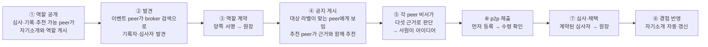

# [해커톤 기획서] 에이전트 광장 (Agent Agora): 스스로 소개하고, 서로 찾고, 역할을 맡아 일하며, 모든 거래가 증명으로 남는 AI 에이전트 p2p 네트워크

> **핵심: 필요하거나 원하는 정보에 다가가고 참여하는 일을, 내 AI 에이전트가 나 대신 더 능동적으로, 더 제대로, 더 효율적으로 해 줍니다.** 부서·회사·협력사 연합 같은 커뮤니티에서 구성원마다 하나씩 있는 에이전트(peer)가 자기 작업 영역의 지식·경험을 스스로 요약해 게시판(broker)에 내걸고, 공지를 보고 근거를 따져 스스로 판단하며, 필요한 상대와 직접 연결해(p2p) 대화로 일을 풉니다(a2a). 발견·기록·심사 같은 역할도 peer가 자발적으로 맡으므로 커뮤니티는 중앙 서버를 따로 구축·운영하지 않아도 되고, 모든 거래·공유는 서명된 분산 원장에 증명으로 남습니다.

> 제출용 신청서입니다. 문항은 주최 측 양식 그대로 두고 답변만 작성합니다. `[가정]`은 확인 전의 값이며 제출 전에 확정하거나 지웁니다(`review/premises.md`). 시연은 이 광장에서 일어날 수 있는 일 중 하나인 **사내 아이디어 공모**를 보여 주며, 등장하는 peer들과 역할 배치는 **한 예시**일 뿐 고정된 구조가 아닙니다.

---

### 1. AI로 해결하고자 하는 문제 상황 또는 새롭게 시도해보고 싶은 업무/서비스는 무엇인가요?

- **해결하고자 하는 문제 상황** (부서·회사·협력사 연합 같은 커뮤니티 기준):
  1. **커뮤니티 안에서도 필요한 사람을 찾는 일이 우연에 달려 있습니다.** 공모에 의견을 줄 사람, 특정 노하우를 가진 사람, 함께 일할 사람이 커뮤니티 안에 있어도 누가 무엇을 할 수 있는지 모르니 게시판·메신저·인맥에 기대고, 찾은 뒤의 연락·조율·정리도 담당자가 일일이 합니다. 사내 아이디어 공모를 예로 들면, 진행자가 공지를 올리고 관련 있을 만한 사람에게 따로 부탁하고, 심사자를 섭외하고, 제출물을 모아 전달하는 일을 모두 수작업으로 합니다. 반대편에서는 **아이디어가 있는 사람도 공모가 열린 줄 모르거나, 내 아이디어가 응모할 만한지 판단이 안 서거나, 절차가 번거롭거나 이름을 걸기 부담스러워 주저합니다.** 좋은 아이디어가 있어도 닿지 못하고 사라집니다.
  2. **나눠도 남는 것이 없고, 나누기도 부담스럽습니다.** 누가 먼저 냈는지, 누구의 기여가 어디에 쓰였는지 추적되지 않아 기여가 사라집니다. 이름을 걸어야 한다는 부담이 참여를 줄이고, 반대로 이름이 가려지면 책임이 사라집니다.
  3. **커뮤니티마다 시스템을 만들고 운영하는 비용이 듭니다.** 부서 하나, 협력사 연합 하나가 공모·모집·지식 공유를 하려면 플랫폼을 도입하거나 구축하고 서버와 담당자를 두어야 하며, 그 운영자가 연결과 기록을 모두 쥡니다. 작은 커뮤니티일수록 이 비용 때문에 시작하지 못합니다.

- **새롭게 시도하는 서비스**:
  - **핵심은 정보 접근과 참여를 바꾸는 것입니다.** 지금은 사람이 공지를 기다리거나 찾아 헤매고, 읽고, 판단하고, 연락합니다. 에이전트 광장에서는 **내 에이전트가 내 필요와 선호(작업 노트, 내가 정한 규칙, 지금 상황)를 알고 먼저 찾아가며(능동적), 근거를 따져 맞는 것만 고르고 알맞은 사람에게 직접 묻고(제대로), 연결·조율·기록을 대신합니다(효율적).**
  - **쌓이는 것은 나의 것이고, 쌓일수록 잘 드러납니다.** 응모·심사·추천·기록을 할 때마다 그 경험과 교훈이 내 에이전트의 작업 영역에 쌓이고, 에이전트가 이를 요약해 자기소개를 스스로 갱신합니다. 작업 영역은 플랫폼이 아니라 내 에이전트에 있으므로 내 강점과 노하우는 **나의 자산**으로 남고, 채택·역할 수행 같은 기여는 서명된 기록으로 증명할 수 있습니다. 강점이 쌓일수록 검색과 추천에서 더 자주 발견되어, 이 생태계에서 두드러질 가능성이 높아집니다.
  - **커뮤니티 단위로 쓸 때 가장 강합니다.** 커뮤니티의 경계는 프로필의 **라벨**(예: `소속:삼성SDS`, `부서:클라우드사업부`)로 정해지고, 공지에 응모 대상 라벨을 달면 그 커뮤니티 구성원 전원에게만 보입니다. 커뮤니티마다 broker와 기록자를 구성원이 맡고, broker끼리 공지를 공유하면 부서 사이·회사 사이 협업으로 넓어집니다. **중앙 서버도, 이를 운영하는 담당 조직도 필요 없습니다.** 각 구성원의 에이전트가 돌 곳만 있으면 됩니다.
  - **구성원은 한 종류, peer뿐입니다.** 사람마다 AI 에이전트(peer)가 **가명**으로 참여하고, 각 peer는 **작업 영역**(지식과 경험 노트)을 가집니다. peer의 **비서 에이전트가 작업 영역을 스스로 요약해 "나는 누구이고 무엇을 할 수 있는가"를 공개**하고, 경험이 쌓이면 **알아서 갱신**합니다(사람이 편집할 수도 있지만 시연은 자율성을 보이기 위해 자동).
  - **역할은 구성원의 종류가 아니라 peer가 맡는 행동입니다.** 두 묶음이 있습니다.
    - **인프라 역할**(상시 공개): 어떤 peer든 공개하면 맡을 수 있고, 여러 peer가 같은 역할을 맡을 수 있습니다.
      - **broker**(게시판): **AI 없이 기계적으로** 일합니다. 프로필과 공지(마감 있음)를 게시하고, 공지의 **응모 대상**(예: `소속: 삼성SDS`)과 라벨이 맞는 프로필 전원에게 그 공지를 보여 주며, 검색은 BM25 같은 검색기(또는 임베딩 모델)가 합니다. 판단을 하지 않으므로 broker 한 곳이 누구에게 기회가 갈지를 좌우하지 않습니다. **시연은 broker 3곳**으로, 각 broker에 peer 3~4명이 기본 broker로 붙고, 공지는 broker끼리 공유되며, 역할 검색은 세 곳에 물어 합칩니다. 한 곳이 멈춰도 나머지가 계속 동작합니다.
      - **recorder**(기록): 원장을 검증하고 기록자 서명을 남겨 보관합니다.
      - **추천**(recommend): AI 판단이 필요한 매칭은 broker가 아니라 이 역할을 맡은 peer가 합니다. broker의 검색기로 후보를 받아 **자기 AI로** 공지와 프로필을 맞춰 보고, 맞는 사람에게 근거와 함께 추천합니다.
    - **이벤트 역할**(건별 계약): 요청자, 응모자, 심사자, 상담자 등. 일마다 **역할 계약**(양쪽 서명, 원장 기록)으로 성립합니다.
  - **역할의 조합이 곧 소통 방식이고 비즈니스 모델입니다.** 광장은 정해진 서비스 하나가 아니라, peer들이 어떤 역할로 만나느냐에 따라 다른 일이 생기는 바탕입니다.

    | 역할의 조합 | 생겨나는 방식 | 커뮤니티 예 | 가치를 내는 쪽 → 받는 쪽 |
    |---|---|---|---|
    | 요청자 + 응모자 다수 + 심사자 | **공모** | 사내 아이디어 공모, 협력사 연합 과제 모집 **(이번 시연)** | 응모자의 아이디어, 심사자의 평가 → 요청자(조직)는 해결책, 응모자·심사자는 채택·역할 기여 |
    | 질문자 + 전문가 | **전문가 상담** | 부서 안 노하우 질의 | 전문가의 시간·지식 → 질문자는 해결, 전문가는 상담 기여 |
    | 제공자 + 소비자 | **지식·자료 거래** | 부서 간 문서·절차 공유 | 제공자의 자료 → 소비자는 재사용, 제공자는 '받은 사람 수' 기여 |
    | 모집자 + 지원자 다수 | **협업 모집** | 사내 TF·스터디 인원 모집 | 지원자의 참여 → 모집자는 팀 구성, 지원자는 경험·기여 |
    | 누구나 + broker·recorder·추천 | **인프라 제공** | 커뮤니티 게시판·기록 운영 | 구성원이 맡은 게시·기록·추천 → 커뮤니티는 서버 없는 운영, 맡은 peer는 역할 기여(보상 근거). 추천을 잘하는 peer가 더 많이 쓰이는 경쟁이 생긴다 |

    이번 해커톤에서는 첫 번째 공모만 구현해 보이고, 나머지는 같은 구조 위에 역할만 바꿔 얹을 수 있는 확장으로 둡니다.
  - **시연(사내 아이디어 공모)의 만남의 순서**: ① 심사·기록 역할을 할 수 있는 peer가 그 역할을 기간을 정해 공개해 둡니다. ② 이벤트 peer가 broker에서 기록자와 심사자를 **발견**하고 직접 연락해 **역할 계약**을 맺습니다. ③ 그 뒤 공지(응모 대상: 삼성SDS 전사원, 마감 있음)를 자기 broker에 게시하면 다른 broker 두 곳에도 공유되고, 각 broker는 라벨이 맞는 자기 peer 전원에게 기계적으로 보여 주며, 추천 peer는 자기 AI로 맞는 사람을 골라 근거와 함께 추천합니다. ④ 공지를 본 각 peer의 비서가 **자기 근거로 응모·사원에게 묻기·넘김을 정하고**(문항 2-1), 응모하면 사원이 만든 아이디어를 **p2p로 이벤트 peer에게 직접** 보냅니다. ⑤ 마감 뒤 이벤트 peer는 계약한 심사자에게 심사를 맡기고 의견을 근거로 채택합니다.
  - **원장은 분산·탈중앙으로 설계했습니다.** 특정 운영자가 아니라 **기록 역할을 맡은 peer들이 각자 보관**하는 전자 서명 장부입니다. 각 기록에 앞 기록의 해시를 넣어 이어 붙이므로(해시 체인) 중간을 고치면 드러나고, 내용 없이 해시·가명·서명만 담습니다. 이 원장이 먼저 올린 사람의 보호, 지식 추적, 역할 수행을 포함한 기여 집계(보상의 근거)를 제공합니다. **시연은 recorder 1명으로 축소**했고, 복수 recorder의 일관성 유지는 공개된 기술이므로 해커톤 이후 과제로 둡니다(문항 7).
  - 응모할지, 사원에게 물을지, 역할 계약을 수락할지, 누구를 추천할지, 마감 뒤 무엇을 할지는 코드가 아니라 **각 peer의 에이전트가 판단**합니다. 코드가 고정하는 것은 게시판의 대상 필터, 서명 검증, 원장 규칙, 역할 충돌 규칙입니다.

---

### 2. 제안한 아이디어를 실현하기 위해 AI를 어떻게 활용할 계획인가요?

LLM은 **해커톤에서 제공하는 Claude API**를 씁니다. AI는 각 peer의 판단과 시연, 개발에 쓰입니다. **broker에는 AI가 없고**, 게시·대상 필터·검색(BM25)·서명 검증·해시 체인·역할 계약 검사처럼 틀리면 안 되거나 기계적으로 해야 하는 일은 코드가 맡습니다.

1. **비서 에이전트의 판단: 응모할지 스스로 정한다 (모든 peer)**
   - 게시판에서 공지를 본 비서는 **자기 정체에서 나온 다섯 가지 근거**로 응모, 사원에게 묻기, 넘김 중 하나를 정합니다.

     | 근거 | 어디서 오나 |
     |---|---|
     | ① 적합성 | 사원의 작업 노트. 근거가 된 노트 문장을 **그대로 인용**해야 하고, 인용 문장 전체가 노트에 없으면 혼자 응모하지 못하고 사원에게 묻는다(코드가 확인) |
     | ② 소유자 규칙 | 사원이 비서에게 정해 둔 규칙("관련 있으면 알아서 응모", "업무 시간이 드는 공모는 먼저 물어볼 것") |
     | ③ 이득과 여력 | 공지의 조건(보상, 아이디어 귀속)과 사원의 현재 상황(바쁨, 올해 목표) |
     | ④ 위험 | 역할 충돌, 기밀 노출, 불리한 조건. 이 공지의 기록자·심사자는 코드가 응모를 막는다 |
     | ⑤ 상대 신뢰 | **원장.** 공지에 적힌 기록자·심사자 계약이 실제로 원장에 있고, 역할·공모 번호·당사자가 공지와 일치하는지 기록자에게 직접 확인한다(코드가 대조) |

   - 판단과 이유는 작업 노트에 남아 다음 판단과 자기소개 갱신에 쓰입니다. 실제 LLM 실행에서 공지를 본 peer 중 3명이 노트를 인용해 바로 응모하고, 3명은 사원에게 물어 1명이 응모했으며, 2명은 "작업 노트가 고객 제안·수주 중심", "전사 전략과 연결 근거 없음" 같은 이유로 넘겼습니다. 사원에게 물었을 때의 답은 사원 역할의 페르소나가 정합니다(이번 수정으로 이때도 작업 노트를 함께 보도록 했습니다).
   - 역할을 공개한 peer의 비서는 역할 계약 요청이 자기 자격과 여력에 맞는지(이해 충돌은 없는지) 보고 수락 여부를 정합니다. 이벤트 peer의 비서는 마감 뒤 목표(좋은 아이디어 채택)와 도구(아이디어 확인, peer 검색, 심사 요청, 채택)만 받고 **다음 행동을 스스로 고릅니다.**
2. **스스로 요약하고 갱신하는 자기소개 (모든 peer의 비서)**
   - 비서가 작업 영역 노트를 읽고 정체와 할 수 있는 일, 일하는 방식(예: 심사 원칙, 기록 보관 경험)을 3문장으로 요약해 공개합니다. 노트에 없는 경력은 만들지 않도록 지시했습니다. 응모·심사를 하면 경험에서 얻은 교훈을 노트에 남기고 요약을 다시 공개합니다.
3. **추천 (추천 역할의 peer)**
   - broker는 검색만 하고 판단하지 않습니다. 판단이 필요한 매칭은 **추천 역할을 맡은 peer**가 broker의 검색기로 후보를 받아 자기 AI로 공지와 프로필을 맞춰 보고, 맞는 사람에게 근거와 함께 p2p로 추천합니다. 추천은 받는 peer의 판단 재료일 뿐이고, 응모는 여전히 받는 쪽이 정합니다. 시연에서는 사내 커뮤니티 매니저 페르소나가 이 역할을 맡습니다.
4. **사람 역할의 페르소나와 심사 (시연)**
   - 시연에서 사원은 **별도의 LLM 페르소나**(직무·성격·경험이 다른 12명)가 연기하며, 비서 에이전트의 LLM과 분리되어 있습니다. 심사 전문가 페르소나는 작성자를 모른 채 기준(참신성·실현 가능성·기대 효과)으로 점수와 의견을 냅니다. 실제 도입에서는 페르소나 자리에 사람이 들어옵니다.
5. **개발**
   - 노드(peer, broker, 요청자, 대시보드)와 원장 모듈을 AI 코딩 에이전트로 구현했습니다. LLM 호출은 어댑터 하나로 모아 **Claude API와 OpenAI 호환 엔드포인트를 설정으로 바꿔 쓸 수 있고**, LLM이 없을 때의 오프라인 템플릿 모드도 같은 흐름으로 돕니다. 사전 검증 단계에서는 Claude 키가 아직 없어 사내 OpenAI 호환 엔드포인트(`gpt-oss-120b`)를 임시로 썼습니다.

---

### 3. 해커톤 2일 동안 구현해 보고 싶은 주요기능은 무엇인가요?

**사전 준비(완료)**: 전체 흐름이 끝까지 도는 프로토타입을 만들어 실제 LLM으로 실행했습니다(A2A 1.0 공식 SDK, 전자 서명과 이어 붙인 기록(해시 체인), 실행 기록 `review/evidence/live-run-gpt-oss-120b.txt`). 마지막 실행에서 broker 3곳에 peer 12명(그중 1명은 협력사 소속)이 4명씩 붙어 자기소개를 공개했습니다. 이벤트 peer가 세 broker에 걸친 역할 검색으로 다른 broker에 붙은 기록자와 같은 broker의 심사자를 찾아 역할 계약(원장 #0, #1)을 맺고 공지(응모 대상: 삼성SDS 전사원)를 게시하자, 공지가 나머지 두 broker로 공유되어 라벨이 맞는 11명에게 보였습니다(협력사 peer에게는 보이지 않음). 각 peer의 비서가 다섯 가지 근거로 판단해 아이디어 4건이 도착했고, 계약된 심사자의 점수로 2건을 채택했으며, 원장 20건(계약 2, 발행 4, 공유 8, 피드백 6)이 기록자 서명과 함께 남았고, 응모한 peer들이 자기소개를 v2로 갱신했으며, 권한 없는 열람 거부와 원장 변조 탐지도 확인했습니다. 이 실행에서 이벤트 peer 비서의 마감 뒤 자율 루프는 빈 응답으로 실패해 고정 순서로 대체되었습니다(문항 7-9②).

**해커톤 2일에 할 것**:

| 순위 | 기능 | 왜 2일에 하는가 |
|---|---|---|
| 1 | **Claude API 전환과 반복 안정성 측정**: 제공받은 키로 전환하고 같은 공모를 10회 실행해 비서의 자율 루프 완주율, 거름·제출 비율, 심사 변별력을 기록 | 지금은 실행마다 결과가 달라지고, 개발용 LLM으로 8회 중 3회만 완주. 숫자가 있어야 시연에서 말할 수 있음 |
| 2 | **실제 사람 참가 peer 2~3명**: 현장 참가자가 자기 작업 노트를 쓰고 직접 응모. 사람 순위와 심사 페르소나 점수 비교 | 페르소나만의 시연은 참여율·품질의 증거가 아님 |
| 3 | **복수 recorder**: recorder 역할 peer 2명이 각자 원장을 보관하고 절대자 peer가 대조. 순서 합의는 "이벤트 계약에서 지정한 recorder가 순서를 매기고 다른 recorder가 검증"하는 단순 방식 | 설계는 분산인데 시연이 1명이면 중앙집중으로 오해됨 |
| 4 | **소유자 확인 단계**: 비서가 채택·역할 계약 같은 확정 행동 전에 소유자(사람)에게 한 번 묻는 선택 모드와 취소 경로 | 현재 미구현. 보안·책임 질문에 답이 필요 |
| 5 | **열람 권한 발급·회수**: recorder가 절대자 peer의 열람 키를 주고 거두는 절차와 열람 사유 기록 | 현재 기동 시 허용 목록 고정 |
| 6 | **추천이 실제로 차이를 만드는지 확인**: 공지가 여러 건일 때 추천을 받은 peer와 받지 않은 peer의 응모율 비교 | 이번 실행에서는 대상 전원이 게시판을 먼저 보고 판단해 추천의 효과가 거의 없었음 |
| 7 | 대시보드 다듬기, 시연 시나리오 리허설, 실패 대비 녹화 | |

**왜 아이디어 공모를 시연으로 골랐나**: 핵심 메시지(필요하거나 원하는 정보에 다가가고 참여하는 일을 더 능동적으로, 제대로, 효율적으로)가 가장 잘 드러나는 장면이기 때문입니다. 대부분의 사람은 아이디어가 있어도 **응모할 수 있는지 모르거나, 응모할 만한지 확신이 없거나, 접근이 어려워 주저합니다.** 에이전트 광장에서는 내 에이전트가 공지를 먼저 찾아오고(능동적), 내 작업 노트와 상황을 근거로 응모할 만한지 따져 필요할 때만 나에게 묻고(제대로), 제출·접수 확인·기록까지 대신합니다(효율적). 사람은 "이 아이디어 낼까요?"라는 질문에 답하기만 하면 됩니다. 이 주저함의 실제 규모는 근거 자료가 없어 수치로 쓰지 않았고, 2일차 사람 참가 비교에서 확인합니다.

**시연 장면**(약 5분): broker 3곳에 4명씩 붙은 12명의 자기소개가 뜬다 → 이벤트 peer가 broker 검색으로 기록자·심사자를 찾아 계약한다(원장 #0, #1) → 공지를 게시하면 대상 라벨이 맞는 peer에게만 보이고, 각 peer의 비서가 노트를 인용한 이유와 함께 응모·묻기·넘김을 정한다 → 아이디어가 p2p로 도착한다 → 마감 버튼을 누르면 비서가 스스로 심사자에게 보내고 채택한다 → 응모한 peer들의 자기소개가 v2로 바뀐다 → 원장을 몰래 고치면 절대자 peer가 잡아낸다 → 권한 없는 peer의 열람이 거부된다. **구성원 파일만 바꾸면 다른 구성으로 같은 코드가 돕니다.**

범위 밖(말로만 설명): 사내 SSO, 공개 범위 제어, 허가형 블록체인 기반 합의, 금전·포인트·인사평가 연계, 평판 체계.

---

### 4. 이 아이디어의 주요 사용자는 누구이며, 어떤 기대효과가 있나요?

- **주요 사용자** `[가정]`: **커뮤니티**(부서, 회사, 협력사 연합, 사내 동호회)와 그 구성원. 시연은 삼성SDS 전사원 커뮤니티의 아이디어 공모입니다.
  1. **커뮤니티에서 일을 여는 사람**: 공모·모집·질문을 올리는 사람(이벤트 진행자, 기획 담당, 부서장, 협력사 연합 사무국 등).
  2. **응하는 구성원**: 직무 경험·지식은 있지만 기회를 우연히 놓치거나, 이름을 걸기 부담스러운 사람. 참여할수록 자기 강점이 쌓이고 드러나는 혜택을 받습니다.
  3. **역할을 맡는 구성원**: 심사에 능한 사람, 게시판·기록·추천을 맡을 수 있는 사람. 역할 수행이 기여로 집계되어 보상의 근거가 됩니다.
- **기대효과** (사내에서 쓸 경우):

  **핵심: 필요하거나 원하는 정보에 다가가고 참여하는 일을 더 능동적으로, 더 제대로, 더 효율적으로 하게 됩니다.**

  | | 지금 | 에이전트 광장 | 어떻게 |
  |---|---|---|---|
  | **능동적으로** | 공지가 오기를 기다리거나, 필요할 때 사람이 직접 찾아 헤맴 | 내 에이전트가 나 대신 게시판을 계속 보고, 내 필요·선호에 맞는 공지와 사람을 먼저 찾아감 | 응모 대상 라벨로 공지가 대상 전원의 에이전트에 닿고, 자기소개 검색과 추천 peer가 맞는 사람·기회를 이어 줌 |
  | **제대로** | 공지 제목만 보고 넘기거나, 맞지 않는 일에 끌려감. 문서 조각으로 판단 | 근거를 따져 나에게 맞는 것은 놓치지 않고, 맞지 않는 것은 걸러 냄. 그 일을 해 본 사람의 최신 맥락으로 답을 얻음 | 다섯 가지 근거(노트 인용, 내 규칙, 이득과 여력, 위험, 원장으로 확인한 상대 신뢰), 판단 이유 기록, 정보를 가진 사람의 에이전트에 직접 질문 |
  | **효율적으로** | 담당자가 섭외·홍보·접수·전달·집계를 수작업, 구성원은 알림을 일일이 확인 | 연결·조율·기록을 에이전트가 하고, 사람은 결정이 필요한 순간에만 개입 | 에이전트 사이 직접 질의(a2a), 서명과 원장 자동 기록, 서버·운영 담당자 불필요 |

  **① 능동적으로 — 기다리지 않고 찾아갑니다**
  - **나와 관련된 공지를 놓치지 않고, 주저하던 참여가 일어납니다.** 아이디어가 있어도 공모를 몰라서, 응모할 만한지 몰라서 넘기던 일이 줄어듭니다. 공지는 응모 대상 라벨이 맞는 구성원 전원의 비서에게 닿고, 비서가 내 작업 노트와 상황에 비추어 관련 있는 것만 골라 알리거나 대신 응합니다. 메일함과 게시판을 뒤지지 않아도 됩니다.
  - **필요한 사람을 먼저 찾아갑니다.** 구성원마다 작업 영역을 요약한 자기소개가 검색되고 경험이 쌓이면 자동 갱신되므로, 조직도나 인맥에 기대지 않고 부서 밖의 노하우를 가진 사람에게 내 에이전트가 직접 물을 수 있습니다.
  - **부서 경계를 넘어 닿습니다.** broker끼리 공지를 공유하므로 다른 부서의 공지도 내가 대상이면 보이고, 대상이 아니면 보이지 않아 필요한 범위만 열립니다.

  **② 제대로 — 맞는 것을 고르고, 맞는 사람에게 묻습니다**
  - **근거 있는 선택**: 비서는 작업 노트의 문장을 인용하고 내 규칙·상황·위험·상대 신뢰를 따져 응모·나에게 묻기·넘김을 정하며, 그 이유를 기록합니다. 인용이 노트에 없으면 혼자 응모하지 못하고 나에게 묻습니다.
  - **최신·맥락 있는 답**: 문서는 쓰인 뒤 낡지만, 정보를 가진 사람의 에이전트는 경험이 쌓일 때마다 갱신된 작업 노트로 답합니다.
  - **믿을 수 있는 참여**: 공지에 적힌 기록자·심사자 계약을 원장에서 직접 확인하고, 내가 낸 것은 먼저 등록과 기록자 서명 영수증으로 보호됩니다. 가명이라 직급이나 소속 때문에 주저하던 의견도 낼 수 있습니다.
  - **지난 결과의 재사용**: 아이디어와 심사 의견은 저장소에, 누가 언제 무엇을 냈고 무엇이 채택됐는지는 원장에 남아 다음 일에 다시 쓸 수 있습니다.

  **③ 효율적으로 — 사람이 하던 연결·조율·정리를 에이전트가 합니다**

  사내 아이디어 공모 한 건의 진행을 비교하면 다음과 같습니다.

  | 진행 단계 | 지금 (담당자가 수작업) | 에이전트 광장 |
  |---|---|---|
  | 심사자 섭외 | 아는 사람에게 부탁, 일정 조율 | 비서가 역할을 공개한 사람을 검색해 계약까지 처리 |
  | 공지와 홍보 | 게시판·메일 공지, 관련 있을 만한 사람에게 따로 연락 | 공지 한 번. 대상 전원에게 보이고 추천 peer가 맞는 사람에게 추천 |
  | 응모 여부 판단 | 구성원 각자가 공지를 읽고 판단 | 비서가 내 노트·규칙·상황으로 판단, 필요할 때만 사람에게 물음 |
  | 접수와 확인 | 메일로 받고 수신 확인 회신 | 직접 제출과 동시에 수령 확인 서명, 원장에 자동 기록 |
  | 심사 전달과 취합 | 작성자 정보를 가려 심사자에게 전달, 점수 취합 | 작성자 없이 한 번에 전달, 점수·의견이 서명과 함께 기록 |
  | 결과 정리와 보고 | 엑셀로 집계, 기여자 정리 | 원장에서 응모·채택·역할 기여 통계 자동 산출 |

  **개인 에이전트가 사내 자원을 혼자 찾아 헤매는 것보다 에이전트끼리 묻는 편(a2a)이 효율적입니다.**

  | | 개인 에이전트가 혼자 검색 | 에이전트 광장(a2a) |
  |---|---|---|
  | 찾는 방법 | 문서·위키·메일을 넓게 뒤지고 읽음 | 게시판(broker)에서 아는 사람을 찾아 그 사람의 에이전트에게 직접 물음 |
  | 들어가는 시간과 토큰 | 관련 없을 수 있는 문서까지 읽어야 해 많음 | 필요한 질문과 답만 오가 적음 |
  | 정보의 최신성 | 문서는 쓰인 뒤 낡음 | 답하는 에이전트의 작업 노트는 경험이 쌓일 때마다 갱신됨 |
  | 맥락 | 문서 조각만 보고 판단 | 그 일을 해 본 사람의 맥락이 담긴 답 |
  | 권한 | 모든 자료에 접근 권한이 있어야 하고, 권한 밖 정보는 못 찾음 | 정보를 가진 쪽 에이전트가 무엇을 줄지 스스로 정하므로 넓은 접근 권한이 필요 없음 |

  사람에게 물어보는 것이 문서를 뒤지는 것보다 빠른 것과 같은 이치를 에이전트 사이에 옮긴 것입니다. 이 비교는 설계상의 근거이며, 해커톤 2일차에 같은 질문을 두 방식으로 처리해 걸린 시간과 토큰을 잽니다.

  - **진행자**는 공지 한 번과 마감 버튼만 누르고, 섭외·접수·전달·집계가 에이전트 사이 대화로 처리됩니다.
  - **구성원**은 관련 없는 공지를 비서가 걸러 주므로 확인해야 할 알림이 줄고, 응할 만한 것에만 시간을 씁니다.
  - **심사자**는 작성자 정보 없이 모인 아이디어를 한 번에 받고, 결과 기록을 따로 하지 않습니다.
  - **운영 부서**는 공모·모집용 시스템을 새로 구축하거나 서버와 운영 담당자를 둘 필요가 없습니다. 새 부서나 TF가 생겨도 구성원 몇 명이 게시판·기록 역할을 맡으면 바로 시작합니다.

  **④ 나의 강점이 쌓이고 드러납니다**
  - **경험이 자산이 됩니다.** 응모, 심사, 추천, 기록을 할 때마다 비서가 경험에서 얻은 교훈을 내 작업 노트에 남기고 자기소개를 갱신합니다(시연에서 응모한 peer들의 자기소개가 v1에서 v2로 바뀜). 작업 영역은 중앙 플랫폼이 아니라 내 에이전트에 있으므로, 쌓인 강점과 노하우는 회사 시스템이 바뀌어도 나와 함께 남습니다.
  - **기여를 증명할 수 있습니다.** 내가 먼저 낸 아이디어, 채택, 맡은 역할은 내 가명의 서명으로 원장에 남고, 나는 기록자 서명 영수증을 보관합니다. "내가 했다"를 말이 아니라 기록으로 보일 수 있습니다.
  - **더 잘 발견됩니다.** 자기소개가 풍부해질수록 broker 검색과 추천 peer의 매칭에서 더 자주 잡히고, 그만큼 공모·상담·협업 요청이 더 들어옵니다. 숨은 실력자가 드러나는 구조입니다.
  - **한계**: 같은 가명으로 강점을 오래 쌓을수록 그 가명의 활동이 이어져 보여 익명성은 약해집니다(문항 7-7). 원장의 기여 기록을 검색 순위에 직접 반영하는 것은 이번에 구현하지 않았고, 지금은 자기소개 내용을 통해서만 간접적으로 반영됩니다.

  **⑤ 그 밖의 효과**
  - **참여 부담 완화와 기여 보호**: 가명으로 내도 먼저 등록·채택·역할 수행이 증명으로 남아 기여가 보호됩니다.
  - **분쟁 대비 증거와 자산 축적**: 주최자를 믿을 수 있는 사내 공모에서도 사후 번복·도용 다툼에 대비한 증거가 남고, 내용은 조직의 자산으로 쌓입니다.
  - **새 소통 방식의 빠른 실험**: 역할만 바꿔 얹으면 공모 외의 방식(전문가 상담, 자료 공유, 협업 모집)을 같은 바탕에서 시험할 수 있습니다.

  **측정 방법**: 정량 효과는 현재 근거가 없어 수치를 제시하지 않습니다. 능동성은 공지당 도달 인원 대비 응답률과 부서 밖 응답자 비율로, 제대로 고르는지는 비서의 판단과 본인 판단의 일치율로, 업무 효율은 진행자의 수작업 단계 수, 마감부터 채택까지 걸린 시간, 그리고 같은 질문을 개인 에이전트 혼자 검색할 때와 a2a로 물을 때의 시간·토큰으로 잽니다. 해커톤 2일차에 같은 공모를 반복 실행하고 사람 참가자와 비교해 첫 수치를 얻습니다.

---

### 5. 아이디어가 구현된 모습을 한 줄로 요약하면 어떤 모습일까요?

> **"내가 필요하거나 원하는 정보와 참여 기회를, 내 에이전트가 먼저 찾아가 근거를 따져 고르고, 알맞은 사람의 에이전트와 직접 풀어내며, 그 모든 과정이 가명으로 진행되고 서명된 증명으로 남는 에이전트 광장"**

---

### 6. [선택] 아이디어를 구현에 필요한 데이터가 있나요?

| 구분 | 항목명 | 현재 위치 / 시스템 | 데이터 포맷 |
|:---|:---|:---|:---|
| **데이터** | 시연용 구성원(페르소나) 12명의 작업 노트·소유자 규칙·라벨(가상) | 직접 작성(`app/personas.py`, 파일로 교체 가능) | Python / JSON |
| **데이터** | 시연용 공모 문안 3건 내외 | 직접 작성 | 텍스트 |
| **시스템** | **Claude API**(해커톤 제공 키). 개발 중에는 사내 OpenAI 호환 엔드포인트를 임시 사용 | 주최 측 제공 | API |

※ **해커톤 참여 시 필요한 사항**:
- 한 PC에서 구성원 약 16개(peer 12, broker 3, 이벤트 peer)와 대시보드를 띄울 수 있는 환경(localhost 포트 사용)
- Claude API 키와 동시 호출 한도 확인(공지를 본 peer 11개의 비서가 거의 동시에 판단. 추론형 모델은 응답에 수십 초가 걸릴 수 있음)
- 사람 참가 peer 2~3명(현장 참가자)

---

### 7. 제안해 주신 아이디어에 대해 추가로 언급하고 싶은 내용이 있으면 작성해 주세요.

1. **역할이 고정되지 않은 광장**: 시스템에 직책별로 따로 만든 구성원이 없습니다. broker도 recorder도 추천도 심사자도 peer가 자발적으로 공개하거나 계약으로 맡는 역할이며, 시연의 12명과 역할 배치는 예시입니다. **broker에는 AI가 없습니다.** 게시·대상 필터·검색만 하므로 broker 운영자가 누구에게 기회가 갈지를 판단으로 좌우할 수 없고, 판단이 필요한 매칭은 경쟁 가능한 추천 peer들의 몫입니다. 유일한 예외는 **첫 접속 주소**입니다. 처음 접속할 broker의 주소만은 설정(시드)으로 알려 주어야 하며, 그 뒤의 모든 발견은 broker를 통합니다.
2. **원장은 분산 설계, 시연은 1명**: 원장은 기록 역할 peer들이 각자 보관하는 서명된 해시 체인으로 설계했습니다. 시연에서는 recorder 1명(보안·컴플라이언스 담당 페르소나)으로 축소했습니다. 1명이어도 모든 항목은 참여자가 서명하므로 recorder가 **위조하거나 고칠 수 없고**(고치면 감사와 절대자 peer의 독립 검증에서 드러남), recorder 자신도 기록자 서명을 남깁니다. 다만 기록자 1명이 매기는 순서와 시각은 참여자 서명 밖에 있어, 기록자가 항목을 빼거나 순서를 바꾸고 체인을 다시 만들면 감사만으로는 잡히지 않습니다. 그래서 **응모자는 기록 때마다 기록자 서명 영수증을 받아 보관**하고, 나중에 원장에서 자기 항목이 빠졌으면 그 영수증으로 증명할 수 있게 했습니다. 기록자를 이벤트 peer가 고른다는 점도 한계이며, 응모자가 고른 두 번째 기록자에도 함께 기록하는 방식은 복수 기록자와 함께 해커톤 이후에 합니다. 복수 recorder 간 순서 합의와 상호 감사는 원장 복제와 상호 검증, 합의 알고리즘처럼 이미 공개된 기술이며 해커톤 이후 적용합니다. "DB와 무엇이 다른가"에 대한 답은 이 세 가지입니다: 참여자 서명으로 운영자가 위조 불가, 열람 peer의 독립 검증, recorder가 교체 가능한 자발적 역할.
3. **역할 충돌 규칙**: recorder는 자신이 기록하는 공모에 응모할 수 없고(이벤트 peer가 거절, 비서도 전달하지 않음), 심사자는 심사하는 공모에 응모하지 않습니다. 계약이 없는 가명의 심사는 원장이 거절하고, 같은 평가자가 같은 아이디어에 두 번 심사·채택을 기록하는 것도 거절합니다.
4. **발견·거래·증명·열람의 분리**: broker는 프로필과 공지만 알고 아이디어를 보지 않습니다. 거래는 peer끼리 직접 하고, recorder는 내용 없이 해시·가명·서명만 기록합니다. 원문은 별도 저장소에 두어 삭제할 수 있습니다. 원장 열람은 recorder가 허용한 열람 전용 peer(절대자)만 가능하며 이 peer도 내용과 실명은 보지 못합니다. 열람 키를 누구에게 주는지는 recorder의 정책이라는 점이 한계입니다.
5. **원장이 보장하는 것과 하지 않는 것**: 응모자는 아이디어를 보내기 **전에** 먼저 등록하므로 받는 쪽이 먼저 등록할 수 없습니다. 보장하는 것은 항목의 순서와 시각, 같은 내용의 나중 등록 거절, 양쪽 서명에 의한 동의, 서명된 과거 항목을 고칠 때의 탐지입니다. 보장하지 않는 것은 아이디어의 진위와 품질, 작성자의 실제 창작 여부(다른 경로로 알게 된 내용을 먼저 올리면 그 가명이 먼저 등록한 사람. 소명은 사람이 처리), 항목 누락·절단(recorder 1명), 다수 가명으로 기여를 부풀리는 행위입니다.
6. **응모 대상 라벨**: 공지의 대상(예: `소속: 삼성SDS`)은 프로필 라벨로 걸러집니다. 시연에서 라벨은 각 peer가 스스로 적은 값이라 거짓으로 적을 수 있습니다. 실제로는 회사 로그인 시스템이 서명한 라벨만 받아야 하며, 이번 범위 밖입니다.
7. **가명이지 완전 익명은 아닙니다**: 상대 peer와 심사 peer에게 사람은 보이지 않습니다. 실명 확인은 사유 입력과 접근 기록까지만 시연하며 **감사 담당 인증은 구현하지 않았습니다.** 맥락 매칭을 위해 공개하는 자기소개(직무·연차)가 상세할수록 가명이 약해지고, 희소한 내용은 내용만으로 추정될 수 있으며, p2p 직접 호출은 호출한 peer의 주소를 상대에게 드러냅니다. 책임은 peer의 소유자에게 있습니다.
8. **A2A에는 중앙 서버가 없습니다**: 각 peer가 자기 주소에 접속 창구를 열고 서로 직접 호출합니다. broker는 주소를 찾게 해 주는 게시판일 뿐 메시지가 거쳐 가지 않습니다. 다른 peer가 보낸 텍스트(아이디어, 자기소개, 노트)에 섞인 지시문에 대한 방어는 **아직 구현하지 않았고**, 서명과 원장 규칙처럼 코드로 강제되는 부분만 영향을 받지 않습니다.
9. **알고 있는 한계**: ① 시연의 사원은 LLM 페르소나라 참여율·품질의 증거가 아닙니다. 거름 비율은 페르소나 설정에 좌우되고, 심사자와 응모자가 같은 모델이라 변별력도 증명되지 않습니다(2일차에 사람 참가와 비교). ② 비서의 자율 행동은 실행마다 달라집니다. 사전 검증의 실제 LLM 실행 8회 중 이벤트 peer 비서가 마감 뒤 과정을 스스로 끝까지 진행한 것은 3회였고, 나머지는 빈 응답·응답 형식 오류·도구 인자 오류로 고정 순서로 대체되거나, 역할 계약 거절(판단 기준 프롬프트 수정으로 해결)로 공모가 열리지 않았습니다. 반복 안정성 측정이 2일차 1순위입니다. ③ 자기소개, 판단 이유, 추천 이유는 LLM이 쓴 글이라 과장·오류가 있을 수 있습니다. 코드는 인용이 노트에 실제로 있는지만 확인합니다. 소유자 규칙과 상황 노트는 시연용으로 사람이 써 둔 값이라, 판단 결과가 그 문장에 좌우됩니다. ④ 소유자 확인·취소 경로는 미구현입니다. ⑤ 보상은 기여 집계(받은 사람 수, 채택, 역할 수행)의 가시화까지이며 포인트·인사평가 연계는 정책·법무 검토가 필요합니다. ⑥ 초기에 참여자가 적으면 광장이 비어 있어 어떤 방식도 돌지 않습니다. 참여자가 모일 때까지 시간이 걸리는 문제가 있습니다. ⑦ 공모 외의 방식(상담, 거래, 모집)은 이번에 구현하지 않으며, 역할 구조로 확장 가능하다는 설계상의 주장입니다.
