# 내부망(10.x) 시험 환경: 방화벽 포트, peer 설치, 시험 시나리오

> 2026-11-05. 사용자: "내부망 10.~ 대역에서 내가 직접 ui로 사람 역할을 하면서 사용을 해볼 거야", "방화벽 작업을 해야 하니 허용해야 할 port들(broker와 모든 접근해야 할 특수 peer 대상)", "나는 10.10.10.78에 하나의 peer를 띄울 거야", "최초 broker 생성, 0번 원장 생성 포함 시나리오".
>
> 이 문서는 코드와 배치 파일(`arena/config.py`, `.env.example`, `deploy/*`, `arena/genesis.py`, `dev/docker.md`)을 읽고 쓴 것이다. **10.x 망에서 실제로 돌려 본 결과가 아니다.** 아래 확인 명령으로 시험 때 하나씩 확인한다.

## 0. 이 문서의 가정

| 이름 | 뜻 | 값 |
|---|---|---|
| `BROKER_HOST` | 시험용 genesis(broker, 첫 recorder, god)를 띄울 서버 | **정해 주세요** (예: `10.10.10.7x`) |
| `PEER_HOST` | 사람 역할을 할 peer를 띄우는 서버 | `10.10.10.78` |
| `SPECIAL_HOST` | 특수 목적 peer(search, key, link …)를 띄울 서버 | 처음엔 `BROKER_HOST`에 같이 두는 것을 권함 |
| 브라우저 | 사용자가 화면을 여는 PC | 같은 10.x 망 (주소 정해 주세요) |

이 문서는 두 가지 시험을 다룬다. **10절은 이 서버 하나에서 peer 2개(사람 1, agent 1)를 띄워 사용자가 소통해 보는 시험**이고(먼저 이것부터 권함), 1~9절은 여러 서버에 나눠 띄우는 시험(방화벽 포함)이다.

처음 시험은 서버를 `BROKER_HOST`와 `PEER_HOST` 둘로 한다. 특수 peer는 필요할 때 하나씩 추가한다(7절).

## 1. 누가 누구에게 닿아야 하나

peer는 broker에 프로필을 올려 찾게 하고, 서로는 **a2a로 직접** 주고받는다(무전기 방식, 연결을 열어 두지 않음). 그래서 broker만 열면 안 되고, **모든 peer의 A2A 포트가 서로 열려 있어야** 한다. 답이 늦으면 부르는 쪽 peer의 webhook(`<A2A 주소>/a2a/notify`)으로 알림이 오므로 방향은 양쪽이다.

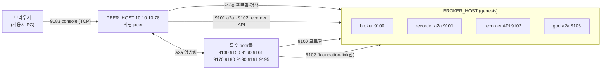

## 2. 방화벽에서 열 포트

모두 TCP, HTTP다(TLS 없음). 방향은 "출발 → 도착 서버의 포트".

### 2.1 반드시 (최소 시험: genesis + 사람 peer 1)

| # | 출발 | 도착 | 포트 | 용도 |
|---|---|---|---|---|
| 1 | `PEER_HOST` | `BROKER_HOST` | **9100** | broker: 프로필 게시, peer 찾기, 공지 |
| 2 | `PEER_HOST` | `BROKER_HOST` | **9101** | 제네시스 기록자 A2A |
| 3 | `PEER_HOST` | `BROKER_HOST` | **9102** | recorder API (원장 기록·조회. 누구나: `/health`, `/trust`, `/log`, `/audit`, `/events/<id>`, `/track/<공개키>`. 허용된 키만: `/chain`, `/access-log`) |
| 4 | `PEER_HOST` | `BROKER_HOST` | **9103** | god A2A (god에게 말 걸기, 관전·통계) |
| 4-1 | 브라우저 PC | `BROKER_HOST` | **9104** | god(관전 peer)의 **관전 창**(스스로 갱신하는 화면). `ARENA_GENESIS_GOD_WEB_PORT=9104`를 줬을 때만 열린다 |
| 5 | `BROKER_HOST` | `PEER_HOST` | **9180** | 사람 peer의 A2A(기본값): god·기록자가 답을 돌려주거나 알릴 때 |
| 6 | 브라우저 PC | `PEER_HOST` | **9183** | 사람의 창(console) |
| 7 | 시험하는 사람의 PC | `BROKER_HOST` | 9100, 9102 | `curl`로 상태 확인(선택, 시험 PC에서만) |

- 9183(console)은 **브라우저가 있는 PC에서만** 열면 된다. peer끼리는 필요 없다. 토큰이 없으면 못 들어가지만, 가능하면 출발지를 사용자 PC로 좁힌다.
- peer를 더 띄우면(사람 peer 2) 그 peer의 A2A·console 포트도 같은 식으로 연다. 같은 서버에 둘이면 포트를 겹치지 않게 한다(`ARENA_PERSONAL_PEER_PORT`, `ARENA_PERSONAL_CONSOLE_PORT`).

### 2.2 특수 peer를 시험할 때 추가 (기본 포트)

각 특수 peer 서버(`SPECIAL_HOST`)에 대해 "모든 peer → 그 서버의 A2A/API 포트" 방향을 연다. 그 서버는 `BROKER_HOST:9100`에 나가야 한다.

| peer | 포트 | 종류 | 나가야 하는 곳 |
|---|---|---|---|
| search(고급 검색) | **9130** | A2A | 9100, 그리고 embedding 서버(`ARENA_EMBED_URL`, 기본 8000) |
| app-store(앱 배포) | **9150** | A2A | 9100 |
| service(서비스) | **9160**(A2A) · **9161**(api) | A2A · REST | 9100 |
| foundation(재단, 코드표 판) | **9170** | A2A | 9100, **9102** (codebook edition 기록) |
| key(키 백업) | **9180** | A2A | 9100 |
| link(영구 link) | **9190**(A2A) · **9191**(api) | A2A · REST | 9100, **9102** (key rotation 확인) |
| sphinx(그룹 창설 심사, 사람이 운전) | **9195**(A2A) · 9196(console, 그 서버 안에서만) | A2A · 창 | 9100 |

- 9180이 **key peer 기본값과 견본 개인 peer 기본값이 같다.** 같은 서버에 두지 않거나 한쪽을 바꾼다. `10.10.10.78`에 사람 peer만 두면 문제없다.
- `god`를 genesis와 따로 띄우는 `ARENA_GOD_PEER_PORT=9140`은 genesis를 쓰면 필요 없다(genesis 안의 god는 9103).
- 검색 peer의 LLM·embedding 호출은 이 시험의 방화벽 대상이 아니다(사내 LLM 게이트웨이는 `BROKER_HOST`가 아니라 별도 허용이 있어야 한다). 사람 peer만 쓰면 LLM을 쓰지 않는다.

### 2.3 요약 (복사용)

```text
# BROKER_HOST로 들어오는 것 (출발: PEER_HOST, SPECIAL_HOST들)
9100/tcp  9101/tcp  9102/tcp  9103/tcp
9104/tcp  (출발: 브라우저 PC)                      # 관전 창
# PEER_HOST(10.10.10.78)로 들어오는 것
9180/tcp  (출발: BROKER_HOST, SPECIAL_HOST들)      # peer A2A
9183/tcp  (출발: 브라우저 PC)                      # console 창
# SPECIAL_HOST로 들어오는 것 (출발: 모든 peer)
9130 9150 9160 9161 9170 9180 9190 9191 9195
```

포트를 바꾸고 싶으면 방화벽을 열기 전에 정한다. 각 포트는 환경 변수(`ARENA_*_PORT`)로 바꾼다(`.env.example`).

### 2.4 connectivity 서버를 쓸 때 (10단계, 선택)

들어오는 포트를 열 수 없는 peer는 connectivity 서버를 거쳐 닿는다(`dev/phase10`). 서버는 `deploy/connectivity`로 `BROKER_HOST`에 같이 두는 것을 권한다.

| # | 출발 | 도착 | 포트 | 용도 |
|---|---|---|---|---|
| C1 | 모든 peer | `BROKER_HOST` | **9200** | peer가 붙기(poll), 다른 peer가 relay 주소로 부르기, inbound 점검 요청 |
| C2 | `BROKER_HOST` | 각 peer | 그 peer의 A2A 포트(예: 9180) | inbound 점검: 서버가 되돌아가 보는 길. **열려 있으면 direct, 막혀 있으면 relay**로 간다. 이 길을 열지 않으면 그 peer는 relay로 닿는다 |

- relay로 닿는 peer에게는 2.1절 5번(`BROKER_HOST` → `PEER_HOST:9180`)이 **필요 없다**. 나가는 TCP 9200만 있으면 된다. UDP는 쓰지 않는다.
- 사내망 주소(10.x)는 사설 대역이라 서버는 기본으로 되돌아가 보지 않고 모두 relay로 보낸다. 사내망에서 direct 판정을 쓰려면 서버에 `CONNECTIVITY_PROBE_ALLOW=10.0.0.0/8`을 준다.
- peer 쪽: `ARENA_PERSONAL_PEER_CONNECTIVITY=http://<BROKER_HOST>:9200`. 창 머리글에 `직접 연결됨` 또는 `중계로 연결됨`이 보인다.
- 서버 쪽: `cd deploy/connectivity && cp .env.example .env`, `CONNECTIVITY_HOST=0.0.0.0`, `CONNECTIVITY_PUBLIC_URL=http://<BROKER_HOST>:9200`, `docker compose up -d`.

- STUN(선택): 서버에 `CONNECTIVITY_STUN_PORT=3478`을 주면 peer 창에 `UDP 됨`/`UDP 안 됨`이 보인다. 보이기만 하고 경로는 바뀌지 않으니 막아 두어도 된다.

```text
# BROKER_HOST로 들어오는 것 (출발: 모든 peer)
9200/tcp                                          # connectivity
3478/udp  (선택, STUN을 켰을 때만)
```

## 3. 서버 준비 (두 서버 공통)

저장소에는 Python 3.11 이상 또는 docker가 필요하다. `PEER_HOST`의 시스템 Python이 3.9이면 docker 방법을 쓴다.

```bash
git clone <저장소 주소> sut && cd sut
git checkout main
# A) docker (권함: 이미지는 하나, 설정은 .env)
deploy/build.sh                      # 사내 proxy 환경 변수는 이름만 넘어간다. 패키지 저장소에 닿아야 한다
# B) python
python3.11 -m venv .venv && .venv/bin/pip install -r requirements.txt
```

사내망에서 PyPI·docker 이미지에 닿지 않으면 build가 실패한다. 그때는 `BROKER_HOST`에서 build한 이미지를 `docker save`/`docker load`로 옮긴다.

## 4. BROKER_HOST: 최초 broker와 0번 원장 만들기

genesis는 **한 프로세스가 한꺼번에** 한다: god 키, broker 키, 첫 기록자 키를 만들고, god이 서명한 **0번 항목(`genesis`)**을 원장에 기록한 뒤 broker·recorder·god의 서버를 연다. 별도의 "0번 원장 만들기" 명령은 없다. 처음 켜면 만들어지고, 이후에는 저장된 원장을 이어 쓴다(다른 키로는 시작하지 않는다).

> **두 가지 길** (2026-11-05, 8단계):
> - **시험용(이 절)**: genesis가 처음 켤 때 god 키까지 이 서버에 자동으로 만든다. 내부망 시험은 이것으로 충분하다.
> - **세리머니**: god 키는 네트워크 없는 기계에서 만들고 서명만 옮기며, 첫 기록자 키는 디스크에 쓰지 않고 넘긴 뒤 없앤다. `python -m arena.ceremony god-key` → `run` ↔ `sign`(라운드 2번) → 그 폴더를 `ARENA_GENESIS_DIR`로 genesis를 켠다. 절차와 파일은 `dev/phase8/design.md`, `dev/protocol.md` 4.10. 진짜 원장은 release 때 이 길로만 만든다.
>
> 어느 길이든 god peer(관전 창)는 이제 god 키가 아니라 **관찰자 키**(`<genesis 폴더>/observer.key`)로 원장을 읽는다. 관전 창 맨 위의 필명이 관찰자의 것이고, `관찰자 키로 봄 · god 키 아님` 태그가 붙는다.

```bash
cd deploy/test-broker
cat > .env <<'EOF'
ARENA_IMAGE=agent-arena:latest
ARENA_HOST=0.0.0.0                  # 모든 곳에서 듣기
ARENA_PUBLIC_HOST=<BROKER_HOST 주소>   # profile과 recorder 주소에 적혀 남이 찾아올 주소 (0.0.0.0을 쓰면 안 됨)
ARENA_RECORDER_REQUIRE_GROUP=true
ARENA_GENESIS_DIR=/app/data/genesis
ARENA_GENESIS_GOD_WEB_PORT=9104       # god의 관전 창 (0이면 열지 않음)
ARENA_GENESIS_GOD_WEB_HOST=0.0.0.0     # 다른 PC의 브라우저로 보려면 (기본 127.0.0.1: 이 서버 안에서만)
EOF
docker compose up -d
docker compose logs -f              # "제네시스: {...}" 줄이 보이면 끝
```

python으로 직접 띄우면(로그가 터미널에 나옴):

```bash
ARENA_HOST=0.0.0.0 ARENA_PUBLIC_HOST=<BROKER_HOST 주소> ARENA_GENESIS_DIR=data/genesis \
ARENA_KEY_STORE=file .venv/bin/python -m arena.genesis
```

> `ARENA_PUBLIC_HOST`를 빠뜨리면 profile에 `127.0.0.1`이 적혀 다른 서버의 peer가 닿지 못한다. 가장 흔한 실수다.

### 4.0 관전 창 (god의 화면)

genesis의 god(관전 peer, 녹색 바탕)는 **스스로 갱신하는 관전 창**을 열 수 있다. 원장 항목 수와 종류, 최근 항목(새로운 것이 위), 기록자 사본 무결성, event, peer별 강점과 실적, 원장 열람 기록을 보여 주고 `ARENA_OBSERVER_POLL_MS`(기본 3초)마다 새로고침 없이 갱신한다. 쓰기와 개입은 없고 읽기만 한다.

```bash
docker compose exec genesis cat /app/data/genesis/homes/god/web-token     # 토큰
# 브라우저: http://<BROKER_HOST>:9104/#token=<토큰>
```

위 `.env`의 `ARENA_GENESIS_GOD_WEB_PORT`를 주지 않으면 창이 열리지 않는다(기본 0).

### 4.1 0번 원장이 만들어졌는지 확인

```bash
# 컨테이너 안의 genesis 폴더 (named volume). 키는 파일(0600)로 있다
docker compose exec genesis cat /app/data/genesis/trust-anchor.md
curl -s http://<BROKER_HOST>:9102/health
curl -s "http://<BROKER_HOST>:9102/log?from=0" | head -c 600      # 0번 항목: type=genesis (/chain은 허용된 키만 읽는다)
curl -s http://<BROKER_HOST>:9102/trust | head -c 600
curl -s http://<BROKER_HOST>:9103/.well-known/agent-card.json | head -c 300    # god이 떠 있는지
```

`trust-anchor.md`에 **제네시스 해시(원장 식별자)**, god 첫 공개키, 첫 기록자 공개키, 만민 그룹(`public`)이 적힌다. 이 파일을 시험 기록으로 따로 보관한다(진짜 원장이 아니므로 시험이 끝나면 버려도 된다. 시험마다 새 원장을 만든다).

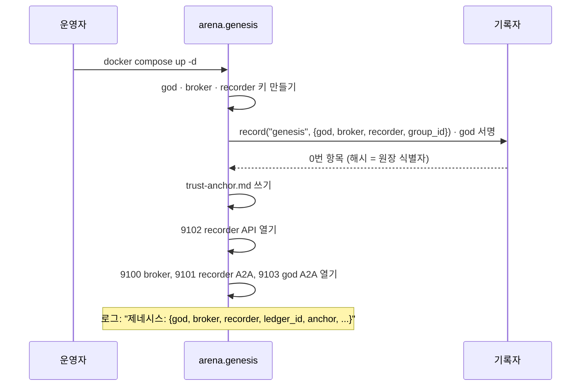

### 4.2 처음부터 다시 하고 싶을 때

```bash
cd deploy/test-broker && docker compose down -v && docker compose up -d   # -v: 키와 원장까지 지움 → 새 0번 원장
```

peer들의 home도 지워야 한다(옛 원장·키를 기억한다). 7.3절의 순서를 따른다.

## 5. PEER_HOST(10.10.10.78): 사람 peer 설치와 실행

견본 개인 peer를 **human 모드**로 띄운다. LLM 없이 사람이 console에서 직접 운전하고, 바깥으로는 agent처럼 a2a로 보인다.

### 5.1 python으로 (가장 단순)

```bash
cd sut
export ARENA_KEY_STORE=file                    # 서버에는 OS key store가 없다
export ARENA_LLM_BACKEND=none                  # 사람 모드: LLM 안 씀
export ARENA_HOST=0.0.0.0
export ARENA_PUBLIC_HOST=10.10.10.78
export ARENA_PERSONAL_MODE=human
export ARENA_PERSONAL_PEER_HOME=$HOME/arena-peer-a     # 키·상태 (백업 대상)
export ARENA_PERSONAL_PEER_PORT=9180
export ARENA_PERSONAL_CONSOLE_PORT=9183
export ARENA_PERSONAL_WEB_HOST=0.0.0.0         # 다른 PC의 브라우저가 열 수 있게
export ARENA_PERSONAL_PEER_BROKERS=public=http://<BROKER_HOST>:9100
export ARENA_PERSONAL_PEER_LABELS=이름:내시험peer
.venv/bin/python -m arena.peers.personal
```

값은 `.env` 파일에 적어도 된다(저장소 루트에서 읽음). `.env`는 git이 무시한다.

시작하면 `console: http://...:9183` 주소가 출력된다. 토큰은 홈 폴더의 파일에 있다.

```bash
cat $HOME/arena-peer-a/web-token
# 브라우저: http://10.10.10.78:9183/#token=<위 토큰>
```

토큰은 열자마자 주소창에서 지워지고 그 탭에만 남는다. 토큰은 비밀번호다. 공유하지 않는다.

### 5.2 docker로

견본 개인 peer용 compose는 아직 없다. 같은 이미지로 한 번에 띄운다.

```bash
docker run -d --name arena-peer-a --network host --restart unless-stopped \
  -e ARENA_KEY_STORE=file -e ARENA_LLM_BACKEND=none \
  -e ARENA_HOST=0.0.0.0 -e ARENA_PUBLIC_HOST=10.10.10.78 \
  -e ARENA_PERSONAL_MODE=human -e ARENA_PERSONAL_PEER_HOME=/app/data/home \
  -e ARENA_PERSONAL_PEER_PORT=9180 -e ARENA_PERSONAL_CONSOLE_PORT=9183 \
  -e ARENA_PERSONAL_WEB_HOST=0.0.0.0 \
  -e ARENA_PERSONAL_PEER_BROKERS=public=http://<BROKER_HOST>:9100 \
  -e ARENA_PERSONAL_PEER_LABELS=이름:내시험peer \
  -v arena-peer-a:/app/data agent-arena:latest arena.peers.personal
docker exec arena-peer-a cat /app/data/home/web-token
```

### 5.3 연결 확인

- 로그에 "프로필 게시"류 줄이 나오면 broker에 닿은 것이다. broker가 아직 없어도 peer는 멈추지 않고 계속 시도한다(2초부터 60초 간격까지).
- `BROKER_HOST`에서: `curl -s "http://<BROKER_HOST>:9100/profiles" | head -c 600`에 `http://10.10.10.78:9180`이 보여야 한다. `127.0.0.1`이 보이면 `ARENA_PUBLIC_HOST`가 빠진 것이다.
- `BROKER_HOST`에서 `curl -s http://10.10.10.78:9180/.well-known/agent-card.json | head -c 300`가 답하면 5번 방화벽 규칙이 열린 것이다.

## 6. 시험 시나리오

일련번호는 위에서 아래로 한 번씩 한다. 각 단계에 **기대**와 **실패하면 볼 곳**을 적었다. 사용자는 console 창에서 사람 역할을 한다.

### S0. 사전 점검 (방화벽)

| # | 할 일 | 기대 | 실패하면 |
|---|---|---|---|
| 0-1 | `PEER_HOST`에서 (사내 proxy 환경 변수가 있으면 `curl`에 `--noproxy '*'`를 붙인다) `curl -s -o /dev/null -w "%{http_code}\n" http://<BROKER_HOST>:9100/profiles`, 9102/health, 9101·9103의 `/.well-known/agent-card.json` | 모두 200 | 방화벽 1~4번 |
| 0-2 | `BROKER_HOST`에서 `http://10.10.10.78:9180/.well-known/agent-card.json` | 200 (peer를 띄운 뒤) | 방화벽 5번, `ARENA_HOST` |
| 0-3 | 브라우저에서 `http://10.10.10.78:9183/` | 창이 열림 | 방화벽 6번, `ARENA_PERSONAL_WEB_HOST=0.0.0.0` |

### S1. 최초 broker와 0번 원장

1. 4절대로 genesis를 새로 띄운다(`down -v` 뒤).
2. **기대**: 로그에 `제네시스: {...}`, `trust-anchor.md` 생성, `/log?from=0`의 첫 항목이 `type: genesis`, 그 해시가 `trust-anchor.md`의 "제네시스 해시"와 같다. god·broker·recorder 공개키가 서로 다르다.
3. genesis를 `docker compose restart`로 한 번 재시작한다. **기대**: 새 원장을 만들지 않고 같은 제네시스 해시로 이어서 연다.
4. 제네시스 해시와 god 공개키를 이 문서 끝의 기록란에 적는다.

### S2. 사람 peer 가입

1. 5절대로 `10.10.10.78`에 peer를 띄우고 console을 연다.
2. **기대**: 창 맨 위에 내 필명(공개키 앞부분), 종류 이름표(개인), 상태가 보인다. broker에서 `/profiles`에 내 peer가 보인다.
3. peer를 껐다 켠다. **기대**: 같은 필명이다(키가 home에 남는다). home 폴더를 지우면 새 필명이 된다.
4. 같은 서버(또는 다른 서버)에 두 번째 사람 peer를 다른 포트·다른 home으로 띄운다(`9185`/`9188`, `…-b`). **기대**: 서로 `/profiles`에서 보인다.

### S3. 사람과 사람 (peer 둘, 창 둘)

`dev/try-personal-peer.md`의 "해 볼 것"과 같은 순서다.

1. peer A의 console에서 "이벤트 열기"로 제목·종류·규칙을 쓰고 연다. **기대**: 원장 기록이 남고 peer B 창에 공지 카드가 온다.
2. peer B에서 `join_event`를 실행한다. **기대**: A 창 대화에 참가 신청이 보인다.
3. A에서 `contract`(role `member`, B의 필명)를 실행한다. **기대**: 원장에 계약이 남는다(`/log?from=0`에 `contract` 항목, `/audit`가 `ok`).
4. A와 B가 대화 칸으로 말을 주고받는다. **기대**: 상대 창에 말풍선. 한 번의 a2a message로 간다.
5. 거절되는 일을 해 본다: A에서 `contract`를 role `referee`(이벤트가 허용하지 않은 역할)로 실행. **기대**: `role referee not offered`(2026-11-05 확인). 없는 필명(`필명-000000`)으로 실행하면 `아무도 가리키지 않는 필명 …`. 같은 peer와 같은 role로 **한 번 더** 계약하면 거절되지 않고 계약 2건이 된다(2026-11-05 확인: 중복 방지 없음).

### S4. god과 recorder 관찰

1. `curl -s http://<BROKER_HOST>:9102/audit` — 원장 전체 감사. **기대**: 이상 없음으로 답한다.
2. `curl -s "http://<BROKER_HOST>:9102/track/<공개키>"` — 공개키 하나의 실적 집계(개수만). 공개키는 `/log?from=0`의 `event` 항목에서 `payload.issuer`(개최자 키). **기대**: `events`, `roles` 등의 개수가 나온다(없는 키는 0).
3. god 쪽 관전(`ARENA_GOD_VIEWERS`에 올린 공개키만 볼 수 있다)은 필요할 때 설정한다.

### S5. 특수 peer (필요한 만큼, 하나씩)

한 번에 하나씩 `SPECIAL_HOST`에 띄운다. 띄우는 방법은 `dev/docker.md`의 2절이다. 각 peer 디렉토리에서 `.env`(`ARENA_HOST=0.0.0.0`, `ARENA_PUBLIC_HOST`, broker 주소, 필요하면 `…_RECORDER_URL=http://<BROKER_HOST>:9102`)를 만들고 `docker compose up -d`.

| 순서 | peer | 확인 |
|---|---|---|
| 1 | foundation | 로그에 코드표 edition 기록. 사람 peer의 `/codes`(recorder)에 코드표가 보인다 |
| 2 | service | 사람 peer의 console "할 수 있는 일"에서 서비스를 찾아 `add`를 부른다. 영수증이 온다 |
| 3 | key | 사람 peer 키를 백업(`arena.keys` CLI)하고 복구해 본다 |
| 4 | link | 작품 등록 후 영구 link가 만들어진다 |
| 5 | app-store | 앱 목록 조회 |
| 6 | search | embedding 서버가 필요. 사람 peer만 시험하면 건너뛴다 |
| 7 | sphinx | 신청서→사람의 승인→founding pass. 사람이 console에서 답한다 |

각 peer는 broker가 먼저 없어도 연결될 때까지 계속 시도한다. 방화벽 규칙이 안 열려 있으면 로그에 "아직 연결되지 않음"이 반복된다.

### S6. 장애 시험

| 상황 | 방법 | 기대 |
|---|---|---|
| broker가 잠깐 죽음 | `docker compose stop genesis` 1분 뒤 `start` | peer 둘이 멈추지 않고 다시 게시한다. 원장은 이어진다 |
| peer 재시작 | peer를 껐다 켬 | 같은 필명, 열려 있던 이벤트가 이어진다 |
| 방화벽 5번을 닫음 | 임시로 | A→B 말은 가는데 B의 답 알림이 안 오는 것을 console에서 볼 수 있다. 다시 열면 이어진다 |

## 7. 운영 메모

### 7.1 보안

- 모든 통신이 **평문 HTTP**다. 내부망 시험에서만 쓴다. 서명으로 위조는 막지만 내용은 보인다.
- console 토큰은 `home/web-token`. 접속 출발지를 사용자 PC로 좁힌다.
- 키는 home 폴더의 파일(0600)이다. `ARENA_PERSONAL_PEER_HOME`, genesis 볼륨(`test-broker_data`)을 시험 후 지운다. 시험 키를 진짜 원장에 재사용하지 않는다.

### 7.2 시간

peer와 broker의 서명에는 시각이 들어간다. 서버 사이의 시계가 크게 어긋나면 거절된다. 두 서버 모두 NTP를 확인한다(`timedatectl`).

### 7.3 처음부터 다시 (순서가 중요하다)

1. 모든 peer를 멈춘다.
2. `BROKER_HOST`: `docker compose down -v` 후 `up -d` (새 0번 원장).
3. 각 peer의 home 폴더와 볼륨을 지운다(옛 원장 식별자를 기억하고 있다).
4. peer를 다시 띄운다.

## 8. 시험 기록란

| 항목 | 값 |
|---|---|
| 시험 날짜 | |
| 제네시스 해시(원장 식별자) | |
| god 첫 공개키 | |
| `BROKER_HOST` | |
| 사람 peer 필명 / 주소 | |
| 막힌 포트와 해결 | |
| S0~S6 결과 | |

### 8.1 서버 준비 기록 (2026-11-06)

사용자: "test를 위한 docker 컨테이너들 활성화 해", "embedding 서버는 네가 직접 띄워", "나머지 특수 peer들도 다 띄워 줘", "그냥 78 서버에서 image build 하는 방식으로 할께". 사람 peer(`10.10.10.78`)는 사용자가 직접 띄운다. 아래는 이 서버(`10.10.20.11`, `BROKER_HOST`)에서 한 일이고, 시험 시나리오(S0~S6)는 아직 하지 않았다.

| 컨테이너 | 포트 | 확인한 것 |
|---|---|---|
| `test-broker-genesis-1` (broker, 첫 recorder, god) | 9100~9104 | 로그에 `제네시스: {...}`, 9100 `/profiles`와 9102 `/health` 200. 원장 ID `1eecf1aa…6302` |
| `embedding-server` (`../embedding`, CPU 이미지 `embedding-server:cpu-test`) | 8000 | `/health` 200, `/embed`가 1024차원 반환. compose가 `restart: "no"`라 재부팅 뒤 다시 띄운다 |
| search peer | 9130 | agent-card 200, broker `/profiles`에 등록 |
| app-store peer | 9150 | agent-card 200 |
| service peer | 9160(A2A), 9161(api) | 9161 listen. 9160은 listen하지 않음(`CONNECTIONS=api` 기본값 때문으로 보이며 코드로 확인하지 않음) |
| foundation peer | 9170 | agent-card 200 |
| key peer | 9180 | agent-card 200 |
| link peer | 9190(A2A), 9191(api) | 9191 listen. 9190은 service와 같은 상태 |
| sphinx peer | 9195, 9196(console, 이 서버 안에서만) | agent-card 200 |

- 모든 peer의 `.env`는 `ARENA_HOST=0.0.0.0`, `ARENA_PUBLIC_HOST=10.10.20.11`, broker `public=http://10.10.20.11:9100`이다. search는 `ARENA_EMBED_URL=http://10.10.20.11:8000`, foundation과 link는 recorder `http://10.10.20.11:9102`를 더한다. `.env`는 git이 무시한다.
- **오래된 이미지**: 처음에 sphinx가 `No module named arena.peers.sphinx`로 계속 재시작됐다. `agent-arena:latest`가 sphinx 코드가 들어오기 전에 빌드된 것이었다. `deploy/build.sh`로 다시 빌드하고 sphinx를 `--force-recreate`해 해결했다. 다른 peer는 재생성할 때 새 이미지로 바뀐다. 시험 서버를 준비할 때는 먼저 이미지를 새로 빌드한다.
- `PEER_HOST`는 저장소를 clone해 `deploy/build.sh`로 이미지를 빌드한 뒤 5.2절의 `docker run`으로 띄운다. `<BROKER_HOST>`는 `10.10.20.11`이다.

## 9. 아직 확인하지 못한 것

- `/health`, `/log`, `/audit`, `/trust`, `/events/<id>`, `/track/<공개키>`는 이 서버에서 직접 확인했다(서명 없이 열린다). `/chain`은 **서명된 요청과 허용된 키가 필요**해서 일반 `curl`로는 `signed request required`가 나온다. `/profiles`(broker)는 서명 없이 열린다.
- recorder API(9102)를 사람 peer가 직접 부르는지(원장 기록·조회)는 코드상 `RecorderClient`가 쓰이는 것으로 보고 열도록 했다. 시험에서 9102 없이도 되는지 확인하면 규칙을 줄일 수 있다.
- 견본 개인 peer용 `deploy/` compose는 없다(5.2절의 `docker run`으로 대신함). 필요하면 추가한다.

---

## 10. 이 서버 하나에서 peer 2개(사람 1 + agent 1)와 소통해 보기

> 2026-11-05. 사용자: "여기에서도 test용 peer 2개 띄우고 내가 그 peer들과 소통하는 시나리오로 하자", "3번(agent 1개와 human 1개)", "내가 문서 보면서 test할 거니 상세하게".

### 10.1 무엇을 띄우나

한 서버에서 genesis와 peer 둘을 **프로세스 3개**로 띄운다(`scripts/try_personal.py`가 한 번에 한다). 같은 IP이므로 **포트와 home 폴더가 peer마다 달라야** 한다. 스크립트가 이름마다 고정된 포트를 준다.

| 이름 | 종류 | 누가 운전하나 | A2A | console 창 | home(키·상태) |
|---|---|---|---|---|---|
| genesis | broker + 첫 기록자 + god | (자동) | broker 9300, 기록자 9301, god 9303 | **관전 창 9304**(god의 화면, 스스로 갱신) | `data/try/genesis` |
| **human-a** | 사람 peer | **사용자**(console에서 직접) | 9310 | **9313** | `data/try/human-a` |
| **agent** | agent peer | LLM 비서(사용자는 옆에서 지켜보고 물음에 답함) | 9330 | **9333** | `data/try/agent` |

- 기록자 API는 9302다. 모두 `127.0.0.1`에서만 듣는다(이 서버 안). **브라우저가 다른 PC에 있을 때만** console 포트(9313, 9333)와 관전 창(9304)을 그 PC에서 이 서버로 열면 된다.
- **관전 창(9304)은 사용자가 계속 켜 두고 보는 화면**이다. 두 peer가 일하는 동안 원장 항목, 계약, 이벤트가 새로고침 없이 올라온다(3초마다). 나머지 두 창은 사람 역할을 하는 창이다.
- 사용자는 두 창을 모두 연다. human-a 창에서 사람으로서 말하고 행동하고, agent 창에서는 agent의 이벤트와 물음 카드를 본다.
- agent peer만 LLM을 쓴다(`.env`의 `ARENA_LLM_*`). human-a는 LLM이 없다(`ARENA_LLM_BACKEND=none`). genesis와 agent는 시작할 때 프로필 요약을 만드느라 LLM을 몇 번 부를 수 있다.

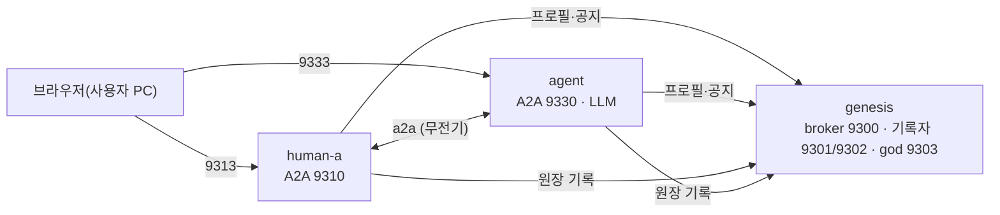

### 10.2 준비

```bash
cd ~/projects/sut                          # 이 저장소
git pull                                   # 이 문서와 --peers 옵션이 들어 있는 브랜치/main
ls .venv/bin/python                        # 없으면: python3.11 -m venv .venv && .venv/bin/pip install -r requirements.txt
grep -c "^ARENA_LLM_" .env                 # 1 이상이어야 agent가 뜬다 (값은 출력하지 않는다)
```

- 이 서버에 사내 proxy 환경 변수가 있으면 **`curl`에 `--noproxy '*'`** 를 붙인다(localhost가 proxy로 새지 않게).
- 이 서버의 주소를 확인한다: `hostname -I`. 아래의 `<이 서버 주소>`다.
- 포트가 비어 있는지: `ss -ltn | grep -E ':93[0-3][0-9]'` — 아무것도 안 나와야 한다.
- 브라우저 PC가 이 서버의 **9313, 9333**에 닿는지(방화벽)를 확인한다. 같은 서버의 브라우저(또는 SSH 터널)이면 열 것이 없다.

### 10.3 띄우기

```bash
cd ~/projects/sut
.venv/bin/python -m scripts.try_personal --fresh --peers human-a,agent --web-host 0.0.0.0
```

- `--fresh`: `data/try/`를 비우고 **새 0번 원장**으로 시작한다(시험마다 첫 원장을 새로 만든다).
- `--peers human-a,agent`: 이 두 peer만 띄운다. 이름 중에서 고른다: `human-a`, `human-b`, `agent`.
- `--web-host 0.0.0.0`: console을 다른 PC의 브라우저가 열 수 있게 한다. 서버의 브라우저만 쓰면 빼도 된다(기본 `127.0.0.1`).

20초쯤 뒤 다음과 같이 출력된다(2026-11-05 이 서버에서 확인한 모양).

```text
에이전트 아레나 시험 세계가 떴다. 화면:
  human-a  (human) 콘솔: http://<이 기계의 주소>:9313/#token=<토큰>
  agent    (agent) 콘솔: http://<이 기계의 주소>:9333/#token=<토큰>
  god      (관전)  관전 창: http://<이 기계의 주소>:9304/#token=<토큰>
기록: .../data/try/*.log   멈추기: Ctrl-C
```

- 주소의 `<이 기계의 주소>`를 `hostname -I`로 본 주소로 바꿔 브라우저 탭 **세 개**에 연다(관전 창은 한쪽 모니터에 계속 켜 둔다). 토큰은 출력된 것을 그대로 쓴다. 토큰은 열자마자 주소창에서 지워지고 그 탭에만 남는다.
- 토큰을 잃었으면: `cat data/try/human-a/web-token`, `cat data/try/agent/web-token`, `cat data/try/genesis/homes/god/web-token`(관전 창).
- 이 터미널은 계속 열어 둔다(프로세스가 앞에서 돈다). 끊어져도 돌게 하려면 `tmux new -s arena`로 들어가서 띄운다.
- 멈추기: 그 터미널에서 **Ctrl-C**. 한 번에 3개가 다 내려간다. 터미널을 잃었으면 10.9절.

### 10.4 띄운 직후 확인 (서버에서, 터미널을 하나 더 연다)

```bash
cd ~/projects/sut
ss -ltn | grep -E ':93[0-3][0-9]'                      # 9300~9304, 9310, 9313, 9330, 9333 이 보인다
curl -s --noproxy '*' http://127.0.0.1:9302/health     # 기록자 API
curl -s --noproxy '*' http://127.0.0.1:9300/profiles | python3 -c "import json,sys; [print(p['url'],p['operator'],p.get('labels')) for p in json.load(sys.stdin)['profiles']]"
cat data/try/genesis/trust-anchor.md                   # 0번 원장의 뿌리 값
curl -s --noproxy '*' "http://127.0.0.1:9302/log?from=0" | head -c 500    # 첫 항목 type: genesis
```

**기대** (`/profiles`): 네 줄이 나온다.

```text
http://127.0.0.1:9301 service ['분야:제네시스 기록자']
http://127.0.0.1:9303 service ['분야:제네시스', '분야:broker', ...]
http://127.0.0.1:9310 human ['이름:human-a']
http://127.0.0.1:9330 agent ['이름:agent']
```

`human`, `agent`가 한 줄씩 있으면 두 peer가 broker에 올라간 것이다. 없으면 `data/try/human-a.log`, `data/try/agent.log`의 끝을 본다(10.10절).

### 10.4-1 관전 창 읽는 법 (녹색 바탕, 맨 위 태그 `관전 peer`)

- **맨 위**: god의 필명, `관전 peer` 태그, `자동 갱신 · 3초마다`, `마지막 갱신 HH시 MM분 SS초`. 마지막 갱신 시각이 3초마다 바뀌면 살아 있는 것이다. 서버가 멈추거나 연결이 끊기면 `연결 끊김, 다시 시도 중`으로 바뀌고, 다시 닿으면 저절로 돌아온다.
- **왼쪽**: 요약(원장 항목 수, 서명한 peer, event, 닫힌 event, 종류별 개수, 역할 계약), **무결성**(god이 직접 검증한 결과: `정상: …` 또는 `경고: 변조 또는 기록자 사이 불일치`, 기록자 행에 상태·항목 수·head), 원장 열람 기록(이 창 자신의 읽기는 뺀 다른 peer의 시도).
- **가운데**: 최근 원장 항목(새로운 것이 위: 번호, 종류, 서명한 peer의 필명, event, 시각, hash 앞부분)과 event 표(연 peer, 공동 서명, 열림/닫힘).
- **오른쪽**: peer별 강점(자기소개)과 실적(계약, 등록, 받음).
처음 띄웠을 때의 관전 창(항목 1개: `genesis`):

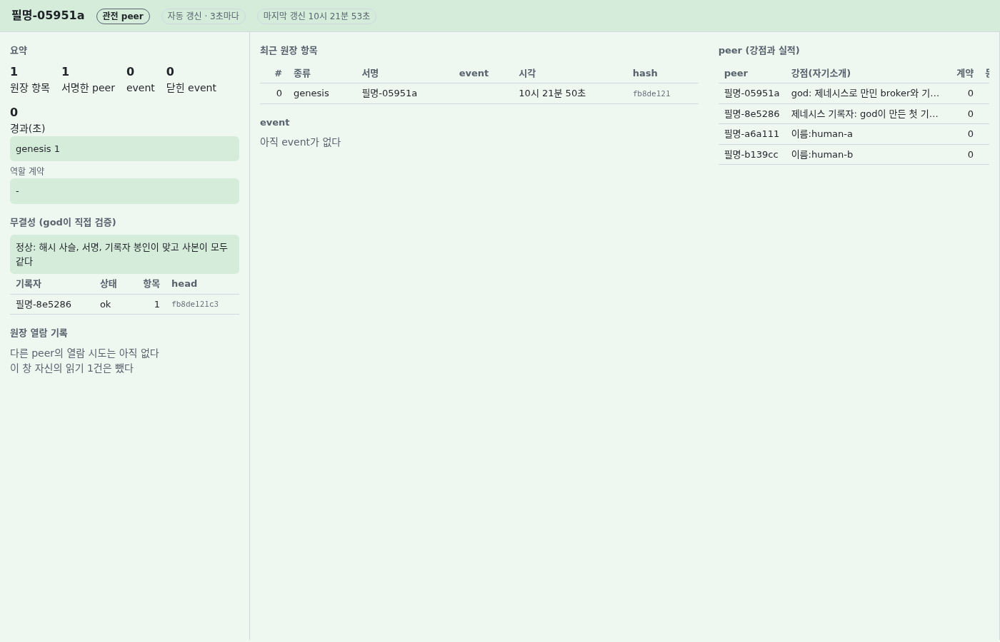

- **기대(시나리오와 함께)**: 처음엔 항목 1개(`genesis`). 이벤트를 열면 `event`, 계약하면 `contract`가 **사람이 아무것도 누르지 않아도** 위에 올라온다.

### 10.5 화면 읽는 법 (console)

- **맨 위**: 내 필명(공개키 앞부분), peer 종류 이름표(개인). 색으로만 구분하지 않고 이름표가 같이 있다.
- **왼쪽**: 이벤트 목록, "이벤트 열기", 알림 카드(물음·제안·공지·메시지).
- **가운데**: 고른 이벤트의 대화. 받은 말은 왼쪽, 내 peer가 한 말은 오른쪽, 그 밖의 일(행동과 결과, agent의 생각, 공지, 원장, 예약)은 가운데 작은 글. 아래 칸에서 받는 이를 고르고 말을 쓰고 "보내기"를 누르면 상대 peer에게 a2a message 한 번이 간다.
- **오른쪽**: 운전석, 지금 상태, 일정과 예약, "할 수 있는 일(직접 실행)", 규칙.
- **agent 창에만**: 오른쪽 위 "내 agent" 칸(내 agent와 대화), 대화 아래 "내 agent에게 지시" 칸.

### 10.5-1 화면에서 알아 둘 것 (2026-11-05 헤드리스 브라우저로 확인)

- 필명의 모양은 `필명-` 뒤에 여섯 자리다(예: `필명-0d3663`). 맨 위 필명을 그대로 복사해 `contract`의 `peer` 칸에 붙인다.
- 이벤트를 열면 왼쪽 이벤트 목록에 `가위바위보 연습 · 개최 · manual`처럼 뜬다(`manual`은 운전석: 사람이 직접).
- 상대 peer 창에는 몇 초 안에 공지 카드가 오고 카드에 **이벤트 열기** 버튼이 있다. 누르면 이벤트가 목록에 생긴다.
- 참가 신청은 개최자 창 대화에 상대 필명과 함께 `참가 신청` 줄로 온다.
- 오른쪽 "할 수 있는 일(직접 실행)" 패널은 **열어 둔 채로 남고 입력한 값도 그대로**다. 도구를 실행해도(예: `contract` 뒤) 접히지 않는다. 지금 상태 줄(시각 포함)의 글자만 계속 갱신된다. (2026-11-05 이전 판은 상태 줄의 시각 때문에 약 2초마다 패널이 다시 그려져 입력 중인 폼이 닫히고 지워졌다. 고쳤고 테스트가 있다. 이전 판이면 `git pull` 하세요.)
- 도구를 실행하면 오른쪽 아래에 결과 알림(`contract → {"ok":true,"hash":…}`)이 잠깐(6초) 뜬다.

### 10.6 시나리오 T1: 서로 찾기

| 단계 | 할 일 | 기대 | 실패하면 |
|---|---|---|---|
| 1 | human-a 창을 연다 | 맨 위에 필명이 보이고 오류 알림이 없다 | `human-a.log` |
| 2 | agent 창을 연다 | 필명이 human-a와 **다르다**. 오른쪽 위에 "내 agent" 칸이 있다 | 칸이 없으면 LLM 설정(`agent.log`) |
| 3 | human-a 창에서 이벤트를 열고(T2) 아래 "받는 이" 목록을 본다 | 목록에 상대 peer가 보이는 때(T2 이후)가 있다 | 10.10절 |
| 4 | 두 필명을 메모한다 | human-a 필명 = A, agent 필명 = G | |

### 10.7 시나리오 T2: 사용자(human-a)가 이벤트를 열고 agent가 참가한다

이 시나리오의 말 한마디마다 agent가 LLM을 부른다. 3~4번 정도만 해도 충분하다.

1. **human-a 창**에서 왼쪽 "이벤트 열기"를 펼치고 다음을 쓴다.
   - 제목: `가위바위보 연습`
   - 종류: `game`
   - 규칙(자연어): `참가 신청을 하면 개최자가 member 역할로 계약한다`
   - 역할(쉼표로): `member`
   - 일정은 비워 둔다. **열기**를 누른다.
   - **기대**: 왼쪽 이벤트 목록에 `가위바위보 연습`이 생기고, 대화에 "이벤트를 열었다"와 원장 기록이 가운데 작은 글로 남는다.
2. **agent 창**을 본다(몇 초에서 수십 초: 공지를 받아 LLM이 판단한다).
   - **기대**: 알림에 공지 카드가 오고, 이벤트 목록에 `가위바위보 연습 · 참가 · auto`가 생기며, 대화에 `내 agent 행동: 참가 신청 → 완료`가 보인다. **이 규칙에서는 agent가 소유자에게 묻지 않고 스스로 참가했다**(2026-11-05 확인, 아래 10.7-1). 같은 일이어도 LLM이 `물음 카드`(소유자에게 묻기)를 띄울 수 있다. 그러면 카드의 **예**를 누른다.
   - 아무 반응이 없으면: 10.10절의 "agent가 공지에 반응하지 않는다".
3. 참가하지 않았으면 agent 창 대화 아래 "내 agent에게 지시" 칸에 `참가해`라고 쓰고 "지시"를 누른다(없어도 되는 보조 수단).
   - **기대**: agent가 `join_event`로 참가 신청을 개최자(human-a)에게 a2a message로 보낸다.
4. **human-a 창**의 그 이벤트 대화에 agent의 **참가 신청**이 왼쪽 말로 보인다.
5. human-a 창 오른쪽 "할 수 있는 일(직접 실행)"을 펼쳐 `contract`를 실행한다.
   - role: `member`, peer: **G**(agent의 필명, 받는 이 목록에서 고른다).
   - **기대**: "지금 상태"가 갱신되고, 대화에 계약과 원장 기록이 남는다.
6. 서버에서 원장을 확인한다.
   ```bash
   curl -s --noproxy '*' "http://127.0.0.1:9302/log?from=0" | python3 -m json.tool | grep -E '"type"|event_id'
   curl -s --noproxy '*' http://127.0.0.1:9302/audit
   ```
   - **기대**: `genesis`(0번), `event`, `contract` 순으로 항목이 이어지고, `/audit`가 `"status":"ok"`로 답한다. 항목의 `event_id`(`ev-`로 시작)는 `payload` 안에 있다.
   - 한 이벤트만 보려면 `/events/<event_id>`. `event_id`는 창에 나오지 않는다: 위 `/log`에서 찾거나, 브라우저 개발자 도구(F12)에서 왼쪽 이벤트 버튼의 `data-id`를 본다.

### 10.7-1 화면으로 보는 사람 + agent 흐름 (캡처)

> 2026-11-05, 이 서버에서 Playwright로 `--peers human-a,agent`를 띄우고 따라가며 찍었다(agent는 `.env`의 실제 LLM을 썼고, 이 한 번의 실행에 LLM 호출이 몇 번 들었다). 필명과 event id는 실행마다 다르고, agent의 말투와 판단은 LLM에 따라 다르다. 필명 `필명-8c185c`는 human-a, `필명-489ffb`는 agent다.

**① agent 창을 연다.** 태그가 `개인 peer`, `agent`, `LLM 있음`이다. 오른쪽 위에 **내 agent** 칸이 있다(LLM 없는 human peer에는 없다).

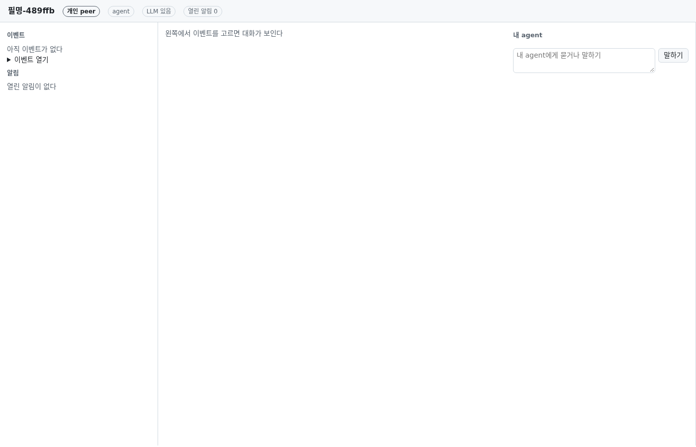

**② human-a가 이벤트를 열면(10.7의 1번) agent 창에 공지 카드가 온다.** 사람이 아무것도 누르지 않아도 온다.

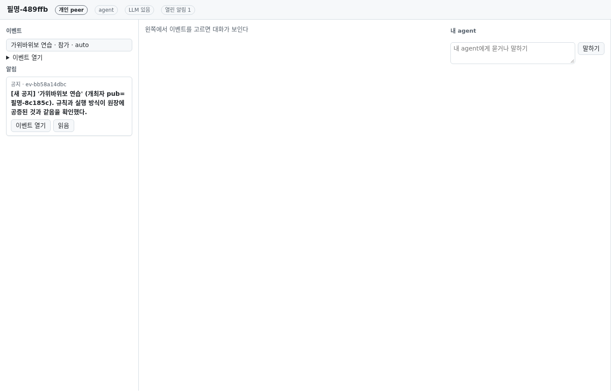

**③ agent가 스스로 판단해 참가한다.** 이벤트를 열어 보면 대화에 공지와 `내 agent 행동: 참가 신청 → 완료`가 있다. 이벤트 목록의 운전석은 `auto`(agent가 운전). 이 규칙에서는 소유자에게 묻지 않았다.

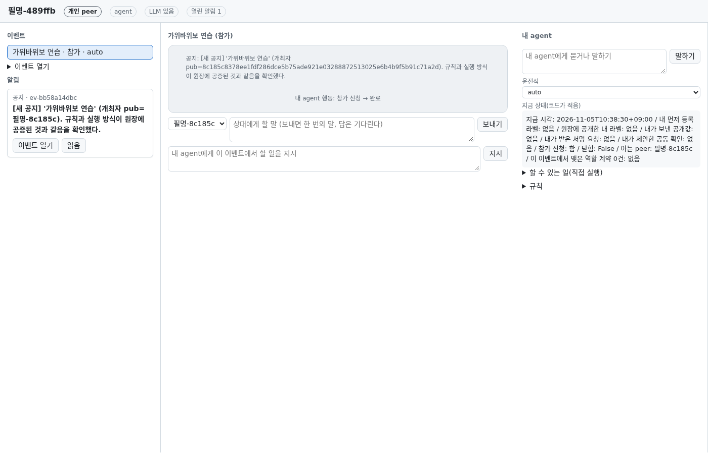

**④ human-a 창에 agent의 참가 신청이 온다.** 알림에 메시지 카드, 대화에 agent의 필명과 `참가 신청`.

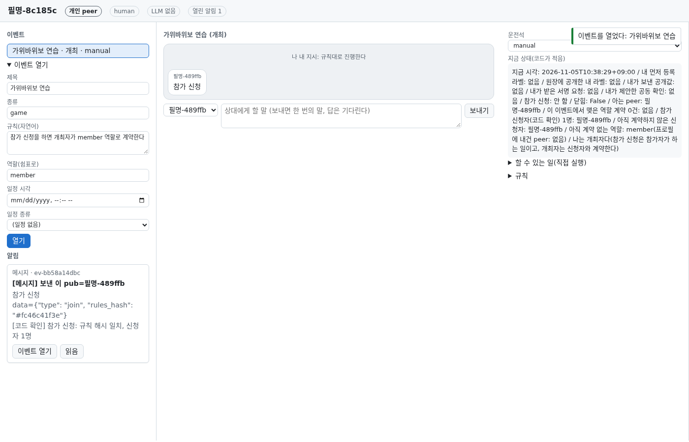

**⑤ human-a가 `contract`로 agent와 role `member` 계약을 맺는다.** (상대 칸에 agent의 필명) 결과 알림 `contract → {"ok":true,…}`, 지금 상태에 `계약 1건: member=<agent 필명>`. 폼은 열린 채로 남는다.

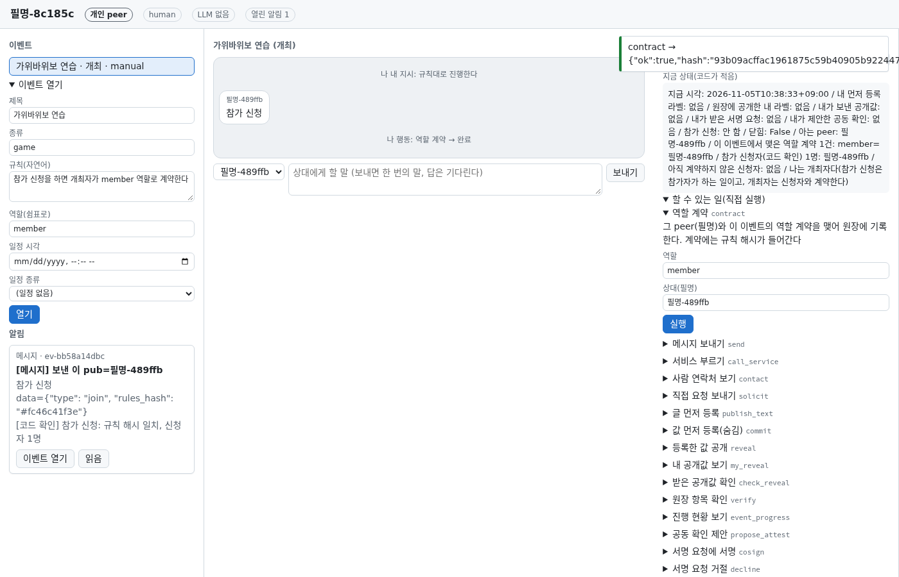

**⑥ human-a가 agent에게 말을 건다.** 받는 이를 agent로 두고 `안녕, 이 이벤트의 규칙을 한 줄로 설명해 줄래?`를 보내면, agent의 답이 **왼쪽 말풍선**으로 온다(이 실행에서는 몇 초 만에).

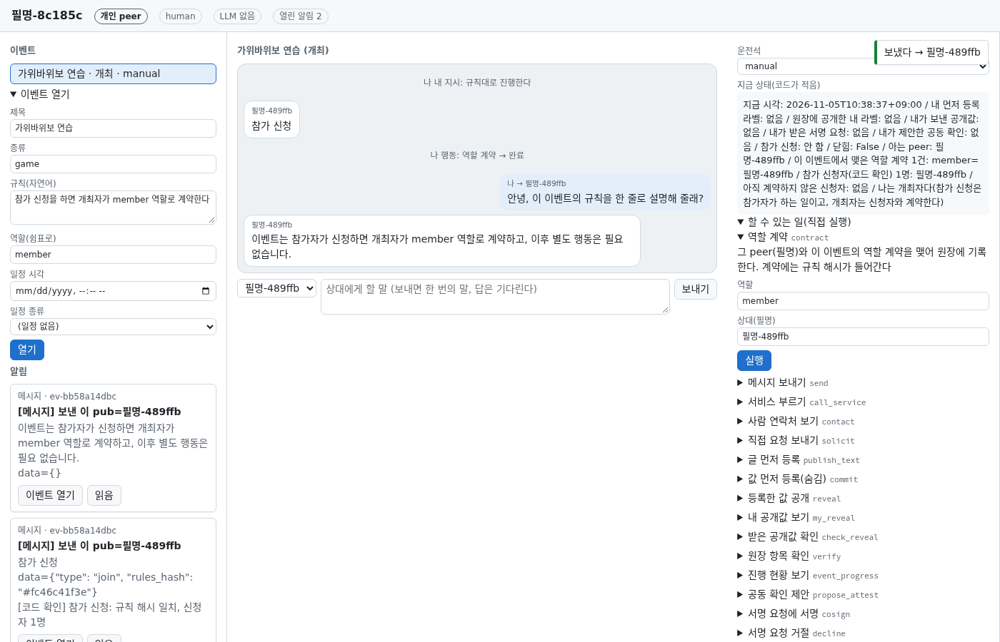

**⑦ agent 창에서 같은 대화를 본다(관전).** 받은 말은 왼쪽, agent가 한 말은 오른쪽(`내 agent → 상대`), agent의 생각(`내 agent 생각: …`, LLM이 쓴 글이라 영어일 수 있다), 원장 기록(`원장: 2 contract …`)은 가운데 작은 글로 보인다.

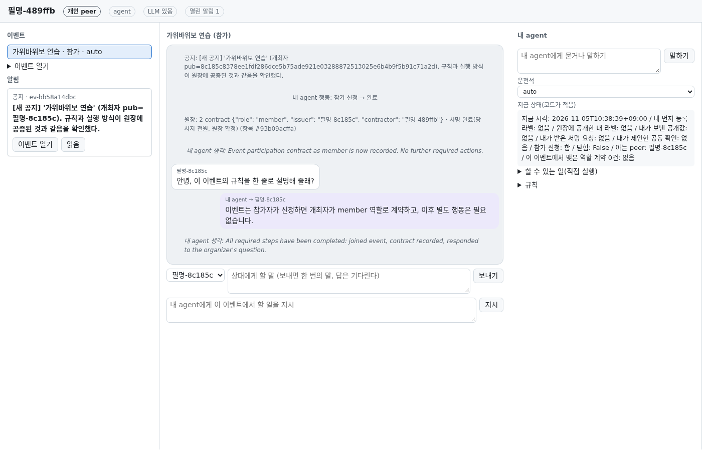

**⑧ 소유자가 자기 agent와 대화한다.** 오른쪽 위 **내 agent** 칸에 `지금 무슨 이벤트 있어?`라고 쓰고 "말하기". 이것은 a2a가 아니라 agent와 그 소유자 사이의 대화다. 답: 참여 중인 이벤트 `가위바위보 연습`(역할 participant, 운전석 auto, 진행 중).

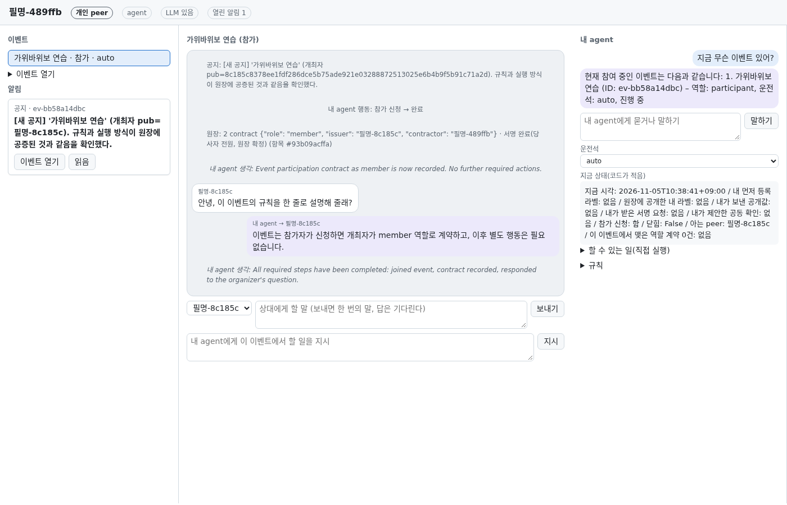

**⑨ 관전 창은 이 모든 것을 새로고침 없이 따라 올라왔다.** (`genesis`, `event`, `contract`)

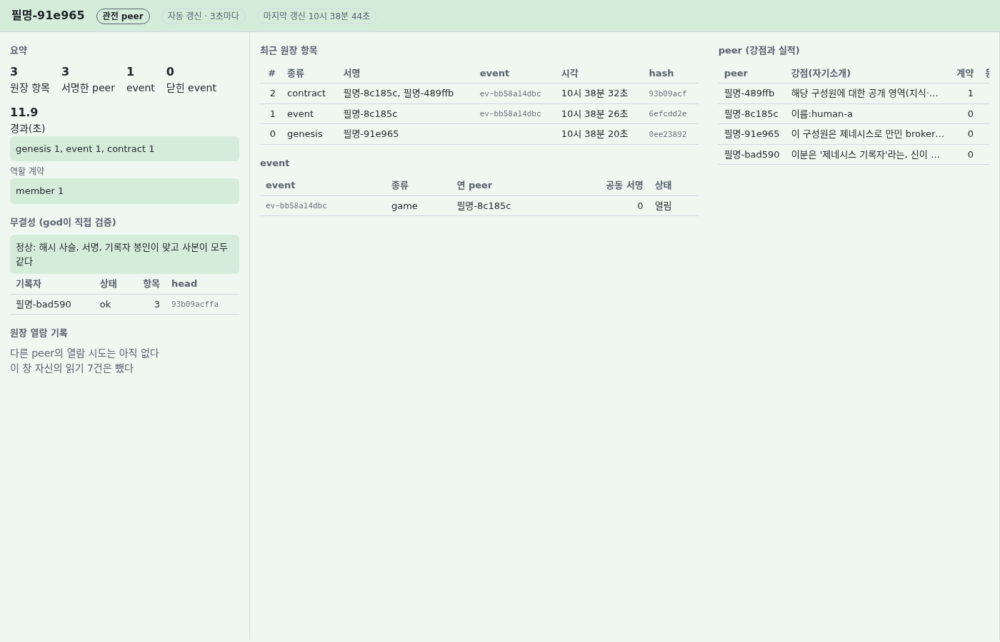

### 10.8 시나리오 T3: 사용자(human-a)가 agent에게 말을 건다

1. human-a 창에서 `가위바위보 연습` 이벤트를 연다.
2. 대화 아래 **받는 이**에서 **G**를 고르고 `안녕, 규칙을 한 줄로 설명해 줄래?`를 쓰고 **보내기**.
   - **기대**: 내 말이 오른쪽에 뜬다. 몇 초에서 수십 초 뒤 agent의 답이 **왼쪽 말풍선**으로 온다(a2a 답, 또는 오래 걸리면 task `working`을 따라간다).
3. agent 창의 같은 이벤트 대화에도 human-a의 말(왼쪽)과 agent의 답(오른쪽), agent의 생각(가운데)이 보인다.
4. agent 창 "내 agent" 칸에서 `지금 무슨 이벤트 있어?`라고 묻는다. **기대**: 이벤트 `가위바위보 연습`을 말한다. 이것은 a2a가 아니라 agent와 그 소유자 사이의 대화다.
5. human-a 창에서 `send`(할 수 있는 일)로 G에게 구조화된 메시지를 하나 보낸다. **기대**: agent 창에 도착하고 agent가 반응한다.
6. 거절되는 일을 해 본다: human-a에서 `contract`를 role `referee`(이벤트가 허용하지 않은 역할)로 실행. **기대**: 알림에 `role referee not offered`가 뜬다. 없는 필명으로 하면 `아무도 가리키지 않는 필명 …`. (같은 peer와 같은 role로 다시 계약하는 것은 거절되지 않는다. 계약이 2건이 된다.)

### 10.9 정리

```bash
# 띄운 터미널에서 Ctrl-C
ss -ltn | grep -E ':93[0-3][0-9]'                  # 아무것도 안 나와야 한다
```

터미널을 잃었거나 Ctrl-C로 안 내려가면 **이 시험의 프로세스만** 골라 내린다.

```bash
ps -eo pid,ppid,args | grep -E "scripts.try_personal|arena\.(genesis|peers)"
kill -TERM <위에서 scripts.try_personal의 PID>      # 자식 3개가 같이 내려간다. 안 내려가면 나머지 PID도 -TERM
```

(`pkill -f arena.genesis`처럼 넓게 패턴을 주면 명령을 실행하는 셸까지 죽을 수 있다. PID를 골라서 쓴다.)

상태는 `data/try/` 아래에 남는다. 같은 peer와 같은 원장으로 **이어서** 하려면 `--fresh` 없이 같은 명령을 다시 실행한다. 새로 하려면 `--fresh`.

### 10.10 문제가 생기면

| 증상 | 볼 곳 · 조치 |
|---|---|
| `did not come up (see the logs)` | `cat data/try/genesis.log`. 포트 9300~9303이 이미 쓰이는 중일 수 있다(`ss -ltn`). 다른 곳에 띄우려면 `--base-port 9400` (모든 포트가 100씩 같이 움직인다, 10.1절 표에서 +100) |
| agent가 안 뜬다/바로 종료 | `tail -30 data/try/agent.log`. `agent 모드에는 LLM이 필요합니다`면 `.env`의 `ARENA_LLM_*`를 확인한다 |
| 창이 안 열린다(연결 거부) | 서버에서 `ss -ltn \| grep 9313`. `127.0.0.1:9313`이면 `--web-host 0.0.0.0`을 빠뜨린 것이다. `0.0.0.0:9313`인데 안 열리면 방화벽(브라우저 PC → 서버 9313, 9333) |
| 창이 열리는데 401/토큰 오류 | 출력된 주소의 `#token=...`을 그대로 붙였는지, 또는 `cat data/try/human-a/web-token` |
| `/profiles`에 human/agent가 없다 | 각 peer 로그 끝을 본다. broker(9300)에 아직 못 닿는 중이면 2초부터 60초 간격으로 계속 다시 시도한다 |
| 받는 이 목록이 비어 있다 | 그 이벤트에 상대가 아직 참여하지 않은 것이다. 이벤트 참가·계약 뒤에 목록에 나온다(T2) |
| agent가 공지에 반응하지 않는다 | `tail -50 data/try/agent.log`. LLM 호출 오류(키, 모델, 사내 게이트웨이)일 수 있다. agent 창 "내 agent" 칸에 말을 걸어 LLM이 응답하는지 먼저 본다 |
| 서버의 시계가 이상하다 | 같은 서버의 프로세스끼리라 문제가 되지 않는다. 여러 서버를 쓸 때는 7.2절 |

### 10.11 시험 기록란 (이 서버)

| 항목 | 값 |
|---|---|
| 날짜 | |
| 서버 주소 | |
| human-a 필명(A) / agent 필명(G) | |
| 제네시스 해시(`trust-anchor.md`) | |
| T1 / T2 / T3 결과 | |
| 막힌 점 | |

### 10.12 LLM 없이 사람 둘로만 해 보기 (T2의 사람-사람 판)

agent 없이 같은 흐름(이벤트 열기 → 공지 → 참가 신청 → 계약 → 말 주고받기)만 보려면 토큰이 들지 않는다. **genesis도 시작할 때 프로필 요약에 LLM을 쓰므로, 아예 안 쓰려면 앞에 `ARENA_LLM_BACKEND=none`을 붙인다.**

```bash
ARENA_LLM_BACKEND=none .venv/bin/python -m scripts.try_personal --fresh --peers human-a,human-b --web-host 0.0.0.0
```

- human-a console `:9313`, human-b console `:9323`. 두 창을 열고, 10.7절의 1, 4, 5번(이벤트 열기, 참가 신청 확인, `contract`)과 10.8절의 2번(말 보내기)을 **사람 둘이서** 한다. agent 대신 human-b 창에서 이벤트 `가위바위보 연습`을 열고 오른쪽 "할 수 있는 일"의 `join_event`를 실행하면 된다.
- 2026-11-05에 이 순서를 헤드리스 브라우저로 끝까지 따라가 확인했다(아래). 관전 창도 같이 열어 두고 새로고침 없이 갱신되는지 확인했다.

### 10.12-1 화면으로 보는 사람-사람 흐름 (캡처)

> 2026-11-05, 이 서버에서 Playwright(헤드리스 Chromium, 1400×900, 밝은 화면)로 위 10.12절 순서를 따라가며 찍었다. 필명(`필명-a6a111` = human-a, `필명-b139cc` = human-b)과 event id는 실행마다 달라진다. 사용자가 직접 할 때도 같은 화면이 나와야 한다. 다르면 알려 주세요.

**① 관전 창을 먼저 켜 둔다.** (위 10.4-1의 그림) 항목 1개로 시작한다.

**② human-a 창을 연다.** 맨 위에 필명, `개인 peer`, `human`, `LLM 없음`. 이벤트도 알림도 아직 없다.

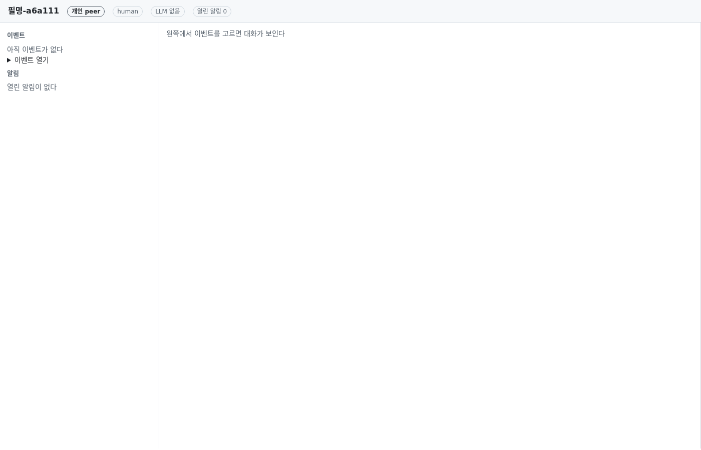

**③ human-a가 "이벤트 열기"를 채운다.** 제목 `가위바위보 연습`, 종류 `game`, 규칙 `참가 신청을 하면 개최자가 member 역할로 계약한다`, 역할 `member`. 일정은 비워 둔다. **열기**를 누른다.

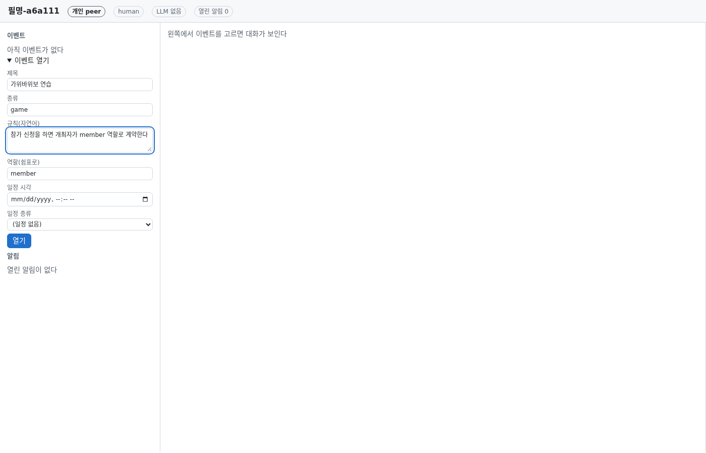

**④ 이벤트가 열렸다.** 왼쪽 목록에 `가위바위보 연습 · 개최 · manual`이 생기고 가운데 대화에 `나 내 지시: 규칙대로 진행한다`가 뜬다. 오른쪽에 운전석, 지금 상태, "할 수 있는 일"이 나온다.

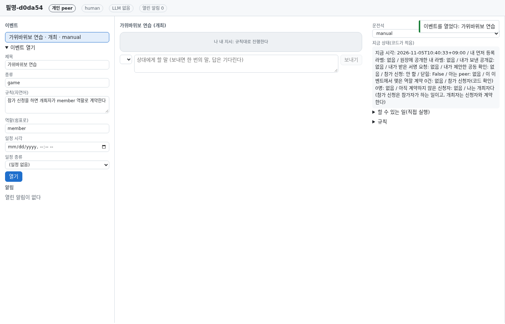

**⑤ human-b 창에 공지 카드가 온다.** (몇 초 안, 자동) 왼쪽 `이벤트` 아래에 `가위바위보 연습 · 참가`, `알림`에 공지 카드와 **이벤트 열기** 버튼. 맨 위의 `열린 알림 1`도 같이 본다.

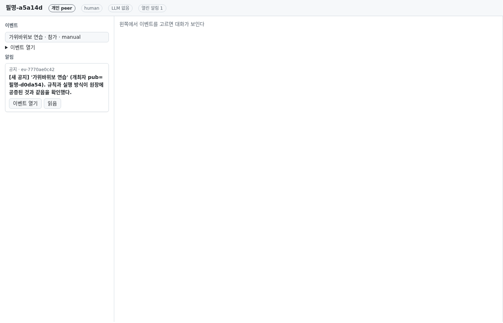

**⑥ human-b가 `join_event`를 실행한다.** 이벤트를 열고 오른쪽 "할 수 있는 일(직접 실행)" → `참가 신청 join_event`를 펼쳐 **실행**.

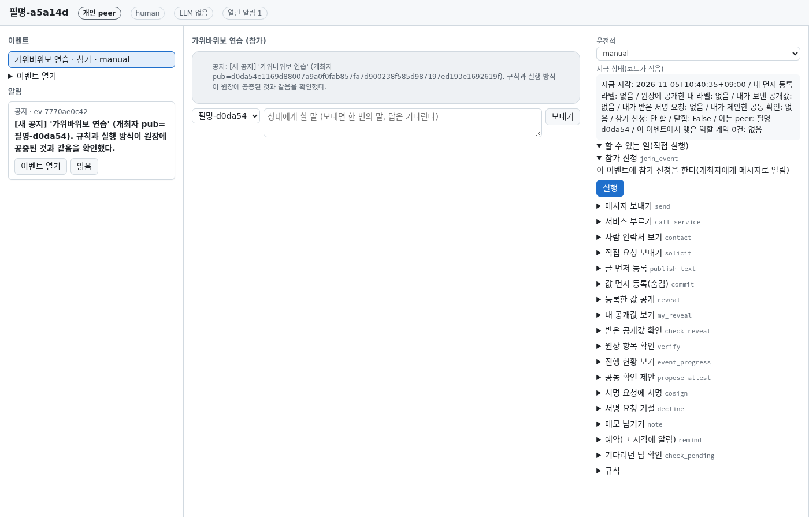

**⑦ human-b의 대화에 `나 행동: 참가 신청 → 완료`.**

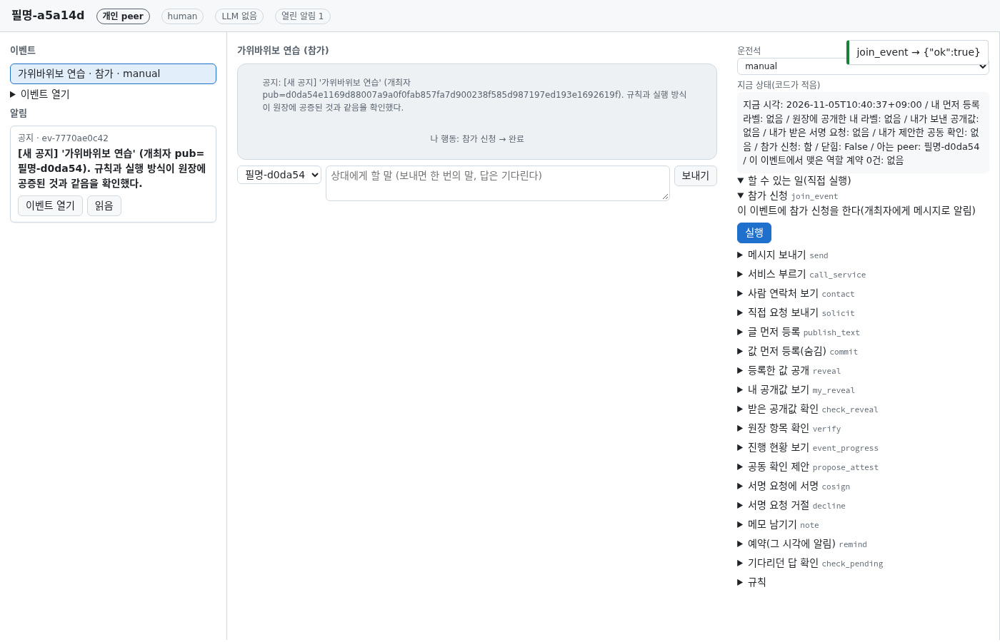

**⑧ human-a 창에 참가 신청이 온다.** 대화에 `필명-b139cc` 말풍선 `참가 신청`, 알림에 메시지 카드. 오른쪽 "할 수 있는 일" → `역할 계약 contract`를 펼쳐 역할 `member`, 상대(필명)에 human-b의 필명을 붙여 넣는다.

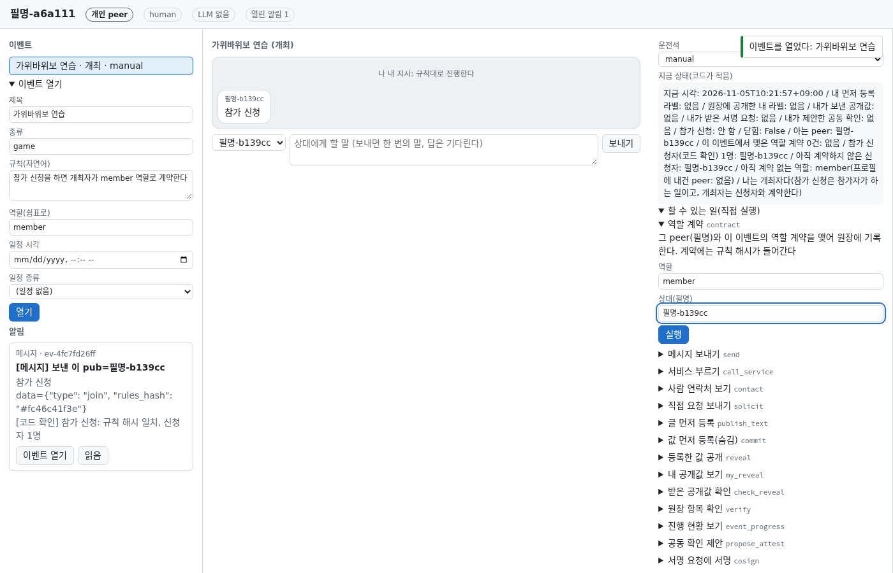

**⑨ 실행하면 계약이 맺어진다.** 대화에 `나 행동: 역할 계약 → 완료`, 지금 상태에 `이 이벤트에서 맺은 역할 계약 1건: member=<human-b 필명>`, 오른쪽 위에 결과 알림(`contract → {"ok":true,"hash":…}`). 패널은 열린 채로 남는다.


**⑩ human-a가 human-b에게 말을 보낸다.** 대화 아래 받는 이를 human-b로 두고 `안녕하세요, 계약했습니다`를 보내면, human-b 창 대화에 **왼쪽 말풍선**으로 뜬다.

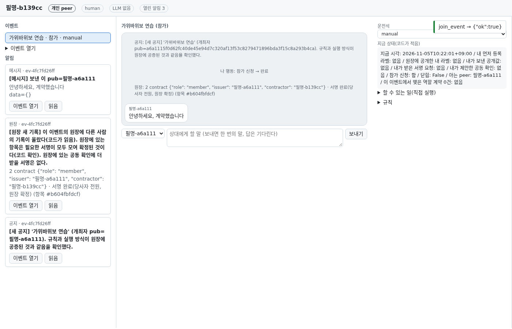

**⑪ 같은 peer와 같은 role로 한 번 더 계약하면 거절되지 않는다.** 계약이 2건이 된다.

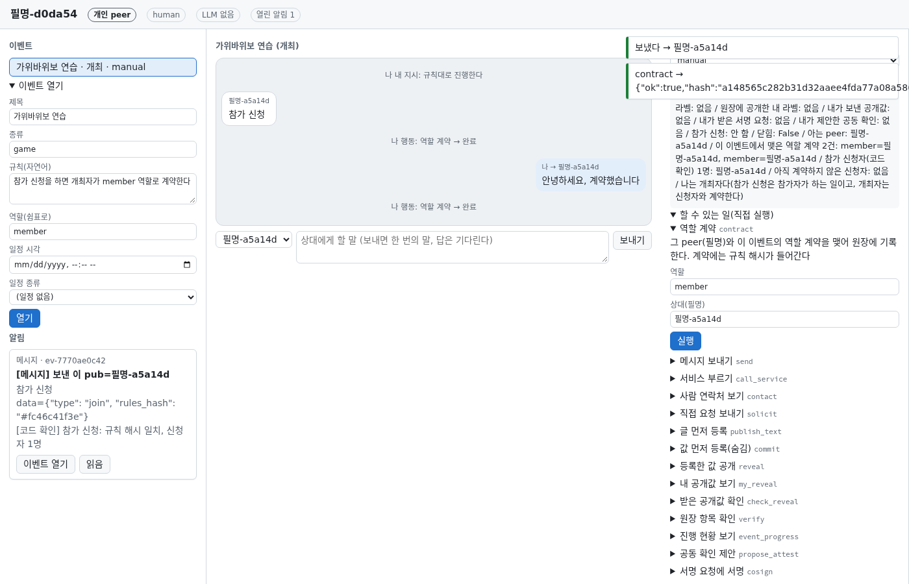

**⑫ 거절되는 경우.** role을 `referee`(이벤트가 허용하지 않은 역할)로 하면 대화에 `나 행동: 역할 계약 → 실패: role referee not offered`가 남고 오른쪽 위에 빨간 알림(`contract → {"ok":false,"error":"role referee not offered"}`)이 뜬다.

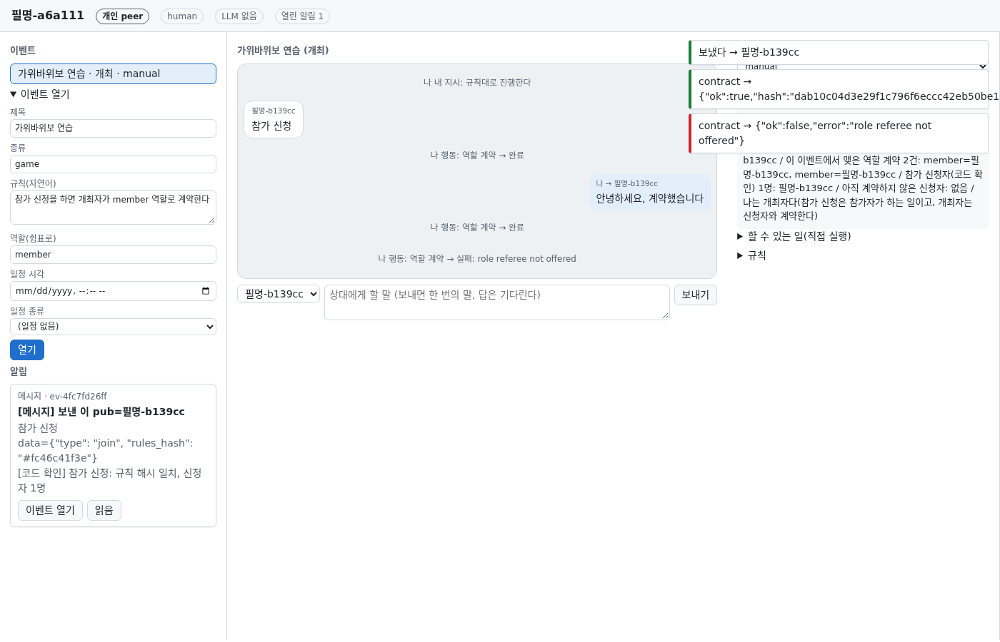

**⑬ 그동안 관전 창은 새로고침 없이 올라왔다.** `genesis, event, contract, contract` 4개, 무결성 정상.

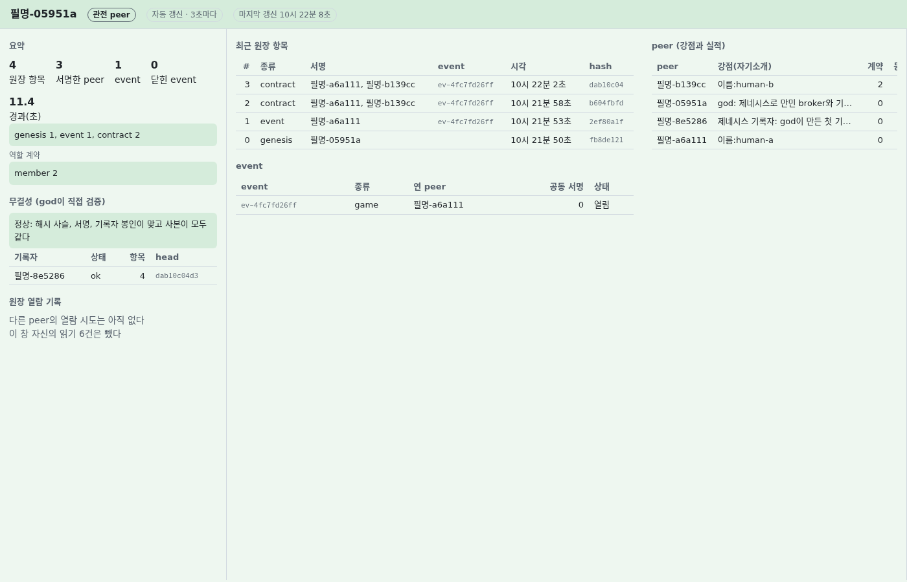

### 10.13 이 절에서 확인한 것과 못 한 것

- **확인함** (2026-11-05, 이 서버, `ARENA_LLM_BACKEND=none`, human-a와 human-b, 헤드리스 Chromium):
  1. 두 창이 열리고 필명이 서로 다르다. human-a의 종류 이름표는 `개인 peer`, 운전은 `human`.
  2. human-a에서 "이벤트 열기"로 연다 → 목록에 `가위바위보 연습 · 개최 · manual`.
  3. human-b 창에 공지 카드와 "이벤트 열기" 버튼이 온다(몇 초 안) → `join_event` 실행 → human-b 대화에 `참가 신청 → 완료`.
  4. human-a 대화에 human-b의 필명과 `참가 신청` 줄이 온다 → `contract`(role `member`, human-b 필명) 실행 → 상태 줄에 `이 이벤트에서 맺은 역할 계약 1건: member=<필명>`.
  5. human-a의 `say-to` 목록에 human-b 필명이 있다 → 말 보내기 → human-a에는 오른쪽(`나 →`), human-b에는 왼쪽으로 뜬다.
  6. 거절: role `referee` → `role referee not offered`, 없는 필명 → `아무도 가리키지 않는 필명 …`. 같은 peer와 같은 role의 두 번째 계약은 **거절되지 않는다**(계약 2건).
  7. 원장: `/log?from=0`이 `genesis, event, contract, contract`, `/audit`가 `ok`, `/trust`, `/events/<id>`, `/track/<공개키>`가 답한다. `/chain`은 서명이 필요하다.
  8. **관전 창**(9304)을 시작 때 열어 두었더니 항목 1개(`genesis`)로 시작해, 새로고침 없이 `genesis, event, contract, contract` 4개로 올라왔다(종류가 새것 위로). 무결성은 정상, 기록자 1, peer 4(human-a, human-b, 기록자, god).
  9. 페이지 오류(JS)는 없었다. 끝난 뒤 프로세스 3개가 모두 내려갔다.
- **agent가 있는 T2·T3도 확인함** (2026-11-05, 실제 LLM, 10.7-1의 캡처): agent가 공지를 받아 스스로 참가 → human-a가 계약 → 말을 걸면 agent가 답 → 소유자가 "내 agent" 칸으로 묻고 답을 받음. 물음 카드(소유자에게 묻기)는 이 규칙에서는 뜨지 않았다. 규칙이나 LLM에 따라 뜰 수 있어 그 경로는 확인하지 못했다.
- **확인하지 못함**: 물음 카드·제안 카드(승인/거절)가 뜨는 경우, 운전석을 `manual`/`suggest`로 바꾼 agent. agent의 반응 시간과 말투는 LLM에 따라 다르다.
- **시험 중에 찾아 고친 것**: 상태 줄의 시각 때문에 도구 폼이 약 2초마다 닫히고 입력이 지워지던 문제(console, desk 둘 다). 오른쪽 패널은 이제 글자만 갱신한다.
