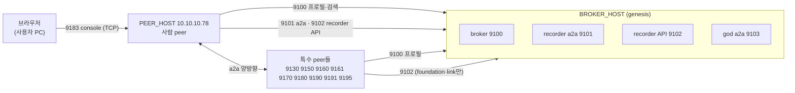
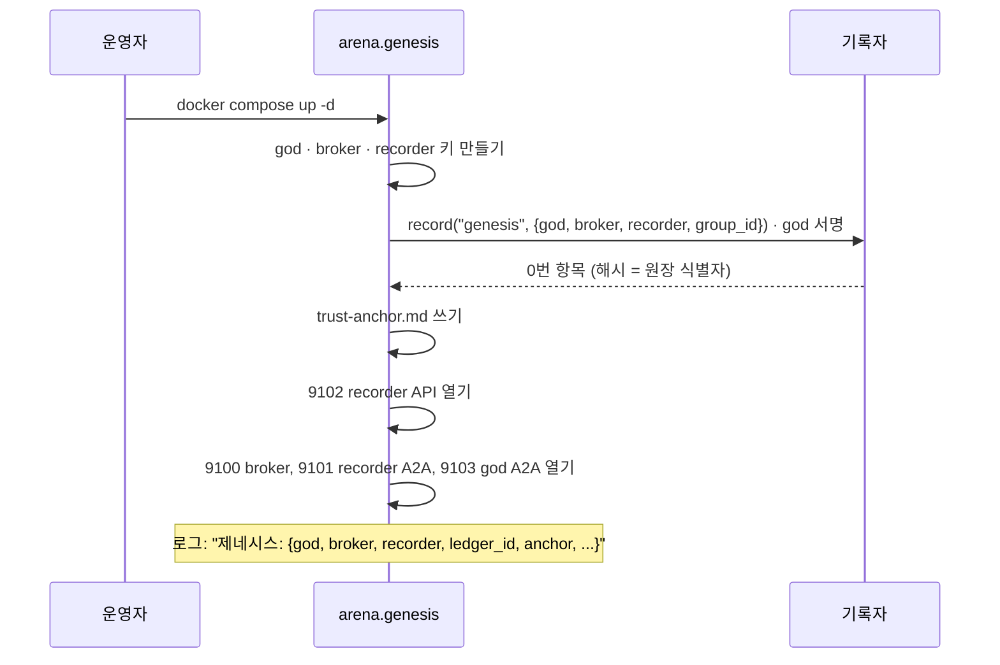

# 내부망(10.x) 시험 환경: 방화벽 포트, peer 설치, 시험 시나리오

> 2026-11-05. 사용자: "내부망 10.~ 대역에서 내가 직접 ui로 사람 역할을 하면서 사용을 해볼 거야", "방화벽 작업을 해야 하니 허용해야 할 port들(broker와 모든 접근해야 할 특수 peer 대상)", "나는 10.10.10.78에 하나의 peer를 띄울 거야", "최초 broker 생성, 0번 원장 생성 포함 시나리오".
>
> 이 문서는 코드와 배치 파일(`arena/config.py`, `.env.example`, `deploy/*`, `arena/genesis.py`, `dev/docker.md`)을 읽고 쓴 것이다. **10.x 망에서 실제로 돌려 본 결과가 아니다.** 아래 확인 명령으로 시험 때 하나씩 확인한다.

## 0. 이 문서의 가정

| 이름 | 뜻 | 값 |
|---|---|---|
| `BROKER_HOST` | 시험용 genesis(broker, 첫 recorder, god)를 띄울 서버 | **정해 주세요** (예: `10.10.10.7x`) |
| `PEER_HOST` | 사람 역할을 할 peer를 띄우는 서버 | `10.10.10.78` |
| `SPECIAL_HOST` | 특수 목적 peer(search, key, link …)를 띄울 서버 | 처음엔 `BROKER_HOST`에 같이 두는 것을 권함 |
| 브라우저 | 사용자가 화면을 여는 PC | 같은 10.x 망 (주소 정해 주세요) |

처음 시험은 서버를 `BROKER_HOST`와 `PEER_HOST` 둘로 한다. 특수 peer는 필요할 때 하나씩 추가한다(7절).

## 1. 누가 누구에게 닿아야 하나

peer는 broker에 프로필을 올려 찾게 하고, 서로는 **a2a로 직접** 주고받는다(무전기 방식, 연결을 열어 두지 않음). 그래서 broker만 열면 안 되고, **모든 peer의 A2A 포트가 서로 열려 있어야** 한다. 답이 늦으면 부르는 쪽 peer의 webhook(`<A2A 주소>/a2a/notify`)으로 알림이 오므로 방향은 양쪽이다.



## 2. 방화벽에서 열 포트

모두 TCP, HTTP다(TLS 없음). 방향은 "출발 → 도착 서버의 포트".

### 2.1 반드시 (최소 시험: genesis + 사람 peer 1)

| # | 출발 | 도착 | 포트 | 용도 |
|---|---|---|---|---|
| 1 | `PEER_HOST` | `BROKER_HOST` | **9100** | broker: 프로필 게시, peer 찾기, 공지 |
| 2 | `PEER_HOST` | `BROKER_HOST` | **9101** | 제네시스 기록자 A2A |
| 3 | `PEER_HOST` | `BROKER_HOST` | **9102** | recorder API (원장 기록·조회, `/health`, `/trust`, `/chain`) |
| 4 | `PEER_HOST` | `BROKER_HOST` | **9103** | god A2A (god에게 말 걸기, 관전·통계) |
| 5 | `BROKER_HOST` | `PEER_HOST` | **9180** | 사람 peer의 A2A(기본값): god·기록자가 답을 돌려주거나 알릴 때 |
| 6 | 브라우저 PC | `PEER_HOST` | **9183** | 사람의 창(console) |
| 7 | 시험하는 사람의 PC | `BROKER_HOST` | 9100, 9102 | `curl`로 상태 확인(선택, 시험 PC에서만) |

- 9183(console)은 **브라우저가 있는 PC에서만** 열면 된다. peer끼리는 필요 없다. 토큰이 없으면 못 들어가지만, 가능하면 출발지를 사용자 PC로 좁힌다.
- peer를 더 띄우면(사람 peer 2) 그 peer의 A2A·console 포트도 같은 식으로 연다. 같은 서버에 둘이면 포트를 겹치지 않게 한다(`ARENA_PERSONAL_PEER_PORT`, `ARENA_PERSONAL_CONSOLE_PORT`).

### 2.2 특수 peer를 시험할 때 추가 (기본 포트)

각 특수 peer 서버(`SPECIAL_HOST`)에 대해 "모든 peer → 그 서버의 A2A/API 포트" 방향을 연다. 그 서버는 `BROKER_HOST:9100`에 나가야 한다.

| peer | 포트 | 종류 | 나가야 하는 곳 |
|---|---|---|---|
| search(고급 검색) | **9130** | A2A | 9100, 그리고 embedding 서버(`ARENA_EMBED_URL`, 기본 8000) |
| app-store(앱 배포) | **9150** | A2A | 9100 |
| service(서비스) | **9160**(A2A) · **9161**(api) | A2A · REST | 9100 |
| foundation(재단, 코드표 판) | **9170** | A2A | 9100, **9102** (codebook edition 기록) |
| key(키 백업) | **9180** | A2A | 9100 |
| link(영구 link) | **9190**(A2A) · **9191**(api) | A2A · REST | 9100, **9102** (key rotation 확인) |
| sphinx(그룹 창설 심사, 사람이 운전) | **9195**(A2A) · 9196(console, 그 서버 안에서만) | A2A · 창 | 9100 |

- 9180이 **key peer 기본값과 견본 개인 peer 기본값이 같다.** 같은 서버에 두지 않거나 한쪽을 바꾼다. `10.10.10.78`에 사람 peer만 두면 문제없다.
- `god`를 genesis와 따로 띄우는 `ARENA_GOD_PEER_PORT=9140`은 genesis를 쓰면 필요 없다(genesis 안의 god는 9103).
- 검색 peer의 LLM·embedding 호출은 이 시험의 방화벽 대상이 아니다(사내 LLM 게이트웨이는 `BROKER_HOST`가 아니라 별도 허용이 있어야 한다). 사람 peer만 쓰면 LLM을 쓰지 않는다.

### 2.3 요약 (복사용)

```text
# BROKER_HOST로 들어오는 것 (출발: PEER_HOST, SPECIAL_HOST들)
9100/tcp  9101/tcp  9102/tcp  9103/tcp
# PEER_HOST(10.10.10.78)로 들어오는 것
9180/tcp  (출발: BROKER_HOST, SPECIAL_HOST들)      # peer A2A
9183/tcp  (출발: 브라우저 PC)                      # console 창
# SPECIAL_HOST로 들어오는 것 (출발: 모든 peer)
9130 9150 9160 9161 9170 9180 9190 9191 9195
```

포트를 바꾸고 싶으면 방화벽을 열기 전에 정한다. 각 포트는 환경 변수(`ARENA_*_PORT`)로 바꾼다(`.env.example`).

## 3. 서버 준비 (두 서버 공통)

저장소에는 Python 3.11 이상 또는 docker가 필요하다. `PEER_HOST`의 시스템 Python이 3.9이면 docker 방법을 쓴다.

```bash
git clone <저장소 주소> sut && cd sut
git checkout main
# A) docker (권함: 이미지는 하나, 설정은 .env)
deploy/build.sh                      # 사내 proxy 환경 변수는 이름만 넘어간다. 패키지 저장소에 닿아야 한다
# B) python
python3.11 -m venv .venv && .venv/bin/pip install -r requirements.txt
```

사내망에서 PyPI·docker 이미지에 닿지 않으면 build가 실패한다. 그때는 `BROKER_HOST`에서 build한 이미지를 `docker save`/`docker load`로 옮긴다.

## 4. BROKER_HOST: 최초 broker와 0번 원장 만들기

genesis는 **한 프로세스가 한꺼번에** 한다: god 키, broker 키, 첫 기록자 키를 만들고, god이 서명한 **0번 항목(`genesis`)**을 원장에 기록한 뒤 broker·recorder·god의 서버를 연다. 별도의 "0번 원장 만들기" 명령은 없다. 처음 켜면 만들어지고, 이후에는 저장된 원장을 이어 쓴다(다른 키로는 시작하지 않는다).

```bash
cd deploy/test-broker
cat > .env <<'EOF'
ARENA_IMAGE=agent-arena:latest
ARENA_HOST=0.0.0.0                  # 모든 곳에서 듣기
ARENA_PUBLIC_HOST=<BROKER_HOST 주소>   # profile과 recorder 주소에 적혀 남이 찾아올 주소 (0.0.0.0을 쓰면 안 됨)
ARENA_RECORDER_REQUIRE_GROUP=true
ARENA_GENESIS_DIR=/app/data/genesis
EOF
docker compose up -d
docker compose logs -f              # "제네시스: {...}" 줄이 보이면 끝
```

python으로 직접 띄우면(로그가 터미널에 나옴):

```bash
ARENA_HOST=0.0.0.0 ARENA_PUBLIC_HOST=<BROKER_HOST 주소> ARENA_GENESIS_DIR=data/genesis \
ARENA_KEY_STORE=file .venv/bin/python -m arena.genesis
```

> `ARENA_PUBLIC_HOST`를 빠뜨리면 profile에 `127.0.0.1`이 적혀 다른 서버의 peer가 닿지 못한다. 가장 흔한 실수다.

### 4.1 0번 원장이 만들어졌는지 확인

```bash
# 컨테이너 안의 genesis 폴더 (named volume). 키는 파일(0600)로 있다
docker compose exec genesis cat /app/data/genesis/trust-anchor.md
curl -s http://<BROKER_HOST>:9102/health
curl -s http://<BROKER_HOST>:9102/chain | head -c 600          # 0번 항목: type=genesis
curl -s http://<BROKER_HOST>:9102/trust | head -c 600
curl -s http://<BROKER_HOST>:9103/.well-known/agent-card.json | head -c 300    # god이 떠 있는지
```

`trust-anchor.md`에 **제네시스 해시(원장 식별자)**, god 첫 공개키, 첫 기록자 공개키, 만민 그룹(`public`)이 적힌다. 이 파일을 시험 기록으로 따로 보관한다(진짜 원장이 아니므로 시험이 끝나면 버려도 된다. 시험마다 새 원장을 만든다).



### 4.2 처음부터 다시 하고 싶을 때

```bash
cd deploy/test-broker && docker compose down -v && docker compose up -d   # -v: 키와 원장까지 지움 → 새 0번 원장
```

peer들의 home도 지워야 한다(옛 원장·키를 기억한다). 7.3절의 순서를 따른다.

## 5. PEER_HOST(10.10.10.78): 사람 peer 설치와 실행

견본 개인 peer를 **human 모드**로 띄운다. LLM 없이 사람이 console에서 직접 운전하고, 바깥으로는 agent처럼 a2a로 보인다.

### 5.1 python으로 (가장 단순)

```bash
cd sut
export ARENA_KEY_STORE=file                    # 서버에는 OS key store가 없다
export ARENA_LLM_BACKEND=none                  # 사람 모드: LLM 안 씀
export ARENA_HOST=0.0.0.0
export ARENA_PUBLIC_HOST=10.10.10.78
export ARENA_PERSONAL_MODE=human
export ARENA_PERSONAL_PEER_HOME=$HOME/arena-peer-a     # 키·상태 (백업 대상)
export ARENA_PERSONAL_PEER_PORT=9180
export ARENA_PERSONAL_CONSOLE_PORT=9183
export ARENA_PERSONAL_WEB_HOST=0.0.0.0         # 다른 PC의 브라우저가 열 수 있게
export ARENA_PERSONAL_PEER_BROKERS=public=http://<BROKER_HOST>:9100
export ARENA_PERSONAL_PEER_LABELS=이름:내시험peer
.venv/bin/python -m arena.peers.personal
```

값은 `.env` 파일에 적어도 된다(저장소 루트에서 읽음). `.env`는 git이 무시한다.

시작하면 `console: http://...:9183` 주소가 출력된다. 토큰은 홈 폴더의 파일에 있다.

```bash
cat $HOME/arena-peer-a/web-token
# 브라우저: http://10.10.10.78:9183/#token=<위 토큰>
```

토큰은 열자마자 주소창에서 지워지고 그 탭에만 남는다. 토큰은 비밀번호다. 공유하지 않는다.

### 5.2 docker로

견본 개인 peer용 compose는 아직 없다. 같은 이미지로 한 번에 띄운다.

```bash
docker run -d --name arena-peer-a --network host --restart unless-stopped \
  -e ARENA_KEY_STORE=file -e ARENA_LLM_BACKEND=none \
  -e ARENA_HOST=0.0.0.0 -e ARENA_PUBLIC_HOST=10.10.10.78 \
  -e ARENA_PERSONAL_MODE=human -e ARENA_PERSONAL_PEER_HOME=/app/data/home \
  -e ARENA_PERSONAL_PEER_PORT=9180 -e ARENA_PERSONAL_CONSOLE_PORT=9183 \
  -e ARENA_PERSONAL_WEB_HOST=0.0.0.0 \
  -e ARENA_PERSONAL_PEER_BROKERS=public=http://<BROKER_HOST>:9100 \
  -e ARENA_PERSONAL_PEER_LABELS=이름:내시험peer \
  -v arena-peer-a:/app/data agent-arena:latest arena.peers.personal
docker exec arena-peer-a cat /app/data/home/web-token
```

### 5.3 연결 확인

- 로그에 "프로필 게시"류 줄이 나오면 broker에 닿은 것이다. broker가 아직 없어도 peer는 멈추지 않고 계속 시도한다(2초부터 60초 간격까지).
- `BROKER_HOST`에서: `curl -s "http://<BROKER_HOST>:9100/profiles" | head -c 600`에 `http://10.10.10.78:9180`이 보여야 한다. `127.0.0.1`이 보이면 `ARENA_PUBLIC_HOST`가 빠진 것이다.
- `BROKER_HOST`에서 `curl -s http://10.10.10.78:9180/.well-known/agent-card.json | head -c 300`가 답하면 5번 방화벽 규칙이 열린 것이다.

## 6. 시험 시나리오

일련번호는 위에서 아래로 한 번씩 한다. 각 단계에 **기대**와 **실패하면 볼 곳**을 적었다. 사용자는 console 창에서 사람 역할을 한다.

### S0. 사전 점검 (방화벽)

| # | 할 일 | 기대 | 실패하면 |
|---|---|---|---|
| 0-1 | `PEER_HOST`에서 `curl -s -o /dev/null -w "%{http_code}\n" http://<BROKER_HOST>:9100/profiles`, 9102/health, 9101·9103의 `/.well-known/agent-card.json` | 모두 200 | 방화벽 1~4번 |
| 0-2 | `BROKER_HOST`에서 `http://10.10.10.78:9180/.well-known/agent-card.json` | 200 (peer를 띄운 뒤) | 방화벽 5번, `ARENA_HOST` |
| 0-3 | 브라우저에서 `http://10.10.10.78:9183/` | 창이 열림 | 방화벽 6번, `ARENA_PERSONAL_WEB_HOST=0.0.0.0` |

### S1. 최초 broker와 0번 원장

1. 4절대로 genesis를 새로 띄운다(`down -v` 뒤).
2. **기대**: 로그에 `제네시스: {...}`, `trust-anchor.md` 생성, `/chain`의 첫 항목이 `type: genesis`, 그 해시가 `trust-anchor.md`의 "제네시스 해시"와 같다. god·broker·recorder 공개키가 서로 다르다.
3. genesis를 `docker compose restart`로 한 번 재시작한다. **기대**: 새 원장을 만들지 않고 같은 제네시스 해시로 이어서 연다.
4. 제네시스 해시와 god 공개키를 이 문서 끝의 기록란에 적는다.

### S2. 사람 peer 가입

1. 5절대로 `10.10.10.78`에 peer를 띄우고 console을 연다.
2. **기대**: 창 맨 위에 내 필명(공개키 앞부분), 종류 이름표(개인), 상태가 보인다. broker에서 `/profiles`에 내 peer가 보인다.
3. peer를 껐다 켠다. **기대**: 같은 필명이다(키가 home에 남는다). home 폴더를 지우면 새 필명이 된다.
4. 같은 서버(또는 다른 서버)에 두 번째 사람 peer를 다른 포트·다른 home으로 띄운다(`9185`/`9188`, `…-b`). **기대**: 서로 `/profiles`에서 보인다.

### S3. 사람과 사람 (peer 둘, 창 둘)

`dev/try-personal-peer.md`의 "해 볼 것"과 같은 순서다.

1. peer A의 console에서 "이벤트 열기"로 제목·종류·규칙을 쓰고 연다. **기대**: 원장 기록이 남고 peer B 창에 공지 카드가 온다.
2. peer B에서 `join_event`를 실행한다. **기대**: A 창 대화에 참가 신청이 보인다.
3. A에서 `contract`(role `member`, B의 필명)를 실행한다. **기대**: 원장에 계약이 남고, `BROKER_HOST:9102`의 `/events/<event_id>`로 조회된다.
4. A와 B가 대화 칸으로 말을 주고받는다. **기대**: 상대 창에 말풍선. 한 번의 a2a message로 간다.
5. 원장이 거절해야 하는 일(역할이 없는 peer의 행동)을 해 본다. **기대**: 거절 사유가 창 오른쪽 위에 뜬다.

### S4. god과 recorder 관찰

1. `curl -s http://<BROKER_HOST>:9102/audit` — 원장 전체 감사. **기대**: 이상 없음으로 답한다.
2. `curl -s "http://<BROKER_HOST>:9102/track/<내 필명>"` — 내 기록. **기대**: S2~S3의 내 항목이 나온다.
3. god 쪽 관전(`ARENA_GOD_VIEWERS`에 올린 공개키만 볼 수 있다)은 필요할 때 설정한다.

### S5. 특수 peer (필요한 만큼, 하나씩)

한 번에 하나씩 `SPECIAL_HOST`에 띄운다. 띄우는 방법은 `dev/docker.md`의 2절이다. 각 peer 디렉토리에서 `.env`(`ARENA_HOST=0.0.0.0`, `ARENA_PUBLIC_HOST`, broker 주소, 필요하면 `…_RECORDER_URL=http://<BROKER_HOST>:9102`)를 만들고 `docker compose up -d`.

| 순서 | peer | 확인 |
|---|---|---|
| 1 | foundation | 로그에 코드표 edition 기록. 사람 peer의 `/codes`(recorder)에 코드표가 보인다 |
| 2 | service | 사람 peer의 console "할 수 있는 일"에서 서비스를 찾아 `add`를 부른다. 영수증이 온다 |
| 3 | key | 사람 peer 키를 백업(`arena.keys` CLI)하고 복구해 본다 |
| 4 | link | 작품 등록 후 영구 link가 만들어진다 |
| 5 | app-store | 앱 목록 조회 |
| 6 | search | embedding 서버가 필요. 사람 peer만 시험하면 건너뛴다 |
| 7 | sphinx | 신청서→사람의 승인→founding pass. 사람이 console에서 답한다 |

각 peer는 broker가 먼저 없어도 연결될 때까지 계속 시도한다. 방화벽 규칙이 안 열려 있으면 로그에 "아직 연결되지 않음"이 반복된다.

### S6. 장애 시험

| 상황 | 방법 | 기대 |
|---|---|---|
| broker가 잠깐 죽음 | `docker compose stop genesis` 1분 뒤 `start` | peer 둘이 멈추지 않고 다시 게시한다. 원장은 이어진다 |
| peer 재시작 | peer를 껐다 켬 | 같은 필명, 열려 있던 이벤트가 이어진다 |
| 방화벽 5번을 닫음 | 임시로 | A→B 말은 가는데 B의 답 알림이 안 오는 것을 console에서 볼 수 있다. 다시 열면 이어진다 |

## 7. 운영 메모

### 7.1 보안

- 모든 통신이 **평문 HTTP**다. 내부망 시험에서만 쓴다. 서명으로 위조는 막지만 내용은 보인다.
- console 토큰은 `home/web-token`. 접속 출발지를 사용자 PC로 좁힌다.
- 키는 home 폴더의 파일(0600)이다. `ARENA_PERSONAL_PEER_HOME`, genesis 볼륨(`test-broker_data`)을 시험 후 지운다. 시험 키를 진짜 원장에 재사용하지 않는다.

### 7.2 시간

peer와 broker의 서명에는 시각이 들어간다. 서버 사이의 시계가 크게 어긋나면 거절된다. 두 서버 모두 NTP를 확인한다(`timedatectl`).

### 7.3 처음부터 다시 (순서가 중요하다)

1. 모든 peer를 멈춘다.
2. `BROKER_HOST`: `docker compose down -v` 후 `up -d` (새 0번 원장).
3. 각 peer의 home 폴더와 볼륨을 지운다(옛 원장 식별자를 기억하고 있다).
4. peer를 다시 띄운다.

## 8. 시험 기록란

| 항목 | 값 |
|---|---|
| 시험 날짜 | |
| 제네시스 해시(원장 식별자) | |
| god 첫 공개키 | |
| `BROKER_HOST` | |
| 사람 peer 필명 / 주소 | |
| 막힌 포트와 해결 | |
| S0~S6 결과 | |

## 9. 아직 확인하지 못한 것

- 이 문서의 `curl` 확인 경로 중 `/profiles`, `/health`, `/chain`, `/audit`, `/trust`, `/track`, `/events`는 코드의 라우트에서 확인했지만, 인증 조건(`guarded`)이 이 망에서 어떻게 작동하는지는 돌려 보지 않았다. 401/403이 나오면 알려 주세요.
- recorder API(9102)를 사람 peer가 직접 부르는지(원장 기록·조회)는 코드상 `RecorderClient`가 쓰이는 것으로 보고 열도록 했다. 시험에서 9102 없이도 되는지 확인하면 규칙을 줄일 수 있다.
- 견본 개인 peer용 `deploy/` compose는 없다(5.2절의 `docker run`으로 대신함). 필요하면 추가한다.
