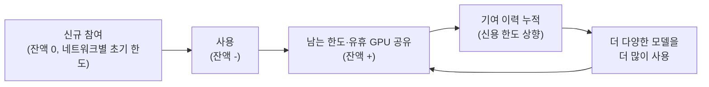
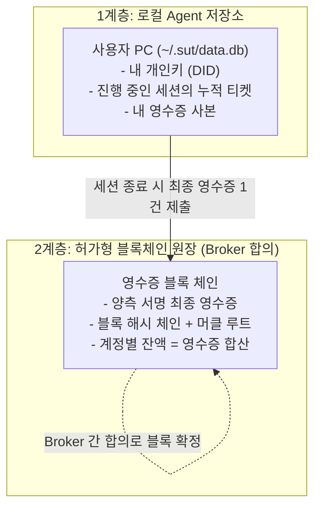
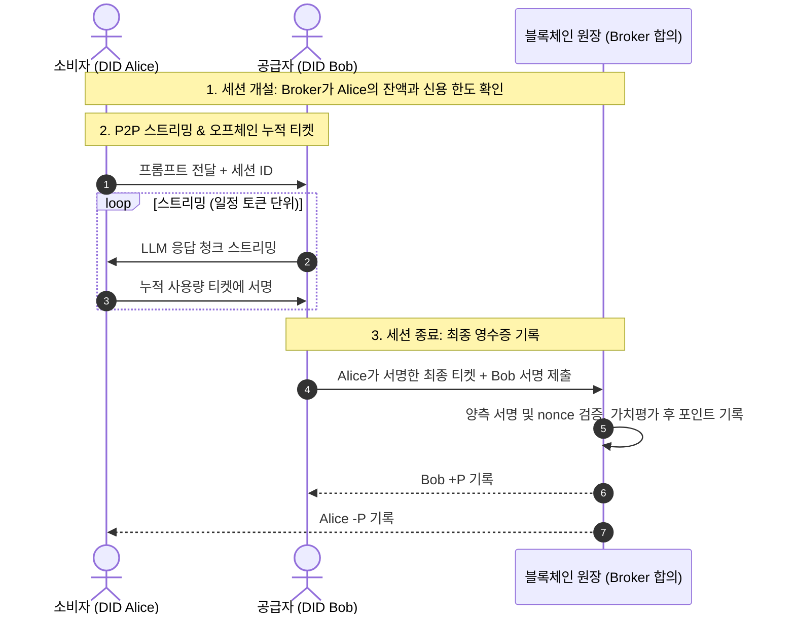

# SUT 포인트 원장(Ledger) 및 정산 아키텍처

> **공급하면 포인트가 쌓이고, 사용하면 포인트가 줄어드는 상호신용(Mutual Credit) 방식의 정산 구조와, 양측 서명 영수증을 영구 기록하는 Broker 합의형 블록체인 원장**

---

## 1. 정산 원리: 상호신용 (Mutual Credit)

### 1.1 기본 규칙
- **공급하면 +, 사용하면 -**: 한 건의 요청이 처리되면 [실시간 가치평가 메커니즘](valuation-mechanism.md)으로 평가한 같은 포인트가 공급자에게 +P, 소비자에게 -P로 기록됩니다.
- **합계는 항상 0**: 포인트를 새로 발행하지 않습니다. 누군가의 +는 반드시 다른 누군가의 -입니다.
- **0에서 시작, 신용 한도까지 마이너스 허용**: 모든 참여자는 잔액 0에서 시작하며, **신용 한도**까지 마이너스로 내려가 사용할 수 있습니다. 신용 한도 규칙은 네트워크마다 다릅니다(1.2절).
- **포인트는 공급·사용 정산용**이며, 계정 간 이전 없이 공급과 사용으로만 움직입니다. 정산 수단이므로 교환 가치를 가질 수 있고, 이를 허용하지 않는 공급원은 SUT에 공급하지 않습니다.
- **네트워크별 원장**: 공개 네트워크와 각 폐쇄형 네트워크는 원장이 따로 있으며, 포인트는 네트워크를 넘나들지 않습니다. ([시스템 개요 2.4절](system-overview.md))

### 1.2 신용 한도와 첫 거래 문제

"잔액이 있어야 쓸 수 있다"는 규칙이라면, 처음에는 아무도 포인트가 없으므로 첫 거래가 일어날 수 없습니다. 반대로 누구에게나 마이너스 한도를 주면, 새 계정을 계속 만들어 한도만 쓰고 떠나는 무임승차가 생깁니다. 그래서 신용 한도는 네트워크의 입장 방식에 따라 다르게 둡니다.

| 네트워크 | 초기 신용 한도 | 첫 거래가 성립하는 방식 | 새 계정 무임승차 |
| :--- | :--- | :--- | :--- |
| **폐쇄형** | 운영 주체 정책 (예: 승인된 참여자에게 작은 초기 한도) | 승인된 참여자가 작은 한도로 먼저 사용 | 입장 승인 단계에서 걸러짐 |
| **공개형** | **0 (기여 우선)** | 공급자가 먼저 공급해 +P를 얻고, 그 포인트로 다른 모델을 사용. 공급자끼리 서로 쓰면서 순환이 시작됨 | 새 계정은 한도가 0이라 가져갈 것이 없음 |

- 어느 네트워크든 공급 이력이 쌓일수록 신용 한도가 늘어납니다.

아래는 폐쇄형 네트워크에서 신규 참여자 C가 작은 초기 한도로 먼저 쓰는 예입니다.

| 단계 | A (OpenAI API 공급) | B (로컬 GPU 공급) | C (신규 참여) | 합계 |
| :--- | :---: | :---: | :---: | :---: |
| 시작 | 0 | 0 | 0 | 0 |
| B가 A의 모델 사용 (500 P) | +500 | -500 | 0 | 0 |
| A가 B의 모델 사용 (300 P) | +200 | -200 | 0 | 0 |
| C가 심야에 B의 GPU 사용 (400 P) | +200 | +200 | -400 | 0 |

### 1.3 선순환 구조



- **신용 한도는 기여에 따라 늘어납니다**: 네트워크별 초기 한도(폐쇄형은 운영 주체 정책, 공개형은 0)에서 시작하고, 공급 이력이 쌓일수록 한도가 커집니다.
- **잔액 상한**: 플러스 잔액에 상한을 두어, 포인트를 쌓아 두기만 하지 않고 다시 사용하도록 유도합니다.
- **시간대별 가치평가의 효과**: 피크 시간대에 공급하면 포인트를 더 받고, 유휴 시간대에 쓰면 덜 차감되므로, 참여자들이 자연스럽게 서로의 빈 시간을 메워 줍니다.

---

## 2. 원장 보관 구조: 로컬 저장소 + 허가형 블록체인 원장



| 계층 | 보관 위치 | 저장 데이터 | 특성 |
| :--- | :--- | :--- | :--- |
| **1. 로컬 저장소** | 사용자 PC (`SQLite`) | 개인키, 진행 중인 세션의 누적 티켓, 내 영수증 사본 | 즉시 기록. SUT Agent가 로컬 관리 |
| **2. 허가형 블록체인 원장** | Broker 노드들이 합의해 블록을 확정하고 복제 보관 | 양측 서명 최종 영수증, 해시 체인, 머클 루트 | **추가만 가능, 수정·삭제 불가**. 잔액은 영수증을 합산해 누구나 재계산 가능 |

- **영구 기록**: 제공한 토큰과 사용한 토큰은 영수증으로 영구히 남습니다. 영수증은 블록 단위로 묶이고, 각 블록은 이전 블록의 해시를 포함하는 체인으로 연결되어, 과거 기록을 바꾸면 이후 해시가 모두 어긋납니다.
- **Broker 합의**: 블록은 Broker 노드들의 합의(예: BFT 계열 합의, 과반 서명)로 확정됩니다. 합의에 참여하는 Broker는 폐쇄형 네트워크에서는 운영 주체가 지정하고, 공개 네트워크에서는 공개 네트워크의 Broker 합의 참여 규칙에 따릅니다. 한 Broker가 기록을 조작해도 다른 Broker들의 서명을 얻을 수 없어 확정되지 않습니다.
- **기록 범위**: 원장에는 소비자의 원장 DID 기준으로 토큰 수, 포인트, 모델, 시각, 양측 서명만 기록하고 프롬프트 원문은 기록하지 않습니다. 참여자는 가명(DID)으로 식별되며, 신용 한도와 제재를 위해 같은 DID는 같은 사람으로 취급됩니다. (상세: [P2P 네트워크 및 DID 구조](p2p-and-identity.md) 3.3절)
- **코인·가스비 없음**: 참여 자격이 있는 Broker들만 블록을 확정하는 허가형(Permissioned) 체인이므로, 블록 확정을 위한 채굴 보상 코인이나 거래 수수료(가스비)가 필요 없습니다. 원장에 기록되는 값은 포인트 증감뿐입니다.

---

## 3. 세션 정산 라이프사이클



---

## 4. 핵심 세부 기술 메커니즘

### 4.1 토큰 카운팅
- **기준값**: 업스트림 LLM 응답에 포함된 `usage` 값(입력, 출력, 캐시 적중 토큰 수)을 기준으로 삼습니다.
- **소비자 측 교차 확인**: 소비자 Agent는 받은 텍스트로 토큰 수를 근사 계산해, `usage` 값이 비정상적으로 크면 서명을 거부합니다. (공개 토크나이저가 없는 모델도 있으므로 완전 일치가 아닌 허용 오차 범위로 판정)

### 4.2 누적 티켓 (Micro-Ticket Structure)
스트리밍 도중 교환되는 서명 티켓은 단조 증가하는 `nonce`를 가지며, 항상 최신 서명이 이전 서명을 대체합니다.
```json
{
  "session_id": "s-89abcd",
  "nonce": 14,
  "model": "claude-sonnet-5-5",
  "tokens": { "input": 1200, "output": 200, "cached": 800 },
  "points": "3.42",
  "consumer_signature": "0x3f98a1..."
}
```
- **잠적 방지**: 소비자가 다음 구간의 티켓에 서명하지 않으면, 공급자는 즉시 스트리밍을 중단합니다.

### 4.3 Broker 운영 보상
- 매칭을 주선한 Broker에는 해당 거래 포인트의 극소량(예: 0.2%)이 기록됩니다. 이 몫은 소비자 차감분에 포함되므로 전체 합계 0은 유지됩니다.

---

## 5. 부정 방지

| 위험 시나리오 | 방어책 |
| :--- | :--- |
| **공급자의 토큰 수 부풀리기** | 소비자는 자신이 확인한 수량에만 서명함. 공급자 단독으로 영수증을 만들 수 없음 |
| **소비자의 잠적** | 티켓 서명이 끊기면 즉시 스트리밍 중단. 손실은 마지막 구간으로 한정 |
| **과거 영수증 재제출** | 원장은 세션별로 가장 높은 `nonce`의 양측 서명 영수증만 유효 처리 |
| **신규 계정으로 한도만 쓰고 이탈** | 공개 네트워크는 초기 한도 0(기여 우선)이라 새 계정으로 가져갈 것이 없음. 폐쇄형 네트워크는 입장 승인 단계에서 걸러지고, 운영 주체가 정한 작은 초기 한도만 허용 |
| **원장 조작** | 블록 해시 체인과 Broker 합의로 단일 Broker의 조작을 차단 |
