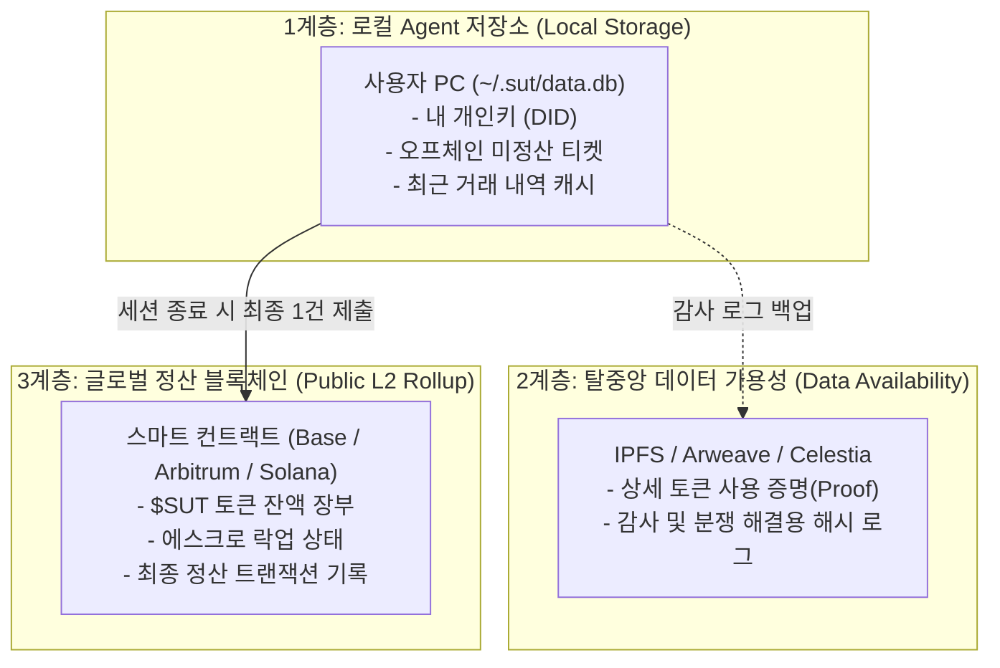
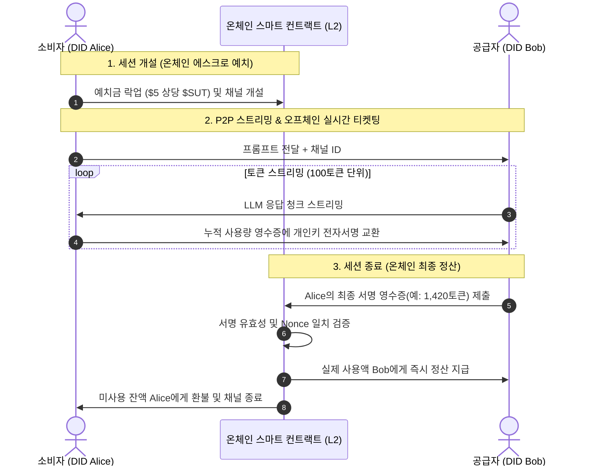

# SUT 분산 원장(Ledger) 및 정산 아키텍처

> **초저비용 마이크로페이먼트를 위한 3계층 분산 원장 및 오프체인 상태 채널 정산 메커니즘**

---

## 1. 3계층 원장 보관 구조 (3-Layer Ledger Architecture)

사용자가 무거운 블록체인 풀노드를 설치할 필요 없이, 가스비 절감과 경량성을 동시에 달성하는 3계층 구조입니다.



### 데이터 분리 및 보관 위치

| 계층 | 보관 위치 | 저장 데이터 | 특성 및 관리 주체 |
| :--- | :--- | :--- | :--- |
| **1. 로컬 원장** | 사용자 PC (`SQLite/RocksDB`) | 개인키, 오프체인 서명 티켓, 활성 채널 상태 | **초고속 쓰기 (0ms, 가스비 0원)**<br>SUT Agent가 로컬 관리 |
| **2. 영수증 원장** | 분산 스토리지 (`IPFS/Arweave`) | 프롬프트/응답 머클 해시, 토큰 검증 증명서 | **영구 보존 & 감사용**<br>분쟁 발생 시 증거로 제출 |
| **3. 글로벌 정산 원장** | **퍼블릭 L2 블록체인** (`Base`, `Arbitrum` 등) | `$SUT` 잔고, 에스크로 잔액, 최종 확정 정산 내역 | **무신뢰 금융 장부**<br>글로벌 검증자(Validators) 합의 |

---

## 2. 상태 채널(State Channel) 기반 정산 라이프사이클

온체인 트랜잭션은 **세션 개설(예치)과 종료(정산) 단 2회만 발생**하여 가스비를 99.9% 절감합니다.



---

## 3. 핵심 세부 기술 메커니즘

### 3.1 결정론적 토큰 카운팅 (Deterministic Counting)
- 공급자와 소비자는 표준 BPE 토크나이저(예: `tiktoken`)를 내장하여, 동일한 프롬프트/응답 텍스트에 대해 **완벽히 일치하는 토큰 수**를 실시간 독립 계산합니다.

### 3.2 오프체인 누적 티켓 (Micro-Ticket Structure)
스트리밍 도중 교환되는 서명 티켓은 단조 증가하는 `nonce`를 가지며, 항상 최신 서명이 이전 서명을 대체합니다.
```json
{
  "channel_id": "0x89ab...cd",
  "nonce": 14,
  "cumulative_tokens": 1400,
  "cost_sut": "1.40",
  "consumer_signature": "0x3f98a1..."
}
```
- **먹튀 방지**: 소비자가 다음 100토큰에 대한 서명을 보내지 않으면, 공급자는 즉시 스트리밍을 중단합니다.

### 3.3 온체인 최종 정산 및 수수료 분배
- 공급자가 소비자의 최종 서명 영수증을 스마트 컨트랙트에 제출하면:
  1. 소비자의 공개키(DID)로 서명 검증 (`Ed25519 Verify`).
  2. 실제 사용된 `$SUT` 금액만큼 공급자 지갑으로 즉시 이체.
  3. 매칭을 주선한 브로커 지갑으로 마이크로 수수료(예: 0.2%) 자동 분배.
  4. 잔여 예치금은 소비자 지갑으로 자동 환불.

---

## 4. 사기 방지 및 분쟁 해결 (Anti-Cheating)

| 위험 시나리오 | 기술적 방어책 |
| :--- | :--- |
| **공급자의 토큰 수 뻥튀기** | 소비자는 자신의 로컬 토크나이저로 확인된 수량에만 개인키로 서명함. 공급자 단독 조작 불가. |
| **소비자의 악의적 잠적** | 소비자가 서명을 중단하면 100토큰(약 $0.0002) 손실 시점에 즉시 차단되므로 피해 최소화. |
| **과거 낮은 영수증 제출 시도** | 컨트랙트는 가장 높은 `nonce`를 가진 양측 서명 영수증만 유효하게 처리. |
| **공급자 노드 이탈/다운** | 타임락(Time-lock / Challenge Period, 예: 24시간) 만료 후 소비자가 단독으로 예치금 전액 회수 가능. |

---

## 5. 블록체인 인프라 선정 기준

- **추천 네트워크**: **Base**, **Arbitrum Orbit**, **Solana** 등 고성능 L2/L3 체인
- **선정 이유**:
  - 트랜잭션당 가스비: **\$0.001 미만**
  - 블록 확정 시간: **0.5 ~ 1초**
  - EVM / SVM 호환 스마트 컨트랙트 및 풍부한 DEX 유동성 풀 보유
- **클라이언트 경량성**: SUT Agent는 경량 RPC 라이트 클라이언트로 통신하므로, 수십 MB 메모리만으로 구동 가능합니다.
